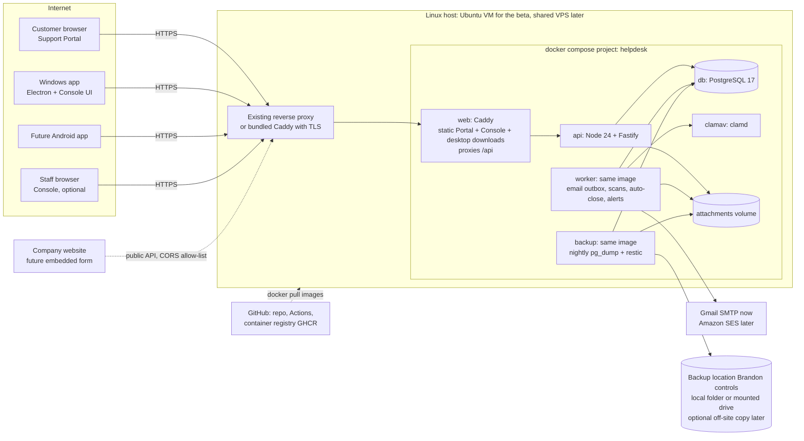
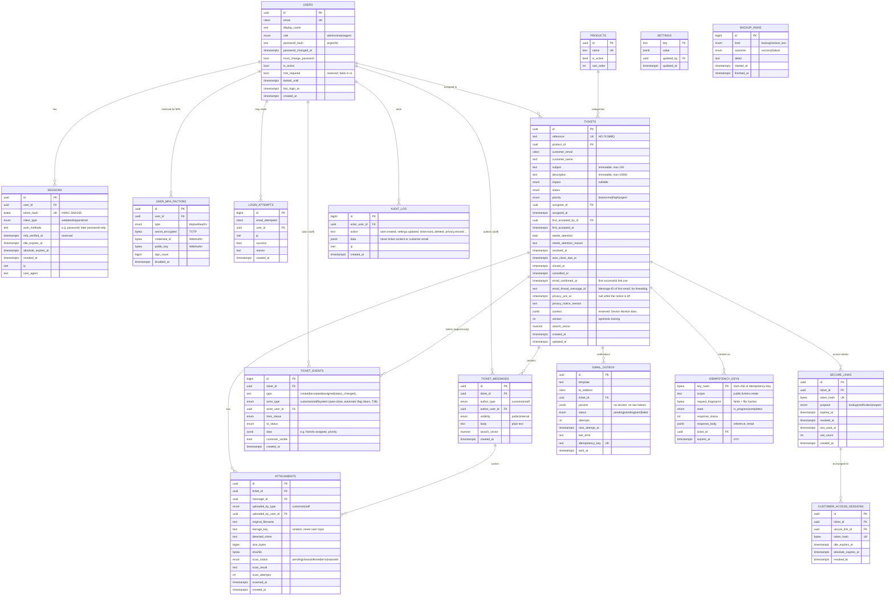

# Help Desk: Architecture

**Status:** Phase 2 draft 3, Oct 6, 2026 (updated for Brandon's Round 5 answers B1–B10 and team decisions T1–T32; see §23) | **Owner:** Architect (bot team) | **Product owner:** Brandon Trout
**Inputs:** `REQUIREMENTS_DISCOVERY.md` (authoritative, Phase 1 closed) and `HELP_DESK_PRODUCT_REQUIREMENTS_BASELINE.md` (the baseline). Where they differ, the discovery log wins (it records Brandon's later answers). Requirement IDs (Q1, P8, R3, ...) refer to the discovery log; section refs (§10) refer to the baseline.
**Companion docs (Phase 2, written in parallel):** `DESIGN.md` (Product Designer: screens, flows, exact UI copy) and `EMAIL_AND_WORDING.md` (Support Ops: email templates). **Those docs own the wording and screen behavior; this document owns the mechanics** (data, API, security, deployment). Where they make a product choice this architecture depends on, it is referenced here; where they disagree with each other or with this doc, see §19. Team decision T4: EMAIL_AND_WORDING owns email text, DESIGN owns screen copy, this document owns mechanics.
**Decision records:** short ADRs live in `docs/adr/`. This document is the overview; the ADRs say why.

Labels used here: **LOCKED** = a requirement we must follow. **ARCH** = a decision this document makes (the team owns it). **PROPOSED** = a product-level default we had to assume to fill a gap; Brandon can overrule it (all are listed in §19 "Gaps").

---

## 0. The short version (plain language)

- **One language everywhere: TypeScript.** The server, both websites, and the Windows app are all written in TypeScript, so every bot works in the same language and they can share code (for example, the rules for which ticket status can change to which).
- **One server program, one database.** A Node.js server (Fastify framework) talks to a PostgreSQL database. A second copy of the same program runs as the "worker" that sends emails, scans attachments for viruses, closes old tickets, and so on. No microservices.
- **Two websites, built the same way.** The public **Support Portal** (customers) and the internal **Console** (staff) are both React web apps.
- **The Windows app is the Console in a desktop wrapper (Electron).** Same screens, same code, packaged as a normal Windows installer. This is what lets Linux bots test almost everything without a Windows PC; GitHub's free Windows build machines do the final packaging and a smoke test.
- **A future Android app** just talks to the same API with the same kind of login token. The server needs no changes.
- **Everything runs in Docker Compose** on one Linux machine. **The beta runs on Brandon's Ubuntu VM** (B4). Moving to the shared VPS is a later go-live step (H2). It only uses one local port and stays out of the way of other services.
- **Email goes out through Gmail first**: the test mailbox `support.trouthomelab@gmail.com` with an App Password (R10). The live address, or Amazon SES, comes later by changing settings only.
- **Nightly encrypted backups** go to a folder or mounted drive Brandon chooses and manages (B2). An off-site copy (for example Backblaze B2) can be added later by configuration. The system tests a restore by itself every week.
- **The code lives in the private GitHub repo** `Stormywookster/help-desk`, and it stays private (B1). Each server gets one read-only download token, and CI minutes are budgeted. Brandon may make it public if minutes run out, so **no secret is ever committed** and the history must always be safe to publish.
- **Branding is a placeholder.** The site name ("Help Desk"), company name ("Your Company"), logo, colors, and sender name are settings, not code, because the company isn't named yet (B5). The ticket form works entirely through the public API, so it can later be placed on the company website.

---

## 1. System overview



**Containers** (all from three images: our `helpdesk-server`, our `helpdesk-web`, and official `postgres` / `clamav/clamav`):

| Service | Image | What it does | Exposed? |
|---|---|---|---|
| `web` | `ghcr.io/stormywookster/helpdesk-web` (Caddy + built static files) | Serves the Portal at `/`, the Console at `/console/` (can be switched off), Windows installer + update feed at `/downloads/desktop/`; forwards `/api/*` to `api`; adds security headers | The only published port (default `127.0.0.1:8380`), or 80/443 in "bundled TLS" mode |
| `api` | `ghcr.io/stormywookster/helpdesk-server` | The REST API (`/api/v1`) | Internal only |
| `worker` | same server image, different command | Background jobs (pg-boss): email outbox, malware scans, auto-close, health alerts | Internal only |
| `migrate` | same server image, one-shot | Applies database migrations before `api`/`worker` start | n/a |
| `backup` | same server image, different command | Nightly DB dump + attachment backup to the configured backup location (local folder or mounted drive, optional off-site copy); weekly restore test | Internal only |
| `db` | `postgres:17` (pinned minor) | The database | Internal only, never published |
| `clamav` | `clamav/clamav:stable` (pinned) | Virus scanner daemon (clamd) + signature updates (freshclam) | Internal only |

---

## 2. Technology stack

| Layer | Choice (ARCH) | Why, in one line | ADR |
|---|---|---|---|
| Language | **TypeScript** everywhere | One language for bots; shared validation and rules | 0001 |
| Repo | **Monorepo**, npm workspaces | One clone builds and tests everything; no extra tools | 0001 |
| Runtime | **Node.js 24 LTS** | Mainstream, long support | 0002 |
| API framework | **Fastify** + **Zod** schemas (`fastify-type-provider-zod`) | Fast, very well documented, schemas produce the OpenAPI contract automatically | 0002, 0004 |
| Database | **PostgreSQL 17** | Reliable, built-in full-text search, row locking for jobs, easy dumps | 0003 |
| ORM / migrations | **Prisma ORM** (raw SQL migrations where needed: triggers, full-text indexes) | Largest training-data presence; readable schema file | 0002 |
| Background jobs | **pg-boss** (job queue + cron stored in PostgreSQL) | No Redis; retries and schedules built in | 0010 |
| Web UIs | **React + Vite + TypeScript**, **Mantine** component library, React Router, TanStack Query | Mainstream, batteries included, mobile-friendly | 0006 |
| Windows app | **Electron** wrapping the Console, packaged by **electron-builder** (NSIS installer), updates via **electron-updater** | Same code as the Console; builds/tests on GitHub Windows runners | 0005, 0016 |
| Future Android | Same `/api/v1` + bearer token. Either Capacitor around the Console (TypeScript) or native Kotlin with a client generated from the OpenAPI file | No backend change either way | 0005 |
| API contract | **OpenAPI 3.1** generated from code, committed at `openapi/openapi.json`; typed client via `openapi-typescript` + `openapi-fetch` | One contract for every client | 0004 |
| Password hashing | **Argon2id** (`argon2` package) | Current best practice | 0007 |
| CAPTCHA | **ALTCHA** (self-hosted proof-of-work, no third-party account, no cookies); Cloudflare Turnstile available by config | Zero human setup; fits "no tracking cookies"; also works from an external page (future embedded form) | 0015, 0017 |
| Email | **Nodemailer** SMTP; Gmail now, Amazon SES (SMTP) later; provider chosen by env vars | No code change to switch | 0011 |
| Malware scan | **ClamAV** (`clamav/clamav` container), quarantine-until-clean | Free, standard, self-hosted | 0009 |
| File storage | Local Docker volume (behind a small storage interface) | Simplest; backed up nightly | 0009 |
| Web server / TLS | **Caddy** inside the stack; either behind the host's existing proxy or terminating TLS itself (automatic Let's Encrypt) | Simplest TLS there is; easy coexistence | 0012 |
| Deployment | **Docker Compose**, images from **GitHub Container Registry (GHCR)**, a `hd` helper script on the server | No Kubernetes; pull-based updates work behind home NAT | 0012 |
| Backups | **restic** (encrypted, deduplicated, retention built in) + `pg_dump`; local folder/mounted drive by default, optional off-site copy | One tool, local or off-site | 0013 |
| Branding | Settings in the database (seeded from env), placeholders by default; no company or site name in code | The company isn't named yet (B5) | 0017 |
| Tests | **Vitest** (unit/integration), **Playwright** (web E2E and Electron), **Prism** (OpenAPI mock server) | Mainstream; all run on Linux | 0014 |
| CI | **GitHub Actions**: `ubuntu-latest` for nearly everything, `windows-latest` for the Windows installer and smoke test, **on releases only** (B1) | No Windows PC needed; fits the private repo's 2,000 free minutes | 0014 |
| Dev mail catcher | **Mailpit** | E2E tests read emails (and secure links) through its API | 0014 |

**Why not other options** (details in ADRs): .NET/WPF or WinUI for Windows would add a second language and Windows-only UI testing; Tauri adds Rust and a different web engine on Windows than on Linux; NestJS is heavier than needed; SQLite would work at this volume but PostgreSQL gives safer concurrent writes for the API + worker and mature full-text search, and costs nothing extra in Docker; Redis/RabbitMQ are not needed at this volume.

---

## 3. Applications

### 3.1 Support Portal (customers, public)
React SPA served at `https://<support-domain>/`. Mobile-first layout (A5). No accounts. Pages:
1. **Submit a ticket** (P9): name (optional), email (required), product (required; hidden and pre-selected when only one active product exists, Q6), subject (required, ≤150), description (required, ≤10,000), impact (optional, P10's three options), attachments (≤5 files, ≤10 MB each, Q4), CAPTCHA (P12). The privacy-notice link + required acknowledgement checkbox appear **only when the `privacy_notice_enabled` setting is on; it is off by default** (B10 amends R4). On success: shows the reference number (P13), the email address **in full** so typos can be caught (T5; shown only to the person who just typed it), and "we emailed you a link" (DESIGN C-02). The confirmation page deliberately has **no direct link** to the ticket: access only comes through the emailed link, which also proves the email address is real.
2. **Look up a ticket** (Q1): reference # (any case, with or without `HD-`) + email + CAPTCHA, then always the same message: "If that matches a ticket, we've emailed a link to that address."
3. **Ticket page** (opened from the emailed secure link): status, the customer-visible history (P24: submission, replies from both sides, status changes; never assignment, priority, or internal notes). Staff messages are labelled **"Support team"** and the customer's own as **"You"**; no staff name, user ID, or email ever reaches the customer (T22, T26b; §6.3). attachments (download once scanned clean), reply box with attachments, **Cancel** button with optional reason (only in New/Open/In Progress/Waiting, P3), **Reopen** button with optional message (only in Resolved within the window, P1/P4). The Resolved email's reopen link opens this page with the Reopen dialog showing; nothing changes until the customer clicks (P1). Closed and Cancelled tickets are read-only (R1).
4. **Link expired** page: one button, "Email me a fresh link" (sends to the address on file, rate-limited).
5. **Privacy notice** page, only when the notice is switched on (text supplied by Brandon later, editable in admin settings; B10).

**Customer-facing wording (T23, T26a):** customers see "ticket" and "ticket number" everywhere (screens, emails, subjects), never "request" or "reference". The exact copy is owned by DESIGN and EMAIL_AND_WORDING (T4). API field names such as `reference` are internal and unchanged.

No analytics, no tracking cookies (R4, still in force after B10). The only cookie is the strictly necessary customer access cookie.

**Branding (B5):** the site name, company name, logo, primary color, and footer text come from `GET /public/config` (admin settings). Nothing is hard-coded. The defaults are placeholders: "Help Desk", "Your Company", and a neutral placeholder logo. No real company name appears anywhere in code, templates, or docs.

**Embeddable later (B5, future):** everything the submit page does goes through documented public endpoints, so the company website can host the form later (§6.5).

### 3.2 Console (staff: Agent + Administrator)
React SPA. **The same build** is used in two places:
- **Inside the Windows app** (the primary internal client, §2 of the baseline). This is how Brandon uses it.
- **In a browser at `/console/`**: always on in development/staging (so Linux bots can test the internal UI with Playwright); **off by default in production** (`HD_CONSOLE_WEB_ENABLED=false`). It can be turned on with one setting if Brandon wants browser access. (The API the Windows app uses must be reachable from the internet anyway; see the threat model, §15.)

Screens: login and change password; ticket list (default view "my open tickets + unassigned New", P14; search; filters for status, priority, product, assignee, and date range; counts per status, P15; "needs attention" badges, R1/P2/Q3); ticket detail (full history including internal notes and the assignment trail, accept/assign, status, priority, public reply vs internal note, attachments with scan status); admin pages (users, products, settings, privacy export/erase, audit log, system health). Agents never see admin-only controls, and the server enforces this anyway (P17, R3).

The unread / needs-attention indicator (Q3; **in v1 per T27**) is a per-ticket "● Needs attention" marker (label per DESIGN rev 8; the reason shown comes from `needs_attention_reason`: new ticket / customer reply / customer reopen) driven by the `needs_attention` flag that the server already keeps for R1/P2 (§4). The Console polls `GET /internal/tickets/counts` every 60 seconds while the list is open. The **app-level count (T28)** comes from `GET /internal/me/attention-count` (§4, §6.3); the Windows app shows it in the taskbar and window title (§3.3). There are no WebSockets in v1.

### 3.3 Windows app (Electron)
- A thin Electron "main" process wraps the Console build (bundled inside the app, loaded from a custom `app://console/` protocol; no remote web content).
- First launch asks for the **server URL** (DESIGN W-01; for example `https://support.example.com`, or `http://192.168.1.50:8380` for the beta VM; plain `http://` is accepted only for private-network addresses) and saves it. If the server has no Administrator yet, the app shows **first-run setup** (DESIGN W-02, §7).
- **Opening a ticket from an alert email (T15).** Gmail and many other mail clients don't make `helpdesk://` links clickable. So staff alerts carry an ordinary **https** link, `${HD_PUBLIC_URL}/open/ticket/HD-XXXXXX`, which serves a small "open in app" page that hands off to the app (§6.6). The app side:
  - **Protocol registration:** electron-builder `protocols: [{ name: "Help Desk", schemes: ["helpdesk"] }]` makes the NSIS installer register `helpdesk://` per user (`HKCU\Software\Classes\helpdesk`, no admin rights; removed on uninstall). At startup the app also calls `app.setAsDefaultProtocolClient("helpdesk")`, which repairs the registration if it went missing.
  - **Single instance:** `app.requestSingleInstanceLock()`. A second launch (Windows starts a new process for every protocol link) passes its command line to the running app through the `second-instance` event and quits; the running window is restored and focused. A cold start reads the link from `process.argv`.
  - **Strict parsing in the main process:** only `helpdesk://ticket/<reference>` is accepted, where the reference must match `^HD-[23456789ABCDEFGHJKMNPQRSTVWXYZ]{6}$` (case-insensitive, upper-cased). There is no query string, no other host or path, and no URL is ever passed to `loadURL`, `shell.openExternal`, or the renderer. Anything else is ignored and logged.
  - **Routing:** the main process sends only the reference to the renderer over a narrow preload API (`onOpenTicket(ref)`). The Console looks it up with `GET /internal/tickets/by-reference/{reference}` (authenticated) and opens it. If nobody is signed in, the reference is held until login, or until server setup on a first run. A deleted or unknown reference shows "Ticket not found".
- **App-level unread badge (T28):** the app shows the number of `needs_attention` tickets the signed-in user can see (§4), hidden when it is 0.
  - **Refresh:** the renderer polls `GET /internal/me/attention-count` **every 60 seconds** while signed in (also when minimized). It refreshes **at once** after the user's own actions that can clear the flag ("Mark as seen", public reply, status change, including accept/assign when it moves a ticket out of `new`; T34), after "Refresh", and **when the window gets focus**. Opening a ticket doesn't change the count (T34). When no count is known (signed out, session expired, still loading, or the server can't be reached, W-13), the badge and title count are **cleared**, so an old number is never shown (**T33**, DESIGN 4.7, OQ-48).
  - **Taskbar:** the renderer passes only an integer to the main process through the preload API (`setAttentionCount(n)`, validated as an integer 0–9999). The main process calls `BrowserWindow.setOverlayIcon()` with a small badge image pre-rendered at build time (`1`…`99`, then `99+` per **T33**) and the accessible description from DESIGN ("{n} tickets need attention" / "1 ticket needs attention" / "More than 99 tickets need attention"), or `setOverlayIcon(null, "")` at 0. The renderer never sends an image, only the number. (`app.setBadgeCount` does nothing on Windows, so the overlay icon is the Windows way.)
  - **Window title:** `({n}) {site_name}` when n ≥ 1, `(99+) {site_name}` over 99, and just `{site_name}` at 0 or when no count is known, for example "(3) Help Desk". This is DESIGN 4.7's copy, confirmed in DESIGN rev 6; the `99+` cap and the plain title while the count is unknown are team decision **T33** (QA AC-LC-56 tests it).
- Login gives a **bearer session token**, stored encrypted with Electron `safeStorage` (Windows DPAPI). The main process attaches it to API requests, so the token is never visible to page JavaScript.
- Security settings: `contextIsolation: true`, `sandbox: true`, `nodeIntegration: false`, navigation locked to the bundled app, `window.open` denied, external links opened in the system browser, strict CSP.
- Installer: NSIS, **per-user install (no admin rights needed)**. Auto-update: electron-updater "generic" provider pointing at `https://<server>/downloads/desktop/`. The `helpdesk-web` image bundles the matching installer and `latest.yml`, so **the server always hands out the desktop version that matches its API**. If the app is too old, the API answers `426 Upgrade Required` (from `HD_MIN_DESKTOP_VERSION`) and the app offers to update.
- Code signing: **none** (B3, LOCKED). Windows SmartScreen shows "Windows protected your PC" / "Unknown publisher" on first install; click "More info" then "Run anyway". Signing could be added later with CI secrets only, if Brandon changes his mind.
- Naming: the installer and window title use the placeholder product name "Help Desk" (build-time `HD_DESKTOP_PRODUCT_NAME`). Once connected, the app shows the server's `site_name` setting. Renaming the installer file itself needs a new release build.

### 3.4 Future Android client
The Android app logs in through the same `POST /api/v1/auth/login` with `clientType: "android"` and receives a bearer token, exactly like Windows. It uses the same `/internal` and `/admin` endpoints. Options when the time comes: (a) **Capacitor** wrapping the Console (most code reused, TypeScript); (b) **native Kotlin** with a client generated from `openapi/openapi.json`. The backend is already prepared for this: bearer sessions, a `client_type` on sessions, `CORS_ALLOWED_ORIGINS` for a Capacitor origin, and versioned API. Push notifications (FCM) would be a later, additive feature (a `device_push_tokens` table and one worker job).

---

## 4. Ticket rules (shared domain logic)

All lifecycle and permission rules live in **`packages/shared`** as pure TypeScript functions with exhaustive unit tests. The API enforces them; the UIs use the same functions to show or hide buttons. Statuses: `new`, `open`, `in_progress`, `waiting_on_customer`, `resolved`, `closed`, `cancelled` (A3: customers see the same names).

| Actor / action | Allowed from | Result | Source |
|---|---|---|---|
| Customer submits | n/a | `new`, `needs_attention` set (T34), admin email | Q3, §7, T34 |
| Staff accepts (self-assign) / assigns | any non-terminal | assignee set; if `new`, it becomes `open`; first acceptance recorded once (`first_accepted_by/at`). Moving a ticket out of `new` with no assignee assigns it to the person acting, and that auto-assign also records first acceptance if none is recorded yet (T45); unassigning doesn't change status (DESIGN OQ-30). Moving out of `new` is a status change, so it clears `needs_attention`; assignment alone doesn't (T34) | §6, §10, T34 |
| Staff changes status | from any of `new`, `open`, `in_progress`, `waiting_on_customer`, `resolved` **to** `open`, `in_progress`, `waiting_on_customer`, or `resolved` (any direction; never *to* `new`, never *to* `closed` by hand) | moving to `resolved` stamps `resolved_at` and `auto_close_due_at`; leaving `resolved` clears them; **clears `needs_attention`** (T34) | §11, DESIGN 2.4, T34 |
| Staff changes priority | any non-terminal state (never on `closed`/`cancelled`) | priority set, event logged (staff-only); `needs_attention` unchanged | R6, T1 |
| Staff adds an internal note | any state, including `closed`/`cancelled` (T1) | note added; status and `needs_attention` unchanged (T34) | T1, T34 |
| Staff opens/views a ticket | any | nothing changes; `needs_attention` stays set (T34) | T34 |
| Staff uses "Mark as seen" | any non-terminal state where the flag is set | clears `needs_attention` (reason `marked_seen`); history event. On `closed`/`cancelled`: rejected `409 TICKET_READ_ONLY` (T1, T35) | DESIGN 4.8.4, T34, T35 |
| Staff cancels (Agent or Admin, with confirmation) | any non-terminal state | `cancelled`; only Admin can restore; **no customer email**; clears `needs_attention` (reason `staff_cancelled`; T34, T35) | G5, DESIGN OQ-29, B6, T13, T34 |
| Staff corrects the customer's email address | any non-terminal state | address replaced; `customer_email_changed` event (old + new address, staff-only); all secure links and customer sessions for the ticket revoked; `email_confirmed_at` cleared; **the confirmation email (with a new link) is resent to the new address** | B9, T12, EMAIL PROPOSED-32 |
| Staff public reply + status in one action | as above | one message, one status change, **one** customer email (the status email with the reply included) | DESIGN 4.8.1, EMAIL PROPOSED-24 |
| Customer replies | `new`, `open`, `in_progress` | message added, status unchanged, `needs_attention` | P2 |
| Customer replies | `waiting_on_customer` | message added, status becomes `open`, `needs_attention` | §10 |
| Customer replies | `resolved` | message added, **stays `resolved`, clock keeps running**, `needs_attention`, admin email | R1 |
| Customer replies | `closed`, `cancelled` | rejected `409 TICKET_READ_ONLY` (T46) | R1, T46 |
| Customer cancels (optional reason, posted as a customer message) | `new`, `open`, `in_progress`, `waiting_on_customer` | `cancelled`, no customer email; **staff alert** routed by B7; clears `needs_attention` automatically (reason `customer_cancelled`, T35); the cancel event is credited to the customer, the `needs_attention_cleared` event to System (T36) | P3, DESIGN C-06, B6, T14, T35 |
| Customer reopens (optional message, posted in the same step) | `resolved` **and** now < `auto_close_due_at` | `open`, clock cleared, assignee kept, `needs_attention`, admin email; no cap on reopens | P1, P4, P5, DESIGN C-07 |
| Customer cancels or reopens outside the states listed above (for example cancel on `resolved`/`closed`, or reopen after `auto_close_due_at`) | n/a | rejected `409 TICKET_READ_ONLY`, same code as staff (T46); the customer-facing message is owned by DESIGN | T46 |
| Auto-close job | `resolved` and now ≥ `auto_close_due_at` | `closed`, actor = system, **no customer email** | P4, P8 |
| Admin reopens | `closed` | `open`, no customer email; clears `needs_attention` (T34) | P7, P17, B6, T34 |
| Admin restores | `cancelled` | `open`, no customer email; clears `needs_attention` (T34) | P7, P17, B6, T34 |
| Admin hard-deletes | any | ticket and its history removed; content-free audit record kept | P21 |
| Internal note | any status, including closed and cancelled | note added | §11 |
| Staff public reply | any except `closed`/`cancelled` (Admin reopens or restores first); a reply on `resolved` still emails the customer | message added, customer emailed (reply text included, B8); clears `needs_attention` (T34) | Q2, T1, T4, T34 |
| Staff edits customer name or product | never in v1 (only the email can be corrected, B9) | no endpoint exists | T22 (DESIGN OQ-41) |
| Anything else by staff on `closed`/`cancelled` (status, priority, assignment, reply, email correction) | n/a | rejected `409 TICKET_READ_ONLY`; only internal notes and Admin reopen/restore are allowed ("Mark as seen" is also rejected; the flag is already clear, T35) | T1, T35 |

`auto_close_due_at = resolved_at + reopen_window_days × 24h`, using the setting **in effect at the moment of resolution** (ARCH; see gap G7). This keeps the promise made in the Resolved email even if the setting changes later. `reopen_window_days` is limited to **1–14** (T2), so a Resolved link never outlives R9's 14-day maximum.

**Needs attention and the app count (T27, T28, T34, T35):** `tickets.needs_attention` is **set** when a ticket is created, when the customer replies, and when the customer reopens it. It is **cleared** when a staff member sends a public reply, changes the ticket's status (any staff status change, including cancel, Admin reopen/restore, and accept/assign when it moves the ticket out of `new`), or uses "Mark as seen" (`POST /internal/tickets/{id}/mark-seen`, §6.3). **Opening or viewing a ticket and adding an internal note do not clear it** (T34). Priority changes, assignment without a status change, and email correction leave it unchanged. **Any move into `closed` or `cancelled` clears it automatically (T35)**, whatever the path: auto-close, customer cancel, staff cancel, or any future path. So `closed`/`cancelled` tickets **never count**. "Mark as seen" is **not** allowed on them: it returns `409 TICKET_READ_ONLY`, exactly as T1 says. A customer cancel still alerts staff (T14). Accepting or assigning a `new` ticket moves it to `open`, which clears the flag; that's intended, because someone has picked the ticket up (T35). Each set/clear writes a staff-only history event whose `needs_attention_reason` says why (`new_ticket`, `customer_reply`, `customer_reopen` / `staff_reply`, `staff_status_change`, `marked_seen`, `auto_closed`, `customer_cancelled`, `staff_cancelled`). **Actors (T36):** a `needs_attention_cleared` event with reason `auto_closed` or `customer_cancelled` has `actor_type = system` (shown as "System"). The status events themselves are credited as they happened: `customer_cancelled` → the customer, `auto_closed` → System, and `staff_cancelled` and the other staff reasons → the staff user. **Where it lives:** the transition table in `packages/shared` returns the flag effect with every transition (`set` / `clear(reason)` / `unchanged`), and every target state `closed` or `cancelled` carries `clear` by definition (a unit test enumerates the table). The one ticket-mutation function in the API and worker (`applyTransition`) writes the status, the flag, and the history events in the same transaction, so no caller has to remember to clear it. The **attention count** for a user is the number of tickets with `needs_attention = true` **within that user's ticket visibility**, computed with the same scope function as the ticket list (`ticketScopeFor(user)` in `packages/shared`). In v1 both roles can see every ticket (R3, DESIGN 2.5), so it's the same number for Admins and Agents. If visibility is ever narrowed per role, the count follows it automatically. Deleted or erased tickets are gone, and `closed`/`cancelled` tickets always have the flag cleared (T35), so neither ever counts. As a second guard, the count query also filters on non-terminal statuses. A partial index `WHERE needs_attention` keeps the query cheap.

**Reference numbers (P13):** `HD-` followed by 6 random characters from `23456789ABCDEFGHJKMNPQRSTVWXYZ` (no 0/O, 1/I/L, U), about 594 million combinations, generated with a cryptographic RNG, unique index, retried on collision. The reference is **not a secret**; access always needs a secure link.

---

## 5. Data model

PostgreSQL. All primary keys are UUIDv7 (time-ordered) unless noted; all timestamps are `timestamptz` stored in UTC and shown in America/New_York (A1). Emails are stored lower-cased (`citext`).



Notes:
- **Assignment history** (§6) is the `assigned` / `accepted` / `unassigned` rows in `ticket_events` (with from/to user IDs in `data`), plus the current values on `tickets` (`assignee_id`, `assigned_at`, `first_accepted_by_id`, `first_accepted_at`).
- **Append-only history** (P23): a database trigger rejects every `UPDATE` on `ticket_events`, `ticket_messages`, and `audit_log`, and rejects `DELETE` unless the transaction has set `SET LOCAL helpdesk.purge = 'on'`. Only the hard-delete and privacy-erase code paths do that. Customers can't edit their subject or description (§7): those columns have no update path in the API, and a trigger blocks changes.
- **Hard delete / privacy erase** (P21, R4): deletes the ticket, its messages, events, attachments (database rows and files), secure links, access sessions, and outbox rows. It then writes an `audit_log` row containing only: who, when, the reference number(s), and counts. No content and no customer email. See gap G3.
- **First-run setup code:** stored as a hash with an expiry in `settings` (`setup_code_hash`, `setup_code_expires_at`); deleted the moment the first Administrator exists.
- **Settings keys** (P20, B5, B10, T2, T6): `products` live in their own table; `settings` holds:
  - *Sender:* `email_from_name` (default "Help Desk"), `email_from_address` (changed only after a successful test email, T6), `email_reply_to` (default: the sending mailbox; must be a monitored mailbox, T4).
  - *Ticket rules:* `reopen_window_days` (default 14, allowed **1–14**, T2), `attachment_max_bytes` (default 10 MB, capped by `ATTACHMENT_HARD_MAX_BYTES`), `attachment_max_files` (default 5).
  - *Branding (B5; placeholders until the company exists):* `site_name` ("Help Desk"), `company_name` ("Your Company"), `brand_logo_key` (empty → built-in neutral placeholder logo), `brand_primary_color` (`#2563EB`, must match `#RRGGBB`), `portal_footer_text` (empty), `support_email_display` (default: the sender address).
  - *Privacy (B10):* `privacy_notice_enabled` (default **false**), `privacy_notice_text`, `privacy_notice_version`. The notice can't be switched on while its text is empty.
  - Env variables (`BRAND_*`, `PRIVACY_NOTICE_ENABLED`) only seed these on first start; after that the admin screen is the source of truth. Link lifetimes are **not** settings: they are startup config only, capped at 14 days (T9, ACCEPTANCE OQ-12). The customer-email "include reply text" switch is gone, because reply text is always included (B8).
- **Idempotency keys** (B5): see §6.5. Rows expire after 24 h (cleanup job) and are deleted with their ticket on hard delete or privacy erase.
- **Staff identity never leaves the staff side (T26b):** `ticket_messages.author_user_id`, `attachments.uploaded_by_user_id`, and `ticket_events.actor_user_id` exist for staff views and audit only. Customer-facing payloads get a server-computed `authorDisplay` ("You" for customer messages, "Support team" for staff messages) and `authorType: customer|support`; the value isn't stored, so a staff rename can't leak into old messages.
- **Users and products are never deleted (T22):** users are deactivated (`is_active = false`) and the last active Administrator can't be deactivated or demoted; products are added, renamed, or turned off (`is_active`), never deleted, and there is no "Other" product. A user's email can't be edited (T26c).
- **Customer email corrections** (B9): the `customer_email_changed` event keeps the old and new address (staff-only). Privacy export and erase for an address also match tickets whose history lists it as a former address (**T24**).
- **CAPTCHA replay protection:** each solved ALTCHA challenge is recorded in a small `captcha_spent` table (signature hash + expiry) until it expires, so one solution can't be used twice.
- **Full-text search** (P14): `search_vector` columns (generated from subject, description, and customer name on tickets, and body on messages) with GIN indexes, queried with `websearch_to_tsquery('english', …)`. Exact matches on reference and email are checked first.
- **Future Device Monitor context** (§17): `tickets.context jsonb`, unused in v1. Attachments already support log files.
- **Rate-limit counters** are kept in memory in the API process (single instance), except the per-email and per-ticket limits for lookups and resends, which are counted from database rows so they survive restarts.

---

## 6. API design

### 6.1 Style and rules
- **REST + JSON over HTTPS**, base path **`/api/v1`**. Resource URLs, standard verbs, plain JSON bodies; multipart only for uploads.
- **Versioning:** URL major version. Adding fields or endpoints is non-breaking and stays in `v1`. A breaking change means a new `/api/v2` alongside `v1` until all clients move. Clients send `X-Client: desktop/1.4.0` (or `web`, `android`); the API can answer `426` for too-old desktop builds.
- **Contract = OpenAPI 3.1**, generated from the Fastify route schemas (Zod) by `npm run openapi` into **`openapi/openapi.json`**, which is committed. CI fails if the committed file doesn't match the code. Web and desktop use the generated typed client (`packages/api-client`). Android would generate a Kotlin client from the same file. Interactive docs (Scalar) at `/api/docs` in dev/staging only. Front-end bots can work against a **Prism mock server** built from the same file before the backend is finished.
- **Response filtering:** every route declares its response schema, and Fastify's serializer **drops any field not in the schema**. Customer endpoints use separate customer schemas, so internal fields (priority, assignee, internal notes) cannot leak by accident. A test asserts this.
- **Pagination:** `?page=1&pageSize=25` (max 100); responses include `total`.
- **Idempotency:** `POST /public/tickets` accepts an `Idempotency-Key` header, so retries never create duplicate tickets or emails (§6.5).
- **Concurrency:** tickets carry a `version`. Mutating requests send `expectedVersion` and get `409 Conflict` if someone else changed the ticket first.
- **Times** are ISO-8601 UTC strings; clients display America/New_York.

### 6.2 Error format (RFC 9457 Problem Details)
Content-Type `application/problem+json`:
```json
{
  "type": "https://helpdesk.invalid/problems/validation",
  "title": "Validation failed",
  "status": 422,
  "code": "VALIDATION_FAILED",
  "detail": "One or more fields are invalid.",
  "errors": [{ "field": "subject", "code": "TOO_LONG", "message": "Max 150 characters." }],
  "requestId": "01J9Z4..."
}
```
Stable machine `code`s include `VALIDATION_FAILED` (422), `UNAUTHENTICATED` (401), `FORBIDDEN` (403), `NOT_FOUND` (404), `CONFLICT_VERSION` (409), `INVALID_TRANSITION` (409), `TICKET_READ_ONLY` (409, T1), `LAST_ACTIVE_ADMIN` (409, T22), `RATE_LIMITED` (429, with `Retry-After`), `CAPTCHA_FAILED` (422), `LINK_EXPIRED` (410), `ACCOUNT_LOCKED` (423), `PASSWORD_CHANGE_REQUIRED` (403), `MFA_REQUIRED` (reserved), **`UPLOAD_LIMIT_EXCEEDED` (413, T7)**, `PAYLOAD_TOO_LARGE` (413, oversized non-upload JSON body), `UNSUPPORTED_FILE_TYPE` (415), `IDEMPOTENCY_KEY_REUSED` (422), `IDEMPOTENCY_IN_PROGRESS` (409), `SENDER_TEST_FAILED` (422, T6), `CLIENT_TOO_OLD` (426), `INTERNAL` (500). Stack traces are never returned. `requestId` matches the server log line.

**Over-limit uploads (T7): `413 Content Too Large` with code `UPLOAD_LIMIT_EXCEEDED`.** Used when any file is larger than `attachment_max_bytes`, when a message carries more than `attachment_max_files` files, or when the request body is over the overall cap:
```json
{
  "type": "https://helpdesk.invalid/problems/upload-limit-exceeded",
  "title": "Upload limit exceeded",
  "status": 413,
  "code": "UPLOAD_LIMIT_EXCEEDED",
  "detail": "\"screenshot.png\" is larger than 10 MB. Nothing was sent. Remove it or choose a smaller file, then try again.",
  "limit": { "kind": "file_size", "maxBytes": 10485760, "maxFiles": 5 },
  "file": "screenshot.png",
  "requestId": "01J9Z4..."
}
```
- `limit.kind` is `file_size`, `file_count`, or `request_size`. `detail` uses DESIGN's copy (C-01). The UI also checks before sending, so the error is a backstop.
- **The whole request is rejected** (submission, customer reply, or staff reply): no ticket, message, attachment, or email is created, and any partly received files are deleted at once. The server stops reading at the first byte or file over the limit and closes the connection, so a huge upload isn't read to the end.
- A 413 from the reverse proxy (300 MB = 314,572,800 bytes body cap) has no JSON body. Clients treat **any** 413 as this error.
- Why 413 rather than 422: RFC 9110 defines 413 as "the request content is larger than the server is willing to process", which covers both too-large and too-many files. Proxies already use 413, so clients need only one handling path. 422 stays reserved for field validation.

### 6.3 Endpoint groups and authentication

| Group | Who | Auth | Extra protection |
|---|---|---|---|
| `/api/v1/setup/*` | first-run only | one-time setup code | disabled once an Administrator exists |
| `/api/v1/public/*` | anyone, including (later) allow-listed external sites | none | CAPTCHA on submit + lookup; per-IP / per-email / per-ticket rate limits; generic responses (no enumeration); `Idempotency-Key` on submit; CORS only for origins in `PUBLIC_CORS_ORIGINS` (§6.4) |
| `/api/v1/customer/*` | customer holding a link | **customer access session** cookie `hd_cust` (HttpOnly, Secure, SameSite=Strict, Path=/api/v1/customer), scoped server-side to **one ticket** | CSRF: SameSite + required `X-Requested-With: helpdesk` header; per-ticket rate limits |
| `/api/v1/auth/*` | staff | none for login; session for the rest | per-IP and per-account throttling and lockout |
| `/api/v1/internal/*` | Agent or Administrator | **staff session**: cookie `hd_session` (browser Console) or `Authorization: Bearer` (Windows/Android) | role check hook; `must_change_password` gate |
| `/api/v1/admin/*` | Administrator only | staff session + `role = administrator` | audit-logged |
| `/api/v1/health`, `/api/v1/ready` | Docker/proxy | none | expose no details |

**Main endpoints**

*Public*
- `GET /public/config`: active products, attachment limits, allowed file types, CAPTCHA provider/site key, branding (site name, company name, logo URL, primary color, footer text), privacy notice on/off + version.
- `GET /public/branding/logo`: the logo image (placeholder when none is set), cacheable.
- `GET /public/privacy-notice`: notice text and version; `404` while the notice is switched off (B10).
- `GET /public/captcha/challenge`: ALTCHA challenge.
- `POST /public/tickets` (multipart: fields + up to 5 files + captcha, plus `privacyAck` only when the notice is on; optional `Idempotency-Key` header): returns `201 { reference, email }` (full address, T5), queues the confirmation email (with link) and the admin alert. Over-limit uploads → `413 UPLOAD_LIMIT_EXCEEDED` (T7). No access cookie is set (DESIGN C-02). Documented for external use in §6.5.
- `POST /public/lookup` `{ reference, email, captcha }`: always `202` with the same body; if it matches, emails a **lookup** link.
- `POST /public/access` `{ token }`: exchanges a secure-link token for an `hd_cust` session; returns `{ status: "ok", purpose: "lookup" | "notification" | "reopen", showReopenDialog }` (`showReopenDialog` is true for a reopen link while the ticket can still be reopened, T25) or `410 LINK_EXPIRED` with a `resendable: true` hint.
- `POST /public/links/resend` `{ token }` (an expired or revoked token): always `202`; if the token was ever valid, emails a fresh link to the address on file.

*Customer (scoped to one ticket)*
- `GET /customer/ticket`: customer view: status, customer-visible events (`{ type, label, createdAt }`, no actor IDs or names), public messages (`{ id, authorType: "customer" | "support", authorDisplay: "You" | "Support team", body, createdAt, attachments }`), attachments (`{ id, fileName, sizeBytes, scanStatus }`), `canCancel`, `canReopen`, `canReply`. **No staff name, user ID, or email appears in any `/public` or `/customer` response (T26b)**; the customer schemas simply have no such fields, and the serializer drops anything not in the schema (§6.1).
- `POST /customer/ticket/messages` (multipart: body + files).
- `POST /customer/ticket/cancel` `{ reason? }` (≤500 chars), `POST /customer/ticket/reopen` `{ message? }`.
- A customer reply, cancel or reopen in a state §4 doesn't allow returns `409 TICKET_READ_ONLY` (T46). The UI should already hide the action using `canReply`/`canCancel`/`canReopen`; the message text is owned by DESIGN.
- `GET /customer/ticket/attachments/{id}`: download (clean files only).
- `POST /customer/logout`.

*First-run setup (only while no Administrator exists; returns 404 forever after)*
- `GET /setup/status` → `{ needsSetup: boolean }`
- `POST /setup/admin` `{ setupCode, name, email, password }` creates the first Administrator. Rate-limited (5 per hour per IP); wrong codes are counted and the code is invalidated after 10 failures.

*Auth*
- `POST /auth/login` `{ email, password, clientType }` returns `{ result: "authenticated", user, token? }` (token only for desktop/android; browsers get the cookie). **Reserved:** `{ result: "mfa_required", challengeId, methods }`.
- `GET /auth/policy` (password minimum length etc., so UI copy never hard-codes it)
- `POST /auth/logout`, `GET /auth/me`, `POST /auth/change-password`, `GET /auth/sessions`, `DELETE /auth/sessions/{id}`.
- Reserved for MFA later: `POST /auth/mfa/verify`, `GET|POST|DELETE /auth/mfa/factors`.

*Internal (Agent + Admin)*
- `GET /internal/tickets?view=default|all&q=&status=&priority=&productId=&assigneeId=&unassigned=&createdFrom=&createdTo=&page=&pageSize=`
- `GET /internal/tickets/counts` (per status + needs-attention count; the needs-attention number comes from the same scoped function as `attention-count`, so the two always agree)
- `GET /internal/me/attention-count` → `{ count, asOf }` (T28): the signed-in user's attention count (§4). Lightweight (one indexed count, no ticket data), `Cache-Control: no-store`, Agent or Admin session; polled every 60 s by the Windows app and refreshed on focus and after the user's own actions
- `GET /internal/tickets/{id}` (full detail with internal notes, events, attachments)
- `PATCH /internal/tickets/{id}` `{ expectedVersion, status?, priority? }` (`409 TICKET_READ_ONLY` on Closed/Cancelled, T1)
- `PATCH /internal/tickets/{id}/customer-email` `{ email, expectedVersion }` (B9; Agent or Admin; active tickets only; logged; revokes old links and sessions; resends the confirmation to the new address, T12)
- `GET /internal/tickets/by-reference/{reference}` (used by the app's deep-link routing, T15; reference validated against the format, `404` otherwise)
- `POST /internal/tickets/{id}/accept`, `POST /internal/tickets/{id}/assign` `{ userId | null, expectedVersion }`
- `POST /internal/tickets/{id}/messages` (multipart: `body`, `visibility: public|internal`, files (public replies only), optional `setStatus: waiting_on_customer|resolved`, `expectedVersion`): one action, one email
- `POST /internal/tickets/{id}/mark-seen` ("Mark as seen": clears `needs_attention`, writes a history event, idempotent on an already-clear active ticket; T34). **On `closed`/`cancelled` it returns `409 TICKET_READ_ONLY`** (T1, T35; their flag is always clear). A staff public reply or status change also clears the flag; `GET /internal/tickets/{id}` (opening the ticket) and internal notes never do
- `GET /internal/attachments/{id}` (download, clean only)
- `GET /internal/users` (active users for the assignee picker), `GET /internal/products`

*Admin only*
- `POST /admin/tickets/{id}/reopen` (closed → open), `POST /admin/tickets/{id}/restore` (cancelled → open)
- `DELETE /admin/tickets/{id}` `{ confirmReference }` (hard delete)
- `POST /admin/tickets/{id}/revoke-links`
- `GET|POST /admin/users`, `PATCH /admin/users/{id}` (name, role, active only; **email is not editable, T26c**: the schema rejects an `email` field with `422`. To fix a wrong staff email, deactivate the user and create a new one; the old account's history stays attributed to it), **no `DELETE`** (users are deactivated, never deleted; the last active Admin can't be deactivated or demoted, and an Admin can't remove their own Admin role, `409 LAST_ACTIVE_ADMIN`; T22, DESIGN OQ-26), `POST /admin/users/{id}/reset-password` (sets a temporary password, forces a change, revokes sessions), `POST /admin/users/{id}/unlock`
- `GET|POST /admin/products`, `PATCH /admin/products/{id}` (rename, turn off/on; **no `DELETE`**, no "Other", T22)
- `GET|PUT /admin/settings` (ticket rules, branding, privacy switch; out-of-range values such as a reopen window outside 1–14 get `422`)
- `POST /admin/settings/sender` `{ name, address }`: sends a test email **to the signed-in Admin's own account address** (T17; there is no recipient field) and saves only if the SMTP server accepts it; otherwise `422 SENDER_TEST_FAILED` and the previous sender stays (T6). A name-only change also goes through here.
- `POST /admin/settings/test-email` (no body): sends a test email through the current sender to the signed-in Admin's own address (T17).
- `PUT /admin/branding/logo` (PNG/JPEG/WebP ≤ 512 KB = 524,288 bytes (T21), magic-byte checked, re-encoded server-side; no SVG), `DELETE /admin/branding/logo`
- `POST /admin/privacy/export` `{ email }` (ZIP of JSON + attachments for that email), `POST /admin/privacy/erase` `{ email, confirmEmail }`
- `GET /admin/audit-log`
- `GET /admin/system/health` (database, scanner and signature age, email outbox backlog/failures, last backup, last restore test, disk usage, version)

### 6.4 CORS and cross-origin use
- The Portal and the browser Console are same-origin with the API (no CORS needed).
- **Native clients:** the Windows app's `app://console` origin and any future Capacitor origin are listed in `CORS_ALLOWED_ORIGINS` (bearer tokens, no cookies).
- **External sites calling the public submission endpoints (B5, future embedded form):** `PUBLIC_CORS_ORIGINS` is a comma-separated list of exact `https://` origins, for example `https://www.your-company.example`. It is **empty by default**. It enables CORS only on `GET /public/config`, `GET /public/branding/logo`, `GET /public/captcha/challenge`, `POST /public/tickets`, and `POST /public/lookup`.
  - Allowed methods are `GET, POST, OPTIONS`, and allowed request headers are `Content-Type` and `Idempotency-Key`. `Retry-After` is exposed.
  - `Access-Control-Allow-Credentials` is **never** sent. Wildcards are refused at startup. Preflight responses are cached for 10 minutes.
  - `/customer`, `/auth`, `/internal`, and `/admin` never accept third-party origins.
- CORS is a browser rule, not a lock. Anyone can already call the public endpoints, so their real protection is CAPTCHA, rate limits, size limits, and idempotency (§15 TM-26).

### 6.5 Public ticket submission API (embeddable later, B5)
B5 makes the embedded form a **future** feature, not v1. v1 still builds everything the API needs, so adding the form later requires configuration and a form on the company site, but no Help Desk code change.
- **Contract:** the submission endpoints are documented in `openapi/openapi.json` under the tag `public-submission`, with request and response examples and every error code. They are stable within `/api/v1`. A runbook, `docs/runbooks/embed-form.md`, shows a minimal HTML/JS form.
- **Flow from an external page:**
  1. `GET /public/config` returns products, limits, allowed types, CAPTCHA settings, branding, and the privacy-notice flag.
  2. The ALTCHA widget, with `challengeurl` set to `https://<support-domain>/api/v1/public/captcha/challenge`, solves the proof-of-work in the visitor's browser.
  3. `POST /public/tickets` (multipart) is sent with `Idempotency-Key: <a UUID generated once per form fill>`.
  4. The page shows the reference and the email address. The customer continues through the emailed link, which always opens the Help Desk Portal at `HD_PUBLIC_URL`, never the company site.
- **Idempotency:**
  - The key is a client-generated string of 16 to 64 characters (`[A-Za-z0-9-]`, typically a UUID). It is stored as a SHA-256 hash for 24 h, together with a fingerprint of the normalized fields and file hashes. Keys are recorded only after the CAPTCHA passes.
  - Same key with the same request: the original `201` response is returned again, with no second ticket and no second email.
  - Same key with a different request: `422 IDEMPOTENCY_KEY_REUSED`.
  - Same key while the first request is still processing: `409 IDEMPOTENCY_IN_PROGRESS` with `Retry-After: 2`.
  - The key is optional for third parties. The Portal always sends one.
- **Rate limits** are the same as for the Portal (per IP and per email). Calling directly from the visitor's browser is the supported pattern. A site that relayed submissions through its own server would hit the per-IP limit; a server-to-server API key is a possible later addition (G34).
- **No iframe embedding in v1** (`frame-ancestors 'none'`). If iframe embedding is ever wanted, an `/embed/submit` page whose `frame-ancestors` come from `PUBLIC_CORS_ORIGINS` is a small later change.
- **Branding** follows the Help Desk's settings (§5). The company site styles its own form.

### 6.6 Non-API web routes
| Route | Served by | Auth | What |
|---|---|---|---|
| `/`, `/t`, … | `web` (Caddy) | none | Portal SPA |
| `/console/` | `web` | Console login | Console SPA (off in production by default) |
| `/downloads/desktop/` | `web` | none | Windows installer + `latest.yml` |
| **`/open/ticket/{reference}`** | `web` (static page) | none | "Open in the Help Desk app" hand-off page for staff alert links (T15) |

**`/open/ticket/{reference}` (T15)**
- **Strict route:** Caddy only matches `^/open/ticket/HD-[23456789ABCDEFGHJKMNPQRSTVWXYZ]{6}$` (case-insensitive). Anything else, including extra path segments, gets `404`. Query strings are ignored, never read.
- **One static file** (`open.html` + one script). There's no server-side lookup, so the page can't reveal whether a ticket exists or what it says. It shows **only the reference number** (taken from the path and validated again in the script), never the subject or any other ticket data. It reads only `site_name` from `GET /public/config` for the heading.
- **What it does:**
  1. On load it tries the deep link once: `location.href = "helpdesk://ticket/HD-7K3M9Q"`. The browser may ask "Open Help Desk?".
  2. It shows a big **Open in the Help Desk app** button (the same link) for browsers that block automatic hand-off.
  3. Plain fallback text: "Nothing happened? Open the Help Desk app on your computer and search for **HD-7K3M9Q**", with a **Copy reference** button.
  4. "Don't have the app yet? **Download it**" links to `/downloads/desktop/` on the same server.
  5. When `HD_CONSOLE_WEB_ENABLED` is on, an extra "Open in the browser instead" link goes to `/console/#/tickets/by-reference/HD-7K3M9Q`, which requires login.
- **No redirect parameters exist.** The only link the page ever builds is `helpdesk://ticket/<validated reference>` or same-origin paths.
- **Headers:** `Content-Security-Policy: default-src 'none'; script-src 'self'; style-src 'self'; img-src 'self'; connect-src 'self'; frame-ancestors 'none'; base-uri 'none'; form-action 'none'`, `Referrer-Policy: no-referrer`, `X-Robots-Tag: noindex`, `Cache-Control: public, max-age=3600` (the page is identical for every reference).

---

## 7. Internal authentication

**v1 (R2, R3, P18, P19):** email + password, no MFA, two fixed roles, no self-signup, no self-service reset.

- **Initial Administrator (one-time setup, P18):** the installer generates a random **setup code** (e.g. `7K3M-9QX2-HD4P`, valid 7 days, stored hashed) and prints it. On first launch the Windows app sees `needsSetup: true` and shows DESIGN W-02, where Brandon enters the code, his name, email, and password. Without the code nobody on the internet can claim the first account; once an Administrator exists the setup endpoints are gone for good. Fallback: `sudo hd create-admin` on the server does the same from the command line, and `sudo hd setup-code` prints a fresh code. Nobody's identity is hard-coded (§5).
- **Creating users:** Admin creates users in the Console with a temporary password. The user must change it at first login (`must_change_password`).
- **Password rules:** at least **15 characters** (`PASSWORD_MIN_LENGTH`; NIST SP 800-63B-4 minimum when a password is the only factor; **settled at 15 by the security owner, G25 resolved**; UI copy reads the value from `/auth/policy`), at most 128, any characters, checked against a bundled list of common/breached passwords (offline, no third-party calls), no forced periodic rotation.
- **Hashing:** Argon2id, memory 19 MiB, iterations 2, parallelism 1 (OWASP baseline), tunable by env. Hashes are upgraded on login if parameters change.
- **Sessions:** server-side, opaque random 256-bit tokens. Only an HMAC-SHA256 of the token (keyed with `HD_TOKEN_PEPPER`) is stored. Browser: `hd_session` cookie (HttpOnly, Secure, SameSite=Strict, Path=/api) plus a required `X-Requested-With` header against CSRF. Desktop/Android: `Authorization: Bearer`. Lifetimes (env-configurable, aligned with DESIGN OQ-24): **12 h idle** for every client; absolute 7 days (web) / 30 days (desktop, android). Logout, password change, admin password reset, deactivation, and role change revoke sessions. Users can see and revoke their own sessions.
- **Throttling and lockout:** per IP, 10 login attempts per 15 minutes. Per account + IP, 10 failures lock that pair for 15 minutes (DESIGN OQ-24). Per account overall, 50 failures in an hour lock the account for 15 minutes and email the administrators. The lockout is temporary on purpose, so an attacker can't lock Brandon out permanently. All attempts go to `login_attempts`. Responses never reveal whether an email exists. Admin (or the CLI) can unlock.
- **Password reset:** Admin resets other users' passwords in the Console. **Admin recovery** (P19) is a documented server procedure: `sudo hd reset-password admin@example.com` prints a new temporary password and revokes that user's sessions. There is no email-based reset in v1 (none was asked for, and it would add an attack path).
- **MFA extension point (R2 note):**
  1. **Schema:** `user_mfa_factors` (TOTP secret encrypted; WebAuthn credential ID, public key, sign count), `users.mfa_required`, and `sessions.auth_methods` / `mfa_verified_at` are created in the **first migration** and stay unused in v1.
  2. **Login flow:** login is coded as a small state machine whose result is already a union: `authenticated` or (reserved) `mfa_required` with a short-lived challenge. Adding MFA means adding the second state, the `/auth/mfa/*` endpoints, and a Console screen. No table changes, no session-format changes.
  3. **Secrets:** `HD_DATA_ENCRYPTION_KEY` is reserved for encrypting TOTP secrets (AES-256-GCM). WebAuthn would use `@simplewebauthn/server` with the relying-party ID set to the support domain. (Electron supports WebAuthn through Windows Hello.)

---

## 8. Customer secure links (no customer accounts)

**LOCKED behavior (Q1):** reference # + email → the system emails a short-lived secure link; every customer-facing email carries that ticket's secure link.

| Aspect | Design (ARCH) |
|---|---|
| Token | 32 bytes from a cryptographic RNG, base64url (43 characters, 256 bits). Not derived from the ticket ID, not a JWT. |
| Storage | Only `HMAC-SHA256(HD_TOKEN_PEPPER, token)` is stored in `secure_links.token_hash` (unique). Raw tokens exist only inside the email being sent. **Tokens are created by the worker at send time**, so raw tokens never sit in the database or the outbox. |
| URL shape | `https://<domain>/t#<token>`. The token is in the **URL fragment**, so browsers never send it to the server or proxies (it stays out of access logs and `Referer` headers). The Portal reads it and POSTs it to `/public/access`. |
| Purposes and expiry (T18, T25, within R9) | Three token purposes (`secure_links.purpose`): **`lookup`: 60 minutes** ("short-lived", Q1); **`notification`: 7 days**; **`reopen`: until that ticket's `auto_close_due_at`**, so the reopen link works for the whole reopen window (P8). A `reopen` link opens the ticket page with the Reopen dialog showing; nothing changes until the customer clicks (P1). That is at most 14 days, because the window is limited to 1–14 days (T2). **Hard ceiling of 14 days (R9, T9), enforced three ways:** (1) the server refuses to start if `SECURE_LINK_LOOKUP_TTL_MINUTES` or `SECURE_LINK_NOTIFICATION_TTL_DAYS` is over 14 days; (2) settings refuse `reopen_window_days` outside 1–14; (3) link creation clamps `expires_at` to `created_at + 14 days` as a last guard. Lookup and notification lifetimes are startup config only, with no settings screen (ACCEPTANCE OQ-12). Emails show the real expiry time (`{{secure_link_expires_at}}`). |
| Which email carries which token | Submission confirmation, Waiting on Customer, staff reply on an active non-Resolved ticket, B9 confirmation resend, fresh-link request: one `notification` token. Lookup: one `lookup` token. **Resolved email** (including a reply + Resolve in one action): one `reopen` token. **Staff reply on a ticket that is already Resolved: two tokens**, a `notification` link (7 days, `{{secure_link}}`) and a `reopen` link (until `auto_close_due_at`, `{{reopen_link}}`) (**T25**; EMAIL C3, DESIGN E-02). The worker mints every token at send time in the same transaction that marks the outbox row as sending; the outbox row lists only the purposes needed, never raw tokens. |
| Multi-use | Links can be used repeatedly until they expire. They are **not** single-use, because corporate email scanners often "click" links first and would use them up. |
| Session | A valid token is exchanged for a customer access session (`hd_cust` cookie) **bound to that one ticket**, 2 h idle / 24 h absolute, and never later than the link's creation + 14 days. |
| Revocation | Admin "revoke all links" button per ticket (also ends access sessions); automatic on hard delete, privacy erase, or a staff correction of the customer's email (B9). Closed and Cancelled tickets stay viewable read-only through valid links. |
| Re-send | Expired-link page → "Email me a fresh link" (`/public/links/resend`) sends a new `notification` link **only to the ticket's address on file**, whatever the purpose of the expired token (the ticket page still offers Reopen while it's allowed). Or the customer uses Lookup again. |
| Rate limits | Lookup: 10/hour per IP, **3/hour per email (T3)**, 5/hour per reference # (DESIGN OQ-4). Resend: 3/hour per ticket, 10/hour per IP. Access exchange: 30 per 15 minutes per IP. All exceedances return the same generic response, plus `429` for per-IP limits. |
| No enumeration | Lookup and resend always return the same `202` message, whether or not the ticket or email exists. Response times are evened out by doing the email enqueue asynchronously. |
| Email matching | Case-insensitive, trimmed. |
| Abuse | Someone can submit a ticket using another person's address, which sends that person a confirmation. This is limited by CAPTCHA and the per-email limits, and the email wording ("If you didn't submit this, ignore this email"). The other person's existing tickets are never exposed, because links only go to the owner's inbox. |

---

## 9. Attachments and malware scanning

**LOCKED (Q4):** both directions; images, PDF, plain text/log, ZIP; 10 MB per file; 5 files per message; malware scan before staff can open; kept for the life of the ticket.

- **Allowed types (DESIGN OQ-9 list; Brandon may adjust; G12/G30):** `.png .jpg .jpeg .gif .webp .heic` (no SVG: it can carry scripts), `.pdf`, `.txt .log`, `.zip`. "10 MB" means 10,485,760 bytes (ACCEPTANCE AC-ATT-06/07 boundary tests). Checked by extension **and** by file signature (magic bytes, `file-type` library). Text files must be valid UTF-8 or ASCII. A mismatch means `415 UNSUPPORTED_FILE_TYPE`.
- **Units (T21):** every size limit uses binary units: 1 KB = 1,024 bytes, 1 MB = 1,048,576 bytes (10 MB = 10,485,760; 25 MB = 26,214,400; 512 KB = 524,288; 300 MB = 314,572,800).
- **Limits:** per-file `attachment_max_bytes` (default 10 MB) and per-message `attachment_max_files` (default 5) from admin settings, capped by `ATTACHMENT_HARD_MAX_BYTES` (25 MB). Uploads are streamed with byte counting and aborted on overflow. **Over any limit, the whole request is rejected with `413 UPLOAD_LIMIT_EXCEEDED` (T7, §6.2):** nothing is saved and no email is sent. Proxies allow request bodies up to **300 MB** (covers the largest admin setting, 10 files × 25 MB, from DESIGN W-10); the API enforces the actual current limits.
- **Flow (quarantine until clean):**
  1. The API streams the upload into `/data/attachments/quarantine/<uuid>` while computing SHA-256. It inserts `attachments` with `scan_status = pending` and enqueues `scan-attachment`.
  2. The worker streams the file to **clamd** (`INSTREAM` over TCP 3310).
  3. **Clean:** move to `/data/attachments/clean/<yyyy>/<mm>/<uuid>`, set `clean`. **Infected:** delete the file, set `infected` with the signature name; the message shows "attachment removed: failed security scan" to both sides, and the event is logged. **Scanner error or timeout:** retry with backoff (up to `SCAN_MAX_ATTEMPTS`, default 10, over about 6 hours), then `error`, shown to admins on the health page with a "rescan" button.
  4. Encrypted or password-protected archives, and archives over ClamAV's limits (zip bombs), are treated as **rejected** (`AlertEncrypted yes`, `AlertExceedsMax yes`). Staff can ask the customer for an unencrypted copy.
- **Nobody can download a file that isn't `clean`.** Download endpoints check scan status, auth, and ticket ownership (customers: only their ticket's public-message attachments).
- **Serving safely:** files are streamed through the API (never served directly by Caddy) with `Content-Disposition: attachment; filename*=UTF-8''<sanitized>`, `Content-Type: application/octet-stream`, `X-Content-Type-Options: nosniff`, `Content-Security-Policy: sandbox; default-src 'none'`, `Cache-Control: private, no-store`. No inline previews in v1. Storage names are random UUIDs; the original filename is display-only (sanitized), so path traversal is impossible.
- **ClamAV container:** `clamav/clamav:stable` (pinned) with a persistent volume for signatures (avoids re-downloading about 300 MB) and `ConcurrentDatabaseReload no` to keep memory near **1.3 to 1.6 GB** (scans pause briefly during the daily reload; the queue absorbs that). Container memory limit 2 GB. freshclam checks for updates 12 times a day (default; more often risks being rate-limited by the ClamAV mirror). The health page shows signature age; the worker alerts admins if signatures are older than 3 days or clamd is down for more than 1 hour.
- **Storage interface:** `AttachmentStore` (`put`, `get`, `move`, `delete`) with a local-disk implementation. An S3-compatible implementation can be added later without touching callers.

---

## 10. Background jobs (worker)

The worker runs **pg-boss** (queue and cron stored in PostgreSQL). Each job is idempotent and safe to run twice.

| Job | Schedule / trigger | Notes |
|---|---|---|
| `send-email` | enqueued in the same DB transaction as the action (outbox pattern) | Retries with exponential backoff (8 attempts over about 24 h), then `failed`, shown on the health page. `idempotency_key` prevents duplicates. Respects `EMAIL_MAX_PER_DAY` and `EMAIL_MAX_PER_MINUTE` (Gmail limits). |
| `staff-alert` | enqueued in the same DB transaction as the customer action: new ticket, customer reply (incl. on Resolved), customer reopen, **customer cancel (T14)** | Resolves recipients at send time with the B7 rule (new ticket → all active Admins; reply/reopen/cancel → assignee, or all active Admins if unassigned or the assignee is inactive), builds the alert content (§11, T11, T15), coalesces customer-reply alerts per ticket (`EMAIL_ALERT_COALESCE_MINUTES`), then hands each message to `send-email`. |
| `scan-attachment` | on upload | See §9. |
| `auto-close` | cron `*/15 * * * *` (requirement: at least hourly, P4) | See below. |
| `health-check` | hourly | Emails admins (at most once per 24 h per issue) if the last backup is older than 26 h, the restore test failed, the scanner is down or stale, disk use is over 85%, the backup location is missing (marker file not found, e.g. drive not mounted) or under 10% free, or email failures are piling up. |
| `cleanup` | daily 04:30 ET | Purges expired sessions, access sessions, and secure links older than 30 days past expiry, `login_attempts` older than 90 days, sent outbox rows older than 90 days, orphaned quarantine files older than 24 h, expired idempotency keys and spent CAPTCHA challenges. |

**Auto-close algorithm (P4, P8, R1):**
1. Select up to 100 IDs `WHERE status = 'resolved' AND auto_close_due_at <= now()`.
2. For each, in its own transaction, through `applyTransition` (§4): `SELECT needs_attention FROM tickets WHERE id=$1 AND status='resolved' AND auto_close_due_at <= now() FOR UPDATE`. If no row comes back (a customer reopened it, someone else closed it, or a concurrent run got there first), skip it. Otherwise `UPDATE tickets SET status='closed', closed_at=now(), needs_attention=false, version=version+1 WHERE id=$1`, then insert a `ticket_events` row (`type = auto_closed`, `actor_type = system`, `customer_visible = true`). If the flag was set, it also sets `needs_attention_reason = 'auto_closed'` and inserts a staff-only `needs_attention_cleared` event with `actor_type = system` (T35, T36). Status, flag, and events commit together, so a second run finds nothing to do (idempotent) and the badge never counts a closed ticket.
3. **No customer email** (P8) and no admin email (not requested).
4. "14 × 24 hours" is exact elapsed time in UTC, unaffected by daylight-saving changes. Customer replies on Resolved don't move `auto_close_due_at` (R1); customer or staff reopen clears it.
5. Testability: all time-dependent code reads one `Clock` service. In `HD_ENV=test` only, `HD_TEST_CLOCK_ENABLED=true` exposes `POST /api/v1/test/clock` so E2E and acceptance tests can move time (ACCEPTANCE "test clock T", 336 h checks); config validation refuses this flag in staging/production. The CLI `hd run-job auto-close --now=2026-11-01T00:00:00Z` exists for support.

---

## 11. Email

**LOCKED:** outbound only (Q2); Gmail-style SMTP first, swappable to Amazon SES or others by configuration (R5). No inbound processing in v1.

**Messages:**

| To | When | Contains secure link? |
|---|---|---|
| Customer | Submission confirmation | yes |
| Customer | Each staff public reply (reply text included, B8; quoted under the label "Support team", T26b) | yes: one `notification` link (7 days). **On a ticket that is already Resolved (T4): two links**, the `notification` link and a `reopen` link valid until auto-close (T25) |
| Customer | Status changed to Waiting on Customer | yes |
| Customer | Status changed to Resolved (with Reopen button; says it closes automatically after N days, P8) | yes: one `reopen` link (valid until auto-close, ≤ 14 days) |
| Customer | Lookup request / fresh-link request (own subject, not threaded; T10) | yes (60 min lookup; 7 days fresh link) |
| Customer | **Not sent:** auto-close (P8); cancellation by the customer or staff; Admin reopen of a Closed ticket; restore of a Cancelled ticket (**B6, LOCKED**) | |
| Customer (new address) | Staff corrected the customer's email (B9): the **confirmation email is resent** to the new address, always (T12) | yes (7 days) |
| Staff, routed per **B7 (LOCKED for now; revisit when more roles are in use)**: new ticket → all active Administrators; customer reply, reopen, or **cancel (T14)** → the assignee, or all active Administrators if the ticket is unassigned or the assignee is inactive | New ticket, customer reply (incl. on Resolved), customer reopen, customer cancel (Q3, R1, T14) | **no customer secure link**; instead an https **"Open ticket" link** to `/open/ticket/HD-XXXXXX` (T15, §6.6). Content per T11/T15, see "Staff alert content" below. Subject `[{site_name}] <Event> <ID>: <subject>` (T10). Customer-reply alerts are coalesced to at most one per ticket per 10 minutes (EMAIL PROPOSED-34). Routing is one function in `packages/shared` |
| All active Administrators | Account lockout, system health alerts | no |

- **Link lifetimes in emails (R9, T9, T18):** lookup link 60 min, notification links 7 days, reopen links until auto-close (Resolved email, and the second link in a staff reply on a Resolved ticket, T25). **14 days is the hard cap for every customer link** (enforced at startup, in settings, and at link creation; §8). Emails show the real expiry time.
- **Staff alert content (T11, T15):** alerts go to internal users only. They may show the event, reference, subject, product, status, priority, assignee (or "Unassigned"), the customer's impact hint, the customer's name and email, attachment count, and a **preview of the customer's message**: the new ticket's description, the reply, the reopen message, or the cancel reason. **Cut rule (T19):** whitespace is collapsed to single spaces; if the text is longer than 500 characters it is cut at the last word boundary at or before character 500, and a single word longer than 500 characters is hard-cut at 500; "…" is then appended and isn't counted. Shorter text is shown whole without "…". The preview is plain text and HTML-escaped, and it's always on (not a setting). Alerts **never** contain internal note text or a customer secure link. Each alert ends with the https "Open ticket" link (§6.6) and the line "Or open the Help Desk app and search for HD-XXXXXX". Exact wording: EMAIL_AND_WORDING A1–A5 (T4, T14). The preview is more customer data in the mailbox; the privacy runbook already covers it (G28).
- **Provider abstraction:** `EmailTransport` interface with implementations `smtp` (Nodemailer, used for Gmail **and** SES), `log` (prints to the console, dev only), and later optionally `ses-api` (AWS SDK). Selected by `EMAIL_TRANSPORT`. **Switching Gmail → SES needs only new values for `SMTP_HOST`, `SMTP_PORT`, `SMTP_USER`, `SMTP_PASSWORD`, `EMAIL_FROM_ADDRESS`, then `sudo hd restart`.**
- **`[TEST]` subject tag outside production (T16):** when `HD_ENV` isn't `production`, every outgoing email's subject starts with `EMAIL_TEST_SUBJECT_TAG` (default `[TEST]`), e.g. `[TEST] [Help Desk] New ticket HD-7K3M9Q: Printer offline`.
  - **Where it's applied:** in the email provider layer. The transport factory always wraps the configured transport (`smtp`, `log`, later `ses-api`) in a `TestTagTransport` decorator, and the factory is the only way to get a transport. So the outbox worker, alerts, sender/test emails, `hd test-email`, and the installer's check all pass through it.
  - Lint forbids importing Nodemailer anywhere else.
  - The tag is added once (never doubled) and is the same on every message, so Gmail threading still works.
  - Startup refuses an empty tag outside production. In production the decorator is a no-op.
  - Unit tests cover both environments; E2E tests assert the tag in Mailpit.
  - The beta VM runs with `HD_ENV=staging`, so all beta mail is tagged, matching R10 ("test data").
- **Testing sender (R10, LOCKED):** `support.trouthomelab@gmail.com` is both the SMTP login and the From address during testing. It is not the live address, which doesn't exist yet. Every email and link sent during testing is test data. At go-live the sender changes by configuration (`sudo hd configure email`) plus the admin sender screen, which saves a new From address only after a test email to the **signed-in Admin's own address** succeeds (T6, T17); on failure it shows the error and keeps the previous sender. The From address must be the mailbox itself or a "Send mail as" alias verified in that Gmail account (G8).
- **Gmail specifics:** `smtp.gmail.com:587` with STARTTLS; username = full Gmail address; password = a **16-character App Password** (requires 2-Step Verification on that Google account; normal passwords no longer work). Limits: **about 500 messages per rolling 24 h for a personal Gmail account** (2,000 for paid Google Workspace); going over can block sending for up to 24 h. We set `EMAIL_MAX_PER_DAY=400` so the worker queues extra emails instead of tripping the block. The From address must be that Gmail address or a "Send mail as" alias verified in Gmail, otherwise Gmail rewrites it (gap G8). With an `@gmail.com` sender, SPF/DKIM/DMARC are Google's and need no DNS work.
- **SES later:** verify the domain in SES (it supplies DKIM CNAME records), add SPF and a DMARC record, request production access (leave the sandbox), create SMTP credentials, put them in `.env`. Steps are in §18 (H-17).
- **One email per action:** a staff reply that also sets Waiting on Customer or Resolved sends only the status email, with the reply included (EMAIL PROPOSED-24).
- **Reply text is always included** in customer emails (B8, LOCKED), quoted under the author label "Support team" (T26b). Customer emails are still sent from and signed with the configurable sender name (default "Help Desk", T21); no staff name, user ID, or staff email address appears in any customer email (the From and Reply-To are the shared mailbox). **Customer emails** never contain internal information: no internal notes, priority, assignee, or technician names (B8, scoped by T11). Staff alerts follow T11 (above) and never contain internal note text. Template tests enforce all three rules.
- **Subjects and threading (T4, T10):** customer ticket-event emails share **one fixed subject per ticket** and carry `In-Reply-To`/`References` pointing at the first email's Message-ID (`tickets.email_thread_message_id`), so Gmail threads them. Lookup and "email me a new link" emails get their own subject and aren't threaded. Admin alerts use `[{site_name}] <Event> <ID>: <subject>`; `site_name` defaults to "Help Desk", which gives exactly T10's format.
- **Content:** email text comes from `EMAIL_AND_WORDING.md` and screen copy from `DESIGN.md` (T4); customer copy says "ticket" / "ticket number", never "request" (T23, T26a). Site name, company name, logo, colors, sender display name, and the portal URL (`HD_PUBLIC_URL`) are template variables, never literals. A test fails the build if a template or UI string contains a hard-coded site or company name (B5). Plain-text + simple HTML templates (React Email or plain template literals, compiled at build). Customer-supplied text is HTML-escaped. Header values are stripped of CR/LF (Nodemailer also encodes headers). Every customer email says replies to the email aren't added to the ticket. Reply-To = a **monitored** mailbox (`email_reply_to`, default: the sending mailbox), so stray replies land somewhere Brandon reads (T4; EMAIL PROPOSED-14). No tracking pixels or tracked links. Template tests assert customer templates can never render internal notes, priority, or assignee (EMAIL PROPOSED-23).
- **Bounces (T17):** v1 has no automated bounce processing. Bounces and stray replies land in the monitored sending/Reply-To mailbox, and the runbook tells Brandon to check it. Staff fix a mistyped address with the B9 correction (T12).
- **Dev and test:** Mailpit catches all mail. E2E tests read messages through Mailpit's HTTP API to pull out the secure link.

---

## 12. Deployment (Docker Compose)

### 12.1 Files on the server (`/opt/helpdesk/`)
```
/opt/helpdesk/
  compose.yaml              # base stack (same for VM and VPS)
  compose.tls.yaml          # overlay: bundled Caddy owns ports 80/443 and gets Let's Encrypt certs
  compose.proxynet.yaml     # overlay: join an existing Docker proxy network (e.g. Traefik) instead of publishing a port
  .env                      # all settings and secrets (chmod 600, owner root)
  hd                        # helper script (symlinked to /usr/local/bin/hd)
  proxy-snippets/           # ready-to-paste configs for nginx, Caddy, Traefik
```

### 12.2 Coexisting on a shared host
- **Namespaced:** `COMPOSE_PROJECT_NAME=helpdesk`, so containers, networks (`helpdesk_internal`, `helpdesk_egress`), and volumes (`helpdesk_pgdata`, `helpdesk_attachments`, `helpdesk_clamdb`, `helpdesk_caddy`, `helpdesk_backup`) are all prefixed. No fixed `container_name`s.
- **One port only:** `web` publishes `${HD_HTTP_BIND:-127.0.0.1:8380}`, which is loopback only, so it is invisible from outside even though Docker bypasses UFW. Change the port if 8380 is taken. Postgres, ClamAV, and the API are never published.
- **Networks:** `helpdesk_internal` is `internal: true` (no internet) for `db` and `api`↔`db`. `helpdesk_egress` lets `api`/`worker` reach SMTP, `clamav` reach signature mirrors, and `backup` reach off-host storage.
- **Resource limits** (`deploy.resources.limits`, honored by Compose v2): db 1 GB, api 512 MB, worker 512 MB, clamav 2 GB, web 128 MB, backup 512 MB. Total about 4.7 GB worst case, about 2.5 to 3 GB typical. **The host needs at least 4 GB RAM free for this stack (6 to 8 GB total recommended on a shared VPS).** Brandon confirmed the beta VM has enough for the virus scanner (B4). VPS sizing is re-checked before go-live. CPU limits: clamav 1.0, others 0.5 to 1.0.
- **Logs:** Docker `json-file` driver with `max-size: 10m`, `max-file: 3` per container, so logs never fill a shared disk. App logs are JSON (Pino) with secrets redacted (`authorization`, `cookie`, `password`, `token`).
- **Containers:** run as non-root, `read_only: true` root filesystem where possible, `no-new-privileges`, all Linux capabilities dropped except what Caddy needs for 80/443 in TLS mode. **No Docker socket mounted anywhere.** Healthchecks on every service; `restart: unless-stopped`.

### 12.3 TLS / reverse proxy: pick one mode at install
The installer detects whether something already listens on ports 80/443 (`ss -ltnp`) and suggests a mode.

| Mode | When | How |
|---|---|---|
| **A. Existing proxy (future VPS; recommended there)** | nginx, Caddy, Traefik, etc. already own 80/443 | Point a new site `support.<domain>` at `http://127.0.0.1:8380`. Snippets provided: set `X-Forwarded-For`/`X-Forwarded-Proto`, body size 300 MB, timeouts 300 s. Set `TRUST_PROXY` to the proxy's address. TLS comes from the existing proxy's certificates. |
| **A2. Existing Docker proxy network** (e.g. Traefik with labels) | the proxy runs in Docker | Use `compose.proxynet.yaml` (joins the external network, adds labels, publishes no port). |
| **B. Bundled TLS** | nothing on 80/443 (fresh VPS) | Use `compose.tls.yaml`: our Caddy listens on 80/443 for `HD_DOMAIN` and gets and renews Let's Encrypt certs automatically. Other services can be added behind it later. |
| **C. LAN only (the beta, B4)** | Brandon's Ubuntu VM at home | `HD_HTTP_BIND=0.0.0.0:8380`, plain HTTP on the home network only, `HD_ENV=staging`, `HD_PUBLIC_URL=http://<vm-ip>:8380`. Not reachable from the internet (no router changes). Links in emails only work on the home network, which is fine for testing (all test mail is test data, R10). If outside testers are needed later: Cloudflare Tunnel (free), documented as optional. |

Security headers (set in Caddy): HSTS (production), `Content-Security-Policy` (Portal and Console: `default-src 'self'; script-src 'self'; style-src 'self' 'unsafe-inline'; img-src 'self' data:; worker-src 'self' blob:; connect-src 'self'; frame-ancestors 'none'; base-uri 'none'; form-action 'self'`), `Referrer-Policy: no-referrer`, `X-Content-Type-Options: nosniff`, `Permissions-Policy` (everything off). `/console/` returns 404 when `HD_CONSOLE_WEB_ENABLED=false`.

### 12.4 Images, releases, updates (works with a private or public repo)
- **Current state:** `github.com/Stormywookster/help-desk` is **private and stays private** (B1, LOCKED). If CI minutes run out, Brandon is fine with making it public; everything below keeps working unchanged in that case (H-12).
- **Tags and channels (ADR 0018, answers IMPLEMENTATION_PLAN Q-P3):** `edge` + `sha-<commit>` are pushed by `ci.yml` `full` on `main`, and only when `full` passes: `edge` = newest green `main` commit. `X.Y.Z` (immutable) + `stable` are pushed **only** by `release.yml`, for **plain SemVer tags `vX.Y.Z`** only. `stable` moves last, after the Windows smoke test, both images, and the release assets succeed, so `stable` = newest fully passed release. **No rc or other suffixed tags:** the trigger is `v[0-9]+.[0-9]+.[0-9]+` and a `gate` job re-checks `^v[0-9]+\.[0-9]+\.[0-9]+$`. The gate also refuses a tag that isn't on `main`, lacks a green `full` for that exact commit, isn't strictly higher than the last release, or comes while a `main-red`/`main-guard` issue is open (ADR 0019).
- CI pushes images to **GHCR** (`ghcr.io/stormywookster/helpdesk-server`, `ghcr.io/stormywookster/helpdesk-web`) with the built-in `GITHUB_TOKEN`. No CI secrets needed. GHCR storage and bandwidth are currently free even for private images (GitHub promises a month's notice before charging); a small cleanup workflow keeps only the last 30 `sha-*` tags anyway.
- **Windows installer, releases only (B1):** the installer is built and smoke-tested on `windows-latest` only by `release.yml` (tags `vX.Y.Z`). A manual run exists for debugging but publishes nothing. The release uploads the installer + `latest.yml` as release assets (these don't count against the 500 MB Actions quota), and the Linux job bakes them into `helpdesk-web`. `edge` images bundle the installer from the most recent release, so between releases an `edge` server's desktop app can be one release behind its API. The versioned API and `HD_MIN_DESKTOP_VERSION` handle this.
- **Pulling private images:** while the repo is private, GHCR images are private too, so each server needs a **read-only download token**: a GitHub *classic* personal access token with only `read:packages` (H-6a). GitHub's container registry does **not** accept fine-grained tokens (GitHub docs, checked Oct 2026), so a classic token restricted to that one scope is the least-privilege option. It is stored only in root's Docker login file on the server (`/root/.docker/config.json`, root-only). `hd registry-login` replaces it. If a pull fails because the token expired or was revoked, `hd update` records the failure and the worker emails the admins ("download token rejected: run `sudo hd registry-login`").
- **Install bootstrap (same commands for private and public):** the deploy bundle (`compose*.yaml`, `install.sh`, `hd`, proxy snippets, `env.example`) is shipped **inside** the `helpdesk-server` image. No raw GitHub file download is needed, which would fail for a private repo. Bootstrap = install Docker → `docker login ghcr.io` (skip if public) → `docker run … helpdesk-server:stable export-deploy` copies the bundle to `/opt/helpdesk` → `bash /opt/helpdesk/install.sh`. `install.sh` checks that it can pull images; if not, it prompts "Paste your GitHub download token (from step H-6a)" and runs `docker login` itself. Exact commands in §18 H-7.
- **Updates are pull-based** (works behind home NAT, no SSH from GitHub into Brandon's machines): `sudo hd update [X.Y.Z|edge|stable]` → takes a pre-update backup → `docker compose pull` → `migrate` runs → `api`/`worker`/`web` restart → health check → automatic rollback to the previous image tag if the health check fails (database migrations are written expand-then-contract so that rollback is safe for one version back).
- **Forward-only auto-update, manual pin for rollback (ADR 0018):** the timer runs `hd update --auto`, which acts only while `HD_IMAGE_TAG=stable`. It reads the pulled image's version label and refuses anything that isn't plain `X.Y.Z` or isn't newer than what's running. **Rollback** = `sudo hd update 0.3.1`: pins that version (`HD_IMAGE_TAG=0.3.1`), takes the pre-update backup, and pauses auto-updates until `sudo hd update stable`. Going down asks for confirmation and warns that migrations are guaranteed backward-compatible only one release back; for older versions, `sudo hd restore <pre-update snapshot>`. A bad release is normally **fixed forward** with a patch tag, which reaches the VM within the hour. `stable` is never moved backwards. **Testing before a release** uses `full` on the exact commit, the `edge` images in the CI stack smoke run, and the manual Windows debug run (T20) when Windows code changed. There are no rc tags.
- **Beta VM (B4):** runs the **`stable` channel**. Each release is a beta milestone; bots cut releases such as `v0.3.0` when a set of features is ready. A systemd timer runs `hd update --auto` hourly (forward-only, `stable` only), so Brandon gets every release, server **and** matching Windows app, without doing anything. `edge` (every green `main` commit) stays available for bots' own test servers and the CI stack smoke run; no Brandon-run server tracks it. **Production (future, VPS):** manual `hd update stable` at first; the timer can be switched on once things are steady.
- **If the repo becomes public:** flip both packages to public once (H-12); servers keep working with or without the token (it can then be revoked).

### 12.5 `hd` helper commands
`hd install`, `hd registry-login`, `hd configure email|backup|backup-offsite|captcha|embed`, `hd update [X.Y.Z|stable|edge]` (and `--auto`, used by the timer; ADR 0018), `hd support-bundle` (T32, below), `hd configure ssh [--keys-only|--off]` (beta VM, §12.6), `hd status`, `hd logs [service]`, `hd restart`, `hd stop`, `hd create-admin`, `hd setup-code`, `hd reset-password <email>`, `hd unlock <email>`, `hd test-email <to>`, `hd backup-now`, `hd backups` (list snapshots), `hd restore <snapshot|latest>`, `hd restore-test`, `hd psql`, `hd run-job <name> [--now=…]`, `hd version`. Each command prints plain-English success or failure.

**`hd support-bundle` (T32).** For beta bug reports: Brandon describes the problem to the Project Lead in chat (with a screenshot if he can). When asked, he runs `sudo hd support-bundle` and attaches the file in the chat (H-22). There's no text-only mode; attaching a file in chat works for him.
- **One file, fixed name:** `helpdesk-support-bundle.zip`, **overwritten on every run**, so the name never changes and the instructions never need a date. The creation time (ET), server hostname, and versions are **inside** the zip (`bundle-info.txt`). The zip is built inside the `helpdesk-server` container (no extra host packages) and **redacted before it's written**: no unredacted copy ever touches the disk. It's written to a temporary file in the same folder and then renamed, so a half-written zip never replaces a good one.
- **Where it goes (default): the home folder of the person who ran `sudo`.** `hd` resolves `SUDO_USER` (for example `/home/brandon/helpdesk-support-bundle.zip`), `chown`s the file to that user, and sets `0600`. That user can copy it off with `scp` or the file manager without `sudo` (H-22). If there's no `SUDO_USER` (logged in as root), it falls back to `/root` and says so.
- **Optional shared folder:** `SUPPORT_BUNDLE_DIR` (§14; empty by default) or a one-off `--to <folder>` writes it to a folder Brandon can open from his desktop instead, for example a dedicated folder on the mounted share he uses for backups (`/mnt/nas/helpdesk-support`). It's **never** written into the restic repository or the backup target folder itself, and `hd` refuses a `SUPPORT_BUNDLE_DIR` or `--to` folder inside `BACKUP_TARGET_DIR`. **Symlinks can't get around this (T39):** both paths are resolved with `realpath` (symlinks followed) before the inside-the-backup-target check, so a link that points into the backup target is refused. A bad `SUPPORT_BUNDLE_DIR` is refused at startup (`.env` validation) **and** again when the command runs; a bad `--to` is refused when the command runs. Why: that folder holds only encrypted restic data guarded by a marker file; a plaintext file there could confuse restic checks and retention, would be copied by any off-site sync of the share, and mixes data with different protection levels. A sibling folder on the same share is fine. On a share, the mount options decide ownership, so the `chown` is best-effort there.
- **Output:** three lines, for example:
  ```
  Support bundle ready: /home/brandon/helpdesk-support-bundle.zip (412 KB, created Oct 6, 2026, 4:12 PM ET)
  It contains versions, health checks, and the last 24 hours of logs, with passwords, tokens, and email addresses removed.
  Next: copy it to your desktop and attach it in the chat with the bot (beta guide, "Send a support bundle").
  ```
- **Contents (allow-list):** `bundle-info.txt`; `hd version` (server, web, and bundled desktop versions, image digests); `hd status` + `/readyz` health and the admin health summary (backup, scanner, email queue, disk); `docker compose ps`; the last 24 hours of logs per service (capped at 5,000 lines each); recent `backup_runs` and job failures; non-secret config (variable **names** plus non-secret values such as `HD_ENV` and `HD_IMAGE_TAG`); `MANIFEST.txt` listing every file in the zip. **Never included:** `.env` secret values, the database, attachments, ticket subjects/bodies, tokens, or cookies. Logs pass through the same redaction as the app logger, plus patterns for tokens, `Authorization`/`Cookie` headers, and passwords, and every email address becomes `<email:abcd1234>` (a short keyed hash, so repeated addresses can still be matched).
- Each run is a human step (H-22) and is recorded in HUMAN_STEPS_LOG (T8, T32). The Project Lead files the GitHub issue and routes it to the Engineer.

---

### 12.6 Beta VM: SSH for support, LAN only (approved by the Project Lead)
So Brandon can run `ssh`/`scp` from his Linux Mint desktop (H-22) without ever seeing "Connection refused", `install.sh` sets up SSH in **Beta on this VM** mode. It asks once, defaulting to Yes, and `sudo hd configure ssh` re-runs it later.
- **Installs and enables** `openssh-server` (`systemctl enable --now ssh`). If SSH is already installed, it keeps the existing config and only adds the drop-in below.
- **Drop-in** `/etc/ssh/sshd_config.d/10-helpdesk.conf` (sorts before Ubuntu's `50-cloud-init.conf`, and sshd uses the first value it reads):
  ```
  PermitRootLogin no
  MaxAuthTries 4
  LoginGraceTime 30
  X11Forwarding no
  AllowUsers <the user who ran sudo>
  PasswordAuthentication yes
  KbdInteractiveAuthentication no
  ```
  It runs `sshd -t` before reloading and removes the drop-in again if the check fails, so a bad config can't lock anyone out. **Password login stays on for the beta** because Brandon isn't a coder. Optional hardening: `ssh-copy-id <vmuser>@<vm-ip>` from the desktop, then `sudo hd configure ssh --keys-only` (sets `PasswordAuthentication no` after confirming a key login works).
- **Firewall (ufw):** adds rules without resetting existing ones. It allows `OpenSSH` (22/tcp) **only from private ranges** (`10.0.0.0/8`, `172.16.0.0/12`, `192.168.0.0/16`) before enabling ufw (so an SSH session in progress isn't cut off) with default-deny incoming. Port 8380 stays as designed: Docker-published ports bypass ufw, so the beta relies on binding `0.0.0.0:8380` behind the home router with no port forwarding (§12.3 mode C). The installer also adds an `8380/tcp` rule for the same private ranges, but that rule is only informational.
- **fail2ban (recommended, default Yes):** `sshd` jail, 5 tries, 10-minute ban, so a mistyped password only means a short wait.
- **Off switch:** `sudo hd configure ssh --off` removes the drop-in and the ufw rule and stops `ssh` if the installer had installed it.
- **Future VPS:** not touched. SSH is already there and is handled separately, key-only, in H-11 and the provider's settings; `install.sh` skips this step outside Beta mode.

## 13. Backups and restore (H4, B2)

- **What:** (1) `pg_dump --format=custom` of the database; (2) the attachments volume (only `clean/`, since quarantine is transient) and the branding logo; (3) the server's `.env` file, so a restore on a new machine has the SMTP and other settings. All three go into a **restic** repository, encrypted on the server with `RESTIC_PASSWORD`. That password must **also** be kept outside the server, in Brandon's password manager, because without it the backups can't be read.
- **When:** nightly at **03:00 ET** (`BACKUP_CRON`, H4), run by the `backup` container. Also before every `hd update`, and on demand with `hd backup-now`. The backup credentials live only in the `backup` container, not in the internet-facing `api`.
- **Where (beta, B2 LOCKED): a location Brandon controls and looks after himself.**
  - `BACKUP_TARGET_DIR` on the host (default `/var/backups/helpdesk`) is bind-mounted into the `backup` container, and the restic repository lives at `${BACKUP_TARGET_DIR}/restic`.
  - The location can be a folder on the VM, a mounted USB or second virtual disk, or a network share. For an SMB share (NAS or Windows shared folder), `hd configure backup` asks for `//server/share`, a username, and a password, stores the credentials root-only in `/etc/helpdesk/backup-share.cred`, and sets up the mount.
  - **Marker-file check:** the installer writes `.helpdesk-backup-target` into the location. If the marker is missing (for example, the drive isn't mounted), the backup **fails loudly** instead of silently filling the VM's own disk under an empty mount point.
  - **Same-disk warning:** if the location is on the same filesystem as the Docker data, the installer and the health page warn: "Backups are on the same disk as the data. Copy them somewhere else or choose a separate drive." Beyond that, Brandon handles copying and storing (B2).
  - The health page shows the path, free space, and last success, and alerts below 10% free.
- **Off-site copy (optional, later):** set `BACKUP_OFFSITE_REPOSITORY` and its credentials with `sudo hd configure backup-offsite`, for example Backblaze B2 (S3 API, free under 10 GB) or SFTP to another machine. After each local backup the job runs `restic copy` to the off-site repository (same encryption password, same retention). The local flow doesn't change.
- **Retention (B2):** default **7 daily / 4 weekly / 12 monthly**, configurable with `BACKUP_KEEP_DAILY`, `BACKUP_KEEP_WEEKLY`, and `BACKUP_KEEP_MONTHLY`. It is applied with `restic forget --prune` to the local and any off-site repository. Erased personal data leaves the backups as they age out (within 12 months at the defaults), which the future privacy notice should mention (G13).
- **Results:** each run records a `backup_runs` row. The health page shows the last success. The worker emails admins if there's no success in 26 h, if the location is missing, or if a restore test fails.
- **Restore procedure** (`sudo hd restore latest`): (1) confirm with a typed "RESTORE"; (2) take a safety snapshot of the current state; (3) stop `api`, `worker`, and `web`; (4) restore the dump into a fresh database (`pg_restore --clean --if-exists`); (5) restore attachment files; (6) run migrations; (7) start everything and run health checks. Moving to a new server (VM → future VPS) means installing fresh with the same backup location (or the off-site copy) and the same `RESTIC_PASSWORD`, then running `hd restore latest`.
- **Automatic restore test** (weekly, Sunday 05:00 ET; also `hd restore-test`): restores the latest snapshot from the **local** repository (no network needed) into a **throwaway** Postgres container and temp directory, then checks:
  - `pg_restore` succeeded;
  - ticket, message, and attachment row counts are close to the live database;
  - the SHA-256 values of 20 random attachments match the database;
  - migrations are up to date.

  If an off-site repository is configured, the first test each month restores from it instead, which proves the off-site copy too. Results are recorded and failures alerted. CI runs a backup → wipe → restore round trip against a local repository on every PR that touches backup code.

---

## 14. Configuration and secrets (every environment variable)

All live in `/opt/helpdesk/.env` (production/staging) or `.env.local` (dev). The installer generates every secret marked **gen** with `openssl rand`. **Secret** values must never be committed. `deploy/env.example` in the repo lists them all with comments. The server validates config at startup (Zod) and refuses to start with a clear message if something is missing or unsafe. Examples: `HD_ENV=production` with `COOKIE_SECURE=false`; **any secure-link lifetime over 14 days (R9, T9)**; `HD_TEST_CLOCK_ENABLED` outside `HD_ENV=test`; a `PUBLIC_CORS_ORIGINS` entry that isn't an exact `https://` origin (wildcards refused); a missing marker file in `BACKUP_TARGET_DIR` (checked by the backup service).

| Variable | Example / default | Secret? | Purpose |
|---|---|---|---|
| `COMPOSE_PROJECT_NAME` | `helpdesk` | | Namespaces containers/networks/volumes |
| `HD_ENV` | `production` / `staging` / `development` / `test` | | Environment mode (the beta VM uses `staging`) |
| `HD_IMAGE_REGISTRY` | `ghcr.io/stormywookster` | | Where images are pulled from |
| `HD_IMAGE_TAG` | `stable` / `edge` / `1.2.0` | | Version to run. The hourly auto-update acts only when this is `stable`; a plain `X.Y.Z` means pinned (ADR 0018) |
| *(not in .env)* registry login | classic token, `read:packages` only | **yes** | Stored by `docker login ghcr.io` in `/root/.docker/config.json`; needed while the repo is private (H-6a) |
| `HD_PUBLIC_URL` | `http://<vm-ip>:8380` (beta) / `https://support.example.com` | | Portal base URL used in every email link and on the download page; never hard-coded (B5) |
| `HD_DOMAIN` | `support.example.com` | | Hostname for bundled-TLS mode |
| `HD_ACME_EMAIL` | `you@example.com` | | Let's Encrypt contact (bundled-TLS mode) |
| `HD_HTTP_BIND` | `127.0.0.1:8380` | | Published address:port of `web` |
| `HD_CONSOLE_WEB_ENABLED` | `false` (prod) / `true` (staging) | | Serve the Console in browsers |
| `HD_DISPLAY_TIMEZONE` | `America/New_York` | | Display time zone (A1) |
| `HD_MIN_DESKTOP_VERSION` | `1.0.0` | | Older desktop apps get 426 |
| `LOG_LEVEL` | `info` | | Pino log level |
| `TRUST_PROXY` | `127.0.0.1,172.16.0.0/12` | | Which proxies' `X-Forwarded-For` to trust |
| `CORS_ALLOWED_ORIGINS` | `app://console` | | Extra allowed origins (desktop, future Android) |
| `PUBLIC_CORS_ORIGINS` | empty | | Exact `https://` origins allowed to call the public submission endpoints (B5, future embedded form; §6.4) |
| `IDEMPOTENCY_KEY_TTL_HOURS` | `24` | | How long submission idempotency keys are remembered |
| `BRAND_SITE_NAME` / `BRAND_COMPANY_NAME` / `BRAND_PRIMARY_COLOR` | `Help Desk` / `Your Company` / `#2563EB` | | First-start defaults for the branding settings (placeholders, B5); the admin screen wins afterwards |
| `PRIVACY_NOTICE_ENABLED` | `false` | | First-start default for the privacy notice + checkbox switch (B10) |
| `HD_INTERNAL_IP_ALLOWLIST` | empty (off) | | Optional: only these IPs/CIDRs may call `/auth`, `/internal`, `/admin` |
| `COOKIE_SECURE` | `true` (must be true in production) | | Secure flag on cookies (false only for LAN staging) |
| `POSTGRES_DB` | `helpdesk` | | DB name |
| `POSTGRES_USER` | `helpdesk` | | DB user |
| `POSTGRES_PASSWORD` | gen | **yes** | DB password |
| `DATABASE_URL` | `postgresql://helpdesk:${POSTGRES_PASSWORD}@db:5432/helpdesk` | **yes** | Built from the above |
| `HD_TOKEN_PEPPER` | gen (32 bytes) | **yes** | HMAC key for session and secure-link token hashes (changing it logs everyone out and kills links) |
| `HD_DATA_ENCRYPTION_KEY` | gen (32 bytes) | **yes** | Reserved: future MFA secrets encryption |
| `ARGON2_MEMORY_KIB` / `ARGON2_ITERATIONS` / `ARGON2_PARALLELISM` | `19456` / `2` / `1` | | Hash cost |
| `PASSWORD_MIN_LENGTH` | `15` | | Minimum staff password length |
| `SETUP_CODE_TTL_DAYS` | `7` | | First-run setup code lifetime |
| `SESSION_WEB_IDLE_HOURS` / `SESSION_WEB_ABSOLUTE_DAYS` | `12` / `7` | | Browser session lifetimes |
| `SESSION_NATIVE_IDLE_HOURS` / `SESSION_NATIVE_ABSOLUTE_DAYS` | `12` / `30` | | Desktop/Android session lifetimes |
| `LOGIN_MAX_FAILURES_PER_ACCOUNT_IP` / `LOGIN_LOCKOUT_MINUTES` | `10` / `15` | | Lockout |
| `LOGIN_MAX_FAILURES_PER_ACCOUNT_HOUR` | `50` | | Account-wide lockout trigger |
| `SECURE_LINK_LOOKUP_TTL_MINUTES` | `60` (max `20160` = 14 days) | | `lookup` link expiry (T18); startup refuses more than 14 days (T9) |
| `SECURE_LINK_NOTIFICATION_TTL_DAYS` | `7` (max `14`) | | `notification` links (T18). `reopen` links instead last until auto-close, ≤ 14 days via T2 (T25); startup refuses more than 14 (T9) |
| `HD_TEST_CLOCK_ENABLED` | `false` (allowed only when `HD_ENV=test`) | | Enables the controllable test clock endpoint |
| `CUSTOMER_SESSION_IDLE_MINUTES` / `CUSTOMER_SESSION_ABSOLUTE_HOURS` | `120` / `24` | | Customer access session |
| `RATE_LIMIT_SUBMIT_PER_IP_HOUR` / `RATE_LIMIT_SUBMIT_PER_EMAIL_HOUR` | `5` / `3` | | Submission limits (P12) |
| `RATE_LIMIT_LOOKUP_PER_IP_HOUR` / `RATE_LIMIT_LOOKUP_PER_EMAIL_HOUR` / `RATE_LIMIT_LOOKUP_PER_REFERENCE_HOUR` | `10` / `3` / `5` | | Lookup limits (per email 3/hour: T3; per reference: DESIGN OQ-4) |
| `RATE_LIMIT_CUSTOMER_MESSAGES_PER_TICKET_HOUR` | `20` | | Reply spam limit |
| `CAPTCHA_PROVIDER` | `altcha` / `turnstile` / `none` (dev/test only) | | CAPTCHA choice |
| `ALTCHA_HMAC_KEY` | gen | **yes** | Signs ALTCHA challenges |
| `TURNSTILE_SITE_KEY` / `TURNSTILE_SECRET_KEY` | (only if Turnstile) | secret key **yes** | Cloudflare Turnstile |
| `EMAIL_TRANSPORT` | `smtp` / `log` | | Email provider type |
| `SMTP_HOST` | `smtp.gmail.com` → later `email-smtp.us-east-1.amazonaws.com` | | SMTP server |
| `SMTP_PORT` | `587` | | |
| `SMTP_SECURITY` | `starttls` / `tls` / `none` (Mailpit only) | | |
| `SMTP_USER` | `support.trouthomelab@gmail.com` (testing sender, R10) | | |
| `SMTP_PASSWORD` | Gmail App Password (16 chars) | **yes** | |
| `EMAIL_FROM_ADDRESS` | same as `SMTP_USER` (R10) | | Default sender. The admin setting can change it only after a test email succeeds (T6) and only to the mailbox or a verified alias (G8) |
| `EMAIL_FROM_NAME` | `Help Desk` (T21; placeholder, B5) | | First-start default sender display name |
| `EMAIL_MAX_PER_DAY` / `EMAIL_MAX_PER_MINUTE` | `400` / `20` | | Stay under Gmail limits (admin warned at 80%) |
| `EMAIL_ALERT_COALESCE_MINUTES` | `10` | | Merge repeated customer-reply alerts per ticket |
| `EMAIL_ALERT_PREVIEW_CHARS` | `500` (allowed **100–500**, T29) | | **Startup refuses any value below 100 or above 500** (or not an integer) with a clear error naming the variable and the allowed range, e.g. `EMAIL_ALERT_PREVIEW_CHARS=99 is invalid: must be an integer from 100 to 500`. Preview length in staff alerts, cut per T19 (T15, T19). Present only for tests; production keeps 500 |
| `EMAIL_TEST_SUBJECT_TAG` | `[TEST]` | | Subject tag added to every email when `HD_ENV` isn't `production` (T16); must be non-empty outside production; ignored in production |
| `ATTACHMENTS_DIR` | `/data/attachments` | | Inside the volume |
| `ATTACHMENT_HARD_MAX_BYTES` | `26214400` (25 MB, binary, T21) | | Ceiling for the admin setting |
| `SCANNER` | `clamav` / `fake` (tests only) | | Scanner implementation |
| `CLAMAV_HOST` / `CLAMAV_PORT` | `clamav` / `3310` | | clamd address |
| `SCAN_TIMEOUT_SECONDS` / `SCAN_MAX_ATTEMPTS` | `120` / `10` | | |
| `AUTO_CLOSE_CRON` | `*/15 * * * *` | | Auto-close schedule |
| `BACKUP_CRON` / `RESTORE_TEST_CRON` | `0 3 * * *` / `0 5 * * 0` (ET) | | Backup schedules |
| `BACKUP_TARGET_DIR` | `/var/backups/helpdesk` (host path: folder, mounted drive, or mounted share) | | Where nightly backups go (B2); must contain the marker file |
| `SUPPORT_BUNDLE_DIR` | empty (= the home folder of the user who ran `sudo`) | | Optional folder for `hd support-bundle` (T32), e.g. a dedicated folder on a mounted share. Both it and `BACKUP_TARGET_DIR` are resolved with `realpath` (symlinks followed), and it's refused if the real path is inside the backup target, **at startup (`.env` validation) and at command run time** (T39). `--to` gets the same check at run time |
| `RESTIC_REPOSITORY` | `/backup-target/restic` (inside the container; derived from the above) | | Local restic repository |
| `BACKUP_OFFSITE_REPOSITORY` | empty; e.g. `s3:https://s3.us-west-004.backblazeb2.com/<bucket>/helpdesk` or `sftp:user@host:/backups/helpdesk` | | Optional off-site copy, added later (B2) |
| `RESTIC_PASSWORD` | gen | **yes (keep a copy off the server!)** | Backup encryption; lost = backups unreadable |
| `AWS_ACCESS_KEY_ID` / `AWS_SECRET_ACCESS_KEY` | B2 keyID / applicationKey (only with an S3/B2 off-site target) | **yes** | Off-site backup credentials |
| `BACKUP_KEEP_DAILY` / `BACKUP_KEEP_WEEKLY` / `BACKUP_KEEP_MONTHLY` | `7` / `4` / `12` | | Retention, configurable (B2) |
| `TZ` | `America/New_York` | | Cron time zone inside containers |

**GitHub Actions secrets:** **none**, private or public. GHCR publishing and release uploads use the built-in `GITHUB_TOKEN` with per-workflow `permissions:`. There are no signing secrets (B3).
**Hard rule (B1): no secret is ever committed.** Real values live only in server `.env` files and Brandon's password manager; `deploy/env.example` contains placeholders only. This is enforced by gitleaks in a pre-commit hook (`.githooks/pre-commit`), in every CI run, and in a weekly full-history scan, so the history is always safe to publish if the repo goes public. A full-history scan must pass before any visibility change (H-12).
**Server-side GitHub credential:** while the repo is private, each server holds one classic `read:packages` token via `docker login ghcr.io` (H-6a). Not needed if the repo becomes public.

**Dev/test-only variables:** `MAILPIT_API_URL` (E2E), `E2E_BASE_URL`, `PRISM_PORT`.

---

## 15. Threat model

### 15.1 Assets
1. Customer personal data and ticket content (names, emails, descriptions, replies). This is GDPR/CCPA-relevant (P22).
2. Attachments (may contain logs, screenshots, sensitive files).
3. Internal notes, priority, assignee identity (must never reach customers, §8/§16).
4. Staff credentials and session tokens (especially the single Administrator).
5. Customer secure-link tokens and access sessions.
6. Admin powers: hard delete, privacy export (a full data dump for an email), user management.
7. Email sending identity (the Gmail account/App Password, later the SES domain) and its reputation.
8. Backups and `RESTIC_PASSWORD`; the server `.env`.
9. The shared host itself and the other services on it.
10. The code, CI pipeline, and published images/installers (supply chain), and the repo history (it may become public, B1).
11. Branding settings and the integrity of the public submission API (B5).

### 15.2 Actors
- Anonymous internet users and bots (spam, scanning, credential stuffing).
- Legitimate customers, and a **malicious customer** (uploads malware, injects script/HTML, floods replies).
- Someone holding a **forwarded or leaked secure link**.
- A **phisher** spoofing Help Desk emails to customers, or spoofing customers to staff.
- An **Agent** (insider with lower privilege) or a compromised Agent account.
- A **compromised neighbor service** on the shared VPS.
- A **thief** of the Windows PC.
- A **supply-chain attacker** (malicious npm package, compromised image, compromised GitHub account).
- A **third-party website** allowed to call the public API (the future company site), or a page pretending to be one.

### 15.3 Trust boundaries
1. Internet ↔ reverse proxy (TLS termination).
2. Proxy ↔ `web`/`api` (only `/api` and static files cross).
3. `api` ↔ `db` / attachments volume / `clamav` (internal network).
4. Worker ↔ external SMTP provider; backup ↔ off-host storage.
5. Customer inbox (outside our control): secure links travel through it.
6. Windows app (on a user's PC) ↔ API.
7. GitHub (repo, Actions, GHCR) ↔ server (pulls images).
8. Our containers ↔ other containers/processes on the shared host.
9. External sites in `PUBLIC_CORS_ORIGINS` ↔ public API (future embedded form).
10. `backup` container ↔ the backup location (local folder, mounted drive, or network share).

### 15.4 Threats and mitigations (STRIDE)

Threat rows are numbered **TM-1 … TM-36** (naming convention in REQUIREMENTS_DISCOVERY), so they never collide with team decisions, which keep plain T-numbers (T1, T2, …).

| # | Threat (STRIDE) | Where | Mitigation |
|---|---|---|---|
| TM-1 | **S**poofing: guessing or forging a secure link | Customer access | 256-bit random tokens; only HMAC hashes stored; expiry (60 min lookup / 7 d notification / until auto-close for Resolved; hard 14-day ceiling enforced at startup, in settings, and at link creation, R9/T9); per-IP limits on exchange; tokens in URL fragment (not logged, no Referer leak); revocable |
| TM-2 | **I**nfo disclosure: reading a ticket with only its reference number | Lookup | Reference is not an access key; lookup only emails the address on file; identical responses (no enumeration); CAPTCHA + rate limits (3/hour per email (T3), 5/hour per reference, 10/hour per IP) |
| TM-3 | **I**nfo disclosure: forwarded/leaked link gives access | Customer inbox | Short expiry; access limited to that one ticket; no internal data in customer views; admin can revoke links; emails warn not to forward |
| TM-4 | **S**poofing: credential stuffing / brute force on staff login | `/auth/login` | Argon2id; 15-character minimum + breached-password list; per-IP and per-account throttles; temporary lockout + admin email alert; generic errors; MFA-ready design |
| TM-5 | **D**oS: attacker locks out the only Admin | Lockout | Per-(account, IP) lockout first, account-wide only at high volume and only 15 min; CLI unlock/reset on the server |
| TM-6 | **E**levation: Agent performs admin actions | API | Role check in one route-group hook for `/admin/*`; shared permission function; a test matrix calls every endpoint as anonymous, customer, Agent, Admin and asserts allow/deny |
| TM-7 | **I**nfo disclosure: internal fields leak to customer (IDOR, over-fetching) | `/customer/*` | Customer session bound server-side to one ticket ID (never taken from the URL); separate response schemas; serializer strips unknown fields; contract tests assert internal fields never appear |
| TM-8 | **T**ampering / **E**levation: XSS via customer text shown in Console or Windows app | Console, Electron | Messages are plain text rendered by React (no `dangerouslySetInnerHTML`, no Markdown/HTML in v1); strict CSP; Electron sandbox + context isolation + no Node in renderer + token held by main process; external links open in the system browser after confirmation |
| TM-9 | **T**ampering: malware uploads infect staff or customers | Attachments | Allow-list of types + magic-byte check; ClamAV scan before anyone can download; encrypted/oversized archives rejected; download-only with `attachment` disposition, `nosniff`, sandbox CSP; no SVG/HTML |
| TM-10 | **D**oS: huge uploads, zip bombs, request floods | Upload, API | Proxy body cap 300 MB, app caps per settings (default 5 × 10 MB); streaming byte limits; ClamAV archive limits; over-limit uploads rejected whole with `413` (T7); per-IP global rate limit; per-ticket reply limits; container memory/CPU limits protect co-hosted services |
| TM-11 | **T**ampering: path traversal via filenames | Storage | Storage keys are server-generated UUIDs; original names only displayed (sanitized) |
| TM-12 | **R**epudiation: "I didn't change that" | Tickets/admin | Append-only `ticket_events` and `audit_log` (DB trigger blocks updates/deletes); actor + timestamp on everything; login attempts logged |
| TM-13 | **T**ampering: history edited or deleted | DB | Triggers (P23); only hard-delete/erase paths can delete, and those are themselves audit-logged without content |
| TM-14 | **S**poofing: phishing emails pretending to be the Help Desk | Email | Authenticated sending (Gmail; later SES domain with SPF/DKIM/DMARC); emails never ask for passwords or payment and say so; links always point to the one support domain |
| TM-15 | **S**poofing: customer impersonation by submitting with someone else's email | Submission | Submitter only sees the ticket they just created; existing tickets need a link from that inbox; staff see an "email not yet confirmed" note until the customer has used a link (`tickets.email_confirmed_at`) |
| TM-16 | **T**ampering: email header injection | Email | CR/LF stripped from all header inputs; Nodemailer header encoding; fixed From |
| TM-17 | **I**nfo disclosure: admin panel exposure | Console | Console web off in production by default; API admin routes require Admin session; no default credentials (first admin needs the installer's one-time setup code); security headers; optional `HD_INTERNAL_IP_ALLOWLIST` (off by default because home IPs change) |
| TM-18 | **E**levation: compromised neighbor service on the shared host | Host | DB/ClamAV/API never published; internal Docker network; containers non-root, read-only, no capabilities, no Docker socket; `.env` root-only 600; note: a full host (root) compromise defeats all of this, so keep the host patched (unattended-upgrades) |
| TM-19 | **I**nfo disclosure: stolen Windows PC | Desktop | Token encrypted with DPAPI (tied to the Windows user); Admin can revoke sessions from another device or `hd` CLI; recommend Windows login password/BitLocker |
| TM-20 | **I**nfo disclosure: backup theft | Backup location | restic client-side encryption; local target and share credentials root-only; off-site key (if added) limited to one bucket; restic password kept off-server |
| TM-21 | **T**ampering: supply chain (npm, images, CI) | Build | Lockfile + `npm ci`; Dependabot; static analysis (Semgrep CE while private; CodeQL if public) + `npm audit` + Trivy image scan in CI; pinned base images; least-privilege workflow `permissions:`; no long-lived secrets in CI; GitHub account 2FA (human step) |
| TM-22 | **I**nfo disclosure: secrets in logs or code, including a repo that may become public (B1) | Everywhere | **No secrets in the repo, ever:** gitleaks pre-commit hook + every CI run + weekly full-history scan; full-history scan must pass before any visibility change (H-12); `.env` never committed; Pino redaction; Problem Details without stack traces |
| TM-23 | **D**oS: email quota exhaustion (spam triggers hundreds of confirmations) | Email | CAPTCHA, per-email/IP limits, `EMAIL_MAX_PER_DAY` cap with queueing; admin alert emails batched if over 20/hour |
| TM-24 | **S**poofing: CSRF against browser sessions | Cookies | SameSite=Strict cookies + required custom header + Origin check; native clients use bearer tokens |
| TM-25 | **I**nfo disclosure: leaked server download token | Server | Classic token limited to `read:packages` (can only download our container images, which contain no secrets); root-only file; revocable in GitHub settings; replaced with `hd registry-login` |
| TM-26 | **S**poofing / **D**oS: abuse of the public submission API from other origins (future embedded form, B5) | `/public/*` | CORS only for exact origins in `PUBLIC_CORS_ORIGINS` (empty by default), never with credentials; customer and staff routes never cross-origin; CAPTCHA (ALTCHA, short-lived single-use challenges) and per-IP/per-email limits apply exactly as on the Portal; size limits + 413; `Idempotency-Key` prevents duplicate tickets and emails on retries, is stored only after the CAPTCHA passes, and expires after 24 h; secure links always point to `HD_PUBLIC_URL`, never to the embedding site |
| TM-27 | **T**ampering: script or CSS injection through branding settings (site name, logo, colors, footer) | Admin settings → Portal, emails, app | Admin-only, audit-logged; text always escaped; colors must match `#RRGGBB`; logo PNG/JPEG/WebP only (no SVG), magic-byte checked, ≤ 512 KB, re-encoded server-side, served with `nosniff` |
| TM-28 | **I**nfo disclosure / **R**epudiation: staff changes a customer's email to redirect a ticket (B9) | `/internal` | Active tickets only (T1); logged in ticket history with old and new address and actor; all old links and customer sessions revoked; the new link goes only to the new address; Admin can review and correct |
| TM-29 | **D**oS (availability): backups silently missing (drive unmounted, or on the same disk as the data) | Backup location | Marker-file check fails the backup loudly; same-disk warning; free-space alert; 26-h no-backup alert; weekly restore test |
| TM-30 | **T**ampering / **S**poofing: open redirect or deep-link injection through `/open/ticket/…` or `helpdesk://` (T15) | Hand-off page, Electron main | Caddy accepts only the exact reference format (else 404); the page has no redirect or URL parameter and builds only `helpdesk://ticket/<validated ref>` or same-origin links; strict CSP, `form-action 'none'`, `frame-ancestors 'none'`; the app re-validates the reference in the main process, accepts only `helpdesk://ticket/<ref>`, never passes URLs to `loadURL`/`shell.openExternal`, and loads the ticket only through the authenticated API; single-instance lock prevents duplicate windows |
| TM-31 | **I**nfo disclosure: the hand-off page or alert email leaks ticket content | `/open/ticket/…`, staff alerts | The page is static and shows only the reference (no subject, no lookup, so it doesn't even confirm the ticket exists); alerts go only to internal users per B7, never carry customer secure links or internal note text (T11); preview limited to 500 characters (T19 cut rule) |
| TM-32 | **R**epudiation / confusion: test mail mistaken for real mail | Email | `[TEST]` tag on every email outside production, applied in the transport layer so nothing bypasses it (T16) |
| TM-33 | **I**nfo disclosure: staff identity (name, user ID, email) leaks to customers (T26b) | `/public/*`, `/customer/*`, Portal, customer emails | Customer response schemas have no staff fields and the serializer drops unknown fields; `authorDisplay` ("Support team" / "You") computed server-side; events exposed to customers carry no actor; customer email templates receive only the label, never a user object; From/Reply-To are the shared mailbox; canary test: a seeded staff user's name and email must never appear in any customer API response, rendered Portal page, or customer email (§16) |
| TM-34 | **I**nfo disclosure: the support bundle (T32) leaks secrets or customer data | `hd support-bundle` → file on the VM → Brandon's desktop → chat | Allow-listed contents only (no `.env` secret values, database, attachments, or ticket text); logger redaction plus token/header/password patterns; email addresses replaced by short keyed hashes; redacted **before** writing (no plaintext copy on disk); one fixed-name file **overwritten each run**, so old bundles don't pile up; owned by the user who ran `sudo`, mode `0600`; never written into the backup target or restic repository (`SUPPORT_BUNDLE_DIR` inside `BACKUP_TARGET_DIR` refused); `MANIFEST.txt` lists every file; copied off only over SSH (`scp`/SFTP) or Brandon's own share; a test plants secrets, tokens, and emails in logs and asserts none appear in the bundle (§16). Residual: copies on Brandon's desktop and in the chat; H-22 tells him to delete the desktop copy after sending |
| TM-35 | **T**ampering / DoS: an untested or test build reaches the unattended beta VM through auto-update | `release.yml`, GHCR, `hd update --auto` | Only plain `vX.Y.Z` tags publish (trigger + `gate` regex); gate requires the commit on `main`, green `full` for that commit (manual `full` run for a docs-only tip), a strictly higher version, and no open `main-red`/`main-guard` issue; `main-guard` `provenance` accepts a skipped `fast` only after re-fetching the merged PR's files and classifying them with the single docs-only list, so code can't slip in as "docs-only"; `pr-meta` (title + gitleaks) runs on every PR; `stable` moved last; server auto-update accepts only plain `X.Y.Z` and only forward; automatic rollback on failed health check; manual pin (ADR 0018, 0019) |
| TM-36 | **S**poofing / **E**levation: SSH on the beta VM brute-forced or reached from outside | Beta VM `sshd` (22/tcp) | LAN only: ufw allows 22/tcp only from RFC1918 ranges, home router has no port forward; `PermitRootLogin no`; `AllowUsers` = the installing user only; `MaxAuthTries 4`, `LoginGraceTime 30`, `X11Forwarding no`; fail2ban `sshd` jail (recommended); `sshd -t` before reload; optional key-only (`hd configure ssh --keys-only`); off switch. Residual: password login kept for the beta (non-coder), so a weak VM password on a compromised home network is the main risk; H-7 asks for a strong VM password. VPS SSH is key-only and handled separately (§12.6) |

**Residual risks to accept knowingly:** single-factor staff login until MFA is added; unsigned Windows installer (B3: "Unknown publisher" prompt, no publisher verification); beta backups are only as safe as the location Brandon chooses (B2); Windows-specific regressions surface only at release time (B1); ClamAV doesn't catch everything (staff should still treat files with care); a root compromise of the shared VPS exposes everything on it.

---

## 16. Testing and CI

### 16.1 Principles
- **Everything except Windows packaging is testable on Linux.** Cloud agents (Linux VMs) must be able to run `npm run verify` and get a full pass: lint, typecheck, unit, integration (real Postgres), API contract check, web E2E (Playwright/Chromium), and Electron E2E under `xvfb`.
- **The Windows-specific part is small** (installer, app start-up on real Windows) and runs on GitHub's `windows-latest` runners **only when a release is built** (B1), or when a bot starts the debug workflow by hand. Nobody needs a Windows machine; screenshots from those runs are uploaded as build artifacts so humans and bots can look at them.
- Every PR must be green before merge. While the repo is private on GitHub Free, branch protection/rulesets aren't available, so this is enforced by convention: `AGENTS.md` says "merge only through a PR whose required checks are green; never push to `main` directly", and the Project Lead bot checks it. **`main-guard.yml`** (ADR 0019) detects and alerts: it opens a `main-guard` issue for any commit on `main` that didn't come from a merged PR with green `pr-meta` and green (or legitimately docs-only-skipped) `fast`, or for a force push, and a `main-red` issue when `ci.yml` fails on `main`. Releases are blocked while either issue is open. It never auto-reverts. Bot rule in `AGENTS.md`: every change via PR, docs-only included; **squash merge only when `pr-meta` is green and `fast` is green or skipped by the docs-only rule** (plus `full` when labelled `full-ci`), with the required `REVIEW <role>: APPROVED` comments (one shared GitHub identity, T31) and a Conventional Commit title (T30, checked by `pr-meta`); no merges while `main-red` or `main-guard` is open except the fix (`fix-main`, `Fixes #N`). If Brandon makes the repo public (or upgrades to GitHub Pro), H-4 turns the convention into an enforced rule. Tests come with every feature (definition of done, §20).
- Agents run `npm run verify` on their own Linux VMs before pushing (free); CI is the safety net, which matters for the private-repo minute budget.
- **No secrets in the repo (B1, hard rule):** gitleaks runs as a pre-commit hook, in every CI run, and weekly over the full history.

### 16.2 Test layers

| Layer | Tool | Runs on | What |
|---|---|---|---|
| Unit | Vitest | Linux (and Windows for desktop/shared) | `packages/shared` rules (every status transition × actor, reopen window, permissions), reference generator, token helpers, email templates, validation schemas, Electron main-process helpers |
| Integration (API) | Vitest + Fastify `inject` + real PostgreSQL | Linux | Every endpoint: happy path, validation, auth matrix (anon/customer/Agent/Admin), rate limits, append-only triggers, hard delete/erase, auto-close idempotency (clock injected, concurrent runs), outbox behavior, attachments with `fake` scanner and with real ClamAV (EICAR test file) in CI |
| Contract | `openapi.json` drift check + Spectral lint + response-schema tests | Linux | Committed spec equals generated spec; customer responses never contain internal fields |
| Web E2E | Playwright (Chromium; mobile viewport for Portal) | Linux | Full stack via `compose.dev.yaml` or native processes; email via Mailpit API |
| Electron E2E | Playwright `_electron` under `xvfb-run` | Linux | The desktop app against the real local backend: launch, set server URL, login, open ticket, reply, logout; security assertions (no `require` in renderer, navigation blocked) |
| Windows smoke | Playwright `_electron` with `executablePath` of the **installed** app | `windows-latest` (releases + manual debug runs) | Install NSIS silently, launch the installed app against a Prism mock API, log in, see the ticket list, screenshot. **Protocol handler (T15):** (1) check `HKCU:\Software\Classes\helpdesk\shell\open\command` points to the installed exe; (2) cold start: launch with the argument `helpdesk://ticket/HD-TEST23` and assert the ticket opens; (3) warm start: while the app runs, `Start-Process "helpdesk://ticket/HD-TEST24"` and assert the same window switches to that ticket and no second app process remains; (4) a malformed link (`helpdesk://evil.example/x`) changes nothing. Then uninstall silently and assert the registry key is gone |
| Image/stack smoke | `docker compose up` + health checks + a short E2E subset | Linux CI | The production images actually work together |
| Backup/restore | script test | Linux CI | backup → wipe → restore → verify counts/hashes |
| Accessibility | `@axe-core/playwright` on every Portal and Console page in E2E; target WCAG 2.2 AA (DESIGN 1.4) | Linux CI | |
| Staff identity (T26b) | Canary test: seed a staff user with a unique name and email (e.g. `Zed Canary`, `canary-staff@example.test`), have them reply, change status, upload a file, and assign the ticket; assert that neither string, nor their user ID, appears in any `/public` or `/customer` response, any rendered Portal page, or any customer email captured in Mailpit; staff messages show `authorDisplay: "Support team"` | Linux | |
| Links per email (T25) | Integration + E2E with the test clock: a staff reply on a Resolved ticket produces one email with two distinct links; the `notification` link expires at sent + 7 days, the `reopen` link at `auto_close_due_at`, and the reopen link opens the Reopen dialog; the Resolved email carries one `reopen` link; no link anywhere exceeds 14 days | Linux | |
| Email templates | snapshot tests of every template; customer templates never render internal fields; staff alerts never render internal note text or customer secure links and apply the T19 cut rule (boundary cases: 499/500/501 characters, a 600-character single word, "…" not counted); `[TEST]` tag present outside production and absent in production (T11, T15, T16) | Linux | |
| Startup config (T29) | Spawn the server with `EMAIL_ALERT_PREVIEW_CHARS` = **99 → refuses** (exit code ≠ 0, message names the variable and "100 to 500"), **100 → starts**, **500 → starts**, **501 → refuses**; also `abc` and `250.5` refuse | Linux | |
| Attention count (T28, T33, T34, T35) | Integration: count equals the ticket list filtered by `needs_attention` for an Admin and an Agent; **set** by ticket creation, customer reply, customer reopen; **cleared** by staff public reply, staff status change, **accept/assign moving `new` → `open`**, and `mark-seen`; **cleared automatically on every move into `closed`/`cancelled`**: auto-close (run `hd run-job auto-close` with the test clock on a flagged Resolved ticket → flag false, `auto_closed` event and `needs_attention_cleared` event (reason `auto_closed`) both with `actor_type = system` (T36), count drops; second run changes nothing), **customer cancel** (reason `customer_cancelled`; the cancel event has `actor_type = customer` and the `needs_attention_cleared` event `actor_type = system`, T36; staff alert still sent), **staff cancel** (reason `staff_cancelled`); **`mark-seen` on a `closed` or `cancelled` ticket → `409 TICKET_READ_ONLY`**; **not cleared** by `GET /internal/tickets/{id}` (opening), an internal note, a priority change, or assignment without a status change; no ticket data in the response. Unit: every transition into `closed`/`cancelled` in the shared table carries `clear`. Vitest: title formatter (`0` → `{site_name}`, `3` → `(3) {site_name}`, `100` → `(99+) {site_name}`), overlay mapping (0 hidden, 1–99, 100+ → `99+`), preload rejects non-integers. Electron E2E (xvfb, fake timers): 60 s poll, refresh on focus and after own action, opening a ticket leaves the count unchanged, cleared on sign-out and when the server is unreachable. Release Windows smoke: overlay set/clear doesn't error, screenshot | Linux + Windows (release) | |
| Release and update guards (ADR 0018, 0019, CR-35) | `fast` parses the workflow YAML: `release.yml` trigger is exactly `v[0-9]+.[0-9]+.[0-9]+`; the gate regex accepts `v1.2.3` and rejects `v1.2.3-rc.1`, `v1.2`, `1.2.3`, `v1.2.3+b`; `main-guard.yml` permissions are as listed; `ci.yml` has a `pr-meta` job with no `if:` and no trigger-level `paths`/`paths-ignore` anywhere in `.github/workflows` (`rg` finds none); `fast` and `full` both `needs: pr-meta` with the `docs_only` condition, and `full` ignores it on `workflow_dispatch`; `.github/docs-only-paths.txt` is the only list and `scripts/ci/docs-only.mjs` its only reader. Vitest for the classifier: docs-only for `docs/x.md` + `README.md`; not docs-only for an empty list, `docs/ACCEPTANCE_CRITERIA.md`, `docs/runbooks/install.md`, `.github/docs-only-paths.txt`, or a mix with `apps/**`. Fixture tests for `provenance`: a docs-only PR with `fast` skipped passes; a code PR with `fast` skipped fails; a PR missing green `pr-meta` fails. Script tests for `hd update --auto`: refuses a non-SemVer label, an equal or lower version, and does nothing while pinned; `hd update X.Y.Z` pins and `hd update stable` un-pins | Linux | |
| Beta SSH setup (§12.6) | CI installer run (answers file, Beta mode): `openssh-server` enabled; `10-helpdesk.conf` contains exactly the listed settings with `AllowUsers` = the runner user; `sshd -T` shows `permitrootlogin no`, `maxauthtries 4`, `x11forwarding no`; a broken drop-in is rolled back; `ufw status` shows 22/tcp allowed only from the three private ranges and default deny; `--off` removes them; VPS mode leaves SSH untouched | Linux | |
| Support bundle (T32) | Plant a fake secret in `.env`, a token and `Authorization` header in logs, and customer emails; run `sudo -u tester sudo hd support-bundle` in the CI stack; assert: exactly one `helpdesk-support-bundle.zip` in the tester's home, owned by tester, mode `0600`; a second run overwrites it (still one file, new time in `bundle-info.txt`); no planted value appears and emails are hashed; files match `MANIFEST.txt` and the allow-list; `--to` and `SUPPORT_BUNDLE_DIR` work and a folder inside `BACKUP_TARGET_DIR` is refused; **symlink cases (T39):** a `SUPPORT_BUNDLE_DIR` that is a symlink into the backup target makes startup refuse, and `--to <symlink into the backup target>` is refused at run time (both after `realpath`, and nothing is written); the output has the path, size, and a next-step line | Linux | |
| Deep links (T15) | Vitest for the main-process link parser (valid, lowercase, extra path, query string, other host, `javascript:`, overlong input); Playwright for `/open/ticket/{ref}` (shows only the reference, never the subject; no `/internal` request; malformed references `404`; button href is exactly `helpdesk://ticket/<ref>`); Electron E2E on Linux passes the link as a launch argument | Linux | |
| Security | Semgrep CE (private) or CodeQL (public), `npm audit --audit-level=high`, Trivy (images), gitleaks (pre-commit, every CI run, weekly full history), OWASP ZAP baseline scan (scheduled, against the CI stack) | Linux CI | |

**Key E2E scenarios** (each is a Playwright test): submit ticket with attachment → confirmation email in Mailpit → open link → see ticket → reply; lookup flow (match and non-match give identical responses); expired link → resend; staff login → default view → accept → status/priority → public reply (customer email arrives) → internal note (customer never sees it) → resolve → customer reopens → resolve → auto-close via `hd run-job auto-close --now=+15d` → customer page read-only; customer reply on Resolved keeps status (R1); Waiting → customer reply → Open; cancel rules; customer cancel → staff alert to the assignee (T14); alert email has the `[TEST]` tag and an https "Open ticket" link (T15, T16); sender change sends its test email to the signed-in Admin (T17); Agent cannot reach admin pages or endpoints; Admin reopen Closed / restore Cancelled; `PATCH /admin/users/{id}` with `email` is rejected and no user `DELETE` route exists (T22, T26c); last active Admin can't be deactivated; hard delete leaves a content-free audit row; privacy export and erase; EICAR upload ends `infected` and is not downloadable; lockout after repeated failures.

### 16.3 GitHub Actions workflows (adapt to private vs public automatically)
Workflows read `github.event.repository.private` and pick the right triggers, so nothing has to be edited if the repo's visibility changes.

| Workflow | Trigger: **private (current)** | Trigger: public | Runner | Jobs |
|---|---|---|---|---|
| `ci.yml` → job `pr-meta` (CR-35) | **every PR event and push to `main`, no path filter, no condition** | same | `ubuntu-latest` | Conventional Commit title check on PRs (T30) → gitleaks on the PR diff / push range (B1) → docs-only classification (`scripts/ci/docs-only.mjs` reading `.github/docs-only-paths.txt`, output `docs_only`). About 1 min. **Required** |
| `ci.yml` → job `fast` | every PR and push to `main`; `needs: pr-meta`, **skipped when `pr-meta` says `docs_only`** | same | `ubuntu-latest` + `postgres:17` service | install (cached) → lint → typecheck → unit → openapi drift → integration (fake scanner) → build. Target ≤ 6 min. **Required** (green, or skipped by the docs-only rule) |
| `ci.yml` → job `full` | push to `main`; PRs labeled `full-ci`; manual (`workflow_dispatch`, e.g. on a release candidate commit, ADR 0018). `needs: pr-meta`; skipped for docs-only changes except on `workflow_dispatch`, which always runs it | every PR + `main` | `ubuntu-latest` + `postgres:17`, `axllent/mailpit`, `clamav/clamav` | real-ClamAV tests → web E2E + accessibility → Electron E2E (xvfb) → docker build + compose smoke → backup/restore test. On `main`: push `edge` + `sha-*` images |
| `desktop-windows.yml` (debug) | **manual "Run workflow" only** (allowed by T20; the engineer triggers it only when needed) | same (B1 applies either way) | `windows-latest` | Same build + silent install + smoke + screenshots as the release job (artifact, 3-day retention); publishes nothing. Useful so a bot can reproduce a Windows-only problem without cutting a release; about 30 billed minutes per run |
| `release.yml` | tag `v[0-9]+.[0-9]+.[0-9]+` only (plain SemVer; bots create tags; ADR 0018) | same | Linux gate, then Windows, then Linux | `gate` (plain SemVer regex, commit on `main`, green `full` for it, version higher than the last release, no open `main-red`/`main-guard` issue) → **the only automatic Windows build (B1):** `npm ci` → unit tests → build Console → `electron-builder --win nsis --publish never` → silent install (`/S`) → Playwright smoke against Prism mock → screenshots → silent uninstall; **the release stops if this fails** → installer as GitHub Release asset → Linux builds `helpdesk-web` (with installer + `latest.yml`) and `helpdesk-server` → push `X.Y.Z`, then move `stable` last → release notes from Conventional Commit PR titles (T30) |
| `scheduled.yml` | weekly (Sun 02:00 ET) | nightly (02:00 ET) | `ubuntu-latest` | full E2E, ZAP baseline, Trivy on published images, `npm audit`, gitleaks over the full history |
| Static analysis | Semgrep CE job inside `ci.yml` `fast` (free, no GitHub add-on needed) | `codeql.yml` on PRs + weekly (free for public repos) | `ubuntu-latest` | |
| `main-guard.yml` (ADR 0019) | `push` to `main` (job `provenance`); `workflow_run` of `ci.yml` on `main`, **failures only** (job `status`) | same | `ubuntu-latest` | `provenance`: each commit must come from a merged PR with `pr-meta` green **and** `fast` green, or `fast` skipped **and** the PR's file list (re-fetched from the API, not trusted from the run) is docs-only under the same classifier; checks the required `REVIEW <role>: APPROVED` comments; flags force pushes; opens or updates a `main-guard` issue. `status`: opens or updates the `main-red` issue. Detect and alert only, never auto-revert |
| `cleanup-images.yml` | weekly | weekly | `ubuntu-latest` | keep last 30 `sha-*` tags per image |
| Dependabot | weekly | weekly | n/a | npm, GitHub Actions, Docker base images (grouped PRs); Dependabot alerts/updates are free on private repos |

**Docs-only rule (defined in one place).** The list lives only in `.github/docs-only-paths.txt` and is read only by `scripts/ci/docs-only.mjs`, which both `pr-meta` and `main-guard`'s `provenance` call. No workflow uses trigger-level `paths:` or `paths-ignore:`. A change is docs-only when **every** changed file matches the list (an empty change list is not docs-only). The list:
- included: `docs/**`, `README.md`, `AGENTS.md`, `CHANGELOG.md`, `LICENSE`;
- excluded even though under `docs/`: `docs/ACCEPTANCE_CRITERIA.md` (feeds `npm run ac:report` in `fast`) and `docs/runbooks/**` (their commands are tested in CI).

Anything under `.github/`, `scripts/`, `deploy/`, `openapi/`, `apps/`, or `packages/` is never docs-only, and so is a change to the list file itself, so a PR can't make itself docs-only by editing the list.

All workflows use `concurrency`. `cancel-in-progress` is true, except `main-guard.yml`, which sets it false: each provenance run checks only its own `before..after` range, so cancelling it would leave commits unchecked (TM-35, ADR 0019; its bootstrap rule is in the ADR 0019 addendum). Workflows also use npm and Playwright caches, and short artifact retention (3 days). On private repos artifacts share the **500 MB** storage quota with GitHub Packages (non-container).

**Minutes budget.**
- **Private (current, B1), GitHub Free:** 2,000 minutes/month, with Windows minutes counted **double**. Rough monthly estimate with the triggers above:

  | Item | Runs × minutes | Minutes |
  |---|---|---|
  | `pr-meta` (CR-35) on every PR run and `main` push, docs-only included | about 150 × 1 | 150 |
  | `fast` on PRs | about 80 × 6 | 480 |
  | `fast` + `full` on `main` (concurrency folds bursts of merges together) | about 40 × 18 | 720 |
  | Windows, releases only | about 4 × 15 × 2 | 120 |
  | Windows, manual debug | about 2 × 15 × 2 | 60 |
  | Linux part of releases | about 4 × 10 | 40 |
  | Weekly `scheduled.yml` | about 4 × 25 | 100 |
  | `main-guard.yml` (ADR 0019) + release `gate` | about 40 × 1 + 5 × 1 + 4 × 1 | 50 |
  | `full-ci` labels on PRs | about 8 × 12 | 100 |
  | **Total** | | **about 1,820 of 2,000 (about 91%)** |

  This is down from about 1,870 in draft 2, because the weekly and label-triggered Windows runs are gone. Bots still run `npm run verify` locally and use `full-ci` sparingly.
- **Expect the 75% switch below in most months** at this estimate; it brings the month back to about 1,520. If that's still tight, the Project Lead asks Brandon about H-12.
- **When usage reaches 75% (1,500 minutes):** the Project Lead bot switches `full` on `main` from every push to every 3 hours, which saves about 300 minutes.
- **If the quota still runs out:** with no payment method or budget set, GitHub **pauses** Actions until the next month instead of charging. Servers aren't affected, and agents keep working with local `verify`, but merges lose their CI check and no release can be built until the reset. Brandon has said he's fine making the repo public in that case (B1; H-12). Public repos get unlimited standard-runner minutes.
- **Public (if it happens):** the same workflows run; `scheduled.yml` goes nightly and CodeQL switches on. Windows still builds only on releases (B1).

### 16.4 How cloud agents run everything on Linux
- `scripts/dev-setup.sh` (idempotent; called from `.cursor/environment.json` install step): installs Node 24, PostgreSQL 17, Mailpit (single binary), Playwright browsers + system deps, `xvfb`, Electron runtime libs, and optionally ClamAV (`clamav-daemon`). If Docker is available it can instead use `docker compose -f deploy/compose.dev.yaml up -d` for db/mailpit/clamav. Tests default to `SCANNER=fake` when no clamd is reachable; CI always runs the real-ClamAV tests.
- `npm run dev` starts api + worker + Portal + Console with hot reload; `npm run verify` runs the whole Linux test suite; `npm run e2e` and `npm run e2e:electron` run Playwright.
- `AGENTS.md` at the repo root tells bots the conventions: where rules live, "every endpoint needs an OpenAPI schema and auth-matrix test", "never log secrets", "regenerate `openapi.json` and the client after API changes", migration rules (expand → contract), commit/PR format.

---

## 17. Repository layout

**Private** GitHub repo, staying private (B1): **`github.com/Stormywookster/help-desk`** (has `main` with a README; Cursor already has access). No secrets in it, ever (§14). Monorepo, npm workspaces, trunk-based: short-lived branches, PRs into `main`, CI must pass (by convention while private, see §16.1).

```
help-desk/
├─ AGENTS.md                    # rules for coding bots (read first)
├─ README.md                    # what this is, how to run it (plain language)
├─ package.json                 # npm workspaces root; scripts: dev, verify, e2e, openapi
├─ tsconfig.base.json, eslint.config.js, .prettierrc, .nvmrc (24)
├─ .cursor/environment.json     # cloud-agent setup (runs scripts/dev-setup.sh)
├─ .githooks/pre-commit, .gitleaks.toml   # secret scanning before every commit (B1)
├─ .github/
│  ├─ workflows/ ci.yml, desktop-windows.yml (manual debug), release.yml (only automatic Windows build; plain SemVer tags only), main-guard.yml (detect + alert), scheduled.yml, codeql.yml (public only), cleanup-images.yml
│  └─ dependabot.yml
├─ apps/
│  ├─ api/                      # Fastify server + worker + backup scheduler + CLI (one codebase, several entrypoints)
│  │  ├─ prisma/ schema.prisma, migrations/
│  │  ├─ src/ config/, http/ (routes by group: public, customer, auth, internal, admin), domain/ (services),
│  │  │       jobs/ (auto-close, send-email, scan-attachment, health, cleanup), email/ (transports, templates),
│  │  │       storage/, scanner/, security/ (tokens, hashing, rate limits), cli/, backup/
│  │  ├─ test/ integration tests
│  │  └─ Dockerfile             # → helpdesk-server image (includes pg client + restic)
│  ├─ portal/                   # customer SPA (React + Vite + Mantine)
│  ├─ console/                  # staff SPA (React + Vite + Mantine); also the Windows app's UI
│  └─ desktop/                  # Electron main/preload, electron-builder config, desktop tests
├─ packages/
│  ├─ shared/                   # status machine, permissions, reference format, Zod schemas, constants
│  ├─ api-client/               # generated types from openapi.json + typed fetch wrapper
│  └─ ui/                       # shared React components/theme used by portal + console
├─ openapi/openapi.json         # generated API contract (committed)
├─ e2e/                         # Playwright: portal/, console/, electron/, fixtures (Mailpit helper, clock)
├─ deploy/
│  ├─ compose.yaml, compose.tls.yaml, compose.proxynet.yaml, compose.dev.yaml
│  ├─ web/ Dockerfile, Caddyfile         # → helpdesk-web image
│  ├─ clamav/clamd.conf                   # ConcurrentDatabaseReload no, archive limits, AlertEncrypted
│  ├─ install.sh, hd                      # installer + helper CLI
│  ├─ env.example                         # every variable, commented
│  └─ proxy-snippets/ nginx.conf, Caddyfile, traefik.md
├─ scripts/ dev-setup.sh, verify.sh
└─ docs/
   ├─ REQUIREMENTS_DISCOVERY.md, HELP_DESK_PRODUCT_REQUIREMENTS_BASELINE.md
   ├─ ARCHITECTURE.md, adr/
   └─ runbooks/ install.md, update.md, backup-location.md, restore.md, admin-recovery.md, switch-to-ses.md, change-sender.md, embed-form.md, go-live-checklist.md
```

---

## 18. Human steps (the only things a person has to do)

Everything else is done by bots. Each step says **when** it's needed and whether it's already **DONE**. Never paste passwords, tokens, or keys into chat, GitHub issues, or code; type them only into the server terminal when asked, and keep a copy in a password manager. Every step Brandon performs is recorded in `docs/HUMAN_STEPS_LOG.md` by the Project Lead for the PROJECT GOAL sign-off (T8).

**Summary**

| Step | What | Status / when |
|---|---|---|
| H-1 | Create the GitHub repository | **DONE** (private, `main` + README) |
| H-2 | Give Cursor access to the repo | **DONE** |
| H-3 | Check GitHub Actions is on, and 2FA on the account | Before coding (2 min) |
| H-4 | Protect `main` | **Not available** (private repo on GitHub Free) |
| H-5 | 2-Step Verification + App Password for `support.trouthomelab@gmail.com` | Before the beta install (5 min) |
| H-6 | Off-site backup (e.g. Backblaze B2) | **Optional, later** (B2) |
| H-6a | GitHub download token for servers (`read:packages`) | Before the beta install (5 min) |
| H-7 | Install the beta on the Ubuntu VM | Beta (20 min) |
| H-8 | Install the Windows app | Beta (5 min) |
| H-9 | Privacy notice text + switch it on | **Only if Brandon turns the notice on** (B10) |
| H-10 | Buy domain + DNS record | **Future** (go-live on the VPS) |
| H-11 | Install on the VPS | **Future** (go-live) |
| H-12 | Make the repo and images public | **Only if** the repo goes public (B1) |
| H-13, H-14, H-16, H-17 | Recovery, spam, token renewal, SES | Only if needed |
| H-15 | Code signing | **Not planned** (B3) |
| H-18 | Change to the live sender address | **Future** (go-live, R10) |
| H-19 | Set the company name, logo, colors | **Later** (when the company exists, B5) |
| H-20 | Let the company website use the form | **Future** (B5) |
| H-21 | Pin or roll back the server version | **Only if needed** (ADR 0018) |
| H-22 | Make a support bundle, copy it to the Mint desktop, attach it in the chat | **Only when the Project Lead asks** (T32) |

**Done**

**H-1. Create the GitHub repository: DONE.** `https://github.com/Stormywookster/help-desk` exists, is **private** (and stays private, B1), and has a `main` branch with a README (HUMAN_STEPS_LOG #1).

**H-2. Let Cursor's cloud agents use the repo: DONE.** Cursor already has access.

**Before any coding**

**H-3. Check GitHub Actions is on, and the account has two-factor login** (2 min)
1. Repo page → **Settings** → **Actions** → **General** → under "Actions permissions" make sure **Allow all actions and reusable workflows** is selected → **Save**. Nothing else is needed: workflows declare their own permissions, and bot branches in the same repo don't need approval to run.
2. Click your picture (top right) → **Settings** → **Password and authentication**. If "Two-factor authentication" isn't enabled, click **Enable two-factor authentication** and follow the steps (an authenticator app is easiest). This protects the code and the published images.

**H-4. Protect the `main` branch: NOT AVAILABLE.** GitHub offers branch protection/rulesets for private repos only on paid plans. The bots follow a "merge only when CI is green" rule written in `AGENTS.md` instead, and `main-guard.yml` opens an issue (and blocks releases) if anything reaches `main` another way (ADR 0019). *Only if the repo is ever made public:* Repo → **Settings** → **Rules** → **Rulesets** → **New ruleset** → **New branch ruleset** → Name `main` → Enforcement status **Active** → **Add target** → **Include default branch** → tick **Require a pull request before merging** (required approvals **0**) and **Require status checks to pass** → **Add checks** → type `fast` and select it → **Create**.

**Before the beta install on the Ubuntu VM**

**H-5. Turn on 2-Step Verification and create an App Password for `support.trouthomelab@gmail.com`** (5 min)
1. Sign in to Google as `support.trouthomelab@gmail.com`, open <https://myaccount.google.com/security> → **2-Step Verification** → **Get started** → follow the steps (phone).
2. Open <https://myaccount.google.com/apppasswords> (sign in again if asked). App name: **Help Desk** → **Create**.
3. Google shows a **16-letter password** once. Save it in your password manager; the installer asks for it in H-7. (If the page says the setting isn't available, 2-Step Verification isn't on yet.)

**H-6. Off-site backup copy: OPTIONAL, LATER** (B2). The beta backs up nightly to a folder or drive you pick during H-7. If you later want a copy outside your home, for example Backblaze B2 (free under 10 GB):
1. Sign up at <https://www.backblaze.com/sign-up/cloud-storage>.
2. Left menu **B2 Cloud Storage → Buckets** → **Create a Bucket** → a unique name like `helpdesk-backup-7391` → Files in bucket: **Private** → Default encryption: **Enable** → Object Lock: **Disable** → **Create a Bucket**. Copy the **Endpoint** shown on the bucket card (looks like `s3.us-west-004.backblazeb2.com`).
3. Left menu **Application Keys** → **Add a New Application Key** → Name `helpdesk-backup` → Allow access to Bucket: **your bucket** → Type of Access: **Read and Write** → **Create New Key**. Copy the **keyID** and **applicationKey** (shown once) into your password manager.
4. On the server: `sudo hd configure backup-offsite` and paste the endpoint, bucket name, keyID, and applicationKey when asked. It runs a test copy and prints **OK**.

**H-6a. Create the server's GitHub download token** (5 min; needed because the repo is private)
The servers download the app's container images from GitHub. Private images need a password-like token. GitHub's container registry only accepts the **classic** kind of token (the newer "fine-grained" tokens don't work there yet), so we create a classic token that can do exactly one thing: **read packages**.
1. Sign in to <https://github.com> as **Stormywookster**.
2. Open this link, which pre-selects the right box: <https://github.com/settings/tokens/new?scopes=read:packages&description=helpdesk-server-download>
   (Or by clicking: your picture → **Settings** → **Developer settings** (bottom of the left menu) → **Personal access tokens** → **Tokens (classic)** → **Generate new token** → **Generate new token (classic)**.)
3. **Note:** `helpdesk-server-download`.
4. **Expiration:** **No expiration** (recommended: the token can only download your private container images, which contain no secrets, and you can delete it any time), or **1 year** (GitHub emails you before it expires; then repeat this step and run `sudo hd registry-login`).
5. **Scopes:** make sure **only** `read:packages` is ticked. Leave everything else, especially `repo`, **unticked**.
6. Click **Generate token**. Copy the token (starts with `ghp_`) right away; it's shown once. Save it in your password manager as "Help Desk server download token".
7. Where it goes: only into the server terminal in H-7 step 4 (and H-11 later). If it's ever missing or rejected, `install.sh` and `sudo hd registry-login` ask for it again ("Paste your GitHub download token (from step H-6a)").
8. To revoke it later: same Tokens (classic) page → click the token → **Delete**.

**Beta (B4: the beta runs on the Ubuntu VM, not the VPS)**

**H-7. Install the beta on the Ubuntu VM** (20 min)
1. VM settings: Ubuntu Server **24.04 LTS** or newer LTS, **2 CPUs, at least 4 GB RAM (6 GB better), 40 GB disk**, network adapter set to **Bridged** (so it gets its own address on your home network). Give your VM user a **strong password**: it's also your SSH password on the home network (§12.6). (You confirmed the beta machine has enough RAM, B4.) *Optional:* attach a second virtual disk or USB drive for backups, or have a NAS / Windows shared folder ready.
2. Log in to the VM's terminal and run: `ip -4 addr show | grep inet`. Note the address that looks like `192.168.x.x` (this is `<vm-ip>`). Optional: reserve that address in your router's DHCP settings so it never changes.
3. Install Docker (copy and paste; it asks for your VM password):
   ```
   curl -fsSL https://get.docker.com | sudo sh
   ```
4. Log in to GitHub's image registry:
   ```
   sudo docker login ghcr.io -u Stormywookster
   ```
   At `Password:` paste the token from H-6a (nothing appears while pasting; that's normal) and press Enter. You should see **Login Succeeded**.
5. Unpack the installer and run it:
   ```
   sudo docker run --rm -v /opt/helpdesk:/out ghcr.io/stormywookster/helpdesk-server:stable export-deploy
   sudo bash /opt/helpdesk/install.sh
   ```
6. Answer the installer's questions (press Enter to accept a default shown in brackets):
   1. **Setup type:** `Beta on this VM (home network)` [default].
   2. **Sending Gmail address:** `support.trouthomelab@gmail.com`, then the **16-letter App Password** from H-5. The installer sends a test email to that address and stops if it fails.
   3. **Where should nightly backups go?**
      - `1` a folder on this VM [default `/var/backups/helpdesk`; it warns that this is the same disk as the data, so copy backups elsewhere yourself];
      - `2` a drive already mounted on this VM (type its path, e.g. `/mnt/backup`);
      - `3` a network share (SMB; it asks for `//server/share`, username, password, and mounts it for you).
   4. **Backup retention:** press Enter for **7 daily / 4 weekly / 12 monthly**, or type other numbers.
   5. **Off-site copy:** press Enter to skip (add later with H-6).
   6. If step 4 was skipped or failed, it asks for the download token here.
   7. **Allow SSH from your home network?** Press Enter for **Yes**. This lets you copy files from the VM to your desktop later (H-22). Only computers on your home network can connect, root can't log in, and only your VM user is allowed (§12.6).
   8. **Block repeated wrong passwords (fail2ban)?** Press Enter for **Yes** (recommended).
7. At the end it prints: the web address, a **setup code** (for the Windows app's first-run screen), and the **backup password**. **Save the backup password in your password manager now**; without it the backups can't be restored. First start takes about 10 minutes (the virus scanner downloads its signatures). From now on the VM installs each new beta release by itself every hour.
8. Optional check: `sudo hd backup-now` should print **Backup OK** with the location.

**H-8. Install the Windows app** (5 min)
1. On your Windows PC open `http://<vm-ip>:8380/downloads/desktop/` and click the `HelpDesk-Setup-….exe` file. (The installer comes from your own server, so no GitHub login is needed.)
2. Windows will say **"Windows protected your PC"** / **Unknown publisher**: click **More info** → **Run anyway**. This is expected, because the app isn't code-signed (B3).
3. When the app opens, enter the server address `http://<vm-ip>:8380` (the download page shows it with a Copy button). The app shows **Set up Help Desk**: type the setup code from step H-7, your name, your email, and a password of **at least 15 characters** (a few random words works well). Then sign in with that email and password.
4. Updates install themselves after that.

**H-9. Privacy notice: ONLY IF you decide to turn it on** (B10; e.g. once the company exists)
The notice link and required checkbox are built but **off**. To turn them on: in the app **Admin → Settings → Privacy** → paste the notice text → **Save** → switch **Show privacy notice on the form** on → **Save**. (It can't be switched on while the text is empty.) Data export/delete tools and "no tracking cookies" work regardless.

**Future: go-live on the VPS (H2; not part of the beta, B4)**

**H-10. Buy the domain and point it at the VPS: FUTURE** (15 min, about $10 to $15/year; D4)
1. Buy the domain at a registrar such as Cloudflare Registrar, Porkbun, or Namecheap.
2. In its DNS settings add: **Type** `A`, **Name** `support`, **Value** = your VPS's public IPv4 address, TTL **Auto** (on Cloudflare set the cloud to **DNS only**/grey). If your VPS has an IPv6 address also add an `AAAA` record with the same name.
3. Wait 10 to 30 minutes. Check from any terminal: `nslookup support.yourdomain.com` should show the VPS address.

**H-11. Install on the VPS: FUTURE** (20 min)
1. Connect: `ssh youruser@<vps-ip>`.
2. Check memory (VPS sizing is re-checked before go-live, B4): `free -h`. The "available" column should show **at least 4G**. If not, the VPS needs more memory first (D6).
3. Check what is using web ports: `sudo ss -ltnp | grep -E ':(80|443|8380) '`
   - **Nothing printed:** choose **Bundled HTTPS** in the installer (it gets the certificate by itself).
   - **nginx / caddy / traefik shown:** choose **Behind existing proxy**. The installer prints the exact lines to add to that proxy and the exact reload command. Copy and paste them.
4. Run H-7 steps 3 to 5 on the VPS (same download token). Choose setup type **Production**, domain `support.yourdomain.com`, the sender (see H-18), and a backup location.
5. To bring over everything from the VM: `sudo hd restore latest` (point it at the same backup location or the off-site copy, with the same backup password). Otherwise start fresh.
6. In the Windows app: **Settings → Server address** → `https://support.yourdomain.com` → log in.
7. Run `sudo hd restore-test` once and confirm it prints **PASSED**. Then work through `docs/runbooks/go-live-checklist.md` with the bots.

**H-18. Switch to the live sender address: FUTURE** (R10: the live address doesn't exist yet)
1. Create the live mailbox (Gmail or Workspace), turn on 2-Step Verification and create an App Password (as in H-5).
2. On the server: `sudo hd configure email` → enter the new address and App Password → it sends a test email.
3. In the app: **Admin → Settings → Sender** → new address and display name → **Save**. It saves only if its test email succeeds; otherwise it shows the error and keeps the old sender (T6).

**Only if the repo is made public (B1: if CI minutes run out)**

**H-12. Make the repo and its two images public** (5 min, one time)
1. Ask the bots to confirm that the **full-history secret scan passed** (they run it before anything else).
2. Repo → **Settings** → **General** → scroll to **Danger Zone** → **Change visibility** → **Make public** → confirm.
3. github.com/Stormywookster → **Packages** tab → **helpdesk-server** → **Package settings** → **Danger Zone** → **Change visibility** → **Public** → type the name to confirm. Repeat for **helpdesk-web**. After that the H-6a token can be deleted.

**Only if needed later**
- **H-13. Admin password lost:** on the server, `sudo hd reset-password your@email` prints a new temporary password. (Setup code lost before first setup: `sudo hd setup-code` prints a new one.)
- **H-14. Spam getting through:** create a free Cloudflare Turnstile widget (Cloudflare dashboard → **Turnstile** → **Add widget** → your support domain), then give the two keys to the server with `sudo hd configure captcha`.
- **H-15. Code signing: NOT PLANNED** (B3). Nothing to do; installs show the "Unknown publisher" prompt (H-8).
- **H-16. Download token expired or revoked:** create a new one (H-6a), then on each server run `sudo hd registry-login` and paste it. (Admins get an email if updates start failing because of the token.)
- **H-17. Switching to Amazon SES:** AWS console → **Amazon SES** → **Identities → Create identity → Domain** → add the DNS records it shows (3 DKIM `CNAME`s; plus `_dmarc` TXT `v=DMARC1; p=none`) → **Request production access** (form) → **SMTP settings → Create SMTP credentials** → on the server run `sudo hd configure email` and enter host `email-smtp.<region>.amazonaws.com`, port 587, the SMTP username/password and the new from-address → it sends a test email. No code change.
- **H-19. Set the company branding** (once the company is named, B5): in the app **Admin → Settings → Branding** → site name, company name, logo (PNG/JPEG/WebP), main color → **Save**. Emails, the support site, and the app pick it up at once. Until then everything shows the placeholders "Help Desk" / "Your Company".
- **H-20. Let the company website show the ticket form** (future, B5): on the server, `sudo hd configure embed https://www.yourcompany.example` (the site's exact address), then give the web developer `docs/runbooks/embed-form.md`.
- **H-21. Pin or roll back the server version** (only if a release breaks something you need before the fix arrives; 2 min): on the server, `sudo hd update 0.3.1` (the version the Project Lead names). It backs up first, installs that version, and pauses automatic updates. When the fix is out, `sudo hd update stable` turns automatic updates back on.
- **H-22. Send a support bundle** (only when the Project Lead asks, T32; about 5 min). The bundle is one file, `helpdesk-support-bundle.zip`. It holds versions, health checks, and the last 24 hours of logs, with passwords, tokens, and email addresses removed, and no ticket text.
  1. **Find the VM's address (`<vm-ip>`).** It's the address you use for the app, `http://<vm-ip>:8380` (from H-7 step 2). If you don't have it, log in on the VM and run `hostname -I`; use the first address (it looks like `192.168.1.50`).
  2. **Make the bundle on the VM.** Either log in on the VM's own screen (console), or, from your Linux Mint desktop, open **Terminal** and run `ssh <vmuser>@<vm-ip>` (the installer set up SSH for your home network in H-7; the first time, answer `yes` to the fingerprint question as in step 3A) (`<vmuser>` is the username you log in to the VM with). Then run `sudo hd support-bundle` and type your VM password when asked. It prints the file's location (for example `/home/<vmuser>/helpdesk-support-bundle.zip`) and its size. Type `exit` to leave the SSH session. (If you set a shared folder for bundles, it prints that folder instead; skip to step 3, option C.)
  3. **Copy it to your Mint desktop.** Use one of these:
     - **A. Terminal (main way):** on the Mint desktop, open **Terminal** and run `scp <vmuser>@<vm-ip>:~/helpdesk-support-bundle.zip ~/Desktop/`. The first time only, it asks "Are you sure you want to continue connecting (yes/no/[fingerprint])?": type `yes` and press Enter (this remembers the VM). Then type your VM password (nothing shows while you type; that's normal) and press Enter. The file appears on your Desktop.
     - **B. File manager (fallback):** open the **Files** app (Nemo) → **File** → **Connect to Server…** → in the address box type `sftp://<vmuser>@<vm-ip>/home/<vmuser>` → **Connect** → enter your VM password. Drag `helpdesk-support-bundle.zip` onto your Desktop.
     - **C. Shared folder (only if you set one up):** open that share in the Files app as you normally do and drag the file to your Desktop.
     - Rare: if A or B still says "Connection refused" (for example, SSH was turned off), log in on the VM's own screen, run `sudo hd configure ssh`, then try again. If it says "Permission denied" after several tries, wait 10 minutes (wrong-password protection) and check the username.
  4. **Send it:** attach the file from your Desktop in the chat with the bot, and say which problem it's for.
  5. **Afterwards:** delete the copy on your Desktop. The one on the VM is replaced the next time you make a bundle. The Project Lead records the step in HUMAN_STEPS_LOG.
- **CI minutes ran out:** nothing breaks on the servers; Actions pauses until next month. Either wait or make the repo public (H-12).
- **Approving pull requests:** not required. Bots merge after CI passes. Brandon can watch on GitHub but doesn't have to click anything.

---

## 19. Conflicts and gaps found in the requirements

Status after Round 5 (B1–B10) and the team decisions (T1–T32): **Resolved** = settled by a LOCKED answer or a team decision (named). **Settled (ARCH)** = this document's default, adopted by ACCEPTANCE_CRITERIA, with no objection so far. **Open** = still needs someone. Every item is cheap to change (a setting or one rule in `packages/shared`).

| # | Gap / conflict | Status and outcome |
|---|---|---|
| G1 | Q2 lists an "auto-Closed" customer email; P8 removes it. | **Resolved (P8, LOCKED):** no auto-close email. |
| G2 | Baseline calls Agent a *future* role; R3 puts it in v1. | **Resolved (R3):** Agent usable in v1. |
| G3 | P23 (append-only history) vs P21/R4 (hard delete / erase). | **Settled (ARCH; ACCEPTANCE RC-10):** delete/erase removes the ticket's history with it; a content-free `audit_log` row records who, when, references, and counts. History can never be *edited*. |
| G4 | Q1 "short-lived" lookup link vs a reopen link that must work for the reopen window; expiry unspecified. | **Resolved (R9, T2, T9, T18, T25):** lookup 60 min, notification 7 days, reopen link until auto-close (Resolved email; second link on a staff reply to a Resolved ticket); nothing over 14 days, enforced at startup, in settings, and at link creation (§8). |
| G5 | Can staff close or cancel tickets manually? | **Settled (ARCH + DESIGN OQ-29; ACCEPTANCE RC-9):** no manual close; staff can cancel with confirmation; Admin restores. |
| G6 | Customer emails on cancel / Admin reopen / restore? | **Resolved (B6, LOCKED):** none sent. |
| G7 | Does a reopen-window change affect already-Resolved tickets? | **Settled (ARCH; ACCEPTANCE RC-11):** fixed at resolution time. Range 1–14 days (T2). |
| G8 | Admin-set sender address vs Gmail sending only as the mailbox or a verified alias. | **Resolved (R10 + T6):** testing sender `support.trouthomelab@gmail.com` (mailbox = From). A new From address is saved only after a successful test email, and must be that mailbox or a verified "Send mail as" alias; otherwise Gmail rewrites or rejects it. **This rule stays** for the live sender at go-live (H-18). |
| G9 | No inbound email, yet customers will hit "Reply". | **Resolved (T4):** Reply-To is a monitored mailbox; emails say replies aren't added to the ticket. |
| G10 | Who gets admin alerts once there are Agents? | **Resolved (B7, LOCKED for now; T14):** new ticket → all active Admins; customer reply/reopen/cancel → assignee, or all Admins if unassigned. No "all alerts to all Admins" rule remains. |
| G11 | "Unread indicator in the Windows app" (Q3, PROPOSED). | **Resolved (T27, T28, T33, T34, T35):** in v1, per-ticket "● Needs attention" marker over `needs_attention` (label per DESIGN rev 8, reason from `needs_attention_reason`), **plus an app-level count** of `needs_attention` tickets the user can see (same scope as the ticket list, §4), from `GET /internal/me/attention-count` polled every 60 s and refreshed on focus and after the user's own actions; shown as a taskbar overlay badge and in the window title `({n}) {site_name}`, hidden at 0. `99+` cap and no badge / plain title while the count is unknown: T33. What sets and clears the flag: T34; every move into Closed/Cancelled clears it, so those tickets never count: T35 (§4). |
| G12 | Exact file types; encrypted ZIPs; infected files. | **Settled (DESIGN OQ-9 list):** png/jpg/jpeg/gif/webp/heic, pdf, txt/log, zip; no SVG. Encrypted/oversized archives rejected; infected files deleted. Brandon may still adjust the list (not blocking). |
| G13 | GDPR "assume worst case" vs "keep indefinitely", and erasure vs backups. | **Partly resolved:** retention 7/4/12, configurable (B2); privacy notice off for the beta (B10); export/erase and no tracking cookies still apply. **Open (future):** legal wording when the company is formed. Not legal advice. |
| G14 | Privacy notice text isn't in P20's settings list. | **Resolved (B10):** setting exists with an on/off switch, **off by default**; go-live checklist only requires text if it's switched on. |
| G15 | "Internal web side" vs Windows-app-only requirement. | **Settled (ARCH):** Console web build exists; browser access in production off by default. |
| G16 | Staff public replies on Closed/Cancelled. | **Resolved (T1):** Closed/Cancelled are read-only for staff except internal notes. |
| G17 | Customer actions on Cancelled tickets. | **Settled (ARCH; ACCEPTANCE OQ-1):** read-only view. |
| G18 | Beta on the home network; email links point to a LAN address. | **Resolved for now (B4):** beta is LAN-only; links work at home (test data, R10). **Open (D8):** outside testers would need a Cloudflare Tunnel. |
| G19 | Customers outside the US see ET times. | **Settled:** times labeled "ET". |
| G20 | Submitting with someone else's email. | **Settled:** allowed, mitigated per TM-15. Staff can now fix typos (B9). |
| G21 | Audit retention unlocked vs "keep indefinitely". | **Settled:** history kept with the ticket; technical logs purged after 90 days. |
| G22 | DESIGN's flat 72 h links vs EMAIL PROPOSED-1. | **Resolved (T18; also R9, T9):** the ARCH defaults stand (60 min / 7 days / until auto-close, ≤ 14 days), and DESIGN and EMAIL now follow them. |
| G23 | Two sets of email wording; reply text in or out. | **Resolved (T4 + B8 + T10):** EMAIL_AND_WORDING owns email text, DESIGN owns screen copy; reply text always included; fixed subject per ticket; lookup/new-link emails have their own subject; alerts `[{site_name}] <Event> <ID>: <subject>`. Both docs still need the update. |
| G24 | Masked vs full email on the confirmation page. | **Resolved (T5):** full address, no masking, shown only to the person who just typed it (§3.1, `POST /public/tickets` returns `email`). |
| G25 | Password minimum: DESIGN 12 vs ARCH 15. | **Resolved: 15** (security owner's decision); DESIGN now says 15. UI reads `/auth/policy`. |
| G26 | DESIGN W-01 requires https; the beta VM is plain HTTP. | **Settled (ARCH; ACCEPTANCE RC-8):** `http://` only for private-network addresses. |
| G27 | In-app first-run setup vs CLI-only. | **Resolved:** setup code printed by the installer (DESIGN OQ-22 agrees). |
| G28 | Gmail copies of customer data; correcting a mistyped customer email. | **Resolved (B9, T12):** staff can correct the email in v1; it's logged, old links are revoked, and the confirmation is resent to the new address. Gmail copies (now including T15 alert previews): a runbook step for privacy requests (Settled, ARCH). |
| G29 | DESIGN OQ-23: installer pre-sets the server address. | **Settled (ARCH; ACCEPTANCE RC-7):** not pre-set; W-01 asks once; the download page shows the address with a Copy button. |
| G30 | File types (DESIGN heic vs ARCH csv/json). | **Settled:** DESIGN OQ-9 list (see G12). |
| G31 | Session, lockout, and rate-limit values. | **Resolved:** DESIGN OQ-24 values (10 failures → 15-min lock; 12 h idle); password 15 (G25); lookup **3/hour per email (T3)** and 10/hour per IP. The separate **per-reference-number limit stays at 5/hour (settled by the Project Lead; T3 covers only the per-email limit).** §8 and §14 agree (fixes ACCEPTANCE RC-22). |
| G32 | ACCEPTANCE_CRITERIA alignment. | **Resolved:** ACCEPTANCE_CRITERIA rev 7 re-baselines on Round 5 and the team decisions (its P-1 to P-7 are answered by B7, B8, B6, B9, B5, B2, B10), uses the test clock (§10), 10 MB = 10,485,760 bytes, Gmail From via Mailpit, hard delete per G3, and T7's `413 UPLOAD_LIMIT_EXCEEDED`. Follow-ups owned by QA (Doc Steward CR-23 – CR-30): add a T25 two-link AC and switch threat citations to TM-n. |
| G33 | Backup retention. | **Resolved (B2):** 7 daily / 4 weekly / 12 monthly, configurable. |
| G34 | B5: the form on the company website is **future**, not v1. | **Settled (Project Lead, Oct 6):** v1 builds the hooks (documented public API, `PUBLIC_CORS_ORIGINS` empty by default, ALTCHA cross-origin, `Idempotency-Key`, branding settings). Not built: iframe embed page, server-to-server API key. Both are small later additions. |
| G35 | Branding placeholders vs literal names in other docs (DESIGN "Help Desk" logo text; EMAIL `{{sender_name}}` example "Device Monitor Support"; T10's literal `[Help Desk]` prefix). | **Settled (ARCH, B5):** all come from settings (`site_name`, `company_name`, `email_from_name`), defaulting to "Help Desk" / "Your Company"; `[Help Desk]` in T10 is read as `[{site_name}]`. A build test blocks hard-coded names. |
| G36 | B1 "Windows installer builds only on releases" means Windows-specific bugs surface at release time, and `edge` servers may carry the previous release's installer. | **Settled (ARCH):** accepted; the release stops if the Windows smoke test fails; Linux Electron E2E runs on every `main` push; a manual debug workflow exists. |
| G37 | B9 email correction vs privacy export/erase by address. | **Resolved (T24):** export/erase also match tickets whose history lists the address as a former customer email. |
| G38 | B2 "local path" backups could sit on the same disk as the data (doesn't protect against disk failure; H4 says "a second location"). | **Settled (Project Lead, Oct 6):** keep the installer's same-disk warning; Brandon will point backups at a drive or share he controls. Marker-file check and free-space alert stay. Off-site copy available later (H-6). |
| G39 | Staff alert links: `helpdesk://` isn't clickable in Gmail (EMAIL PROPOSED-47). | **Resolved (T15):** https `/open/ticket/{ref}` hand-off page (§6.6) + search fallback; protocol handler tested in Windows CI. |
| G40 | Message preview in staff alerts (EMAIL PROPOSED-17, ~300 chars) and what alerts may show. | **Resolved (T11, T15):** 500-character (T19 cut rule) preview; alerts may show status, priority, assignee, impact hint; never internal note text. |
| G41 | Staff alert when a customer cancels (EMAIL PROPOSED-46). | **Resolved (T14):** sent, routed by B7. |
| G42 | Test mail could be mistaken for real mail (EMAIL PROPOSED-48). | **Resolved (T16):** `[TEST]` subject tag outside production, applied in the transport layer. |
| G43 | Who receives the T6 sender test email; bounces. | **Resolved (T17):** the signed-in Admin's own address; no automated bounce processing (bounces land in the monitored mailbox). |
| G45 | T25: a staff reply on a Resolved ticket needs a reopen link as well as the main link (Doc Steward CR-2). | **Resolved (T25):** new token purpose `reopen`; that email carries two links (§8, §11). |
| G46 | Staff identity in customer-facing payloads (T26b) and editing a staff user's email (T26c, Doc Steward ND-3). | **Resolved (T26b, T26c):** customers only ever see "Support team"; no staff name, user ID, or email in customer APIs, Portal views, or emails (TM-33, canary test). Staff email isn't editable; deactivate and recreate. |
| G47 | Defaults that are now team decisions (T22): customer timeline labels, WCAG 2.2 AA, users never deleted + last-Admin protection, products never deleted and no "Other", no editing customer name/product, audit log per DESIGN, CAPTCHA on submit and lookup. | **Resolved (T22):** all already in this document (§3.1, §4, §5, §6.3, §8, §16). |
| G48 | Release tags vs an auto-updating beta VM (IMPLEMENTATION_PLAN Q-P3): `v*.*.*` also matched rc tags, which would move `stable` and reach the VM. | **Resolved (architect, ADR 0018):** plain `vX.Y.Z` only (trigger + gate regex), gate checks, `stable` moved last, forward-only `hd update --auto`, rollback by pin (`hd update X.Y.Z`, H-21); pre-release testing via `full`, `edge`, and the T20 manual run. |
| G49 | No branch protection on the free private repo (IMPLEMENTATION_PLAN Q-P4). | **Resolved (architect, ADR 0019):** `main-guard.yml` detects and alerts (provenance check on every push, `main-red` issue on CI failure), blocks releases while an issue is open, never auto-reverts; about 45 min/month. |
| G50 | Beta bug reports from a LAN-only VM (IMPLEMENTATION_PLAN Q-P6). | **Resolved (T32):** Brandon reports in chat; `hd support-bundle` (§12.5) gives versions, health, and redacted logs on request (H-22, TM-34). |
| G51 | `EMAIL_ALERT_PREVIEW_CHARS` lower bound. | **Resolved (T29):** startup refuses values below 100 as well as above 500 (§14); boundary tests 99/100/500/501 (§16). |
| G52 | Docs-only PRs skip `fast`, so `main-guard` provenance would flag every one and the T30 title check never ran on them (Doc Steward CR-35). | **Resolved (architect):** always-on `pr-meta` job; provenance accepts a skipped `fast` only for re-classified docs-only PRs; one docs-only list (§16.3, ADR 0019). |
| G53 | T34 + T1: a ticket flagged and then auto-closed or cancelled by the customer couldn't be cleared if "Mark as seen" is refused on Closed/Cancelled. | **Resolved (T35):** every move into Closed or Cancelled clears the flag automatically (in the shared transition table, with a history reason); "Mark as seen" on Closed/Cancelled returns `409 TICKET_READ_ONLY`, so T1 is unchanged. Accept/assign from `new` clearing the flag is confirmed. |
| G44 | ID clash: §15 threat rows used plain T-numbers, colliding with team decisions T-n. | **Resolved (naming convention, REQUIREMENTS_DISCOVERY):** threat rows renamed TM-1 … TM-32 (same numbers) across this document and all ADRs; later rows continue the series, now **TM-1 … TM-36**. The QA Lead updates ACCEPTANCE citations (e.g. AC-EM-30 → TM-16, AC-ROLE-20 → TM-4, AC-GEN-06 → TM-15). |

---

## 20. Phased build order (for coding agents)

Each phase is a set of PRs. **Definition of done for every PR:** code + tests, `npm run verify` green on Linux, CI green, OpenAPI regenerated if the API changed, docs/runbooks updated if behavior changed. Phases marked ∥ can run in parallel once their inputs exist.

| Phase | Goal | Main outputs | Depends on |
|---|---|---|---|
| **0. Bootstrap** | Repo skeleton everyone builds on | npm workspaces, TS/ESLint/Prettier, `AGENTS.md`, `scripts/dev-setup.sh`, `.cursor/environment.json`, `deploy/compose.dev.yaml` (Postgres, Mailpit, ClamAV), `ci.yml` (`fast` job; private/public-aware triggers), Dependabot, Semgrep (CodeQL only if public), gitleaks (CI + `.githooks/pre-commit`) | H-1, H-2 (both DONE) |
| **1. Shared domain** | Business rules as pure code | `packages/shared`: statuses, transition function (actor × from × action), permissions, reference generator, Zod schemas for every form/API body, constants; exhaustive unit tests | 0 |
| **2. Database** | Schema and safety rails | Prisma schema + migrations for all §5 tables (incl. reserved MFA table), append-only + immutable-field triggers, FTS indexes, seed (product "Device Monitor", default settings), test DB helpers | 1 |
| **3. API foundation** | Server skeleton + contract pipeline | Fastify app, config validation (§14), Pino with redaction, Problem Details errors, health/ready, route-group auth hooks, rate-limit plugin, OpenAPI generation + drift check, `packages/api-client` generation, Prism mock script | 2 |
| **4. Staff auth** | Login and roles | Argon2id, sessions (cookie + bearer), first-run setup code + `/setup` endpoints, login state machine (MFA-ready), lockout/throttles, change password, sessions list/revoke, CLI `create-admin`/`setup-code`/`reset-password`/`unlock`, auth-matrix test harness | 3 |
| **5. Internal tickets API** | Staff ticket work | list/search/filters/default view/counts, detail, accept/assign, status/priority with `expectedVersion`, public replies + internal notes, events, mark-seen (T34; 409 on Closed/Cancelled, T35), users/products read endpoints | 4 |
| **6. Public + customer API** | Customer flows | customer serializers with `authorDisplay` and no staff fields (T26b), `reopen` token purpose + `showReopenDialog` (T25), submission (CAPTCHA ALTCHA incl. cross-origin use, privacy ack only when enabled, limits + `413 UPLOAD_LIMIT_EXCEEDED`, `Idempotency-Key`, `PUBLIC_CORS_ORIGINS`, public-submission OpenAPI examples), secure links (create/hash/expire/revoke), access exchange, customer view, reply, cancel, reopen, lookup, resend; enumeration-safe responses | 5 |
| **7. Worker: email + auto-close** | Background jobs | pg-boss setup, outbox + `send-email` (SMTP/log transports, templates, daily cap), all §11 notifications incl. two-token staff reply on Resolved (T25), `staff-alert` (B7 routing incl. customer cancel T14, preview T15, https open link), `TestTagTransport` (`[TEST]`, T16), `auto-close` with injectable clock + CLI `run-job`, `cleanup` | 6 |
| **8. Attachments** | Files, safely | upload streaming + type checks, quarantine store, `scan-attachment` (clamd INSTREAM), clean/infected/error/rejected handling, download endpoints with safe headers, EICAR tests | 6 (∥ with 7) |
| **9. Admin API** | Admin powers | users create / edit / turn off / reset password / unlock (users are never deleted; email not editable, T22, T26c), products (add / rename / turn off, never deleted, T22), settings (sender test-before-save T6, branding + logo, privacy switch, reopen window 1–14), customer-email correction (B9), admin reopen/restore, hard delete, revoke links, privacy export/erase, audit log, system health | 7, 8 |
| **10. Portal UI** ∥ | Customer website | submit, success, lookup, ticket page (reply/cancel/reopen/attachments), expired-link page, privacy page (only when enabled); branding from `/public/config`; mobile-first; Playwright E2E with Mailpit | 6 (can start on Prism mock after 3) |
| **11. Console UI** ∥ | Staff UI | login/change password, ticket list + filters + counts + needs-attention badge, ticket detail, admin pages, health page; Playwright E2E | 5, 9 (can start on Prism mock after 3) |
| **12. Windows app** | Desktop packaging | `apps/desktop` Electron shell (server URL setup, safeStorage token, header injection, hardening, auto-update, 426 handling, `helpdesk://` protocol + single-instance lock + strict link parser, T15), Electron E2E on Linux (xvfb), Windows job in `release.yml` (build, unit, NSIS, silent install, smoke, screenshots) + manual `desktop-windows.yml` | 11 |
| **13. Deployment** | Runs on a real server | `release.yml` gate + plain-SemVer trigger (ADR 0018), forward-only `hd update --auto` and pinning, `hd support-bundle` (T32), production Dockerfiles, `helpdesk-web` (Caddy + static + installer + `/open/ticket/{ref}` hand-off page, T15), `compose.yaml` + overlays, resource limits, Caddyfile + headers, deploy bundle inside `helpdesk-server` (`export-deploy`), `install.sh` (registry-login prompt) + `hd`, proxy snippets, `release.yml` + GHCR publishing (no pre-releases, T38) + `cleanup-images.yml`, compose smoke test in CI, staging auto-update timer | 12 |
| **14. Backups + monitoring** | Data safety | `backup` service (pg_dump + restic + configurable retention; local target with marker and same-disk checks; optional off-site `restic copy`), `backup_runs`, `hd backup-now/restore/restore-test`, weekly restore test, health-check alerts, CI round-trip test, runbooks | 13 |
| **15. Hardening + launch prep** | Verify the threat model | walk through §15 table and add a test or check per row, ZAP baseline, Trivy, dependency review, security headers test, load sanity test (e.g. 50 concurrent users), runbooks (install, update, restore, admin recovery, switch to SES, go-live checklist) | 14 |
| **16. Beta → go-live** | Real use | Beta on the VM (B4): Brandon does H-3, H-5, H-6a, H-7, H-8; bots cut beta releases and fix issues. Later (future go-live): H-10/H-11 on the VPS, H-18 new sender | 15 |

---

## 21. Decisions only Brandon can make

**Closed by Round 5 (Oct 6, 2026)**

| # | Question | Decision | Effect on the design |
|---|---|---|---|
| D1 | Keep the repo private or make it public? | **Private** (B1). Public is fine later if CI minutes run out. | Tiered CI within 2,000 min/month (§16.3); Windows builds only on releases; download token on servers (H-6a); **no secrets ever committed** (gitleaks gates, §14). H-4 not available; H-12 only if it goes public. |
| D2 | Where do backups go? | **A configurable location Brandon controls** (local folder, mounted drive, or share) on an automatic nightly schedule; off-site (e.g. B2) optional later; retention 7/4/12, configurable (B2). | §13 rewritten; `BACKUP_TARGET_DIR`, `BACKUP_OFFSITE_REPOSITORY`; H-6 optional; installer prompts in H-7. Also closes G33. |
| D3 | Which email account sends support mail? | **`support.trouthomelab@gmail.com` for testing** (R10); live address later. | H-5 is 2SV + App Password for it; G8 rule stays; H-18 at go-live. |
| D5 | Code-sign the Windows app? | **No** (B3). | Installs show "Unknown publisher" → More info → Run anyway (H-8). H-15 not planned. |
| D6 (beta) | Enough RAM for ClamAV? | **Yes on the beta VM** (B4). | No change for the beta. VPS sizing re-checked before go-live (D6b). |

**Architect decisions (not Brandon's):** IMPLEMENTATION_PLAN Q-P3 → plain SemVer release tags, forward-only updates, rollback by pin (ADR 0018); Q-P4 → `main-guard.yml` detect and alert, no auto-revert (ADR 0019).

**Still open (none blocks the beta)**

| # | Question | Default until answered | When it matters |
|---|---|---|---|
| D4 | Domain name at go-live (H1 already says: buy a dedicated one) | `support.<new-domain>` | Future go-live (H-10) |
| D6b | VPS sizing (at least 4 GB free RAM, about 20 GB disk) | Check with `free -h` before go-live | Future go-live (H-11) |
| D7 | Live sender address (R10: not created yet) | Keep the test mailbox until go-live | Future go-live (H-18) |
| D8 | Should the beta be reachable from outside the home network (outside testers)? | **No**, LAN only. If yes: free Cloudflare Tunnel, about 15 min of Brandon's time | Only if outside testers are wanted |
| D9 | Company name, logo, colors, legal text | Placeholders "Help Desk" / "Your Company" (B5) | When the company is formed (H-19), no code change |
| D10 | Turn on the privacy notice + checkbox, with what text | Off (B10) | When the company is formed (H-9) |
| D11 | Add an off-site backup copy? | No (B2: optional, later) | Any time (H-6) |
| D12 | Attachment type list (DESIGN OQ-9 default) | png/jpg/jpeg/gif/webp/heic, pdf, txt/log, zip | Any time; not blocking |
| D13 | Alert routing beyond "for now" (B7) | As B7 | When more roles are in use |

---

## 22. ADR index

| ADR | Decision |
|---|---|
| [0001](adr/0001-typescript-monorepo.md) | TypeScript everywhere, npm-workspaces monorepo |
| [0002](adr/0002-backend-stack.md) | Node.js 24 + Fastify + Zod + Prisma |
| [0003](adr/0003-database-postgresql.md) | PostgreSQL 17 |
| [0004](adr/0004-api-rest-openapi.md) | REST `/api/v1`, generated OpenAPI contract, Problem Details errors (`413 UPLOAD_LIMIT_EXCEEDED` for T7) |
| [0005](adr/0005-windows-app-electron.md) | Windows app = Electron wrapping the Console; `helpdesk://` deep links via an https hand-off page; tested on Linux + Windows CI runners |
| [0006](adr/0006-web-frontends.md) | Two React + Vite + Mantine SPAs |
| [0007](adr/0007-internal-auth.md) | Argon2id + server-side sessions; MFA extension point |
| [0008](adr/0008-customer-secure-links.md) | Emailed secure links, hashed tokens, ticket-scoped customer sessions |
| [0009](adr/0009-attachments-clamav.md) | Local volume + ClamAV quarantine-until-clean |
| [0010](adr/0010-background-jobs-pgboss.md) | pg-boss worker, outbox email, idempotent auto-close |
| [0011](adr/0011-email-provider-abstraction.md) | SMTP abstraction: Gmail App Password now, SES by config later |
| [0012](adr/0012-docker-compose-deployment.md) | Docker Compose on a shared host, Caddy, pull-based updates from GHCR (private images: read-only token; bootstrap from image) |
| [0013](adr/0013-backups-restic.md) | restic nightly backups to a location Brandon controls (off-site optional), weekly automatic restore test |
| [0014](adr/0014-testing-and-ci.md) | Vitest/Playwright; GitHub Actions with Windows runners; tiered triggers for the private-repo minute budget |
| [0015](adr/0015-captcha-altcha.md) | ALTCHA CAPTCHA by default, Turnstile optional |
| [0016](adr/0016-desktop-distribution.md) | Desktop installer/updates served by our server; unsigned (B3); built only on releases (B1) |
| [0017](adr/0017-public-submission-api-and-branding.md) | Public submission API ready for embedding (CORS allow-list, ALTCHA, idempotency key); branding as settings, placeholders only |
| [0018](adr/0018-release-tagging.md) | Plain SemVer release tags only; `stable` moves forward only; pin to roll back |
| [0019](adr/0019-main-guard.md) | `main-guard.yml` detects and alerts (no auto-revert); releases blocked while `main` is red |

---

## 23. Changelog

### Revision 2026-10-06: Round 5 decisions
Applied Brandon's Round 5 answers B1–B10 and the Project Lead's team decisions T1–T10 (REQUIREMENTS_DISCOVERY.md), plus R9 and R10.
- **R9 / T2 / T9:** link lifetimes unchanged (60 min / 7 days / until auto-close); 14-day hard ceiling enforced at startup, in settings (reopen window 1–14), and at link creation; customer sessions never outlive link creation + 14 days (§8, §14).
- **R10:** testing sender `support.trouthomelab@gmail.com`; H-5 reduced to 2SV + App Password; G8 rule kept; new H-18 for the live sender (§11, §18).
- **B1:** repo stays private; hard no-secrets rule with gitleaks pre-commit + CI + weekly full history; Windows installer built only in `release.yml` (+ manual debug run); CI estimate about 1,620 of 2,000 minutes (§14, §16, ADR 0014, 0016).
- **B2:** backups to a configurable location Brandon controls with marker and same-disk checks; off-site optional via config; retention 7/4/12 configurable; restore test runs against the local repo (§13, §14, ADR 0013).
- **B3:** no code signing; SmartScreen note kept (§3.3, H-8, ADR 0016).
- **B4:** beta on the Ubuntu VM tracking the `stable` channel; VPS is the future go-live (H2), H-10/H-11 marked future (§12, §18, ADR 0012).
- **B5:** public submission API ready for embedding (OpenAPI tag, `PUBLIC_CORS_ORIGINS`, ALTCHA cross-origin, `Idempotency-Key`); branding as settings with placeholders only; threat rows TM-26 and TM-27 (§3.1, §5, §6.4, §6.5, §15, new ADR 0017).
- **B6 / B7 / B8:** no customer emails on cancel/reopen/restore; alert routing new → all Admins, reply/reopen → assignee or all Admins; reply text always included, no internal info in any email (§4, §11, ADR 0011).
- **B9:** staff can correct a customer's email, which is logged, revokes old links, and emails a fresh link; threat row TM-28 (§4, §5, §6.3, §15).
- **B10:** privacy notice + checkbox built but off by default (`privacy_notice_enabled`); H-9 only if switched on (§3.1, §5, §18).
- **T1:** Closed/Cancelled read-only for staff except notes (`409 TICKET_READ_ONLY`). **T3:** lookup 3/hour per email everywhere. **T4/T10:** wording ownership, monitored Reply-To, subject rules. **T5:** full email on confirmation. **T6:** sender saved only after a successful test. **T7:** `413 UPLOAD_LIMIT_EXCEEDED`, whole request rejected (§6.2, ADR 0004, 0009). **T8:** human steps logged in HUMAN_STEPS_LOG.md.
- **G25** resolved at 15 characters. §19 statuses updated (G33 closed; new G34–G38); §21 split into closed and still-open decisions (D1, D2, D3, D5, D6-beta closed).

### Revision 2026-10-06 (2): team decisions T11–T17 and Support Ops cleanup
- **T11 / T15 staff alerts:** alerts may show status, priority, assignee, impact hint, and a ~500-character preview of the customer's message, never internal note text or customer secure links (§11, `EMAIL_ALERT_PREVIEW_CHARS`). Customer-email rules unchanged (B8).
- **T15 open link:** https `/open/ticket/{reference}` hand-off page (tries `helpdesk://`, manual button, search fallback, download link; shows only the reference); Electron protocol registration, single-instance lock, strict parser, `GET /internal/tickets/by-reference/{reference}`; threat rows TM-30–TM-31; Windows CI protocol-handler smoke test (§3.3, §6.6, §15, §16, ADR 0005, 0011, 0014).
- **T12:** email correction always resends the confirmation (no "send a new link" option). **T13:** staff cancellations send no customer email. **T14:** customer cancel sends a staff alert routed by B7; new `staff-alert` worker job (§4, §10, §11).
- **T16:** `[TEST]` subject tag outside production via `TestTagTransport` in the transport factory (`EMAIL_TEST_SUBJECT_TAG`; threat row TM-32).
- **T17:** sender test email goes to the signed-in Admin's own address; no automated bounce processing (§6.3, §11).
- **Support Ops leftovers verified:** §11 now states the 14-day cap; lookup limit 3/hour per email (per-reference 5/hour settled as a separate limit); B7 routing in §11/G10; no "pending" reply-text or subject items; G28 reflects B9/T12; G14 and the build phases don't require a privacy notice; G24 = full email (T5).
- **§19:** G31, G34, G38 settled by the Project Lead; new G39–G43 resolved (T14–T17); G44 open (threat-ID vs team-decision naming clash).

### Revision 2026-10-06 (3): threat-row rename, Doc Steward fixes CR-1 – CR-9, team decisions T18–T27
- **CR-1 / CR-9 (G44):** threat-model rows renamed **TM-1 … TM-32** (same numbers) in §15, every cross-reference in this document (§6.4, G20, changelog), and ADR 0017, per the REQUIREMENTS_DISCOVERY naming convention. Team decisions keep plain T-numbers. G44 Resolved. The §15.4 note is replaced by a one-line pointer to the convention.
- **CR-2 (T25, Blocker):** new token purpose `reopen`; a staff reply on an already-Resolved ticket carries a `notification` link (7 days) and a `reopen` link (until `auto_close_due_at`, ≤ 14 days); the Resolved email carries one `reopen` link; `/public/access` returns `purpose` + `showReopenDialog`; tests added (§5, §6.3, §8, §11, §16, ADR 0008). G45.
- **CR-3 (T14):** alert wording reference A1–A5 (§11).
- **CR-4 (T19):** exact preview cut rule in §11 and ADR 0011; `EMAIL_ALERT_PREVIEW_CHARS` capped at 500 at startup (§14); boundary tests (§16).
- **CR-5:** header and §19 cite T1–T27; G37 Resolved (T24); G47 records the defaults T22 adopted.
- **CR-6:** G22 Resolved (T18); "DESIGN still says 12" removed (§7, G25); G32 Resolved against ACCEPTANCE rev 7.
- **CR-7 (T22):** build phase 9 reads "create / edit / turn off / reset password / unlock (users are never deleted)"; the API has no user or product `DELETE`; last-active-Admin protection (`409 LAST_ACTIVE_ADMIN`).
- **CR-8 (B1, T20):** ADR 0016 now matches G36 (installer only on release tags, `edge` carries the latest release's installer, manual debug run publishes nothing).
- **T18–T21:** lifetime defaults cited (§8, §14); T19 cut rule; T20 manual debug run cited (§16.3, ADR 0014, 0016); sender name "Help Desk" and binary size units with byte values (§9, §6.3, §14, ADR 0009, 0017).
- **T22–T24:** see CR-5/CR-7; customer wording "ticket" / "ticket number" (§3.1, §11); G37 Resolved.
- **T26:** (a) "ticket", never "request", in customer copy; (b) customers only see "Support team": server-computed `authorDisplay`, no staff fields in customer schemas, label in quoted email replies, new threat row TM-33 and a canary test (§3.1, §5, §6.3, §11, §15, §16, ADR 0004, 0011); (c) staff email not editable (`PATCH /admin/users/{id}` rejects `email`; deactivate and recreate) (§6.3, ADR 0007). G46.
- **T27:** unread indicator in v1 (§3.2, G11 Resolved).

### Revision 2026-10-06 (4): release scheme, main guard, team decisions T28–T32
- **Q-P3 → ADR 0018:** only plain `vX.Y.Z` tags release (trigger `v[0-9]+.[0-9]+.[0-9]+` + `gate` regex; commit on `main`, green `full`, higher version, no open `main-red`/`main-guard` issue); `stable` moved last; `edge` = newest green `main`; forward-only `hd update --auto`; rollback by pin `hd update X.Y.Z` (H-21); no rc tags; pre-release testing via `full`, `edge`, and the T20 manual run (§12.4, §12.5, §14, §16.3, TM-35, G48).
- **Q-P4 → ADR 0019:** `main-guard.yml` detects and alerts (provenance on every push to `main`, `main-red` issue on CI failure), blocks releases, never auto-reverts; bot rule restated; about 45 min/month; budget now about 1,670 of 2,000 (§16.1, §16.3, §17, H-4, G49).
- **T28:** app-level unread count: `GET /internal/me/attention-count`, same scope as the ticket list, 60 s poll + refresh on focus and after own actions; Windows taskbar overlay badge (1–99, `99+`) and window title `({n}) {site_name}` (matches DESIGN 4.7, pending Designer confirmation), hidden at 0 or when no count is known (§3.2, §3.3, §4, §6.3, §16, G11).
- **T29:** startup refuses `EMAIL_ALERT_PREVIEW_CHARS` below 100 or above 500, with the variable and range in the error; tests 99/100/500/501 (§14, §16, G51).
- **T30:** Conventional Commit PR titles, checked inside `fast` (moved to `pr-meta` in revision 6); release notes generated from them; version bumps (ADR 0018, 0019).
- **T31:** one shared GitHub identity; reviews are `REVIEW <role>: APPROVED` comments; `main-guard` checks provenance, not authorship (§16.1, ADR 0019).
- **T32:** `hd support-bundle` with allow-listed, redacted contents (§12.5), human step H-22, threat row TM-34, test (§16), G50.
- Threat rows now **TM-1 … TM-35**.

### Revision 2026-10-06 (5): support bundle delivery (T32 follow-up)
- `hd support-bundle` writes one already-redacted file with a fixed name, `helpdesk-support-bundle.zip`, overwritten each run (time and versions inside, in `bundle-info.txt`). It goes to the home folder of the user who ran `sudo` (owned by them, `0600`) or to an optional `SUPPORT_BUNDLE_DIR` / `--to` folder, never inside the backup target. It prints the path, size, and a next step. No text-only mode (the Project Lead confirmed Brandon can attach files in chat) (§12.5, §14).
- H-22 rewritten as plain steps: find `<vm-ip>`, run the command on the console or over `ssh`, copy it with `scp` (main way) or Nemo "Connect to Server" over SFTP (fallback) or an existing share, attach it in the chat, delete the desktop copy (§18).
- TM-34 mitigations extended (redacted before writing, single overwritten file, owner-only, not in the backup target, residual desktop/chat copies); §16 test extended; ADR 0012 updated.

### Revision 2026-10-06 (6): Doc Steward re-sweep 2 (CR-34, CR-35, CR-40), T33, T34, beta SSH
- **CR-35:** new always-on `pr-meta` job in `ci.yml` (every PR and `main` push, no path filter; Conventional Commit title check T30, gitleaks on the diff B1, docs-only classification). `fast` and `full` need it and skip only for docs-only changes. `provenance` requires green `pr-meta` and green `fast`, or `fast` skipped with the merged PR's re-fetched files classified as docs-only; it also checks the `REVIEW` comments. The docs-only list is defined once (`.github/docs-only-paths.txt`, read only by `scripts/ci/docs-only.mjs`) and documented in §16.3. Title check moved out of `fast`. CI estimate about 1,820 (91%) before the 75% switch. Updated §16.1, §16.2, §16.3, TM-35, ADR 0014, 0018, 0019.
- **CR-34 / T34:** `needs_attention` is set on ticket creation, customer reply, and customer reopen; cleared by a staff public reply, any staff status change, or "Mark as seen"; **not** by opening a ticket or an internal note. New `POST /internal/tickets/{id}/mark-seen` (replaces `mark-read`). "Mark as seen" is also allowed on Closed/Cancelled (superseded by T35 in revision 7: not allowed there; closing/cancelling clears the flag). §3.3, §4 rows and rule, §6.3, §16 tests, §20 phase 5, G11.
- **CR-40 / T33:** `99+` cap and no badge / plain title while the count is unknown cited as T33; "pending Designer confirmation" removed (§3.3, G11, ADR 0005). G44 now says TM-1 … TM-36.
- **Beta SSH (Project Lead approval):** `install.sh` installs and hardens `openssh-server` on the beta VM (drop-in `10-helpdesk.conf`, `AllowUsers` the installing user, ufw 22/tcp from RFC1918 only, fail2ban recommended, password login kept for the beta, key-only optional, off switch); VPS untouched (§12.6, §12.5, H-7, H-22, new TM-36, §16 test, ADR 0012).

### Revision 2026-10-06 (7): T35 (closing or cancelling clears `needs_attention`)
- **T35 / G53 Resolved:** any move into `closed` or `cancelled` (auto-close, customer cancel, staff cancel, any future path) clears `needs_attention` automatically, with a staff-only history event whose reason says why. The rule is in the shared transition table and applied by the single `applyTransition` function, so no caller has to remember it. The architect's interim "Mark as seen on Closed/Cancelled" reading is removed: `mark-seen` there returns `409 TICKET_READ_ONLY` (T1 unchanged). Accept/assign from `new` clearing the flag is confirmed (§4 rule and rows, §6.3).
- Auto-close job clears the flag in the same transaction, staying idempotent (§10). Attention count: Closed/Cancelled can never count (§4).
- Tests: auto-close, customer cancel, and staff cancel clear the flag; `mark-seen` on Closed/Cancelled → 409; `new` → `open` clears; table-level unit test (§16). G11, §20 phase 5, ADR 0005 updated. TM-36 approved as written (no change).

### Revision 2026-10-08 (8): T36, T39
- **T36:** `needs_attention_cleared` events for `auto_closed` and `customer_cancelled` have `actor_type = system`; the customer-cancel status event stays credited to the customer and `auto_closed` to System (§4 rule and row, §5 actor type, §10, §16 tests).
- **T39:** `SUPPORT_BUNDLE_DIR`, `--to`, and `BACKUP_TARGET_DIR` are resolved with `realpath` before the inside-the-backup-target check; a bad value is refused at startup and at run time; symlink test cases added (§12.5, §14, §16, ADR 0012).
- T38 (no pre-releases in §20) was handled by the Project Lead directly.

### Revision 2026-10-18 (9): T45, T46
- **T45:** when a staff status change moves a ticket out of `new` and auto-assigns the person acting, `first_accepted_by/at` is recorded if not already set (§4 accept row).
- **T46:** customer reply, cancel or reopen in a disallowed state returns `409 TICKET_READ_ONLY`, the same code as staff; DESIGN owns the customer wording (§4 rows, §6.3 customer endpoints).
