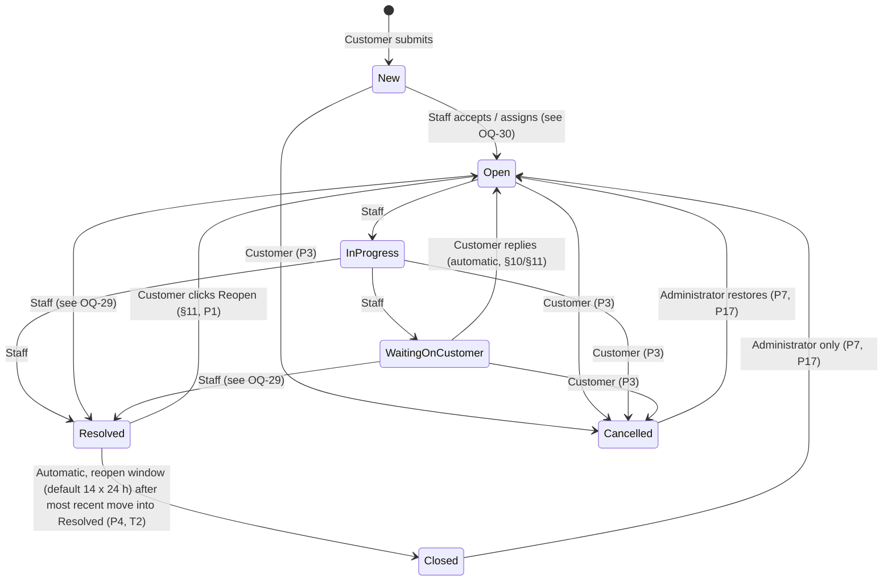
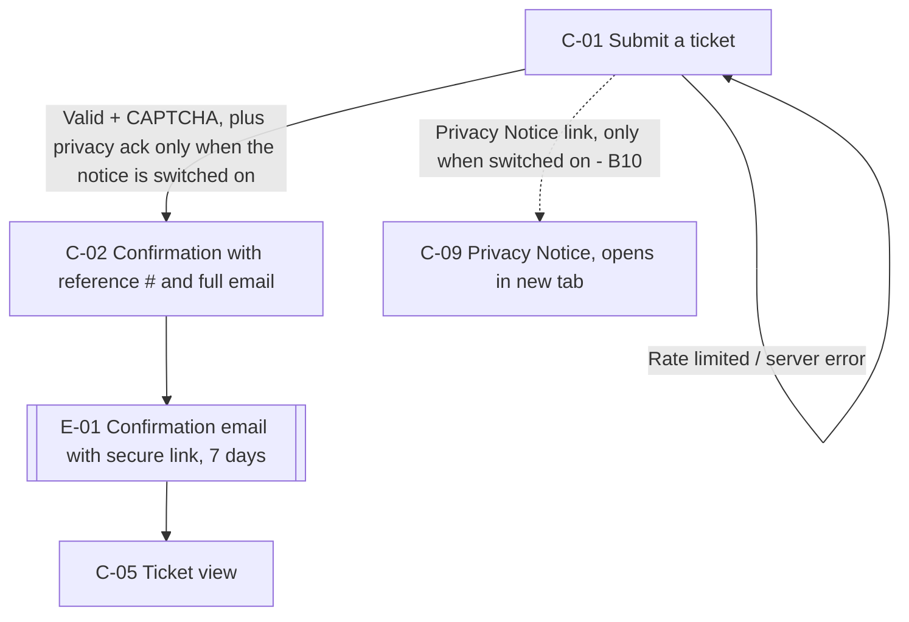
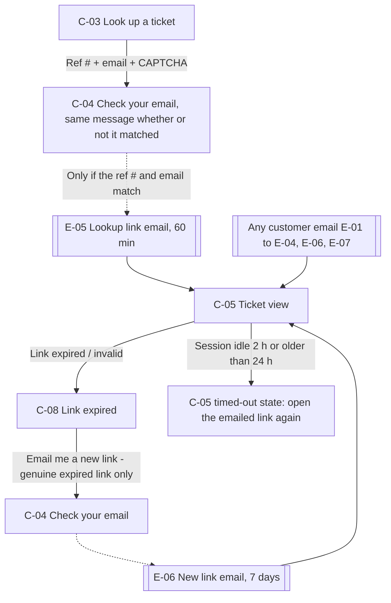
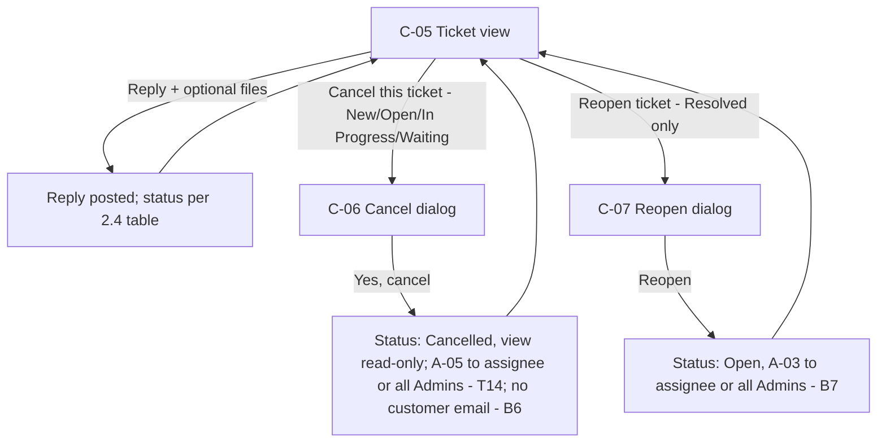
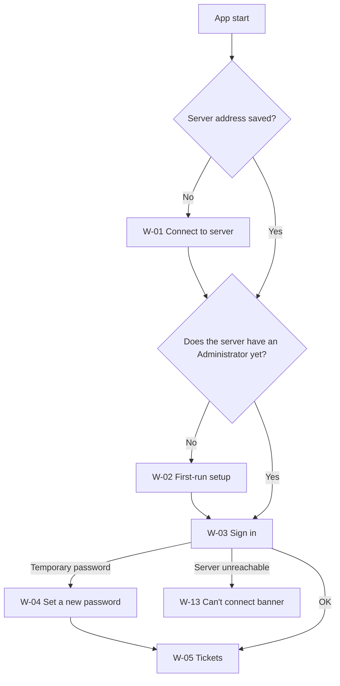
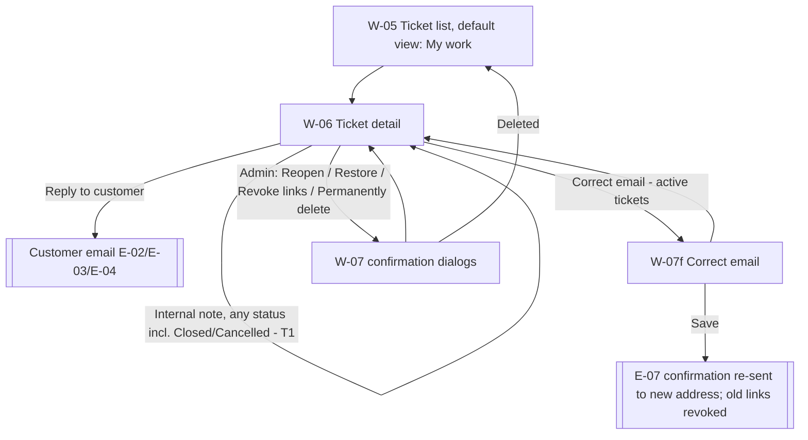
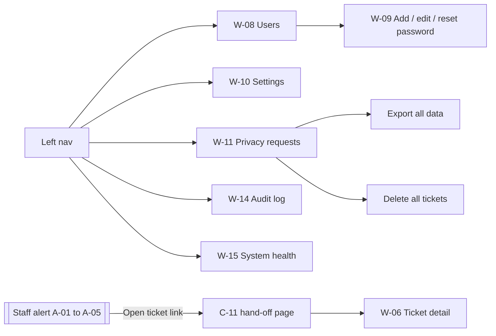

# Help Desk: Design Spec (UX / Product)

**Phase:** 2 (architecture + design) | **Product owner:** Brandon Trout | **Author:** Product Designer (bot team) | **Date:** Oct 6, 2026
**Status:** Draft for review, revision 10 (reconciled with Round 4-5 decisions, team decisions T1-T36, and the Phase 2 team docs). Framework-neutral: this spec describes screens, behavior, and copy only. The tech stack and mechanics belong to `ARCHITECTURE.md`.

> **Branding placeholder (B5, CONTEXT).** Brandon's company isn't registered or named yet. **"Help Desk", the sender display name "Help Desk" (T21), the logo text, and every other brand string in this spec are placeholders.** They come from the Branding settings (site name default "Help Desk", company name default "Your Company"; W-10, ARCH §5; OQ-45), and nothing here should be hard-coded as a final name. Copy blocks write the name as `{site name}`; wireframes show the default placeholder value. The real values are deferred to go-live. The same goes for legal text (privacy notice, terms), which Brandon will supply after the company is formed (B10).

### Changelog
| Date | Rev | Change |
|---|---|---|
| Oct 6, 2026 | 1 | First draft: flows, screen inventory, wireframes, copy, traceability, 38 open questions. |
| Oct 6, 2026 | 2 | Reconciliation pass against REQUIREMENTS_DISCOVERY R9-R10, B1-B10, **T1-T17**, plus ARCHITECTURE, EMAIL_AND_WORDING, ACCEPTANCE_CRITERIA, PHASE2_OPEN_QUESTIONS, and the ADRs. **Secure links:** removed the flat 72 hours; screens now read the real lifetime from the server: 60 min (lookup), 7 days (other notifications), until auto-close for the Resolved email, never more than 14 days (R9, T9, ARCH §8). Customer page session 2 h idle / 24 h max. **Reopen window** setting 1-14 days (T2). **Closed/Cancelled read-only for staff** except internal notes (T1). **Confirmation page** shows the full email address (T5); every wireframe and copy block checked. **No customer emails** on cancel (customer or staff), admin reopen, or restore (B6, T13). **Staff alert routing** per B7, plus a **new alert when a customer cancels** (T14), with alert content per T11 and a message preview + clickable https link (T15); added the C-11 "Open in the app" hand-off page. **Reply text in customer emails** (B8). **Staff can correct a customer's email** (W-07f): confirmation step, old links revoked, confirmation email re-sent to the new address, history entry (B9, T12). **Privacy notice and checkbox off by default**, switchable by an Administrator, both states shown (B10). **Passwords** at least 15 characters (ARCH §7). **Reference # alphabet** per ARCH §4. **Reply address is monitored:** removed every "replies aren't read" line (R10, T4). **Email text now lives only in EMAIL_AND_WORDING (T4):** the drafts in §3.14 and §4.16 were deleted and replaced with screen-to-email trigger maps; stale subjects, "72 hours", the hard-coded team sign-off, and un-prefixed alert subjects are gone; on-screen copy that mentions an email now matches EMAIL (subjects, `[TEST]` tag per T16, test-email recipient per T17). Testing sender `support.trouthomelab@gmail.com` (R10) shown only as the testing value. Branding is a set of placeholders in Settings (B5, ARCH §5). Infected-file wording aligned to ARCH §9. Sender saved only after a test email succeeds (T6). Added screens the ARCH/ACs rely on: Correct customer email, Revoke customer links, Unlock account, Signed-in devices, "Email not yet confirmed" note, Branding and Privacy notice settings, Audit log (W-14), System health (W-15), C-11 hand-off page. Open Questions re-statused; OQ-39 to OQ-47 added. Conflicts and traceability rebuilt. |
| Oct 6, 2026 | 3 | Small follow-up for T18-T21: sender display name default is "Help Desk" (T21); size limits confirmed as binary units (10 MB = 10,485,760 bytes; 512 KB = 524,288 bytes); link lifetimes already matched T18; threat-row references renamed to TM-n; C-16 resolved. Alert preview truncation (T19) is defined in EMAIL_AND_WORDING. |
| Oct 6, 2026 | 4 | Fix pass for the Doc Steward's CONSISTENCY_REPORT (CR-10 to CR-16) and team decisions T22-T27. **CR-10 / T23 / T26a:** every customer-facing "reference number" is now "ticket number" and every customer-facing "request" is now "ticket" (nav, page titles, headings, banners, buttons, errors, dialogs, status descriptions, flow labels, mobile, quoted subject); the C-03 bridge helper is gone; the first message is labeled "Original message". OQ-47 and C-15 RESOLVED. **CR-11 / T22:** OQ-17, 21, 26, 35, 41, 43 RESOLVED (no copy change). **T26b:** principle 1 now says "Support team" is the author label and emails are signed with the sender name. **T27:** OQ-28 RESOLVED (unread indicator in v1). **CR-12 / T24:** W-07f and W-11 state that privacy export/delete find the old address too; C-13 RESOLVED. **CR-13 / T18:** removed the stale EMAIL OQ-16 note; C-12 RESOLVED. **CR-14:** C-14 RESOLVED (ACCEPTANCE rev 7). **CR-15 / T26c:** W-09 Edit user now has a wireframe with the email read-only and the helper "To fix a wrong email address, turn this user off and add them again as a new user." **CR-16:** status line now rev 4, sources cite T1-T27, traceability rows added for T18-T27; changelog put in order. **T25:** E-02 row notes both links. New conflict C-18 (EMAIL subject still says "support request"). |
| Oct 6, 2026 | 5 | Architect cross-check via Doc Steward: fixed the typo in the customer-terms note (never "request"); E-04 (Resolved email) now has a single reopen link (P8, EMAIL C5, ARCH §8), and only E-02 carries two links (T25). C-18 RESOLVED (EMAIL updated by Support Ops). |
| Oct 6, 2026 | 6 | T28: added the app attention badge to W-05: taskbar badge plus window title "({n}) {site name}", hidden at 0, capped at "99+", with an accessible description and update rules. Updated 4.8.4, the traceability table (T28) and sources (T1-T28). New OQ-48 (badge cap and unknown-count behavior, designer default). |
| Oct 6, 2026 | 7 | Doc Steward re-sweep 2 (CR-42): updated the sources note (Q3 settled by T27/T28, Q6 by T22, P8 LOCKED with N days); Q3 traceability row now cites T27/T28 and A-01 to A-05; C-16 and C-17 RESOLVED; Reset password dialog now has the 15-character helper and errors (AC-ROLE-18); badge count source is now `GET /internal/me/attention-count`. CR-34 (needs-attention set/clear rules) is on hold until ND-8 is decided. |
| Oct 6, 2026 | 8 | T34 (CR-34): 4.8.4 rewritten. The flag is set on a new ticket, a customer reply, or a customer reopen, and cleared by a staff public reply, a status change, or "Mark as seen" (not by opening a ticket or adding an internal note). The flag is renamed on screen from "Customer replied" to "Needs attention" with a reason line, because new tickets are flagged too. The W-05 badge refreshes after status changes too. T33: OQ-48 RESOLVED. Traceability now includes T33 and T34; sources cite T1-T34. |
| Oct 6, 2026 | 9 | T35: any move into Closed/Cancelled (auto-close, customer cancel, staff) clears the needs-attention flag; Mark as seen is hidden on Closed/Cancelled tickets; the badge never counts them; accepting or assigning a New ticket clears the flag. Updated 4.8.4, the W-05 badge refresh rules, OQ-28 and traceability (T35); sources cite T1-T35. |
| Oct 6, 2026 | 10 | T36: the "Needs-attention flag cleared" history entry is credited to "System" when auto-close or a customer cancel clears it ("Cancelled by customer" is still credited to the customer). Added actor rules to 4.8.4 and example rows to 4.8.5; traceability T36; sources cite T1-T36. Added a note that "next sign in" (reset) vs "first sign in" (Add user) is deliberate (QA question). |

---

## 1. Purpose, scope, sources, and design principles

### 1.1 Purpose
This spec defines what customers and support staff see and do in Help Desk v1: user flows, a screen inventory, low-fi wireframes, and the exact copy for each screen. It also defines what each email must contain and which screen it leads to; the email wording itself lives in `EMAIL_AND_WORDING.md` (T4). Engineers should be able to build the UI from this document without making product decisions. Anything the sources leave open is listed in **Section 6, Open Questions**, marked inline as "(see OQ-n)", and drawn here using the recommended default so the design is complete. Those spots are **pending until Brandon (or, for team-level items, the Project Lead) confirms them**. Section 6 shows each one's status: RESOLVED (with the deciding ID), ADOPTED (a team default the other docs already build on), or OPEN.

### 1.2 Scope
| In scope (v1) | Out of scope (v1), per P15/P16 and baseline §17/§18 |
|---|---|
| Public customer site: submit, confirm, look up, secure-link ticket view, reply, attach files, cancel, reopen, privacy notice (off by default, B10), mobile layout; plus the staff "Open in the app" hand-off page used by alert links (C-11, T15) | Customer accounts (baseline §4) |
| Customer emails: submission confirmation, support reply, Waiting on Customer, Resolved, lookup link, new-link email (Q1, Q2, P8, T10). Wording in EMAIL_AND_WORDING (T4) | Adding email replies to tickets automatically (no inbound processing, Q2). The reply address is a monitored mailbox, but replies stay outside the ticket |
| Staff alert emails: new ticket, customer reply, reply on Resolved, reopen, customer cancel (Q3, R1, T14), routed per B7. Wording in EMAIL_AND_WORDING (T4) | Knowledge base, SLAs/escalation, canned responses, satisfaction surveys (P16) |
| Windows support app: sign in, first-run setup, ticket list (search, filters, status counts), ticket detail, customer email correction (B9, T12), user management, settings (including branding placeholders and the privacy-notice switch), privacy export/delete, audit log, system health | Dashboards or reports beyond counts per status (P15). (System health is an operations page, not reporting.) |
| Two fixed roles: Administrator and Agent (R3) | Configurable permission matrix (R3), MFA (R2), Android app, Device Monitor integration (baseline §2, §17), help form embedded on the future company website (B5 FUTURE) |

### 1.3 Sources and precedence
1. `REQUIREMENTS_DISCOVERY.md` (**the authority**). IDs such as Q1, P9, R3, R9, B7 refer to its LOCKED items. Its Project Lead team decisions **T1-T36** come next: they settle conflicts and override any team doc, but never a LOCKED item.
2. `brandon-answers-round2-2026-10-06.md` (Brandon's original answers; historical context only).
3. `HELP_DESK_PRODUCT_REQUIREMENTS_BASELINE.md` (the baseline). Refs such as §10 point to it.
4. Phase 2 team docs, each owning one layer (T4): `ARCHITECTURE.md` (ARCH) owns mechanics (data, API, timings, security, link lifetimes, password rules); **this doc owns on-screen copy and screen behavior**; `EMAIL_AND_WORDING.md` (EMAIL) owns email text; `ACCEPTANCE_CRITERIA.md` (AC) tests all three. `docs/adr/` holds the reasons behind ARCH choices.
5. `GROK_BOT_HANDOFF.md` (context).

Only **LOCKED** items and T-decisions are treated as requirements. The items that used to be PROPOSED are now settled: the Q3 unread indicator and app badge by T27/T28, Q6 "no Other option" by T22 (OQ-35), and P8 is LOCKED with the Resolved email stating the actual N-day close (N = the reopen window, T2). Where the other docs still disagree with the decisions or with each other, Section 6.2 lists it instead of picking a side.

### 1.4 Design principles
1. **Privacy first.** Customers see only their own ticket, and only through a secure link sent to their email (Q1, §16). Lookup copy never reveals whether a ticket or email exists (see OQ-3). Internal notes, priority, and technician identity never reach a customer screen or email (§8, P24, B8). Staff messages carry the author label "Support team" on screen and in the reply quoted inside emails; customers never see staff names. Customer emails are signed with the sender name (default "Help Desk") (T26b, T21).
2. **Customer-visible versus internal is obvious.** In the Windows app every message carries a visible label, color, and icon that says who can see it. You can't mistake an internal note for a reply.
3. **Deliberate actions for anything that changes state.** Reopen, cancel, delete, and export all ask for a confirmation. A customer reply never reopens a Resolved ticket (P1, R1).
4. **Start small, expand later** (R5). One product means no product dropdown (P9). There's no dashboard, just status counts (P15). The ticket and data model have room for more products, Agents, and future clients.
5. **Plain, friendly language.** Short sentences, no jargon, and every error says what to do next. English only (A1).
6. **One time zone.** All times are shown in America/New_York with an "ET" label (A1), formatted `Oct 6, 2026, 10:57 AM ET`.
7. **Phones are first-class** on the public site (A5). Every customer screen works at 320 px wide.
8. **Accessible by default.** The target is WCAG 2.2 AA (see OQ-21): visible labels, keyboard operable, errors announced, and color never the only signal.
9. **Minimal steps for Brandon** (Project Goal). Defaults are ready to use, and setup is one screen.
10. **Read limits from the server, don't hard-code them.** Password length, attachment limits, link lifetimes, and the reopen window are server values (ARCH §6.3 `/auth/policy`, `/public/config`; T9). Copy shows them through placeholders such as `{15}` or `{60 minutes}`; the number inside is today's default.

---

## 2. Shared concepts (only as defined in the requirements)

### 2.1 Names used in copy
- **Product/site name:** `{site name}`, default "Help Desk", a placeholder everywhere it appears (B5; see the branding note at the top and OQ-45). The sender display name is its own setting (W-10).
- **Supported product at launch:** "Device Monitor" (Q6).
- **Customer-facing terms (T23, T26a):** customers see **"ticket"** everywhere (for example, "your ticket") and never "request", and the reference is the **"ticket number"**. Staff also see "ticket". "Reference #" survives only as the internal data-field name in spec prose and staff screens. *(This is wording only. It doesn't change any status name; A3 keeps status names identical.)*

### 2.2 Ticket number (P13; called "reference #" in staff screens and spec prose)
- Non-sequential, shown as `HD-` plus 6 characters, e.g. `HD-7K3M9Q` (P13). The characters come from `23456789ABCDEFGHJKMNPQRSTVWXYZ`, so there's no 0, O, 1, I, L, or U (ARCH §4; OQ-8 RESOLVED).
- Shown in a monospace style with a "Copy" button wherever it appears to the customer.
- Lookup accepts it case-insensitively, with or without the `HD-` prefix and surrounding spaces (ARCH §3.1, AC-LINK-20).

### 2.3 Ticket statuses (§10, A3)
Customers and staff see the same status names (A3). The customer-facing descriptions below are the exact copy used on the ticket view.

| Status | Meaning (§10) | Customer-facing description (exact copy) |
|---|---|---|
| New | Submitted, not yet accepted or assigned | "We've received your ticket. Someone from our support team will pick it up soon." |
| Open | A technician accepted it or it was assigned | "Our support team has picked up your ticket." |
| In Progress | Actively being worked on | "We're working on your ticket." |
| Waiting on Customer | Support needs information or action from the customer | "We need more information from you. Please reply below so we can keep going." |
| Resolved | Support believes it's fixed; the customer can reopen it during the reopen window (1-14 days, default 14; T2) | "We think this is fixed. If it isn't, you can reopen this ticket until {auto-close date}." |
| Closed | Finalized; the customer can't reopen it | "This ticket is closed. If you still need help, please submit a new ticket." |
| Cancelled | Cancelled (terminal); the record is kept | "This ticket was cancelled. If you still need help, please submit a new ticket." |

### 2.4 Allowed transitions


*The diagram shows the main paths. Staff can also move tickets backward between normal workflow states (§11), for example Waiting on Customer back to In Progress, or Resolved back to In Progress. Those arrows are left out to keep it readable.*

**Customer-triggered transitions (all locked):**

| From | Customer action | Result | Source |
|---|---|---|---|
| New, Open, In Progress | Reply | Message added, **no status change**, ticket flagged "Needs attention" internally (T34) | P2 |
| Waiting on Customer | Reply | Message added, status changes to **Open** automatically | §10, §11 |
| Resolved | Reply | Message added, **stays Resolved**, the auto-close clock keeps running, staff alert A-04 sent, "Needs attention" flag set (T34) | R1 |
| Resolved | Reopen (explicit button) | Status changes to **Open**, clock cleared, assignee kept, staff alert A-03 sent | §11, P1, P4, Q3, ARCH §4 |
| New, Open, In Progress, Waiting on Customer | Cancel | Status changes to **Cancelled**; staff alert A-05 sent (T14); no customer email (B6) | P3, B6, T14 |
| Resolved, Closed, Cancelled | Cancel | Not allowed (no button shown) | P3 |
| Closed | Anything | Read-only | R1, §10 |
| Cancelled | Reply or reopen | Not allowed; read-only (ARCH G17; OQ-16) | P3, §10 |

There's no limit on how many times a customer can reopen (P5). Waiting on Customer never times out on its own (P6).

**Staff-triggered transitions:**
- Staff may move tickets backward between normal workflow states (§11). Status changes never require a note (§9, §11).
- Staff can set any of **Open, In Progress, Waiting on Customer, Resolved** from any of New, Open, In Progress, Waiting on Customer, or Resolved. Staff can't pick **New** by hand (New means "not yet accepted"), and can't pick **Closed** by hand (Closed only happens automatically). Both roles can **Cancel** any active ticket, after a confirmation (OQ-29 ADOPTED by ARCH §4/G5).
- **Closed and Cancelled are read-only for staff (T1):** no status, priority, assignment, or reply changes, and no customer email correction (T1, ARCH §4). **Internal notes can still be added** (baseline §11). This lasts until an Administrator reopens or restores the ticket. Permanent delete stays available to Admins (P21).
- **Administrator only:** Closed to Open ("Reopen ticket") and Cancelled to Open ("Restore ticket") (P7, P17).
- Moving into Resolved starts (or restarts) the auto-close clock. Leaving Resolved stops it (P4).

### 2.5 Roles (R3, P17)
| Capability | Administrator | Agent |
|---|---|---|
| View, search, and filter all tickets; accept or assign; change status and priority; reply; add internal notes | Yes | Yes ("all ticket work", R3) |
| Settings (products, sender, reopen window, attachments, branding, privacy-notice switch) | Yes | No |
| User management (create users, reset passwords) | Yes | No |
| Reopen Closed tickets / restore Cancelled tickets | Yes | No |
| Permanently delete a ticket, or delete all tickets for an email | Yes | No |
| Privacy export | Yes (OQ-37) | No (AC-ROLE-07) |
| Correct a customer's email address (New to Resolved; not Closed/Cancelled) | Yes | Yes (B9 "staff"; ARCH §6.3) |
| Revoke a ticket's customer links | Yes | No (ARCH §6.3, AC-ROLE-27) |
| Unlock a locked account; view audit log and system health | Yes | No (ARCH §6.3) |
| Add internal notes on Closed/Cancelled tickets | Yes | Yes (T1) |

Admin-only controls are **hidden** for Agents, not just disabled, and the backend enforces permissions anyway (P17). There's no self-signup (P18). MFA isn't in v1 (R2). Sign-in screens are laid out so a second-step screen can slot in later without a redesign.

### 2.6 Priority and impact
- **Priority** (internal only): Low, Normal (default), High, Urgent (R6). Customers never see it (§13, P24).
- **Customer-reported impact** (optional on the form): "Just a question", "Something isn't working", "I can't use the product at all" (P10). Staff see it as a hint labeled "Customer says:". It **never** sets priority (P10).

### 2.7 Attachments (Q4, P20)
- Allowed in both directions: customer uploads and files staff attach to replies (Q4).
- Types: images, PDF, plain text/log files, ZIP (Q4). The exact list of extensions is pending (see OQ-9).
- Limits: 10 MB (10,485,760 bytes) per file, 5 files per message (Q4). Admins can change them in Settings within 1-25 MB and 1-10 files (P20; ARCH §9). All copy uses the current setting values; the defaults are shown here. A message with any file over the limit is rejected as a whole, with a clear message, and nothing is stored (T7).
- A malware scan must finish before **anyone** can download a file (Q4, ARCH §9). File states are described in 3.8 and 4.8.3. An infected file is deleted, and both sides see "attachment removed: failed security scan" (ARCH §9/G12).
- Files are kept for the life of the ticket (Q4, P21).

### 2.8 Notifications (Q1, Q2, Q3, P8, R1, B6, B7, B8, T4, T10-T17)
**Email text is owned by `EMAIL_AND_WORDING.md` (T4).** This spec only says which event or screen triggers which email. IDs in brackets are EMAIL's template names; §3.14 and §4.16 map them to screens.

| Event | Customer email | Staff alert (recipients per B7) |
|---|---|---|
| Ticket submitted (C-01) | E-01 Submission confirmation [C1] | A-01 New ticket [A1] → **every active Administrator** |
| Staff sends a customer-visible reply in any active status, **including Resolved** (T4) | E-02 Support reply [C3], with the reply text (B8) | none |
| Status set to Waiting on Customer | E-03 Waiting on Customer [C4]; one email even if a reply was sent in the same action (ARCH §4) | none |
| Status set to Resolved (every move into Resolved) | E-04 Resolved, with reopen link [C5] (P8) | none |
| Auto-close | **No email** (P8 supersedes Q2) | none |
| Customer asks for a link on C-03 | E-05 Lookup link [C2a], own subject (T10) | none |
| Customer uses "Email me a new link" on C-08 | E-06 New link [C2b], own subject (T10) | none |
| Staff correct the customer's email (W-07f) | E-07 = **the confirmation [C1] re-sent to the new address** with a fresh link; old links revoked; nothing to the old address (B9, T12) | none |
| Customer replies (New, Open, In Progress, Waiting on Customer) | none | A-02 Customer reply [A2] → **the assignee, or every active Administrator if unassigned or the assignee is turned off** (B7, ARCH §11); at most one per ticket per 10 minutes |
| Customer replies on Resolved | none | A-04 Reply on Resolved [A4] → same routing (B7, R1) |
| Customer reopens (C-07) | none | A-03 Reopened [A3] → same routing (B7) |
| **Customer cancels (C-06)** | **none** (B6) | **A-05 Cancelled by customer [A5]** → same routing (**T14**) |
| Staff cancel (W-07c); Admin reopen of Closed / restore of Cancelled (W-07d) | **none** (B6, T13) | none (alerts fire only on customer actions) |
| Staff moves a ticket to Open or In Progress without a reply | none (Q2 list) | none |
| Admin saves a new sender or presses "Send test email" (W-10) | none | S1 Test email [S1] → **the signed-in Admin's own address only** (T6, T17) |
| Account locked; system problem | none | S2 / S3 [S2, S3] → every active Administrator (ARCH §7, §10) |

- Every customer email carries that ticket's secure link (Q1). Every email states its own link's real expiry in ET, so screens never promise a number of hours (§2.9).
- There's no inbound processing (Q2), but **the reply address is a monitored mailbox** (R10, T4, ARCH §11). Customer emails say that replying won't add anything to the ticket and point to the ticket page (EMAIL §6). No screen says replies "aren't read".
- Customer emails never carry internal information: notes, priority, assignee, or any staff name (B8, §8). Staff alerts may show status, priority, assignee, and the impact hint, plus a ~500-character preview of the customer's message, but **never internal note text** and never a customer secure link (T11, T15). Their "Open ticket" link goes to C-11 (T15).
- Outside production every subject starts with `[TEST]` (T16). Sending from `support.trouthomelab@gmail.com` during testing is test data (R10). No automatic bounce handling in v1: bounces land in the monitored mailbox, and staff fix a mistyped address with W-07f (T17, B9).

### 2.9 Secure link (Q1, R9, ARCH §8)
- A link emailed to the ticket's email address that opens the ticket view (C-05) without an account.
- Lifetimes (ARCH §8; R9 caps every link at **14 days**, T9 enforces it at startup and in settings):

| Link | Lifetime (default) | Where it's set |
|---|---|---|
| Lookup link (E-05) | **60 minutes** from sending | Server configuration only (no settings screen, ACCEPTANCE OQ-12 decision) |
| Links in notification emails (E-01, E-02, E-03, E-06, E-07) | **7 days** from sending | Server configuration only (T18) |
| Resolved email's link (E-04), including its reopen link | **Until that ticket's auto-close time**, i.e. the reopen window (1-14 days, T2) | Follows the reopen-window setting (W-10) |

- Links can be used many times until they expire (not single-use, ARCH §8). Every email states its own link's real expiry in ET (ARCH §8, AC-LINK-30), so screen copy never promises a fixed number of hours.
- Opening a link starts a customer session for that one ticket: **2 hours idle, 24 hours maximum** (ARCH §8). When it ends, the customer opens the emailed link again or requests a new one.
- An expired genuine link opens C-08, which offers a one-step "Email me a new link". An Admin can revoke all of a ticket's links (W-06 More menu), and correcting the customer's email revokes the old ones and any open customer session (B9, T12, ARCH §8). A revoked link behaves like an invalid one on C-08.

### 2.10 Privacy (R4, B10, P21, P22, P23)
- **Privacy notice and acknowledgement: OFF by default in v1/beta (B10).** The notice link, the required checkbox, and the notice page are built and can be switched on later by an Administrator in **Settings → Privacy notice** (W-10) once Brandon supplies the text after the company is formed (ARCH §5; OQ-39 RESOLVED). The switch can't be turned on while the notice text is empty. Section 3.4 shows both states.
- No tracking or analytics cookies (R4, still applies under B10). The only cookie is the strictly necessary customer access cookie, and the CAPTCHA sets none (ADR 0015), so there's no cookie banner (OQ-5 RESOLVED).
- Admin tools export all data for an email address and permanently delete all tickets for an email address (R4; still apply under B10). Single-ticket permanent delete is Admin only and is logged without content (P21).
- Backups keep 7 daily, 4 weekly, and 12 monthly copies (B2), so deleted data ages out of backups within about 12 months.
- Audit history is append-only. Nobody can edit it, including Admin (P23).

---

## 3. Public customer site

### 3.1 User flows

**Flow A: Submit a ticket**


**Flow B: Return to a ticket**


**Flow C: Act on a ticket (inside C-05)**


### 3.2 Screen inventory

| ID | Name | Purpose | Entry points | Exits |
|---|---|---|---|---|
| C-00 | Site frame (header + footer) | Shared navigation; privacy link on every page when the notice is switched on (B10) | Every page | Any nav link |
| C-01 | Submit a ticket (home page) | Create a ticket | Site root; header "Submit a ticket"; C-05 Closed/Cancelled state; C-08 | C-02 on success; C-09 (new tab) |
| C-02 | Ticket received | Show the reference # and next steps | Successful C-01 submit | C-01 ("Submit another ticket"); C-03 |
| C-03 | Check on a ticket (lookup) | Ticket a secure link by ref # + email | Header "Check on a ticket"; C-02; C-08 | C-04 |
| C-04 | Check your email | Neutral lookup result | C-03 submit; C-08 "Email me a new link" | C-03 ("Send another link"); C-01 |
| C-05 | Ticket view (secure link) | View status and conversation; reply; attach; cancel; reopen | Secure link in E-01 to E-07 | C-06, C-07 dialogs; C-01 (from Closed/Cancelled) |
| C-06 | Cancel ticket (dialog) | Confirm cancellation | C-05 "Cancel this ticket" | C-05 |
| C-07 | Reopen ticket (dialog) | Confirm reopening | C-05 "Reopen ticket"; reopen link in E-04 (lands on C-05) | C-05 |
| C-08 | Link expired or not valid | Recover from a bad or expired link | Expired or invalid secure link | C-04 (resend), C-03, C-01 |
| C-09 | Privacy Notice | Show Brandon's notice text. **Exists only when the notice is switched on (B10)**; otherwise its address shows the C-10 "page not found" page | C-01 link; footer link | Back / close tab |
| C-10 | Error pages | Page not found, rate limited, service unavailable | Bad URL; server errors | C-01, C-03 |
| C-11 | Open in the app (staff hand-off page) | Turn the https "Open ticket" link in a staff alert into the Windows app (T15, ARCH §6.6) | Link in staff alerts A-01 to A-05 | Windows app W-06 (via sign-in if needed); app download |
| E-01 to E-07 | Customer emails (wording in EMAIL_AND_WORDING, T4) | Outbound notifications (Q2, P8, Q1, T10, B9) | System events (2.8) | Secure link leads to C-05 |

### 3.3 C-00 Site frame

```
+--------------------------------------------------------------------------+
| [Help Desk]                          Submit a ticket | Check on a ticket |
+--------------------------------------------------------------------------+
|                                                                          |
|                            ( page content )                              |
|                                                                          |
+--------------------------------------------------------------------------+
| [Privacy Notice  ·]  We don't use tracking or analytics cookies.         |
| All times are Eastern Time (ET).                                         |
+--------------------------------------------------------------------------+
```
**Copy (exact)**
- Logo / home link: the Branding logo, or a neutral placeholder logo plus the `{site name}` text when no logo is set (site name default "{site name}", a placeholder; B5, ARCH §5; OQ-45 RESOLVED)
- Nav: "Submit a ticket" · "Check on a ticket"
- Footer: "Privacy Notice" (link to C-09, **shown only when the privacy notice is switched on**, B10) · "We don't use tracking or analytics cookies." (always shown; R4 still applies) · "All times are Eastern Time (ET)." · `{portal footer text}` from Branding, only if set (empty by default; ARCH §5)
- Skip link (first focusable item): "Skip to main content"

**Accessibility:** landmark regions (header, nav, main, footer). Skip link visible on focus. Nav marks the current page.

### 3.4 C-01 Submit a ticket

```
+--------------------------------------------------------------------------+
| Get help with Device Monitor                                             |
| Tell us what's going on and we'll get back to you by email.              |
| Fields marked * are required.                                            |
|                                                                          |
| [!] Please fix the 2 problems below.          <- error summary (on error)|
|                                                                          |
| Your name (optional)                                                     |
| [______________________________________]                                 |
|                                                                          |
| Email address *                                                          |
| [______________________________________]                                 |
| We'll send updates and your secure link here.                            |
|                                                                          |
| (Product *  [Select a product        v])  <- ONLY when 2+ products exist |
|                                                                          |
| Subject *                                                                |
| [__________________________________________________________]   0/150     |
|                                                                          |
| Describe the problem *                                                   |
| +------------------------------------------------------------+           |
| |                                                            |           |
| |                                                            |           |
| +------------------------------------------------------------+ 0/10,000  |
| What happened, what you expected, and any steps to reproduce it.         |
| Please don't include passwords.                                          |
|                                                                          |
| How much is this affecting you? (optional)                               |
| ( ) Just a question                                                      |
| ( ) Something isn't working                                              |
| ( ) I can't use the product at all                                       |
|                                                                          |
| Attachments (optional)                                                   |
| [ Add files ]  Up to 5 files, 10 MB each. Images, PDF, text or log       |
|                files, and ZIP files.                                     |
|   screenshot.png   1.2 MB   [Remove]                                     |
|   app.log          240 KB   [Remove]                                     |
|                                                                          |
| [ ] I've read the Privacy Notice (opens in a new tab). *                 |
|     <- ONLY when the privacy notice is switched on (state B, B10)        |
|                                                                          |
| [ CAPTCHA widget ]                                                       |
|                                                                          |
| [ Submit ticket ]                                                        |
+--------------------------------------------------------------------------+
```

**Privacy notice states (B10).** The form has two configured states. Everything else on the form is identical in both.

| | State A: notice OFF (**default for v1/beta**) | State B: notice ON (switched on later through configuration; see OQ-39) |
|---|---|---|
| Privacy checkbox | Not shown | Shown, **unchecked**, required |
| Footer "Privacy Notice" link (C-00) | Not shown | Shown |
| C-09 page | Doesn't exist (C-10 "page not found") | Shows Brandon's notice text |
| Acknowledgement record on the ticket | None; W-06 shows "Privacy notice: not requested" | Time recorded; W-06 shows "Privacy notice acknowledged {date}"; History "Privacy notice acknowledged" |
| "Please confirm you've read the Privacy Notice." error | Never shown | Shown if unchecked |

```
State A (default): ... Attachments ... [ CAPTCHA widget ] [ Submit ticket ]
State B:           ... Attachments ... [ ] I've read the Privacy Notice
                                           (opens in a new tab). *
                                       [ CAPTCHA widget ] [ Submit ticket ]
```

**Field rules (P9, P10, P12, R4/B10, Q4)**
| Field | Required | Rule | Source |
|---|---|---|---|
| Your name | No | Free text, max 100 characters (OQ-13 ADOPTED, AC-FORM-17) | P9 |
| Email address | Yes | Valid email format | P9 |
| Product | Yes | Pre-selected and **hidden** while only one product exists. Becomes a dropdown with "Select a product" placeholder when 2+ active products exist. No "Other" option (OQ-35 ADOPTED) | P9, Q6 |
| Subject | Yes | Max 150 characters; live counter | P9 |
| Describe the problem | Yes | Max 10,000 characters; live counter | P9 |
| How much is this affecting you? | No | One of three options; no default selected | P10 |
| Attachments | No | Types and limits per 2.7 (types pending Brandon, OQ-9) | Q4 |
| Privacy acknowledgement | **State B only:** yes | Checkbox, unchecked by default. Not shown in State A | R4, B10 |
| CAPTCHA | Yes | Self-hosted, no cookies (ADR 0015) | P12 |

**Copy (exact)**
- Page title (browser tab): "Submit a ticket · {site name}"
- H1: "Get help with Device Monitor" (when 2+ products exist: "Get help")
- Intro: "Tell us what's going on and we'll get back to you by email."
- "Fields marked * are required."
- Labels and helper text as in the wireframe. Email helper: "We'll send updates and your secure link here." Description helper: "What happened, what you expected, and any steps to reproduce it. Please don't include passwords."
- Attachments helper: "Up to {5} files, {10} MB each. Images, PDF, text or log files, and ZIP files."
- Privacy checkbox (State B only): "I've read the [Privacy Notice] (opens in a new tab)."
- Button: "Submit ticket". While sending: "Sending…" (button disabled)

**Validation and error messages (exact)**
| Condition | Message (shown under the field and listed in the error summary) |
|---|---|
| Error summary heading | "Please fix the {n} problem(s) below." ("problem" when n = 1) |
| Email empty | "Please enter your email address." |
| Email invalid | "Please enter a valid email address, like name@example.com." |
| Product not chosen (multi-product only) | "Please choose a product." |
| Subject empty | "Please add a subject." |
| Subject over 150 | "Subject must be 150 characters or fewer. You're at {n}." |
| Description empty | "Please describe the problem." |
| Description over 10,000 | "Description must be 10,000 characters or fewer. You're at {n}." |
| Privacy not acknowledged (State B only) | "Please confirm you've read the Privacy Notice." |
| CAPTCHA not done or failed | "Please complete the check to show you're not a robot." |
| File too large (the whole submission is rejected, T7) | "\"{file name}\" is larger than {10} MB. Please choose a smaller file." |
| File type not allowed | "\"{file name}\" can't be attached. You can attach images, PDFs, text or log files, and ZIP files." |
| Too many files | "You can attach up to {5} files per message. Remove a file to add another." |
| File upload failed | "\"{file name}\" didn't upload. Please try again." |
| Rate limited (P12; 5/hour per IP, 3/hour per email, ARCH §14) | Banner: "You've sent several tickets in a short time. Please wait a while and try again. If it's urgent, you can reply on an existing ticket instead." |
| Server or network error | Banner: "Something went wrong and your ticket wasn't sent. Your details are still here. Please try again in a few minutes." |

**States**
- *Default:* empty form; the product is hidden and pre-selected (single product); no privacy checkbox (State A).
- *Client-side validation:* runs on submit and on leaving a field, never while the user is still typing in it. Counters turn to warning style at 90% of the limit.
- *Submitting:* button reads "Sending…" and is disabled. Fields stay visible.
- *Error:* everything the user entered is kept, including selected files (no re-typing). The error summary gets focus.
- *Success:* go to C-02.

**Accessibility:** every input has a visible `<label>`-equivalent. Helper text and errors are programmatically tied to their fields. The counter announces politely at 90% and 100%. Radio options are a labeled group ("How much is this affecting you?"). "Add files" is a real button that works by keyboard; drag-and-drop is optional. Each file's "Remove" button reads "Remove {file name}". The CAPTCHA must be usable by keyboard and screen reader (the self-hosted proof-of-work check needs no puzzle-solving; ADR 0015).

### 3.5 C-02 Ticket received

```
+--------------------------------------------------------------------------+
|  (✓) Thanks, we've received your ticket                                  |
|                                                                          |
|  Your ticket number is                                                   |
|  +----------------------+                                                |
|  |  HD-7K3M9Q           |  [ Copy ]                                      |
|  +----------------------+                                                |
|  Keep this number. You'll need it with your email address to check on    |
|  this ticket.                                                            |
|                                                                          |
|  What happens next                                                       |
|  1. We've sent a confirmation to jordan@example.com with a secure link   |
|     to your ticket.                                                      |
|     Spotted a typo in your email address? We can't reach you at the      |
|     wrong address, so please submit your ticket again with the right     |
|     one.                                                                 |
|  2. Use that link to see updates, reply, or add files.                   |
|  3. We'll email you when we reply or when anything important changes.    |
|                                                                          |
|  Didn't get the email? Check your spam or junk folder. You can also      |
|  get a new link any time from Check on a ticket.                         |
|                                                                          |
|  [ Check on a ticket ]     Submit another ticket                         |
+--------------------------------------------------------------------------+
```
**Copy (exact)**
- Page title: "Ticket received · {site name}"
- H1: "Thanks, we've received your ticket"
- "Your ticket number is" / `{HD-XXXXXX}` / button "Copy" becomes "Copied" for 2 seconds (announced to screen readers)
- "Keep this number. You'll need it with your email address to check on this ticket."
- H2: "What happens next"
- 1: "We've sent a confirmation to {email address, in full} with a secure link to your ticket." (T5)
- Under 1: "Spotted a typo in your email address? We can't reach you at the wrong address, so please submit your ticket again with the right one." (Staff can also correct an address later, B9, but the customer has no way to ask them to, so this page doesn't promise it.)
- 2: "Use that link to see updates, reply, or add files."
- 3: "We'll email you when we reply or when anything important changes."
- "Didn't get the email? Check your spam or junk folder. You can also get a new link any time from [Check on a ticket]."
- Primary button: "Check on a ticket". Link: "Submit another ticket".

**Behavior notes:** no direct link to the ticket view on this page. Access comes only through the emailed link, which also confirms the email address is real (see OQ-7). The email address is shown **in full** so the customer can catch typos (T5). It's shown only here, to the person who just typed it. The lookup page, the lookup result page, and the expired-link page never show it (AC-FORM-23). If the user refreshes, the page shows the same content for the same browser tab, with no resubmission. Once they leave the page, the full address isn't shown again.

**Accessibility:** focus moves to the H1 on load. The ticket number is plain selectable text (not an image) and is spaced out for screen readers via an accessible label "H D dash 7 K 3 M 9 Q".

### 3.6 C-03 Check on a ticket (lookup)

```
+--------------------------------------------------------------------------+
| Check on a ticket                                                        |
| Enter your ticket number and the email address you used. We'll email     |
| you a secure link to view and reply to your ticket.                      |
|                                                                          |
| Ticket number                                                            |
| [ HD-______ ]                                                            |
| It starts with HD-, like HD-7K3M9Q.                                      |
|                                                                          |
| Email address                                                            |
| [______________________________________]                                 |
|                                                                          |
| [ CAPTCHA widget ]                                                       |
|                                                                          |
| [ Email me a link ]                                                      |
|                                                                          |
| Lost it? It's at the start of the subject of every email about your      |
| ticket, like "[HD-7K3M9Q] Your Device Monitor support ticket".           |
+--------------------------------------------------------------------------+
```
**Copy (exact)**
- Page title: "Check on a ticket · {site name}"
- H1: "Check on a ticket"
- Intro: "Enter your ticket number and the email address you used. We'll email you a secure link to view and reply to your ticket."
- Label "Ticket number", helper "It starts with HD-, like HD-7K3M9Q." (T23)
- Label "Email address"
- Button "Email me a link". While sending: "Sending…"
- Footer hint: "Lost it? It's at the start of the subject of every email about your ticket, like \"[HD-7K3M9Q] Your {product} support ticket\"." (matches EMAIL's fixed per-ticket subject, T10; in testing the subject also starts with "[TEST]", T16)

**Validation (exact):** format checks only, never existence checks (see OQ-3).
| Condition | Message |
|---|---|
| Ticket number empty | "Please enter your ticket number." |
| Ticket number wrong format | "That doesn't look like a ticket number. It should look like HD-7K3M9Q." |
| Email empty | "Please enter your email address." |
| Email invalid | "Please enter a valid email address, like name@example.com." |
| CAPTCHA | "Please complete the check to show you're not a robot." |
| Rate limited (10/hour per IP, 3/hour per email (T3), 5/hour per reference #; ARCH §8) | Banner: "Too many attempts. Please wait a while and try again." Shown only for the per-IP limit; the per-email and per-reference limits silently send nothing and still show C-04, so they reveal nothing (ARCH §8) |
| Server error | Banner: "Something went wrong. Please try again in a few minutes." |

**Behavior:** a well-formed submission **always** goes to C-04 with identical wording and similar response timing, whether or not the ref # and email match (see OQ-3). Matching is case-insensitive for the email and ref # (see OQ-8). CAPTCHA appears on lookup as well as submission (see OQ-4).

**Accessibility:** the ref # input uses `autocapitalize=characters` and disables autocorrect and spellcheck.

### 3.7 C-04 Check your email

Two variants share one layout. **A** follows a lookup on C-03; **B** follows "Email me a new link" on C-08. The link lifetime is read from the server (`/public/config`), never typed into the copy (ARCH §8, T9).

```
+--------------------------------------------------------------------------+
|  (✉) Check your email                                                     |
|                                                                          |
|  If the ticket number and email address match one of our tickets,        |
|  we've sent a secure link to that email address. The link works for     |
|  60 minutes.                                                             |
|                                                                          |
|  Look for an email called "Your secure link for ticket HD-7K3M9Q".       |
|  It can take a few minutes to arrive. Check your spam or junk folder too.|
|                                                                          |
|  Still nothing? Make sure you used the same email address you entered    |
|  when you submitted the ticket.                                          |
|                                                                          |
|  [ Send another link ]      Submit a new ticket                          |
+--------------------------------------------------------------------------+
```
**Copy (exact), variant A (after C-03)**
- Page title: "Check your email · {site name}"
- H1: "Check your email"
- "If the ticket number and email address match one of our tickets, we've sent a secure link to that email address. The link works for {60 minutes}." (lookup-link lifetime, ARCH §8)
- "Look for an email called \"Your secure link for ticket {reference as typed, normalized to HD-XXXXXX}\"." (EMAIL C2a subject, T10; it only repeats what the customer typed, so it confirms nothing)
- "It can take a few minutes to arrive. Check your spam or junk folder too."
- "Still nothing? Make sure you used the same email address you entered when you submitted the ticket."
- Button "Send another link" (back to C-03 with the ref # pre-filled, email blank). Link "Submit a new ticket".

**Copy (exact), variant B (after C-08 "Email me a new link")**
- H1: "Check your email"
- "We've sent a new link to the email address on this ticket. It works for {7 days}."
- "Look for an email called \"Your new link for ticket {ref}\"." (EMAIL C2b subject, T10)
- "It can take a few minutes to arrive. Check your spam or junk folder too. If nothing arrives, you may have asked for several links in a short time. Please wait an hour and try again."
- Link "Check on a ticket" (C-03). Link "Submit a new ticket".

**Privacy:** variant A is the same page for match and no match, and for a silently rate-limited lookup. It never repeats the email address back. Variant B looks the same whether or not the 3-per-hour-per-ticket resend limit was hit (ARCH §8).

### 3.8 C-05 Ticket view (secure link)

The core customer screen. The layout is the same in every status; the banner and available actions change per status (table below).

```
+--------------------------------------------------------------------------+
| Ticket HD-7K3M9Q [Copy]                                                  |
| App crashes when exporting a report                       <- subject     |
| Device Monitor · Submitted Oct 6, 2026, 10:57 AM ET                      |
|                                                                          |
| +----------------------------------------------------------------------+ |
| | Status: [ Waiting on Customer ]                                      | |
| | We need more information from you. Please reply below so we can     | |
| | keep going.                                                          | |
| +----------------------------------------------------------------------+ |
|                                                                          |
| Conversation                                          (oldest first)     |
| ------------------------------------------------------------------------ |
| You · Oct 6, 2026, 10:57 AM ET                     [Original message]    |
|   When I click Export, the app closes. Started after the update...       |
|   Attachments: screenshot.png (1.2 MB) [Download]                        |
|                                                                          |
| - - Status changed to Open · Oct 6, 2026, 11:20 AM ET - - - - - - - - -  |
| - - Status changed to In Progress · Oct 6, 2026, 11:21 AM ET - - - - - - |
|                                                                          |
| Support team · Oct 6, 2026, 2:04 PM ET                                   |
|   Thanks! Could you send the log file from Settings > Logs?              |
|                                                                          |
| - - Status changed to Waiting on Customer · Oct 6, 2026, 2:04 PM ET - -  |
| ------------------------------------------------------------------------ |
|                                                                          |
| Add a reply                                                              |
| +------------------------------------------------------------+           |
| |                                                            |           |
| +------------------------------------------------------------+ 0/10,000  |
| You can't change your original message, but you can add details here.    |
| Please don't include passwords.                                          |
| [ Add files ]  Up to 5 files, 10 MB each. Images, PDF, text or log       |
|                files, and ZIP files.                                     |
| [ Send reply ]                                                           |
|                                                                          |
| ------------------------------------------------------------------------ |
| Don't need help anymore?  Cancel this ticket                             |
| Keep this page's link private. Anyone with it can view this ticket.      |
+--------------------------------------------------------------------------+
```

**What appears in the conversation (P24, §8):** the original submission (subject, description, impact if given, attachments), customer replies, Support team replies (with attachments), and status changes. **Never shown:** internal notes, priority, assignee or any staff name, assignment events, or internal flags. Impact appears on the original ticket as "You said: {impact option}". Customer-visible timeline actors are worded as follows (see OQ-17):
- Customer messages: "You"
- Staff replies: "Support team" (never the technician's name, §6, §8)
- Status lines: "Status changed to {Status}". When the customer did it: "You reopened this ticket" / "You cancelled this ticket". After auto-close: "This ticket closed automatically".

**Status-dependent banner and actions**
| Status | Banner copy (exact) | Reply box | Add files | Cancel link | Reopen |
|---|---|---|---|---|---|
| New | 2.3 New text | Yes | Yes | Yes | No |
| Open | 2.3 Open text | Yes | Yes | Yes | No |
| In Progress | 2.3 In Progress text | Yes | Yes | Yes | No |
| Waiting on Customer | 2.3 Waiting text (banner uses attention style) | Yes. Helper adds: "Replying moves your ticket back to our team." | Yes | Yes | No |
| Resolved | "We think this is fixed. If it isn't, you can reopen this ticket until {auto-close date}." + button **[ Reopen ticket ]** inside the banner | Yes. Helper replaced with: "Replying adds a message but won't reopen this ticket. If you still need help, choose Reopen ticket." (R1, P1) | Yes | **No** (P3) | **Yes** |
| Closed | 2.3 Closed text + button **[ Submit a new ticket ]** | **No.** Replaced with: "This ticket is closed, so you can't reply to it." | No | No | No |
| Cancelled | 2.3 Cancelled text + button **[ Submit a new ticket ]** | **No** (see OQ-16). Replaced with: "This ticket was cancelled, so you can't reply to it." | No | No | No |

`{auto-close date}` = the most recent move into Resolved + the reopen window (1-14 days, default 14) × 24 h, fixed at the moment of resolution, shown as "Oct 20, 2026, 2:04 PM ET" (P4, T2, ARCH §4; OQ-20 RESOLVED).

**Reply copy and messages (exact)**
- Label: "Add a reply"
- Default helper: "You can't change your original message, but you can add details here. Please don't include passwords."
- Button: "Send reply" / while sending "Sending…"
- Empty reply: "Please write a message before sending." (see OQ-13: text is required, even when files are attached)
- Over limit: "Your reply must be 10,000 characters or fewer. You're at {n}." (see OQ-13)
- File errors: same as C-01. A reply with any file over the limit is rejected as a whole, and the text stays in the box (T7).
- Success toast/inline (New/Open/In Progress): "Your reply was sent."
- Success (Waiting on Customer): "Thanks, your reply was sent. We've moved your ticket back to our support team."
- Success (Resolved): "Your reply was sent. This ticket is still Resolved and will close on {auto-close date}. If you still need help, choose Reopen ticket."
- Rate limited (20 messages per hour per ticket, ARCH §14): "You've sent several messages in a short time. Please wait a few minutes and try again."
- Server error: "Your reply wasn't sent. Your message is still here. Please try again."
- Status changed while the page was open (e.g. it closed): "This ticket was updated while you had it open. We've refreshed it so you see the latest." Any unsent draft stays in the box if replying is still allowed. If not, the draft is shown read-only with "Copy text".

**Attachment display for customers (OQ-11 ADOPTED):** customers can download their own files and Support team files. While a file is still being checked, it's listed as "{file name} · Checking file…" with no download. A file that fails the malware scan is deleted and shown as "{file name} · Attachment removed: failed security scan" with no download (ARCH §9; the same words staff see).

**Other states**
- *Loading:* skeleton of the header and three message rows. Text: "Loading your ticket…"
- *Long conversations:* oldest first, so the reply box is always last. A "Jump to reply" link sits under the status banner.
- *Session timed out:* opening a link starts a session for this one ticket, 2 hours idle and 24 hours at most (ARCH §8; OQ-2 RESOLVED). When it ends, the next action shows an inline panel instead of sending: H2 "This page timed out" · "For your security, we close the page after a while. Open the link in your latest email from us again, or get a new link." · buttons "Get a new link" (C-03, ref # pre-filled) and "Copy my message" when a draft exists. The draft stays visible.
- *Link revoked while open* (staff corrected the email address, or an Administrator revoked links): same as an expired session, but the next action goes to C-08 in its "not valid" form. Any draft stays visible to copy.
- *Not found / invalid token:* C-08 (it never says "not found" or "wrong email").

**Accessibility:** the status banner is a labeled region ("Ticket status"). Status is given in text, not just badge color. The conversation is an ordered list, and each item starts with the actor and time. Status-change rows are distinct list items with the text "Status changed to …", not visual dividers only. After posting, focus moves to the new message and the success text is announced.

### 3.9 C-06 Cancel ticket (dialog)

```
+----------------------------------------------------+
| Cancel this ticket?                           [ X ] |
|                                                    |
| We'll stop working on HD-7K3M9Q. After it's        |
| cancelled, you won't be able to reply to it or     |
| reopen it. If you need help later, you can submit  |
| a new ticket.                                      |
|                                                    |
| Why are you cancelling? (optional)                 |
| [________________________________________]         |
|                                                    |
| [ Yes, cancel ticket ]   [ Keep my ticket ]        |
+----------------------------------------------------+
```
**Copy (exact)**
- Trigger link on C-05: "Don't need help anymore? Cancel this ticket". Shown only for New, Open, In Progress, Waiting on Customer (P3).
- Title: "Cancel this ticket?"
- Body: "We'll stop working on {ref}. After it's cancelled, you won't be able to reply to it or reopen it. If you need help later, you can submit a new ticket."
- Optional reason (OQ-15 ADOPTED, ARCH §6.3): label "Why are you cancelling? (optional)", max 500 characters. Counter "{n}/500" from 450. If given, it appears in the conversation as the customer's message "Cancellation reason: {text}".
- Buttons: "Yes, cancel ticket" (destructive style), "Keep my ticket" (default focus)
- Success (C-05 banner): "Your ticket has been cancelled. We've let our support team know." C-05 then shows the Cancelled state.
- Not allowed anymore (status changed, e.g. Resolved meanwhile): "This ticket can't be cancelled now because its status changed. We've refreshed the page."
- Error: "We couldn't cancel your ticket. Please try again."

**Emails:** the customer gets **no email** for a cancel (B6), and neither does a customer whose ticket staff cancel (T13). The assignee, or every active Administrator if it's unassigned, gets staff alert **A-05 "Cancelled by customer"** [EMAIL A5], which shows the reason as its message preview when one was given (T14, T15). OQ-18 RESOLVED. The success copy doesn't promise any email.

**Accessibility:** modal dialog. Focus is trapped, Esc equals "Keep my ticket", and focus returns to the trigger.

### 3.10 C-07 Reopen ticket (dialog)

```
+----------------------------------------------------+
| Reopen this ticket?                           [ X ] |
|                                                    |
| We'll let our support team know you still need     |
| help with HD-7K3M9Q.                               |
|                                                    |
| What's still not working? (optional)               |
| +----------------------------------------------+   |
| |                                              |   |
| +----------------------------------------------+   |
|                                                    |
| [ Reopen ticket ]        [ Not now ]               |
+----------------------------------------------------+
```
**Copy (exact)**
- Trigger: button "Reopen ticket" in the Resolved banner of C-05. The reopen link in E-04 lands on C-05 with the dialog already open (P8). It never reopens on page load alone, because the customer must click (P1).
- Title: "Reopen this ticket?"
- Body: "We'll let our support team know you still need help with {ref}."
- Optional message (see OQ-14): label "What's still not working? (optional)", max 10,000 characters, posted as a customer reply in the same step.
- Buttons: "Reopen ticket" (primary), "Not now"
- Success banner on C-05: "Your ticket has been reopened. Our support team will take another look." Status shows **Open** (§11).
- Not allowed (already Closed): "This ticket has closed and can't be reopened. Please submit a new ticket and mention {ref}." + button "Submit a new ticket"
- Error: "We couldn't reopen your ticket. Please try again."

No reopen limit (P5). The assignee is kept (ARCH §4). Staff alert **A-03** [EMAIL A3] goes to the assignee, or every active Administrator if it's unassigned (B7), with the optional message as its preview (T15). The customer gets no email for the reopen itself.

### 3.11 C-08 Link expired or not valid

```
+--------------------------------------------------------------------------+
|  This link has expired or isn't valid                                    |
|                                                                          |
|  For your privacy, links to your ticket only work for a limited time.    |
|                                                                          |
|  [ Email me a new link ]                                                 |
|                                                                          |
|  Or look up your ticket with your ticket number and email address:       |
|  Check on a ticket                                                       |
+--------------------------------------------------------------------------+
```
**Copy (exact)**
- Page title: "Link expired · {site name}"
- H1: "This link has expired or isn't valid"
- "For your privacy, links to your ticket only work for a limited time."
- Button: "Email me a new link". It's shown only when the link was genuine but expired. The system then sends E-06 [EMAIL C2b, "Your new link for ticket {ref}"] to the ticket's current email address and shows C-04 variant B. The customer doesn't type anything. Limit: 3 per hour per ticket (ARCH §8). While sending: "Sending…".
- Revoked links (after a staff email correction or an Administrator's "Revoke customer links") are treated as **not valid**: no button, lookup path only, so the old address can't pull a fresh link.
- "Or look up your ticket with your ticket number and email address: [Check on a ticket]"
- For links that are malformed or unknown, the button is hidden and only the lookup path shows. The heading stays the same, so the page doesn't reveal which case it is.

### 3.12 C-09 Privacy Notice

```
+--------------------------------------------------------------------------+
| Privacy Notice                                                           |
| Last updated: {date}                                                     |
|                                                                          |
| {Privacy notice text supplied by Brandon (R4)}                           |
|                                                                          |
+--------------------------------------------------------------------------+
```
- H1: "Privacy Notice". "Last updated: {date the notice text was last saved}". The body is the text from **Settings → Privacy notice** (W-10), shown as plain paragraphs (OQ-6 RESOLVED by B10).
- **Off by default (B10):** while the switch is off this address shows C-10 "We can't find that page", and nothing links to it. The switch can't be turned on while the text is empty (ARCH §5), so there's no placeholder page and no launch blocker for the beta.

### 3.13 C-10 Error pages
| Case | H1 | Body | Actions |
|---|---|---|---|
| Page not found | "We can't find that page" | "The link may be wrong or out of date." | "Submit a ticket" · "Check on a ticket" |
| Rate limited (any page) | "Please slow down" | "We've had a lot of activity from you in a short time. Please wait a while and try again." | "Back to home" |
| Service unavailable | "{site name} is temporarily unavailable" | "We're working on it. Please try again in a few minutes. Anything you've already sent is safe." | "Try again" |

### 3.14 Customer emails: what triggers them and where they land (Q1, Q2, P8, T4)
**The wording, subjects, variables, and sign-off of every customer email live only in `EMAIL_AND_WORDING.md` §6 (T4).** The earlier drafts were removed from this spec so there's a single source. This section keeps only the design contract: which screen or event sends which email, and where its link lands.

| ID | EMAIL template | Sent when (screen / event) | Its link opens | Link lifetime (ARCH §8) | Design notes |
|---|---|---|---|---|---|
| E-01 | **C1** Submission confirmation | C-01 submitted successfully (C-02 shows) | C-05 | 7 days | C-02 names the full address it went to (T5) |
| E-02 | **C3** Support reply | W-06 "Send reply to customer" with Set status "No change", in any active status including Resolved (T4) | C-05; on a Resolved ticket also a reopen link (C-05 with C-07 open) | 7 days ticket link + reopen link until auto-close (T25) | Includes the reply text (B8). Files are never attached, only downloaded on C-05 |
| E-03 | **C4** Waiting on Customer | Status set to Waiting on Customer (W-06 dropdown, or the composer's Set status) | C-05 | 7 days | One email even when a reply goes with it (ARCH §4). Mentions the cancel option, which is the C-05 "Cancel this ticket" link |
| E-04 | **C5** Resolved | Status set to Resolved (W-07b, or the composer's Set status) | C-05 with C-07 open (the reopen link is its only link; P8, EMAIL C5, ARCH §8) | Until that ticket's auto-close time (≤ 14 days, T2) | Says a reply won't reopen the ticket, matching the C-05 Resolved helper (R1, P1) |
| E-05 | **C2a** Secure lookup link | C-03 with a matching ref # + email | C-05 | 60 minutes | Own subject (T10); C-04 variant A names it |
| E-06 | **C2b** Fresh link | C-08 "Email me a new link" | C-05 | 7 days | Own subject (T10); C-04 variant B names it |
| E-07 | **C1** re-sent | W-07f "Correct email address" saved (B9, T12) | C-05 | 7 days | Goes to the new address only. Old links and customer sessions are revoked first. Nothing goes to the old address |

**Never sent (no screen may promise them):** auto-close (P8); cancel by the customer or by staff (B6, T13); Admin reopen of a Closed ticket or restore of a Cancelled one (B6). After those, a staff reply (E-02) is the way to reach the customer.

**On-screen copy that refers to an email, checked against EMAIL_AND_WORDING:**
- C-02: "We've sent a confirmation to {full email address}…" (C1; T5).
- C-03 footer hint: the per-ticket subject "[HD-7K3M9Q] Your {product} support ticket" (C1/C3/C4/C5 subject, T10). Label and errors say "ticket number", as EMAIL does (T23).
- C-04: "Your secure link for ticket {ref}" (C2a) and "Your new link for ticket {ref}" (C2b), each with the lifetime read from the server.
- C-05 and C-08: "the link in your latest email from us"; no promise of hours.
- W-07f, W-10: see §4.16.
- No screen says replies to our emails "aren't read". The reply address is monitored (R10, T4); emails tell customers that replying won't add anything to their ticket.
- In testing, every subject starts with "[TEST]" (T16). Screens quoting a subject show the production form.

### 3.15 Mobile layout (A5)
Breakpoint: single column below 640 px. Minimum width 320 px. Touch targets at least 44 × 44 px. No horizontal scrolling.

**C-01 on a phone**
```
+---------------------------+
| Help Desk            [≡]  |  <- nav collapses into a menu button
+---------------------------+
| Get help with             |
| Device Monitor            |
| Tell us what's going on   |
| and we'll get back to you |
| by email.                 |
|                           |
| Your name (optional)      |
| [_______________________] |
| Email address *           |
| [_______________________] |  <- email keyboard
| We'll send updates...     |
| Subject *          0/150  |
| [_______________________] |
| Describe the problem *    |
| [                       ] |
| [                       ] |
|                  0/10,000 |
| How much is this          |
| affecting you? (optional) |
| ( ) Just a question       |  <- full-width tap rows
| ( ) Something isn't       |
|     working               |
| ( ) I can't use the       |
|     product at all        |
| [   Add files          ]  |  <- opens camera/photos/files picker
| [ ] I've read the Privacy |  <- State B only (B10)
|     Notice. *             |
| [ CAPTCHA ]               |
| [    Submit ticket    ]  |  <- full-width button
+---------------------------+
```

**C-05 on a phone**
```
+---------------------------+
| Help Desk            [≡]  |
+---------------------------+
| Ticket HD-7K3M9Q [Copy]   |
| App crashes when          |
| exporting a report        |
| Device Monitor ·          |
| Oct 6, 2026, 10:57 AM ET  |
| +-----------------------+ |
| | Waiting on Customer   | |
| | We need more info...  | |
| | [ Jump to reply ]     | |
| +-----------------------+ |
| You · Oct 6, 10:57 AM ET  |
|  When I click Export...   |
|  📎 screenshot.png  ↓     |
| · Status: Open            |
| Support team · 2:04 PM ET |
|  Could you send the log?  |
| · Status: Waiting on Cust.|
| --------------------------|
| Add a reply               |
| [                       ] |
| [   Add files          ]  |
| [      Send reply      ]  |
| --------------------------|
| Cancel this ticket        |
+---------------------------+
```
- On phones, dates within the current year drop the year in the timeline only ("Oct 6, 10:57 AM ET"). The header always shows the full date.
- Dialogs C-06 and C-07 become full-screen sheets with buttons stacked: the primary on top, then the secondary.
- The Resolved banner's "Reopen ticket" button is full width.
- The menu button [≡] opens: "Submit a ticket", "Check on a ticket", and "Privacy Notice" (only when the notice is switched on, B10).

### 3.16 C-11 Open in the app (staff hand-off page, T15)
Staff alerts can't rely on a `helpdesk://` link, because Gmail doesn't make it clickable. So each alert carries an ordinary https link to this small static page, which hands off to the Windows app (ARCH §3.3, §6.6). It isn't a customer page: no customer nav, no footer links.

```
+--------------------------------------------------------------------------+
| [Help Desk]                                                              |
+--------------------------------------------------------------------------+
|  Opening HD-7K3M9Q in the Help Desk app…                                 |
|                                                                          |
|  [ Open in the Help Desk app ]                                           |
|                                                                          |
|  Nothing happened? Open the Help Desk app on your computer and search    |
|  for HD-7K3M9Q.   [ Copy reference ]                                     |
|                                                                          |
|  Don't have the app yet? Download it                                     |
|  Open in the browser instead       <- only when browser access is on     |
+--------------------------------------------------------------------------+
```
**Copy (exact)**
- Page title: "Open {ref} · {site name}"
- H1: "Opening {ref} in the {site name} app…"
- Button: "Open in the {site name} app" (the same hand-off link; the page also tries it once on load, and the browser may ask to open the app)
- "Nothing happened? Open the {site name} app on your computer and search for {ref}." + button "Copy reference" → "Copied" for 2 seconds
- "Don't have the app yet? [Download it]" (the server's installer download)
- "Open in the browser instead" (only when the browser version of the staff app is switched on; it asks for sign-in)

**Behavior:** the page shows **only the reference number** from its own address: no subject, no status, and no check that the ticket exists (ARCH §15). In the app, the ticket opens in W-06. If nobody is signed in, the app shows W-03 first and then opens the ticket. An unknown or deleted reference shows W-06's "This ticket doesn't exist or was permanently deleted." A malformed address shows C-10 "We can't find that page".

**Accessibility:** the H1 is announced on load; the main button is the first focusable item; "Copy reference" announces "Copied".

---

## 4. Windows support app

### 4.1 User flows

**Flow D: First launch and sign-in**


**Flow E: Work a ticket**


**Flow F: Administration (Administrator only)**


### 4.2 Screen inventory

| ID | Name | Purpose | Entry points | Exits | Roles |
|---|---|---|---|---|---|
| W-01 | Connect to server | Enter or change the server address (see OQ-23) | First launch; "Change server" link on W-03 | W-02 or W-03 | Any |
| W-02 | First-run setup | Create the first Administrator, once (P18) | Server has no Administrator | W-03 | Setup only |
| W-03 | Sign in | Authenticate an internal user (§15) | App start; after sign-out or session expiry | W-04, W-05 | Any |
| W-04 | Set a new password | Forced change after a reset, or voluntary change (see OQ-25) | W-03 (temporary password); W-12 | W-05 | Any |
| W-05 | Main window: Tickets | List, search, filter, status counts (P14, P15) | After sign-in; nav "Tickets" | W-06 | Admin, Agent |
| W-06 | Ticket detail | Conversation, notes, status, priority, assignment, history | W-05 row; search by exact ref # | W-05; W-07 | Admin, Agent (some actions Admin only) |
| W-07 | Ticket action dialogs | Assign, cancel, admin reopen or restore, permanent delete, correct customer email (W-07f), revoke customer links (W-07g) | W-06 | W-06 / W-05 | See each dialog |
| W-08 | Users | List internal users; unlock locked accounts (R3, ARCH §7) | Nav "Users" | W-09 | Admin |
| W-09 | Add / edit user, reset password | Create users with a password, change role, reset passwords, deactivate (P18, R3) | W-08 | W-08 | Admin |
| W-10 | Settings | Products, email sender, reopen window, attachment limits (P20), branding placeholders (B5), privacy-notice switch (B10) | Nav "Settings" | Same screen | Admin |
| W-11 | Privacy requests | Export all data / delete all tickets for an email (R4) | Nav "Privacy requests" | Same screen | Admin |
| W-12 | My account | Change own password, signed-in devices, sign out | Name menu (top right) | W-04, W-03 | Any |
| W-13 | Connection and error states | Offline or server errors (A2) | Any screen | Retry | Any |
| W-14 | Audit log | Read-only list of admin and security events (ARCH §6.3) | Nav "Audit log" | Same screen | Admin |
| W-15 | System health | Database, scanner, email, backups, disk, version (ARCH §10) | Nav "System health"; S3 alert | Same screen | Admin |
| A-01 to A-05, S1 to S3 | Staff alert and system emails (wording in EMAIL_AND_WORDING §7, §7b) | New ticket, customer reply, reopen, reply on Resolved, customer cancel; test email; lockout; system problem | System events (§2.8, §4.16) | C-11 → W-06; W-08; W-15 | Per B7 (§2.8) |

### 4.3 W-01 Connect to server

```
+------------------------------------------------------+
| Connect to Help Desk                                  |
|                                                      |
| Server address                                       |
| [ https://__________________________________ ]       |
| Your Administrator can give you this address.        |
|                                                      |
| [ Connect ]                                          |
+------------------------------------------------------+
```
**Copy (exact):** title "Connect to {site name}". Label "Server address". Helper "Your Administrator can give you this address." Button "Connect" / "Connecting…".
**Errors:** "Enter the server address." · "That doesn't look like a web address. It should start with https://." · "Use https:// for a server on the internet. Plain http:// only works for a server on your home or office network." (ARCH G26) · "We couldn't reach a {site name} server at that address. Check the address and your internet connection, then try again."
**Notes:** OQ-23 RESOLVED (ARCH G29): the installer doesn't pre-set the address. W-01 asks once, and the server's download page shows the address with a Copy button. Before a server is connected, `{site name}` shows the built-in default ("Help Desk"). Example for the beta VM: `http://192.168.1.50:8380`.

### 4.4 W-02 First-run setup (P18, A4)

Shown only while the server has **no** Administrator account. Once one exists, this screen can never be shown again.

```
+------------------------------------------------------------+
| Set up Help Desk                                           |
| Create the first Administrator account. You only do this   |
| once.                                                      |
|                                                            |
| Setup code                                                 |
| [______________]                                           |
| Find this in the server setup instructions.                |
|                                                            |
| Your name                                                  |
| [______________________________]                           |
| Email address (you'll sign in with this)                   |
| [______________________________]                           |
| Password                                                   |
| [______________________________]  [Show]                   |
| At least 15 characters.                                    |
| Confirm password                                           |
| [______________________________]  [Show]                   |
|                                                            |
| [ Create Administrator account ]                           |
+------------------------------------------------------------+
```
**Copy (exact)**
- Title: "Set up {site name}"
- Intro: "Create the first Administrator account. You only do this once."
- "Setup code", helper "The server installer showed this code when it finished. It works for 7 days." (OQ-22 RESOLVED, ARCH §7)
- "Your name" · "Email address (you'll sign in with this)" · "Password" (helper "At least {15} characters.", value from `/auth/policy`; OQ-24 RESOLVED, ARCH §7) · "Confirm password"
- Button: "Create Administrator account" / "Creating…"
- Success: "You're all set. Sign in with your new account." then go to W-03 with the email pre-filled.

**Errors (exact):** "Enter the setup code." · "That setup code isn't right. Check the server setup instructions and try again." · "Enter your name." · "Enter a valid email address." · "That setup code has expired. On the server, run sudo hd setup-code to get a new one." · "Your password needs at least {15} characters." · "Passwords can be at most {128} characters." · "That password is too common or has appeared in a data breach. Choose a different one." · "The passwords don't match." · "{site name} has already been set up. Sign in instead." (the case where someone else finished setup first)

**Accessibility:** "Show" toggles are buttons labeled "Show password" / "Hide password".

### 4.5 W-03 Sign in

```
+------------------------------------------------------+
| Sign in to Help Desk                                  |
|                                                      |
| Email address                                        |
| [______________________________]                     |
| Password                                             |
| [______________________________]  [Show]             |
|                                                      |
| [ Sign in ]                                          |
|                                                      |
| Forgot your password?                                |
| Server: support.example.com   Change server          |
+------------------------------------------------------+
```
**Copy (exact)**
- Title: "Sign in to {site name}". Labels "Email address", "Password". Button "Sign in" / "Signing in…"
- "Forgot your password?" expands to: "Ask an Administrator to reset it for you. If you're the only Administrator, follow the account recovery steps in the {site name} admin guide." (P19: there's no self-service reset)
- "Server: {host}" · link "Change server" (to W-01)

**Errors (exact)**
| Case | Message |
|---|---|
| Missing field | "Enter your email address." / "Enter your password." |
| Wrong email or password | "That email address and password don't match. Try again, or ask an Administrator to reset your password." (the same message whether or not the account exists) |
| Too many attempts (10 failures → 15-minute lock; ARCH §7) | "Too many sign-in attempts. Wait 15 minutes and try again." (AC-AUTH-12). An Administrator can also unlock the account (W-08) |
| Account turned off (see OQ-26) | "This account has been turned off. Ask an Administrator if you need access." (shown only after a correct password) |
| Server unreachable (A2) | "Can't reach the {site name} server. Check your internet connection and try again." + button "Try again" |
| Session expired (12 hours inactive; ARCH §7) | Banner on W-03: "You were signed out because you were inactive. Please sign in again." |
| Opened from an alert link (C-11) while signed out | Banner on W-03: "Sign in to open {ref}." After sign-in, W-06 opens for that ticket (ARCH §3.3) |

**MFA-ready (R2):** after a correct password the flow goes through one "post-password" step. In v1 that step is empty, so a code screen can be added later without changing W-03.

### 4.6 W-04 Set a new password (see OQ-25)
- Title: "Set a new password"
- Forced intro (after an admin reset): "Your password was reset. Choose a new one to continue."
- Voluntary intro (from W-12): "Choose a new password."
- Fields: "Current password" (voluntary only), "New password" (helper "At least {15} characters."), "Confirm new password"
- Button: "Save password". Success toast: "Your password has been changed." Other signed-in devices can be signed out from W-12 "Signed-in devices".
- Errors: "Your current password isn't right." · "Your password needs at least {15} characters." · "Passwords can be at most {128} characters." · "That password is too common or has appeared in a data breach. Choose a different one." · "The passwords don't match." · "Choose a password you haven't just used." (only for a forced change, to rule out reusing the temporary password)

### 4.7 W-05 Main window: Tickets (P14, P15)

```
+-----------------------------------------------------------------------------------------------+
| Help Desk                                                  Brandon Trout (Administrator) [v]  |
+-----------+-----------------------------------------------------------------------------------+
| Tickets   | Tickets                                                     [⟳ Refresh] Updated   |
| Users*    |                                                                         just now  |
| Settings* | [ New 3 ][ Open 5 ][ In Progress 2 ][ Waiting on Customer 1 ][ Resolved 4 ]       |
| Privacy   | [ Closed 120 ][ Cancelled 6 ]                                                     |
| requests* |                                                                                   |
|           | View: (•) My work  ( ) All tickets                                                |
| * Admin   | [ Search reference #, email, subject, or message text ___________ ] [Search]      |
|   only    | Status [Any v] Priority [Any v] Product [Any v] Assignee [Any v]                  |
|           | Created [From __/__/____] [To __/__/____]                    Clear filters        |
|           |-----------------------------------------------------------------------------------|
|           | ●  Reference  Subject                       Customer          Status       Prio   |
|           |              Assignee        Updated                                              |
|           |-----------------------------------------------------------------------------------|
|           | ●  HD-7K3M9Q  App crashes when exporting... jordan@ex...      Waiting on   High   |
|           |               Brandon Trout  Oct 6, 2:04 PM ET                Customer            |
|           |    HD-Q8R2TW  Can't add a second device     sam@ex...         New          Normal |
|           |               Unassigned     Oct 6, 9:12 AM ET                                    |
|           |  ...                                                                              |
|           |-----------------------------------------------------------------------------------|
|           | Showing 1-50 of 64                                         [< Previous] [Next >]  |
+-----------+-----------------------------------------------------------------------------------+
```
(In the real layout each row is a single line. It's wrapped here only to fit the page.)

**Columns:** flag (● = "Needs attention", 4.8.4, T34), Reference, Subject, Customer (email; name if given), Product (shown only when 2+ products exist), Status, Priority, Assignee ("Unassigned" when empty), Impact (the customer's choice as a short tag: "Question" / "Not working" / "Can't use"), Updated. Click a column header to sort. Default sort: Updated, newest first (see OQ-31).

**Status counts (P15):** one chip per status with a count. Counts cover **all tickets**, not the current filter (see OQ-31). Clicking a chip sets the Status filter to that status and switches View to "All tickets". This is the only reporting in v1 (P15).

**App attention badge (T27, T28):** the app shows how many tickets marked needs-attention the signed-in user can see, using the count from the server (ARCH `GET /internal/me/attention-count`; the Architect owns the counting rule). The same number appears in two places:
- **Taskbar badge:** a number badge on the app's taskbar icon. 1-99 show as the number; 100 or more show as "99+". No badge at all when the count is 0.
- **Window title:** "({n}) {site name}", or "(99+) {site name}" over 99; just "{site name}" at 0. The count goes first so it stays visible when the taskbar shortens the title.
- **Accessible description** of the badge: "{n} tickets need attention" ("1 ticket needs attention"; "More than 99 tickets need attention").
- **Updates** with the regular 60-second refresh, after "Refresh", and right after the signed-in user does something that clears the flag (T34): a reply to the customer, a status change (including Resolve, Cancel, and accepting or assigning a New ticket, T35), or "Mark as seen". Moves into Closed or Cancelled made by someone else or by auto-close show up on the next refresh (T35). Opening a ticket or adding an internal note doesn't change it. It counts all tickets the user can see, not only the current view or filter, just like the status counts.
- **No count known** (signed out, still loading, or can't reach the server, W-13): no badge, and the title is just "{site name}". We don't show an old number that could be wrong (see OQ-48).
- It's separate from the per-ticket ● "Needs attention" flag (4.8.4); the badge is the total of those flags the user can see.

**Views:**
- "My work" (default, P14): tickets assigned to me in Open, In Progress, or Waiting on Customer, **plus** unassigned New tickets (see OQ-31 for whether Resolved is included).
- "All tickets": everything, filtered by the controls.

**Search (P14):** one box matches the reference # (exact, any case, with or without "HD-"), customer email (full or partial), and subject or message text, including customer replies, staff replies, and internal notes, since this is staff-only (see OQ-31). Typing an exact reference # and pressing Enter opens that ticket directly.

**Filters (P14):**
- Status: multi-select, "Any" or any of the 7 statuses
- Priority: "Any", Low, Normal, High, Urgent
- Product: "Any" + the product list (hidden while only one product exists)
- Assignee: "Anyone", "Me", "Unassigned", then each user by name
- Created: From / To dates, ET (see OQ-31: created date)
- "Clear filters" resets to the defaults for the current view.

**Copy (exact)**
- Window title (T28): "({n}) {site name}" when the attention count is 1 or more, for example "(3) Help Desk"; "{site name}" when it is 0. Counts over 99 show as "(99+) {site name}" (see OQ-48).
- Nav: "Tickets", "Users", "Settings", "Privacy requests", "Audit log", "System health" (all but "Tickets" only for Administrators)
- Search placeholder: "Search reference #, email, subject, or message text"
- Flag tooltip and accessible name: "Needs attention: new ticket" / "Needs attention: customer replied" / "Needs attention: customer reopened" (the latest reason, T34)
- "Showing {a}-{b} of {n}" · "Previous" · "Next"
- "Refresh" · "Updated just now" / "Updated {n} min ago" (see OQ-32)

**States**
- *Loading:* "Loading tickets…" with row skeletons. Counts show "–".
- *Empty, My work:* "You're all caught up. There are no tickets assigned to you and no unassigned new tickets." Link: "See all tickets"
- *Empty, filters or search:* "No tickets match your search or filters." Button: "Clear filters"
- *Empty, brand-new system:* "No tickets yet. New tickets from the support site will appear here."
- *Error:* "We couldn't load tickets. Check your connection and try again." Button "Try again"

**Accessibility:** the list is a grid with row and column headers. Arrow keys move between rows and Enter opens one. The "Needs attention" flag has text for screen readers, not color alone. Shortcuts: Ctrl+F focuses search, F5 refreshes. Count chips are toggle buttons with the accessible name "{Status}: {n} tickets".

### 4.8 W-06 Ticket detail

```
+------------------------------------------------------------------------------------------------------+
| < Back to tickets                                                                                    |
| HD-7K3M9Q [Copy]   App crashes when exporting a report                    [More v]                   |
| ● Needs attention    [ Mark as seen ]                                                                |
+--------------------------------------------------------------------------+---------------------------+
| [ Conversation ]  [ History ]                                            | Status                    |
|--------------------------------------------------------------------------| [ Waiting on Customer v ] |
| CUSTOMER · Jordan Lee <jordan@example.com>                               | Auto-closes: —            |
| Oct 6, 2026, 10:57 AM ET · Original message                              |                           |
| | When I click Export, the app closes...                                 | Priority                  |
| | 📎 screenshot.png 1.2 MB  ✓ Scanned [Open] [Save]                      | [ High v ]                |
|                                                                          |                           |
| ·· Status: New → Open by Brandon Trout · 11:20 AM ET                     | Assigned to               |
| ·· Assigned to Brandon Trout by Brandon Trout · 11:20 AM ET              | Brandon Trout             |
|                                                                          | [ Assign... ]             |
| +----------------------------------------------------------------------+ | Accepted Oct 6, 11:20 AM  |
| | 🔒 INTERNAL NOTE · NOT VISIBLE TO CUSTOMER                           | | by Brandon Trout          |
| | Brandon Trout · Oct 6, 2026, 11:25 AM ET                             | | First accepted by:        |
| | Probably the PDF exporter. Check build 2.3.1.                        | | Brandon Trout             |
| +----------------------------------------------------------------------+ |                           |
|                                                                          | Product                   |
| +======================================================================+ | Device Monitor            |
| | ✉ REPLY TO CUSTOMER · SENT · VISIBLE TO CUSTOMER                     | |                           |
| | Brandon Trout (shown to customer as "Support team")                  | | Customer says             |
| | Oct 6, 2026, 2:04 PM ET                                              | | "Something isn't working" |
| | Thanks! Could you send the log file from Settings > Logs?            | | (hint only, doesn't set   |
| +======================================================================+ | priority)                 |
|                                                                          |                           |
| CUSTOMER · Jordan Lee · Oct 6, 2026, 3:10 PM ET                          | Customer                  |
| | Here it is.                                                            | Jordan Lee                |
| | 📎 app.log 240 KB  ⏳ Scanning… can't open yet                         | jordan@example.com        |
|                                                                          | ⚠ Email not yet confirmed |
|--------------------------------------------------------------------------| [ Correct email… ]        |
| Write:  (•) Reply to customer   ( ) Internal note                        | [ Find all tickets… ]     |
| +----------------------------------------------------------------------+ |                           |
| | The customer will see this reply and get an email.                   | | Created                   |
| |                                                                      | | Oct 6, 2026, 10:57 AM ET  |
| +----------------------------------------------------------------------+ |                           |
| [ Attach files ]                     Set status: [ No change v ]         | Privacy notice: not       |
|                                       [ Send reply to customer ]         | requested (switched off)  |
+--------------------------------------------------------------------------+---------------------------+
```

#### 4.8.1 Telling customer-visible and internal content apart (§9, P24)
| Item | Visual treatment | Header label (exact) |
|---|---|---|
| Customer message | Neutral background, left aligned | "CUSTOMER · {name or email}" |
| Staff reply (customer-visible) | Blue border and tint, envelope icon | "REPLY TO CUSTOMER · SENT · VISIBLE TO CUSTOMER" + "{staff name} (shown to customer as \"Support team\")" |
| Internal note | Yellow background, dashed border, lock icon | "INTERNAL NOTE · NOT VISIBLE TO CUSTOMER" |
| Status, assignment, or priority event | Small grey inline row | "Status: {old} → {new} by {actor}", "Assigned to {user} by {actor}", "Priority: {old} → {new} by {actor}" |

The composer changes with the mode so nobody can confuse the two:
- **Reply to customer** mode: blue composer border. Placeholder "The customer will see this reply and get an email." Button **"Send reply to customer"**. A "Set status" dropdown (default "No change") lets staff set Waiting on Customer or Resolved in the same action (see OQ-19).
- **Internal note** mode: yellow composer, lock icon. Placeholder "Only your support team can see this note. The customer won't be notified." Button **"Add internal note"**. No status control and no attachments (see OQ-12).
- The mode defaults to **Reply to customer**. Switching mode keeps the draft text and shows: "Switched to internal note. This won't be sent to the customer." (or the reverse).
- Drafts survive switching tabs and closing the ticket in the same session.

**Messages can't be edited or deleted once sent** (P23 append-only; see OQ-33). Only permanently deleting the whole ticket removes them.

#### 4.8.2 Right panel controls
- **Status** dropdown lists only the transitions allowed for this user (2.4; see OQ-29). Picking one applies it immediately with a toast "Status changed to {status}." Confirmation dialogs are used only for **Cancelled** (W-07c) and for Resolved when no reply is being sent: "Mark as Resolved? The customer will get an email with a reopen link, and the ticket will close automatically on {date}." Buttons "Mark as Resolved" / "Cancel".
  - While Resolved: "Auto-closes: {time of resolution + reopen window}" (P4, T2). Otherwise "Auto-closes: —".
  - Closed (Admin): dropdown replaced by button **"Reopen ticket"** (W-07d). Agents see "Closed. Only an Administrator can reopen this ticket."
  - Cancelled (Admin): button **"Restore ticket"** (W-07d). Agents see "Cancelled. Only an Administrator can restore this ticket."
  - **Closed and Cancelled are read-only (T1):** Status, Priority, Assign, and "Correct email…" are shown as plain text, not controls. The composer offers **Internal note only** (the "Reply to customer" option is removed, not just disabled). Banner under the title: "This ticket is {Closed/Cancelled}, so it's read-only. You can still add internal notes." If the server rejects a change anyway (`TICKET_READ_ONLY`), show: "This ticket is now {status}, so it can't be changed. We've refreshed it."
- **Priority:** Low / Normal / High / Urgent (R6). It changes immediately and is logged.
- **Assigned to:** current assignee or "Unassigned". Buttons **"Assign to me"** (shown when it isn't already yours) and **"Assign…"** (W-07a). Below that: "Accepted {date} by {user}" (§6) and "First accepted by: {user}" (§6). Full reassignment history is in the History tab.
- **Product** (read-only; see OQ-41). **Customer says** shows the impact hint with "(hint only, doesn't set priority)" (P10). If no impact was given, it shows "Not given".
- **Customer:** name (read-only; OQ-41) and email. "Find all tickets for this email" runs that search in W-05.
  - **"Correct email…"** (both roles, B9) opens W-07f. Shown for New, Open, In Progress, Waiting on Customer, and Resolved; hidden on Closed and Cancelled (T1).
  - **"⚠ Email not yet confirmed"** (ARCH §15 threat row TM-15, AC-GEN-06): shown until the customer has opened any secure link for this ticket, and again after an email correction until they open the new one. Tooltip: "The customer hasn't opened a link from us yet, so we can't be sure this address is theirs or is typed correctly." It disappears once they do.
- **Created**, and the privacy notice line (B10): "Privacy notice acknowledged {date}" when the notice was switched on at submission, otherwise "Privacy notice: not requested (switched off)".
- **More ▾** menu: "Copy reference number". Admin only: "Revoke customer links…" (W-07g) and "Permanently delete ticket…" (W-07e).

#### 4.8.3 Attachments in the staff view (Q4; see OQ-11)
| State | Shown as | Actions |
|---|---|---|
| Scanning | "⏳ Scanning… can't open yet" | none |
| Clean | "✓ Scanned" | "Open", "Save" |
| Infected (file deleted) | "⛔ Attachment removed: failed security scan" | none |
| Scan failed or error | "⚠ Couldn't scan this file yet. We'll try again." | none |

Staff attach files only to replies to customers (Q4), with the same limits and messages as the customer site. Staff-attached files are scanned too.

#### 4.8.4 "Needs attention" flag (P2, R1, T27, T34)
- **Set** (T34) when a ticket is created, when the customer replies (any status, including Waiting on Customer and Resolved), or when the customer reopens it.
- **Cleared** (T34) when a staff member sends a reply to the customer, changes the ticket's status, or clicks **"Mark as seen"**. Accepting or assigning a New ticket (New to Open) counts as a status change and clears it (T35). Just opening the ticket, or adding an internal note, does **not** clear it.
- **Cleared automatically** (T35) on any move into Closed or Cancelled, whoever or whatever makes it: auto-close, a customer cancel, or staff. Closed and Cancelled tickets are never flagged and never counted in the badge. (A customer cancel still sends staff alert A-05, T14, so the cancel isn't missed.) Clearing it is logged ("Needs-attention flag cleared" in History).
- **Who the "flag cleared" entry is credited to** (T36): the staff user when they clear it (reply, status change, accept/assign, Mark as seen, or a staff move into Closed/Cancelled); **"System"** when auto-close or a customer cancel clears it. On a customer cancel, the "Cancelled by customer" entry is still credited to "Customer", and the "Needs-attention flag cleared" entry right after it is credited to "System".
- Shown as ● in W-05 and as "● Needs attention" plus the reason in W-06: "New ticket", "The customer replied", or "The customer reopened this ticket" (the latest reason). The ticket count is shown in the app attention badge and window title (T28, T33; see W-05 "App attention badge").
- "Mark as seen" appears only while the flag is set, and never on Closed or Cancelled tickets, where it's hidden, not just disabled (T35). Toast: "Marked as seen."
- The flag was called "Customer replied" before rev 8. It was renamed because T34 also flags new tickets. The History event "Customer replied" (the customer's message) is unchanged.

#### 4.8.5 History tab (§12, P23)
```
+--------------------------------------------------------------------------------+
| History                                  This history can't be edited.         |
|--------------------------------------------------------------------------------|
| Oct 6, 2026, 10:57 AM ET  Customer (jordan@example.com)  Ticket created         |
| Oct 6, 2026, 10:58 AM ET  Brandon Trout                Customer email changed:  |
|                                                        jordan@exmaple.com →     |
|                                                        jordan@example.com.      |
|                                                        Confirmation re-sent.    |
| Oct 6, 2026, 11:20 AM ET  Brandon Trout                Accepted ticket          |
| Oct 6, 2026, 11:20 AM ET  Brandon Trout                Status New → Open        |
| Oct 6, 2026, 11:25 AM ET  Brandon Trout                Added internal note      |
| Oct 6, 2026, 11:30 AM ET  Brandon Trout                Priority Normal → High   |
| Oct 6, 2026, 2:04 PM ET   Brandon Trout                Replied to customer      |
| Oct 6, 2026, 2:04 PM ET   Brandon Trout                Status In Progress →     |
|                                                        Waiting on Customer      |
| Oct 6, 2026, 3:10 PM ET   Customer                     Customer replied         |
| Oct 6, 2026, 3:10 PM ET   System                       Status Waiting on        |
|                                                        Customer → Open          |
+--------------------------------------------------------------------------------+
```
- Events (§12): Ticket created, Privacy notice acknowledged (only when the notice was on, B10), Accepted ticket, Assigned to {user}, Reassigned from {user} to {user}, Unassigned, Status {old} → {new}, Customer replied, Replied to customer, Added internal note, Resolved, Customer reopened, Reopened by Administrator, Cancelled by customer / Cancelled by {user}, Restored by Administrator, Closed automatically after {n} days in Resolved, Priority {old} → {new}, Needs-attention flag cleared, **Customer email changed: {old} → {new}. Confirmation re-sent.** (actor = the staff user; B9, T12, AC-AUD-32), Customer links revoked by {user}, Data exported (see OQ-37). The old and new addresses appear only here, to staff; never to the customer (ARCH §5).
- Actor is "Customer", "System", or the staff user's name. The timestamp is in ET (§12, A1).
- Automatic flag clearing (T36). Example rows, exact wording:
  - `Oct 9, 2026, 9:00 AM ET   System     Closed automatically after 14 days in Resolved`
  - `Oct 9, 2026, 9:00 AM ET   System     Needs-attention flag cleared`
  - `Oct 7, 2026, 4:12 PM ET   Customer   Cancelled by customer`
  - `Oct 7, 2026, 4:12 PM ET   System     Needs-attention flag cleared`
  
  The "flag cleared" row appears only if the flag was actually set. When staff clear the flag, the row is credited to that staff user (4.8.4).
- Read-only, with no edit or delete controls anywhere (P23). Footer: "This history can't be edited."
- Filter chips: "All", "Status", "Assignment", "Messages".

#### 4.8.6 Ticket detail states
- *Loading:* "Loading ticket…"
- *Sending:* button reads "Sending…". On failure: "Your reply wasn't sent. Your text is still here. Try again." (the same pattern for notes)
- *Changed by someone else:* banner "This ticket was updated by {user or "the customer"} while you had it open." + button "Show latest". Before sending, staff are warned: "This ticket changed since you opened it. Review the latest before sending?" Buttons "Show latest" / "Send anyway".
- *Not found or deleted:* "This ticket doesn't exist or was permanently deleted." Button "Back to tickets". (Also used when an alert link from C-11 points to a deleted ticket.)
- *Closed or Cancelled:* read-only per 4.8.2 (T1); internal notes still work.
- *Permission denied:* "You don't have permission to do that. Ask an Administrator." (shown if the backend rejects an action, P17)

**Accessibility:** each message is a region with a heading whose text includes the visibility label ("Internal note, not visible to customer"), so screen-reader users get the same warning as sighted users. The composer mode is a labeled radio group, and the send button's name always includes the destination. Status, Priority, and Assignee are labeled controls. Everything works by keyboard: Ctrl+Enter sends, but only after the mode is announced.

### 4.9 W-07 Ticket action dialogs

**W-07a Assign** (§6; see OQ-30)
- Title: "Assign ticket {ref}"
- List: "Me ({name})", each active user ("{name} · {role}"), "Unassigned"
- Buttons: "Assign" / "Cancel"
- Note under the list when the ticket is New: "Assigning this ticket will move it to Open." (see OQ-30)
- Toasts: "Assigned to {name}." / "Ticket is now unassigned."

**W-07b Mark Resolved without a reply** (see 4.8.2), copy as given there.

**W-07c Cancel ticket (staff; see OQ-29)**
- Title: "Cancel ticket {ref}?"
- Body: "The ticket will move to Cancelled and the customer won't be able to reply or reopen it. We won't email the customer, so send them a reply first if they should know. Nothing is deleted. Only an Administrator can restore it." (No customer email, B6, T13; no staff alert, because alerts fire only on customer actions, T14)
- Buttons: "Cancel ticket" (destructive) / "Keep ticket"

**W-07d Admin reopen / restore** (P7, P17)
- Reopen title: "Reopen ticket {ref}?" Body: "This Closed ticket will move to Open. The customer will be able to see updates and reply again."
- Restore title: "Restore ticket {ref}?" Body: "This Cancelled ticket will move to Open. The customer will be able to see updates and reply again."
- Buttons: "Reopen ticket" or "Restore ticket" / "Cancel"
- Extra line in both bodies: "We won't email the customer about this. Send them a reply if they should know." (B6)
- History records "Reopened by Administrator" or "Restored by Administrator". No customer email (B6), no staff alert.

**W-07e Permanently delete ticket** (Admin only, P17, P21)
```
+--------------------------------------------------------------+
| Permanently delete ticket HD-7K3M9Q?                         |
|                                                              |
| This deletes the ticket and everything in it: messages,      |
| internal notes, history, and attachments. This can't be      |
| undone.                                                      |
|                                                              |
| A record that this ticket was deleted, by whom and when, is  |
| kept. No ticket content is kept.                             |
|                                                              |
| Type the reference number to confirm                         |
| [______________]                                             |
|                                                              |
| [ Permanently delete ]   [ Cancel ]                          |
+--------------------------------------------------------------+
```
- The "Permanently delete" button stays disabled until the typed value matches the reference # (any case).
- Success toast in W-05: "Ticket {ref} was permanently deleted."
- Error: "The ticket wasn't deleted. Please try again."
- What's logged and backups: see OQ-38 (RESOLVED).

**W-07f Correct customer email** (Agent or Admin; New to Resolved only; B9, T12, T1)

Step 1, edit:
```
+--------------------------------------------------------------+
| Correct the customer's email address                         |
|                                                              |
| Current address                                              |
| jordan@exmaple.com                                           |
|                                                              |
| Correct address *                                            |
| [ jordan@example.com                        ]                |
|                                                              |
| When you save:                                               |
| • We'll send the confirmation email again, with a new link,  |
|   to the correct address.                                    |
| • Links we sent to the old address stop working, and anyone  |
|   viewing the ticket with them is signed out.                |
| • Nothing is sent to the old address.                        |
| • The change is recorded in this ticket's history.           |
|                                                              |
| [ Continue ]   [ Cancel ]                                    |
+--------------------------------------------------------------+
```
Step 2, confirm:
```
+--------------------------------------------------------------+
| Change the email address for HD-7K3M9Q?                      |
|                                                              |
| From: jordan@exmaple.com                                     |
| To:   jordan@example.com                                     |
|                                                              |
| Only do this if you're sure the new address belongs to this  |
| customer. Whoever reads that inbox will be able to see and   |
| reply to this ticket.                                        |
|                                                              |
| [ Change and resend confirmation ]   [ Back ]                |
+--------------------------------------------------------------+
```
**Copy (exact)**
- Trigger in W-06 Customer panel: "Correct email…"
- Step 1 title: "Correct the customer's email address". Labels "Current address" (read-only), "Correct address" (required, pre-filled with the current address, all selected).
- Step 1 list: "When you save:" · "We'll send the confirmation email again, with a new link, to the correct address." · "Links we sent to the old address stop working, and anyone viewing the ticket with them is signed out." · "Nothing is sent to the old address." · "The change is recorded in this ticket's history."
- Buttons: "Continue" / "Cancel"
- Step 2 title: "Change the email address for {ref}?" Body: "From: {old}" · "To: {new}" · "Only do this if you're sure the new address belongs to this customer. Whoever reads that inbox will be able to see and reply to this ticket."
- Buttons: **"Change and resend confirmation"** (primary) / "Back". There's no "don't resend" option: the resend always happens (T12).
- Success toast: "Email address changed. We've sent the confirmation to {new}." The Customer panel shows the new address and "⚠ Email not yet confirmed".
- History entry (4.8.5): "Customer email changed: {old} → {new}. Confirmation re-sent." with the staff user as actor.
- Errors: "Enter an email address." · "Enter a valid email address, like name@example.com." · "That's already the address on this ticket." · "This ticket is now {Closed/Cancelled}, so the email can't be changed." (T1) · "Someone else changed this ticket while you were editing. Check the latest details and try again." (version conflict) · "The address was changed, but the confirmation email hasn't gone out yet. It will be retried automatically." (outbox delay; the change itself is saved)

**Notes:** the email sent is EMAIL **C1** (E-07 in §2.8). The customer's name isn't editable here (OQ-41). Later emails and lookups use only the new address (AC-FORM-25, 26). **Privacy export and delete find the ticket under both the new and the old address (T24, ARCH G37, AC-FORM-27).**

**W-07g Revoke customer links** (Admin only; ARCH §8, AC-ROLE-27)
- Trigger: More ▾ → "Revoke customer links…"
- Title: "Revoke all customer links for {ref}?"
- Body: "Every link we've emailed for this ticket stops working, and anyone viewing it on the support site is signed out. Use this if a link may have been forwarded or seen by someone else. We won't email the customer. They can get a new link from Check on a request, or you can reply to send them one."
- Buttons: "Revoke links" (destructive) / "Cancel"
- Success toast: "Customer links revoked." History: "Customer links revoked by {user}."
- Allowed in any status, including Closed and Cancelled (it doesn't change the ticket, and Closed/Cancelled tickets stay viewable through valid links, ARCH §8).

### 4.10 W-08 Users (Admin only, R3)

```
+-------------------------------------------------------------------------------+
| Users                                                         [ + Add user ]  |
|-------------------------------------------------------------------------------|
| Name            Email                    Role            Status               |
| Brandon Trout   brandon@example.com      Administrator   Active   (you)       |
| Sam Rivera      sam@example.com          Agent           Active   [Edit] [⋯]  |
| Alex Chen       alex@example.com         Agent           Turned off [Edit][⋯] |
+-------------------------------------------------------------------------------+
  ⋯ menu: Reset password… · Turn off account / Turn on account · Unlock account (only while locked)
```
**Copy (exact)**
- Title "Users". Button "Add user". Columns "Name", "Email", "Role", "Status". Status values "Active" / "Turned off" / "Locked until {time} ET" (see OQ-26; ARCH §7). "(you)" marks the signed-in user.
- **Unlock account** (ARCH §7, AC-AUTH-15): confirmation "Unlock {name}'s account? They'll be able to sign in again right away." Buttons "Unlock" / "Cancel". Toast "{name}'s account is unlocked." Logged in the audit log (W-14).
- Empty state (only you): "You're the only user. Add a user so someone else can help with tickets."
- Role help (tooltip next to "Role"): "Administrator: everything, including settings, users, reopening Closed tickets, restoring Cancelled tickets, and permanent deletes. Agent: all ticket work, including correcting a customer's email, but no settings, users, reopening, restoring, revoking links, or deleting." (R3, B9)

### 4.11 W-09 Add / edit user, reset password (P18, R3)

**Add user**
- Title: "Add user"
- Fields: "Name" · "Email address (used to sign in)" · "Role" (radio: "Agent" default, "Administrator") · "Temporary password" (helper: "At least {15} characters. Share it with them privately. They'll choose their own password when they first sign in.") with a "Generate" button
- Buttons: "Add user" / "Cancel"
- Success: "{name} was added. Give them the server address, their email, and the temporary password."
- Errors: "Enter a name." · "Enter a valid email address." · "A user with this email address already exists." · "The password needs at least {15} characters." · "That password is too common or has appeared in a data breach. Use Generate, or choose a different one."

**Edit user** (T26c, ARCH §6.3, AC RC-16)
```
+------------------------------------------------------+
| Edit user                                            |
|                                                      |
| Name                                                 |
| [ Sam Rivera                         ]               |
| Email address (used to sign in)                      |
| sam@example.com                       <- read-only   |
| To fix a wrong email address, turn this user off and |
| add them again as a new user.                        |
| Role                                                 |
| (•) Agent   ( ) Administrator                        |
|                                                      |
| [ Save changes ]   [ Cancel ]                        |
+------------------------------------------------------+
```
- Editable: "Name" and "Role". The email address is shown as plain read-only text, not a field (T26c; the API accepts only name, role, and active).
- Helper under the email (exact): "To fix a wrong email address, turn this user off and add them again as a new user." ("Turn off account" is in W-08's ⋯ menu; "Add user" is W-08's button.)
- Buttons "Save changes" / "Cancel". Toast "Changes saved."
- You can't remove your own Administrator role, or the last active Administrator's (see OQ-26): "There must always be at least one active Administrator."

**Reset password**
- Title: "Reset password for {name}?"
- Body: "Set a temporary password. {name} will be signed out and will need to choose a new password the next time they sign in." (OQ-25 ADOPTED, ARCH §7)
- Field "Temporary password" + "Generate". Helper (exact): "At least {15} characters. Share it with them privately. They'll choose their own password when they next sign in." Buttons "Reset password" / "Cancel"
- Errors (exact, same rules as Add user, ARCH §7): "The password needs at least {15} characters." · "That password is too common or has appeared in a data breach. Use Generate, or choose a different one."
- Success: "Password reset. Share the temporary password with {name} privately."
- *Note (intentional):* this helper says "when they next sign in", and the Add user helper says "when they first sign in". The difference is deliberate: Add user creates a brand-new account, while a reset applies to an existing user who has signed in before. Both lead to the same forced password change (OQ-25, ARCH §7).

**Turn off / turn on account** (see OQ-26)
- Title: "Turn off {name}'s account?"
- Body: "They'll be signed out and won't be able to sign in. Their tickets and history stay as they are. {n} open tickets are assigned to them. You may want to reassign them." + link "Show their tickets"
- Buttons: "Turn off account" / "Cancel". The reverse uses "Turn on account".
- You can't turn off your own account: "You can't turn off your own account."

### 4.12 W-10 Settings (Admin only, P20, B5, B10, T2, T6)

```
+-------------------------------------------------------------------------------+
| Settings                                                                      |
|-------------------------------------------------------------------------------|
| Products                                                                      |
| Customers choose from these when they submit a ticket. With only one active   |
| product, it's selected for them automatically and the choice is hidden.       |
|   Device Monitor            Active      [Rename] [Turn off]                   |
|   [ + Add product ]                                                           |
|-------------------------------------------------------------------------------|
| Email sender                                                                  |
| Sender name      [ Help Desk                         ]                        |
| Sender address   [ support.trouthomelab@gmail.com    ]   <- testing value     |
| Customers see this as who the email is from. Replies go to this mailbox,      |
| so someone should check it.                                                   |
| [ Save sender ]   [ Send test email to me ]                                   |
|-------------------------------------------------------------------------------|
| Reopen window                                                                 |
| Customers can reopen a Resolved ticket for [ 14 ] days (1-14). After that it  |
| closes automatically.                                                         |
|-------------------------------------------------------------------------------|
| Attachments                                                                   |
| Max file size   [ 10 ] MB        Max files per message  [ 5 ]                 |
| Allowed types: images, PDF, text or log files, ZIP.                           |
|-------------------------------------------------------------------------------|
| Branding   (placeholders until the company is named)                          |
| Site name      [ Help Desk           ]   Company name [ Your Company      ]   |
| Logo           [placeholder logo]  [ Upload… ] [ Remove ]                     |
| Main color     [ #2563EB ] ■         Footer text (optional) [ __________ ]    |
|-------------------------------------------------------------------------------|
| Privacy notice                                                                |
| [ ] Show a privacy notice on the ticket form           <- OFF by default      |
| Notice text  +---------------------------------------------------------+      |
|              |                                                         |      |
|              +---------------------------------------------------------+      |
|-------------------------------------------------------------------------------|
|                                              [ Save changes ]  [ Discard ]    |
+-------------------------------------------------------------------------------+
```
**Copy and rules (exact)**
- **Products** (see OQ-35): "Add product" → dialog "Product name" + "Add". "Rename" → "Save". "Turn off" → confirmation "Turn off {product}? Customers won't be able to choose it for new tickets. Existing tickets keep it." Buttons "Turn off" / "Cancel". The last active product can't be turned off: "You need at least one active product." There's no delete and no "Other" option.
- **Email sender** (P20, R5, R10, T6, T17; OQ-36 RESOLVED). This block saves on its own, through its own button:
  - Helper: "Customers see this as who the email is from. Replies go to this mailbox, so someone should check it." (the mailbox is monitored, T4)
  - "Save sender" sends a test email **to your own address** first and saves only if it goes through (T6, T17). While waiting: "Sending a test email to {your email}…". Success: "Sender saved. We sent a test email to {your email}." Failure: "We couldn't send from {address}, so we kept the previous sender ({old address}). The email server said: {error}." The fields keep what was typed so it can be fixed.
  - Helper under the address: "This must be the server's mailbox or an address that mailbox is allowed to send as." (ARCH G8)
  - "Send test email to me" (current sender, no change): toast "Test email sent to {your email}." or "The test email couldn't be sent. Check the email setup on the server." There's no recipient field (T17).
  - During testing the address is `support.trouthomelab@gmail.com` (R10). It isn't the live address. The live address and display name are deferred to go-live. The mailbox password and server details aren't in the app; they're server configuration (R5).
  - Note under the section outside production: "This is a test server. Every email it sends has [TEST] at the start of the subject." (T16)
- **Reopen window** (P20, T2; OQ-20 RESOLVED): whole days, **1-14**. Error "Enter a number of days from 1 to 14." Helper: "Changes apply to tickets resolved after you save. Tickets already Resolved keep their current close date." (ARCH G7)
- **Attachments** (P20, Q4; OQ-10 ADOPTED): size 1-25 MB, files 1-10. Errors "Enter a size from 1 to 25 MB." / "Enter a number of files from 1 to 10." File types are listed but not editable in v1 (OQ-9 ADOPTED).
- **Branding** (B5, ARCH §5; OQ-45 RESOLVED): heading note "(placeholders until the company is named)". Fields "Site name" (default "Help Desk", required, max 60), "Company name" (default "Your Company"), "Logo" (PNG, JPEG, or WebP, up to 512 KB; "Upload…" / "Remove"; with no logo the built-in neutral placeholder is used), "Main color" (`#RRGGBB`, default `#2563EB`), "Footer text (optional)" (shown in the C-00 footer). Helper: "These appear on the support site, in emails, and in this app as soon as you save." Errors: "Enter a site name." · "Enter a color like #2563EB." · "Logos must be PNG, JPEG, or WebP and 512 KB or smaller." The actual values are deferred until the company exists (D9).
- **Privacy notice** (B10, ARCH §5; OQ-39 RESOLVED): checkbox "Show a privacy notice on the ticket form" (**off by default**). Helper: "When this is on, customers must tick \"I've read the Privacy Notice\" before they can submit, and the notice gets its own page on the support site." Label "Notice text". Turning it on with empty text: "Add the notice text before turning this on." Saving new text while it's on: "Saved. Customers will see the updated notice on new requests." (the version and date update; C-09 "Last updated").
- Save: "Settings saved." Unsaved changes on leaving: "You have unsaved changes. Save them before leaving?" Buttons "Save" / "Discard" / "Stay here".

### 4.13 W-11 Privacy requests (Admin only, R4, P21, P22)

```
+-------------------------------------------------------------------------------+
| Privacy requests                                                              |
| Use these tools when someone asks for a copy of their data or asks you to     |
| delete it.                                                                    |
|                                                                               |
| Customer email address                                                        |
| [ jordan@example.com                    ]  [ Find data ]                      |
|                                                                               |
| 3 tickets found for jordan@example.com                                        |
|   HD-7K3M9Q  App crashes when exporting a report   Waiting on Customer        |
|   HD-2PX4NV  Question about alerts                 Closed                     |
|   HD-W7C9DK  Second device won't link              Cancelled                  |
|                                                                               |
| [ Export all data… ]            [ Permanently delete all tickets… ]           |
+-------------------------------------------------------------------------------+
```
- Matching is on the ticket's customer email, **exact match, any case**. This is stricter than W-05 search, so other people's tickets are never included by mistake. Tickets whose history lists the address as a **former** address (after W-07f) are also listed, tagged "(former address on this ticket)" (T24, ARCH G37, AC-FORM-27).
- No results: "No tickets found for {email}." Explain: "Check the spelling. Only exact matches are shown."

**Export** (see OQ-37)
- Dialog title: "Export all data for {email}?"
- Body: "This creates one file containing {n} tickets: everything the customer submitted, all replies, internal notes, status history, and attachments. Store it securely and delete your copy once you've sent it."
- Buttons: "Export" (opens a save-file dialog; default name `helpdesk-export-{email}-{yyyy-mm-dd}.zip`) / "Cancel"
- Progress: "Preparing export…" Success: "Export saved to {path}." Error: "The export couldn't be created. Please try again."
- Files removed by the security scan no longer exist, so the export summary lists them by name: "{file name} was removed when it failed the security scan."
- The export is logged in each ticket's history as "Data exported by {user}" (see OQ-37).

**Delete all** (R4, P21)
- Dialog title: "Permanently delete all tickets for {email}?"
- Body: "This permanently deletes {n} tickets for {email}, including all messages, internal notes, history, and attachments. This can't be undone. A record that a deletion happened is kept, without any ticket content." Tip: "Export first if the person also asked for a copy."
- Confirm field: "Type the email address to confirm". The button stays disabled until it matches (any case).
- Buttons: "Permanently delete {n} tickets" / "Cancel"
- Success: "{n} tickets for {email} were permanently deleted." Partial failure: "{x} of {n} tickets were deleted. Try again to delete the rest."
- Body also says: "Copies in backups are removed as the backups age out, within about 12 months." (B2: 7 daily, 4 weekly, 12 monthly; OQ-38 RESOLVED). Copies in the support mailbox, including staff alert previews, are handled by the privacy runbook (ARCH G28).

### 4.14 W-12 My account
- Menu under the user's name: "Change password" (W-04), "Signed-in devices", "Sign out"
- **Signed-in devices** (ARCH §6.3 sessions list): a list of "{device or app} · {last used, ET}", with "(this device)" on the current one, and a "Sign out" button on each other row. Toast "Signed out of that device." Empty: "You're only signed in here."
- Sign out confirmation is shown only if there's an unsent draft: "You have an unsent reply or note. Sign out anyway?" Buttons "Sign out" / "Stay signed in"

### 4.15 W-13 Connection and error states (A2)
- Lost connection banner (all screens): "You're offline. {site name} needs an internet connection. We'll reconnect automatically." + "Try now". Actions are disabled while offline. Drafts are kept.
- Server error toast: "Something went wrong on the server. Please try again."
- Signed out on the server (e.g. password reset or account turned off): return to W-03 with "You've been signed out. Please sign in again."

### 4.16 Staff alert and system emails: what triggers them (Q3, R1, B7, T11, T14-T17)
**Wording, subjects, and content rules live only in `EMAIL_AND_WORDING.md` §7 and §7b (T4).** The earlier drafts were removed from this spec. The subject format is EMAIL's `[{site name}] <Event> <ID>: <subject>` (T10), with `[TEST]` in front outside production (T16).

| ID | EMAIL template | Sent when (screen / event) | To (B7) | Lands on |
|---|---|---|---|---|
| A-01 | **A1** New ticket | C-01 submitted | Every active Administrator | C-11 → W-06 |
| A-02 | **A2** Customer reply | C-05 reply on New, Open, In Progress, or Waiting on Customer (at most one per ticket per 10 minutes) | The assignee, or every active Administrator if unassigned or the assignee is turned off | C-11 → W-06 |
| A-03 | **A3** Reopen | C-07 confirmed | Same as A-02 | C-11 → W-06 |
| A-04 | **A4** Customer reply on a Resolved ticket | C-05 reply on Resolved (R1) | Same as A-02 | C-11 → W-06 |
| A-05 | **A5** Cancelled by customer (**T14**) | C-06 confirmed by the customer. Not sent for staff cancels (W-07c) | Same as A-02 | C-11 → W-06 (read-only, T1) |
| S1 | **S1** Sender test email | W-10 "Save sender" or "Send test email to me" | The signed-in Admin only (T17) | none |
| S2 | **S2** Account lockout | Account-wide lockout (ARCH §7) | Every active Administrator | W-08 (Unlock) |
| S3 | **S3** System problem | Health checks fail (ARCH §10) | Every active Administrator | W-15 |

Design notes the screens rely on:
- Alerts are for staff only. They may show status, priority, assignee, and the impact hint (T11), and a ~500-character preview of the customer's own message (T15). They never contain internal note text or a customer secure link.
- Each ticket alert's main link is the https "Open ticket" link to **C-11**, with "or search for {ref} in the app" as a fallback (T15). That's why W-05 search opens a ticket directly on an exact reference # (P14).
- Admin reopen/restore, staff cancels, staff email corrections, and link revocations send **no** alert, because alerts fire only on customer actions.

### 4.17 W-14 Audit log (Admin only, ARCH §6.3)
```
+-------------------------------------------------------------------------------+
| Audit log                                   This log can't be edited.         |
| [ Search user, action, or ref # ____ ]   From [__/__/____]  To [__/__/____]   |
|-------------------------------------------------------------------------------|
| When                     Who             What                                 |
| Oct 6, 2026, 3:12 PM ET  Brandon Trout   Changed settings: Reopen window      |
| Oct 6, 2026, 3:05 PM ET  Brandon Trout   Unlocked Sam Rivera's account        |
| Oct 6, 2026, 2:50 PM ET  Brandon Trout   Permanently deleted HD-W7C9DK        |
| Oct 6, 2026, 2:40 PM ET  System          Sign-in locked: sam@example.com      |
+-------------------------------------------------------------------------------+
```
- Nav item "Audit log" (Admin only). Read-only, newest first, 50 per page, with no edit or delete anywhere (P23).
- Rows show who, when (ET), and a plain-language action: settings changes (which section), sender changes, branding changes, privacy-notice switch, user added / role changed / turned off / password reset / unlocked, sign-in lockouts, link revocations, admin reopen/restore, permanent deletes (references and counts only, no content, P21), privacy exports and erasures (counts only).
- Ticket-level events stay in each ticket's History tab (4.8.5); this page is for admin and security events (OQ-43).
- Empty: "Nothing has been logged yet." Error: "We couldn't load the audit log. Try again."

### 4.18 W-15 System health (Admin only, ARCH §10)
```
+-------------------------------------------------------------------------------+
| System health                                   Checked 1 min ago [⟳ Refresh] |
|-------------------------------------------------------------------------------|
| ✓ Database          Working                                                   |
| ✓ File scanner      Working · virus definitions updated 3 h ago               |
| ⚠ Email             2 emails waiting to be sent · 0 failed                    |
| ✓ Backups           Last backup Oct 6, 2026, 2:00 AM ET · 41 GB free          |
| ✓ Restore test      Passed Oct 5, 2026, 3:00 AM ET                            |
| ✓ Disk space        62% free                                                  |
|   Version           0.3.0                                                     |
+-------------------------------------------------------------------------------+
```
- Each row uses an icon **and** a word ("Working", "Needs attention", "Not working"), never color alone.
- Row help text (exact): Email failed: "{n} emails couldn't be sent after several tries. Check the email setup on the server." · Backups same disk: "Backups are on the same disk as the data. Copy them somewhere else or choose a separate drive." (ARCH §13) · No backup in 26 h: "No backup has finished in over a day. Check the backup location." · Scanner down: "Files can't be checked right now, so new attachments wait until the scanner is back."
- The S3 alert email links here (OQ-44 ADOPTED).

---

## 5. Requirements traceability

Every item in `REQUIREMENTS_DISCOVERY.md`, mapped to the screens that satisfy it. "Non-UI" means the item is infrastructure or process with no screen by nature. **⚠ No screen** flags a requirement with no screen coverage.

| ID | Requirement (short) | Screens / sections | Coverage |
|---|---|---|---|
| Q1 | Lookup by ref # + email; short-lived emailed secure link; every customer email carries it | C-03, C-04, C-05, C-08, E-01 to E-07, §2.9 | Covered (lifetimes R9/ARCH §8) |
| Q2 | Customer emails: confirmation, each support reply, Waiting on Customer, Resolved; no inbound email | §2.8, §3.14 (wording in EMAIL) | Covered |
| Q3 | Staff emailed on new tickets, customer replies, reopens; unread indicator and app badge (T27, T28) | §4.16 A-01 to A-05; W-05 flag and app attention badge; W-06 (4.8.4) | Covered (routing B7, T14; indicator T27/T28) |
| Q4 | Attachments both directions; types; 10 MB / 5 files; scan before opening; kept for life of ticket | C-01, C-05, W-06 (4.8.3), W-10, §2.7 | Covered |
| Q5 | Self-hosted Docker on Linux; Ubuntu VM pre-launch | none | Non-UI |
| Q6 | Device Monitor only at launch | C-01 (hidden product), W-10 Products | Covered (OQ-35) |
| H1 | Personal domain pre-launch, dedicated domain at go-live | none (URLs are placeholders) | Non-UI |
| H2 | Production on a VPS; pre-launch on a local VM | W-01 (http on private networks only) | Non-UI |
| H3 | Email sending method (resolved by R5) | W-10 Email sender | See R5 |
| H4 | Nightly backup of DB + attachments | W-15 Backups row; W-11 delete note | Mostly non-UI |
| P1 | Customer reply doesn't reopen Resolved; explicit Reopen button | C-05 (Resolved), C-07, E-04 | Covered |
| P2 | Reply on New/Open/In Progress: no status change, "needs attention" flag (T34) | C-05, W-05, W-06 (4.8.4) | Covered |
| P3 | Customer cancel from New/Open/In Progress/Waiting only | C-05 action table, C-06 | Covered |
| P4 | Auto-close after the reopen window following the latest move into Resolved; reopen resets | C-05 banner date, E-04, W-06 "Auto-closes", History | Covered |
| P5 | No cap on customer reopens | C-07 | Covered |
| P6 | No Waiting on Customer timeout | §2.4 | Covered (no UI by design) |
| P7 | Admin reopen Closed / restore Cancelled → Open | W-06 (4.8.2), W-07d | Covered |
| P8 | Resolved email with reopen link; no auto-close email | §2.8, §3.14 E-04 | Covered |
| P9 | Form fields and limits; product hidden with one product | C-01 | Covered |
| P10 | Impact options; hint only | C-01, C-05, W-05, W-06 | Covered |
| P11 | Priority levels (resolved by R6) | W-05, W-06 | See R6 |
| P12 | CAPTCHA + rate limits per IP and per email | C-01, C-03, C-05, C-10 | Covered (values ARCH §8/§14, T3) |
| P13 | Non-sequential ref # | §2.2, C-02, C-03, C-05, C-11 | Covered (ARCH §4 alphabet) |
| P14 | Search and filters; default view my open + unassigned New | W-05 | Covered |
| P15 | No reporting beyond counts per status | W-05 chips | Covered |
| P16 | Out of v1: KB, SLAs, canned responses, surveys | §1.2 | Covered (by omission) |
| P17 | Role-based permissions; Admin-only actions | §2.5, W-05 nav, W-06, W-07d/e/g, W-08 to W-11, W-14, W-15 | Covered |
| P18 | One-time setup creates the first Admin; Admin creates users; no self-signup | W-02, W-08, W-09 | Covered |
| P19 | Admin recovery via a documented server procedure | W-03 "Forgot your password?" text only | ⚠ No screen (by design: `sudo hd reset-password`) |
| P20 | Settings: products, sender, reopen window, attachment limits | W-10 | Covered |
| P21 | Keep indefinitely; Admin permanent delete, logged without content | W-07e, W-11, W-14 | Covered |
| P22 | Assume GDPR/CCPA apply | C-01 (State B), C-09, W-10 Privacy notice, W-11, §2.10 | Covered |
| P23 | Audit history append-only | W-06 History (4.8.5), W-14 | Covered |
| P24 | Customer sees submission, replies, status changes only | C-05 | Covered (OQ-17) |
| A1 | English; America/New_York display | §1.4 principle 6 | Covered |
| A2 | Windows app needs internet | W-01, W-03, W-13 | Covered |
| A3 | Customer status names match internal | §2.3, C-05 | Covered |
| A4 | Brandon is the initial Admin | W-02, W-08 | Covered |
| A5 | Public site mobile-friendly | §3.15 | Covered |
| R1 | Reply on Resolved stays Resolved, alert + flag; Closed read-only for customers | C-05, A-04, W-06 | Covered |
| R2 | No MFA in v1; easy to add | W-03 MFA-ready note | Covered |
| R3 | User management; Admin + Agent | §2.5, W-08, W-09 | Covered |
| R4 | Privacy notice + ack (amended by B10); export and delete-all; no tracking cookies | C-00, C-01 States A/B, C-09, W-10, W-11 | Covered |
| R5 | Mailbox SMTP first; swappable by configuration | W-10 Email sender (name/address only) | Partly non-UI |
| R6 | Priority Low / Normal / High / Urgent | W-05, W-06 | Covered |
| R7 | Mainstream, low-maintenance tech | Framework-neutral spec | Non-UI |
| R8 | Code on GitHub | none | Non-UI |
| R9 | Secure links valid at most 14 days | §2.9, C-04, C-05, C-08, W-10 reopen window 1-14 | Covered |
| R10 | Testing sender `support.trouthomelab@gmail.com`; monitored mailbox | W-10 Email sender, §2.8 | Covered |
| B1 | Repo private, no committed secrets, release-only installer builds | none | Non-UI |
| B2 | Backups to a location Brandon controls; retention 7/4/12 | W-15 Backups row, W-11 note | Mostly non-UI |
| B3 | Unsigned Windows installer | none | Non-UI |
| B4 | Beta on Brandon's Ubuntu VM | W-01 (http for private addresses) | Mostly non-UI |
| B5 | Name and branding are placeholders; website form is future | Header note, C-00, W-10 Branding | Covered (form: FUTURE, no v1 UI) |
| B6 | No customer email on cancel, admin reopen, restore | §2.8, C-06, W-07c, W-07d | Covered |
| B7 | Alert recipients | §2.8, §4.16 | Covered |
| B8 | Reply text in customer emails; no internal info | §2.8, §3.14 | Covered (wording in EMAIL) |
| B9 | Staff can correct a customer's email; logged | W-06, W-07f, 4.8.5, W-11 | Covered |
| B10 | Privacy notice + checkbox off by default, switchable | C-00, C-01 States A/B, C-09, W-06, W-10 | Covered |
| T1 | Closed/Cancelled read-only for staff except internal notes | §2.4, 4.8.2, 4.8.6, W-07f | Covered |
| T2 | Reopen window 1-14 days; auto-close follows | §2.3, C-05, W-10 | Covered |
| T3 | Lookup limit 3/hour per email | C-03 | Covered |
| T4 | EMAIL owns email text, DESIGN owns screen copy; monitored Reply-To | §1.3, §2.8, §3.14, §4.16 | Covered |
| T5 | Full email on the confirmation page | C-02 | Covered |
| T6 | New From saved only after a test succeeds | W-10 Email sender | Covered |
| T7 | Over-limit upload rejected entirely | C-01, C-05 errors | Covered |
| T8 | Sign-off process and human-step log | none | Non-UI |
| T9 | Link lifetimes configurable, never over 14 days | §2.9 (copy reads server values) | Covered |
| T10 | Per-ticket subject; own subjects for link emails; alert prefix | C-03 hint, C-04, §3.14, §4.16 | Covered |
| T11 | Alerts may show status, priority, assignee, impact; never note text | §2.8, §4.16 | Covered |
| T12 | Email correction revokes old links and re-sends the confirmation | W-07f, 4.8.5, §2.8, §3.14 | Covered |
| T13 | No customer email for staff cancels | W-07c, §2.8 | Covered |
| T14 | Staff alert when a customer cancels | C-06, §2.8, §4.16 A-05 | Covered |
| T15 | Alert preview + clickable https link | C-11, §4.16, W-03 banner | Covered |
| T16 | `[TEST]` subject tag outside production | §2.8, §3.14, W-10 note | Covered |
| T17 | Test email to the signed-in Admin; bounces land in the mailbox | W-10 Email sender, §2.8 | Covered |
| T18 | Default link lifetimes follow ARCH (60 min / 7 days / until auto-close), all ≤ 14 days | §2.9, C-04 | Covered |
| T19 | Alert preview truncation at ~500 characters | §4.16 (rule in EMAIL) | Covered (no screen; email content) |
| T20 | Manual Windows debug build allowed | none | Non-UI |
| T21 | Default sender display name "Help Desk"; binary size units | Header note, W-10 Email sender, §2.7 | Covered |
| T22 | Designer defaults adopted (OQ-17, 21, 26, 35, 41, 43); "Support team"; CAPTCHA on submit and lookup | C-01, C-03, C-05, W-06, W-08, W-09, W-10, W-14, §6.1 | Covered |
| T23 | "Ticket number" is the only customer-facing term for the reference | §2.1, C-02, C-03, C-04, C-08 | Covered |
| T24 | Privacy export/delete also find a former address | W-07f notes, W-11 | Covered |
| T25 | Staff reply on Resolved carries the 7-day ticket link and the reopen link | §3.14 E-02 | Covered (wording in EMAIL) |
| T26 | (a) "ticket", never "request", for customers; (b) "Support team" author label, emails signed with the sender name; (c) staff email not editable | §2.1, all C-screens, §3.14, W-09 | Covered |
| T27 | Windows-app unread indicator in v1 | W-05 flag, W-06 (4.8.4) | Covered |
| T28 | App-level badge: taskbar badge + window title count of needs-attention tickets the user can see; hidden at 0 | W-05 "App attention badge" and window title copy, 4.8.4 | Covered |
| T33 | Badge "99+" cap and no badge / plain title while the count is unknown (adopts OQ-48) | W-05 "App attention badge", window title copy | Covered |
| T34 | What sets and clears needs_attention | 4.8.4, W-05 flag and badge update rules, §2.4 rows | Covered |
| T35 | Any move into Closed/Cancelled clears the flag; no Mark as seen there; badge never counts them; New to Open via accept/assign clears it | 4.8.4, W-06 header (Mark as seen), W-05 badge update rules | Covered |
| T36 | Actor "System" for the flag-cleared entry when auto-close or a customer cancel clears it; cancel entry still credited to the customer | 4.8.4, 4.8.5 History (actor rules and example rows) | Covered |
| PROJECT GOAL | Minimize Brandon's steps | §1.4 principle 9; one-screen W-02 | Covered (process) |

**Baseline capability check (§2):** submit ✓ C-01 · receive ref # ✓ C-02 · look up ✓ C-03 · view status ✓ C-05 · reply ✓ C-05 · additional info ✓ C-05 · upload ✓ C-01/C-05 · cancel ✓ C-06 · reopen ✓ C-07 · view/manage tickets ✓ W-05/W-06 · accept/assign ✓ W-06/W-07a · track technician ✓ W-06 · update status ✓ W-06 · priority ✓ W-06 · reply ✓ W-06 · internal notes ✓ W-06 · search/filter ✓ W-05 · history ✓ W-06 · admin functions ✓ W-08 to W-11, W-14, W-15.

**Requirements with no screen coverage:** P19 (by design, a server command). Non-UI by nature: Q5, H1, H2, R7, R8, B1, B3, T8, and the R5 provider swap. Future items with intentionally no v1 UI: the form on the company website (B5), the Android client (§2), and Device Monitor context (§17).

---

## 6. Open Questions

### 6.1 Open Questions and their status
Status: **RESOLVED** (decided by the named ID), **ADOPTED** (team default the other docs already build on; Brandon can still overrule), **OPEN** (needs a decision; the recommended default is already drawn), **DEFERRED** (waits for go-live).

| # | Question | Status | Decision, or recommended default | Screens |
|---|---|---|---|---|
| OQ-1 | Site and email name | RESOLVED (B5) / values DEFERRED | `{site name}` placeholder "Help Desk", set in W-10 Branding; real name at go-live | All |
| OQ-2 | Secure link lifetime and reuse | RESOLVED (R9, T9, ARCH §8) | 60 min lookup, 7 days other emails, until auto-close for Resolved; reusable until expiry; session 2 h idle / 24 h | C-04, C-05, C-08 |
| OQ-3 | Lookup hides whether a ref # / email exists | ADOPTED (ARCH §8) | Same C-04 page always | C-03, C-04, C-08 |
| OQ-4 | Rate limits and CAPTCHA placement | RESOLVED (T3, ARCH §8/§14) | Submit 5/h per IP, 3/h per email; lookup 10/h per IP, 3/h per email, 5/h per ref #; resend 3/h per ticket; replies 20/h per ticket; CAPTCHA on submit and lookup | C-01, C-03, C-05, C-08 |
| OQ-5 | CAPTCHA without tracking cookies; no banner | RESOLVED (ADR 0015) | Self-hosted, cookie-free check; no banner | C-00, C-01, C-03 |
| OQ-6 | Privacy notice text and acknowledgement | RESOLVED (B10) | Off by default; when on: required unchecked box, time recorded | C-01, C-09, W-06, W-10 |
| OQ-7 | Confirmation page links straight to the ticket? | ADOPTED (ARCH §15) | No; access only via the emailed link | C-02 |
| OQ-8 | Ref # format and input rules | RESOLVED (ARCH §4) | `HD-` + 6 from `23456789ABCDEFGHJKMNPQRSTVWXYZ`; case/space/prefix tolerant | §2.2, C-03 |
| OQ-9 | Allowed file extensions | ADOPTED (ARCH G12) | png jpg jpeg gif webp heic, pdf, txt log, zip; not editable in v1 | C-01, C-05, W-10 |
| OQ-10 | Attachment limit range | ADOPTED (ARCH §9) | 1-25 MB, 1-10 files; defaults 10 MB / 5 | W-10 |
| OQ-11 | Scan states for customers; who downloads | ADOPTED (ARCH §9) | "Checking file…", then download; infected file removed | C-05, W-06 |
| OQ-12 | Attachments on internal notes | ADOPTED (ARCH §6.3) | No | W-06 |
| OQ-13 | Text limits; files-only reply | ADOPTED (AC-FORM-17) | Name 100, reply 10,000, cancel reason 500; text required | C-01, C-05, C-06 |
| OQ-14 | Message when reopening | ADOPTED (ARCH §4) | Optional, posted as a reply | C-07 |
| OQ-15 | Reason when cancelling | ADOPTED (ARCH §6.3) | Optional, ≤ 500, posted as a message and used as the A-05 preview | C-06 |
| OQ-16 | Customer actions on Cancelled | ADOPTED (ARCH G17) | View only | C-05 |
| OQ-17 | Customer-facing timeline wording | RESOLVED (T22, T26b) | "You", "Support team", "Status changed to …", "This ticket closed automatically" | C-05 |
| OQ-18 | Emails on cancel, admin reopen/restore | RESOLVED (B6, T13, T14) | No customer email; A-05 alert only when the customer cancels | C-06, W-07c, W-07d |
| OQ-19 | Reply + status change: one email? Reply text? | RESOLVED (B8, ARCH §4) | One email with the reply text | W-06 |
| OQ-20 | Reopen window vs auto-close; range | RESOLVED (T2) | One setting, 1-14 days, fixed at resolution | W-10, C-05 |
| OQ-21 | Accessibility target | RESOLVED (T22) | WCAG 2.2 AA | All |
| OQ-22 | First-run setup protection | RESOLVED (ARCH §7, G27) | Installer-printed setup code, valid 7 days | W-02 |
| OQ-23 | How the app learns the server address | RESOLVED (ARCH G29) | W-01 asks once; download page shows it | W-01 |
| OQ-24 | Password, lockout, session rules | RESOLVED (ARCH §7, G25, G31) | ≥ 15 chars, ≤ 128, breached-list check; 10 failures → 15-min lock; 12 h idle | W-02 to W-04, W-09 |
| OQ-25 | Forced change after reset; self change | ADOPTED (ARCH §7) | Yes and yes | W-03, W-04, W-09, W-12 |
| OQ-26 | Users: turn off vs delete; last Admin | RESOLVED (T22) | Turn off only; last active Admin protected | W-08, W-09 |
| OQ-27 | Alert recipients and content | RESOLVED (B7, T11, T15) | §2.8 routing; preview + https link; no note text | §4.16 |
| OQ-28 | Needs-attention flag rules; unread indicator | RESOLVED (T27, T34, T35) | Set on new ticket, customer reply, or customer reopen; cleared by a staff public reply, a status change (including accept/assign of a New ticket), "Mark as seen", or any move into Closed/Cancelled; not cleared by opening a ticket or adding an internal note | W-05, W-06 (4.8.4) |
| OQ-29 | Staff status moves and cancel | ADOPTED (ARCH §4, G5) | Any of Open/In Progress/Waiting/Resolved; no manual New/Closed; both roles cancel with confirmation | W-06, W-07c |
| OQ-30 | Assignment vs status | ADOPTED (ARCH §4) | Accept/assign moves New → Open; reopen keeps assignee | W-06, W-07a |
| OQ-31 | My work, counts, date filter, sort, search scope | ADOPTED (ARCH §6.3) | As drawn in W-05 | W-05 |
| OQ-32 | Auto-refresh | ADOPTED (ARCH §3.2) | Every 60 s + Refresh | W-05, W-06 |
| OQ-33 | Edit or delete sent messages | ADOPTED (P23, ARCH §5) | No | W-06 |
| OQ-34 | Staff correct customer email | RESOLVED (B9, T12, T1) | Yes: Agent or Admin, New to Resolved; confirmation step; old links and sessions revoked; C1 re-sent to the new address; nothing to the old one; history shows old → new (W-07f) | W-06, W-07f |
| OQ-35 | Product list management; "Other" option | RESOLVED (T22, Q6) | Add, rename, turn off; no delete; no "Other" | W-10, C-01 |
| OQ-36 | Sender in Settings vs server config | RESOLVED (R5, R10, T6, T17) | Name + address in W-10, saved after a test to your own address; mailbox login in server config | W-10 |
| OQ-37 | Privacy export: who, what, format, logged | ADOPTED (AC-ROLE-07, ARCH §6.3) | Admin only; everything incl. notes; ZIP; logged | W-11 |
| OQ-38 | Deletion log and backups | RESOLVED (B2, ARCH §5) | References + counts only; backups age out in ~12 months | W-07e, W-11 |
| OQ-39 | Where the privacy notice is switched on | RESOLVED (ARCH §5) | W-10 Privacy notice; can't turn on with empty text | W-10, C-01, C-09 |
| OQ-40 | Email-correction details (links, emails, states, history) | RESOLVED (B9, T1, T12, ARCH §4) | See OQ-34 | W-07f |
| OQ-41 | Can staff correct the customer's **name** or the ticket's **product**? | RESOLVED (T22) | No in v1 (B9 covers email only); read-only | W-06 |
| OQ-42 | Signed-in devices list | ADOPTED (ARCH §6.3) | W-12 list with per-device sign-out | W-12 |
| OQ-43 | What the audit log page shows | RESOLVED (T22) | Admin and security events only; ticket events stay in History | W-14 |
| OQ-44 | System health page contents | ADOPTED (ARCH §6.3, §10) | Rows per W-15 | W-15 |
| OQ-45 | What branding covers and where it's set | RESOLVED (B5, ARCH §5) / values DEFERRED | W-10 Branding: site name, company name, logo, color, footer text | C-00, W-10 |
| OQ-46 | Hand-off page for alert links | RESOLVED (T15, ARCH §6.6) | C-11 as drawn; shows only the reference | C-11 |
| OQ-47 | One customer term on screens and in emails? | RESOLVED (T23, T26a) | "ticket" and "ticket number" everywhere customers look (screens, emails, subjects); never "request" or "reference number". Copy swept in rev 4 | C-00 to C-10, EMAIL §6 |
| OQ-48 | App badge details not in T28: cap for large counts; what shows when the count is unknown | RESOLVED (T33) | Cap at "99+" in badge and title; no badge and plain "{site name}" title while signed out, loading, or disconnected (no old number) | W-05, W-13 |

### 6.2 Conflicts between source documents
| # | Conflict | Sources | Status / resolution used here |
|---|---|---|---|
| C-1 | Q2 lists an auto-Closed email; P8 removes it | Discovery Q2 vs P8 | RESOLVED: no email (P8) |
| C-2 | Brandon's P16/P17 answers vs R3 (Agent role in v1) | Answers file vs R3 | RESOLVED: R3 |
| C-3 | Fixed 14-day window vs P20 setting | Baseline + P4 vs P20 | RESOLVED: T2 (1-14, one setting) |
| C-4 | Q4 fixed limits vs P20 configurable | Q4 vs P20 | RESOLVED: Q4 values as defaults, ARCH §9 range |
| C-5 | Admin MFA hint vs R2 | Answers P18 vs R2 | RESOLVED: R2, no MFA |
| C-6 | Agent matrix "not locked" vs R3 | Baseline vs R3 | RESOLVED: R3 |
| C-7 | Alerts to "the admin" vs several users | Q3 vs R3 | RESOLVED: B7 (+ T14 for cancel) |
| C-8 | "Short-lived" link vs useful reopen link | Q1 vs P8 | RESOLVED: R9, T9, ARCH §8 |
| C-9 | CAPTCHA vs no tracking cookies | P12 vs R4 | RESOLVED: ADR 0015 |
| C-12 | Link lifetime defaults: EMAIL used 14 days for every customer link; ARCH uses 60 min (lookup) / 7 days (others) / until auto-close | EMAIL vs ARCH | **RESOLVED (T18):** ARCH defaults; EMAIL OQ-16 now agrees |
| C-13 | Privacy tools and a corrected address: do export/erase also find the old address? | ARCH G37 vs earlier ACCEPTANCE | **RESOLVED (T24):** yes; AC-FORM-27 already matches. W-11 tags such rows "(former address on this ticket)" |
| C-14 | ACCEPTANCE rev 6 marked B9 details TBD | ACCEPTANCE vs T1/T12/ARCH | **RESOLVED:** ACCEPTANCE rev 7 has concrete AC-FORM-22/24/29/31 and no open questions |
| C-15 | Customer term: DESIGN screens said "request" / "reference number"; EMAIL says "ticket" / "ticket number" | DESIGN vs EMAIL | **RESOLVED (T23, T26a):** "ticket" / "ticket number" on every customer screen |
| C-16 | **ID clash.** ARCH §15 threat rows are T1-T32; team decisions are T1-T17 (ARCH G44) | ARCH internal | **RESOLVED.** ARCH now numbers threat rows TM-n (no fixed upper bound); this spec writes "TM-n" for threat rows and bare "T-n" for team decisions |
| C-17 | **Stale cross-doc notes.** EMAIL §10 still lists ARCH items that ARCH has since fixed (alert recipients, reply-text switch, threading, email correction), and EMAIL §10 item 8 still describes DESIGN's old email drafts, which this pass deleted | EMAIL vs ARCH/DESIGN | **RESOLVED.** EMAIL §10 has been refreshed |
| C-18 | EMAIL's per-ticket subject still reads "[HD-…] Your {product} support **request**" and C1 says "We got your support request"; T26a puts "ticket" in subjects too | EMAIL vs T26a | **RESOLVED.** Support Ops updated EMAIL_AND_WORDING (subject "Your {{product_name}} support ticket"; C1/C5 reworded) |

*No conflict was found on status names, customer visibility rules, alert routing, the Admin-only action list, or the T11-T17 decisions. All current docs agree on them.*
