# Help Desk: Implementation Plan

**Author:** Help Desk Engineer (bot team) | **Owner/approver:** Brandon Trout | **Date:** Oct 6, 2026
**Status:** Draft for review by the Project Lead. Plan only; no code exists yet.
**Built from:** the docs in this folder as of 12:32 PM ET (newest file time), ARCHITECTURE draft 3 with ADRs 0001–0019, `ACCEPTANCE_CRITERIA.md` revision 10.3 (511 acceptance criteria) and team decisions T1–T43 in `REQUIREMENTS_DISCOVERY.md`.
**Policy:** the build follows `RESOURCE_EFFICIENCY_POLICY.md` (v2.0): tight task prompts, risk-based review (independent AI review only for risky areas such as CI, gitleaks and auth), at most 2 failed attempts per approach before stopping to report, and a stop after each approved stage for Brandon's go-ahead.

---

## Summary (read this first)

- **What we're building:** a support-ticket system with a public website for customers (the **Portal**), a staff app (the **Console**) that runs in a browser and inside a **Windows app**, and a server that sends emails, scans files, closes old tickets, and backs itself up.
- **How:** 55 small tasks in 10 milestones (M0–M9). Each task is one pull request (PR) written by one Cursor cloud agent. Every PR must pass automatic checks before it is merged.
- **What Brandon sees:** each milestone ends in a demo. Up to M6 the demos are reports, screenshots, and videos produced by GitHub's automatic test runs. At M7 the beta runs on Brandon's Ubuntu VM at home; at M8 Brandon tries it and says yes or no.
- **What Brandon does:** about 35 minutes of setup at the beta (Gmail App Password, a GitHub download token, the VM install, the Windows app), plus the final user test. A possible 2-minute GitHub check comes earlier, only if the first automatic test run doesn't start. Nothing else is required; he never has to approve a PR. During the beta there are two "only if needed" steps: H-22 sends a support bundle when the Project Lead asks (about 5 min), and H-21 pins or rolls back a version (2 min).
- **Every acceptance criterion is covered:** all 511 AC IDs map to a task (Appendix A), and a script proves it (§4.3). None is deferred; a few can only be fully proven with Brandon at the beta (Appendix A, "Needs a human").
- **Open questions:** listed in §8.3. None blocks starting M0.

## How to read this plan

| If you are… | Read |
|---|---|
| Brandon | The Summary, §2 (milestones and demos), §7 (your steps). |
| Project Lead | Everything; §5 (Git rules) and §8 (risks/questions) need your sign-off. |
| A coding agent | §3 (order), your task in §4, §5, §6. Your PR must meet the task's **DoD** and include the §6.3 evidence. |
| Architect / QA / Designer / Support Ops | §4 (look for your role under **Reviewers**), §5.3, §8. |

Terms: **PR** = pull request (a proposed change). **CI** = the automatic checks GitHub runs. **AC** = acceptance criterion in `ACCEPTANCE_CRITERIA.md` (e.g. `AC-LC-07`). **DoD** = definition of done. **∥** = can run in parallel. Times are Eastern (ET).

**Source precedence** (as the brief and the docs require): `REQUIREMENTS_DISCOVERY.md` (LOCKED items, then team decisions T1–T43) → `ARCHITECTURE.md` and `adr/0001`–`0019` → `ACCEPTANCE_CRITERIA.md` for what "done" means → `DESIGN.md` (screen copy) and `EMAIL_AND_WORDING.md` (email text, T4). Where they still disagree, §8.3 lists the conflict instead of choosing silently.

---

## 1. What exists today and the ground rules

- The repo `github.com/Stormywookster/help-desk` exists, private, with `main` and a README (H-1, HUMAN_STEPS_LOG #1). Cursor has access (H-2, ARCHITECTURE §18; HUMAN_STEPS_LOG #2).
- It is on GitHub Free, so **branch protection is not available** (H-4). The merge gate is a written convention plus compensating checks (§5.6).
- **No secret is ever committed** (B1). No GitHub Actions secrets are needed (ARCHITECTURE §14).
- **Windows builds run only for releases** (B1); a manual debug build that publishes nothing is allowed (T20).
- Stack (ADRs 0001–0019; 0018 release tagging and 0019 main-guard cover process, not stack): TypeScript monorepo (npm workspaces), Node 24, Fastify + Zod + Prisma, PostgreSQL 17, pg-boss worker with an outbox, React + Vite + Mantine for Portal and Console, Electron for Windows, Docker Compose + Caddy, restic backups, ClamAV, ALTCHA, Gmail SMTP now (SES later), Vitest + Playwright, GitHub Actions.

---

## 2. Milestones and demos

| Milestone | Tasks | Demo at the end | Who can see it |
|---|---|---|---|
| **M0** Foundation and CI | M0-T01…M0-T04 (4) | A green CI run on `main` and a fresh cloud agent setting up the repo by itself from `scripts/dev-setup.sh`. | Anyone with repo access (Brandon, all bots) on the GitHub Actions page. The Project Lead posts the link and a two-line summary for Brandon. |
| **M1** Ticket engine and staff API | M1-T01…M1-T11 (11) | A CI-generated "API scenario report": a staff user signs in, accepts a ticket, changes status and priority, replies, adds a note, and every denied action is refused. Includes the committed `openapi.json` and the Scalar API page as a build artifact. | Repo members via the Actions artifact. Project Lead summarises for Brandon in plain English. |
| **M2** Customer flows, email, files, auto-close | M2-T01…M2-T09 (9) | The Mailpit capture from a CI run: submit → confirmation email → open link → reply → staff reply → Resolved → reopen → auto-close (test clock), plus an EICAR file being blocked. Emails are exported as HTML/text files in the artifact. | Repo members via the artifact. Support Ops reviews the email samples. |
| **M3** Admin powers and privacy tools | M3-T01…M3-T05 (5) | API scenario report for settings (failed test email keeps the old sender), branding change, email correction, privacy export ZIP, erase, and the audit log. | Repo members via the artifact; Architect signs off privacy/security. |
| **M4** Customer website (Portal) | M4-T01…M4-T06 (6) | Playwright video and screenshots of every customer flow on desktop and phone sizes, plus the axe accessibility report. | Repo members via the artifact. Designer and QA review; the Project Lead sends Brandon a few screenshots. |
| **M5** Staff app in the browser (Console) | M5-T01…M5-T06 (6) | Playwright video and screenshots of setup, sign-in, list, ticket work, and every admin screen, for both roles. | Repo members via the artifact; Designer and QA review. |
| **M6** Windows app | M6-T01…M6-T02 (2) | The first release tag (`v0.0.1`, before any server tracks `stable`) produces a GitHub Release with the unsigned installer and the Windows smoke-test screenshots (install, sign in, ticket list, `helpdesk://` link). | Repo members on the GitHub Release page (private repo). Brandon can download the installer but doesn't need to. |
| **M7** Deployment, backups, beta on the VM | M7-T01…M7-T08 (8) | Release `v0.1.0`. After Brandon runs H-5, H-6a, H-7, H-8 the beta is live at `http://<vm-ip>:8380` on his home network, the Windows app installs from `/downloads/desktop/`, and `sudo hd backup-now` prints Backup OK. | Brandon on his home network only (LAN, B4). Bots can't reach the VM; they see what Brandon reports (T32 bug flow, §5.5a) and the CI stack smoke run. |
| **M8** Hardening and beta acceptance | M8-T01…M8-T03 (3) | The acceptance pack: every AC with its test result or manual record, the threat-model checklist, and the Project Lead's sign-off, followed by Brandon's user test on the VM. Problems he finds follow the T32 bug flow (§5.5a). | Brandon (user test on the VM); repo members (report attached to the release). |
| **M9** Go-live on the VPS (deferred) | M9-T01…M9-T01 (1) | Only when Brandon decides to go live: the site on his domain over HTTPS. | Public (customers) once live. |

A milestone is done when all its tasks are merged, CI `full` is green on `main`, and the demo artifact is linked in the milestone's tracking issue (the Project Lead creates one issue per milestone). M9 is deferred until Brandon decides to go live (B4).

---

## 3. Order of work

### 3.1 Rules
1. **Scaffold and CI first.** M0 runs in order (M0-T02 ∥ M0-T03 after M0-T01; M0-T04 last). No feature work starts before M0-T04 is merged and green.
2. **One schema up front.** M1-T03 creates every table from ARCHITECTURE §5, so parallel tasks rarely need migrations (§5.7).
3. **Contract early.** After M1-T05, the Portal (M4-T01) and Console (M5-T01) shells start against the Prism mock while the API is still being built.
4. Tasks marked ∥ can be given to separate agents at the same time.

### 3.2 Dependency graph

```mermaid
flowchart LR
  subgraph M0["M0 Foundation and CI"]
    M0T01["M0-T01<br/>Monorepo scaffold and docs import"]
    M0T02["M0-T02<br/>Repo rules: AGENTS.md, PR template, CO"]
    M0T03["M0-T03<br/>Dev environment, verify script, AC-tag"]
    M0T04["M0-T04<br/>CI workflows: ci.yml pr-meta/fast/full"]
  end
  subgraph M1["M1 Ticket engine and staff API"]
    M1T01["M1-T01<br/>Shared domain: statuses, transition fu"]
    M1T02["M1-T02<br/>Shared schemas: Zod bodies, reference "]
    M1T03["M1-T03<br/>Database schema, triggers, seed"]
    M1T04["M1-T04<br/>API foundation: Fastify app, config va"]
    M1T05["M1-T05<br/>OpenAPI pipeline, api-client, Prism mo"]
    M1T06["M1-T06<br/>Staff authentication and sessions"]
    M1T07["M1-T07<br/>First-run setup and server CLI"]
    M1T08["M1-T08<br/>User management API"]
    M1T09["M1-T09<br/>Ticket list, search, filters, counts"]
    M1T10["M1-T10<br/>Ticket workflow API: accept, assign, s"]
    M1T11["M1-T11<br/>Messages API: public replies and inter"]
  end
  subgraph M2["M2 Customer flows, email, files, auto-close"]
    M2T01["M2-T01<br/>Worker, outbox, email transports"]
    M2T02["M2-T02<br/>Email templates customer + staff alert"]
    M2T03["M2-T03<br/>Public submission API Portal and exter"]
    M2T04["M2-T04<br/>Secure links, lookup, resend, access e"]
    M2T05["M2-T05<br/>Notification routing and staff alerts"]
    M2T06["M2-T06<br/>Customer ticket API: view, reply, canc"]
    M2T07["M2-T07<br/>Auto-close, cleanup, retention"]
    M2T08["M2-T08<br/>Attachment upload and validation"]
    M2T09["M2-T09<br/>Malware scanning and safe downloads"]
  end
  subgraph M3["M3 Admin powers and privacy tools"]
    M3T01["M3-T01<br/>Admin ticket powers: reopen, restore, "]
    M3T02["M3-T02<br/>Settings, products, branding, privacy "]
    M3T03["M3-T03<br/>Privacy export and erase"]
    M3T04["M3-T04<br/>Admin audit log and system health API"]
    M3T05["M3-T05<br/>Customer email correction B9"]
  end
  subgraph M4["M4 Customer website (Portal)"]
    M4T01["M4-T01<br/>Portal shell, branding, layout, footer"]
    M4T02["M4-T02<br/>Portal: submit form and confirmation"]
    M4T03["M4-T03<br/>Portal: lookup, link landing, expired "]
    M4T04["M4-T04<br/>Portal: ticket view and replies"]
    M4T05["M4-T05<br/>Portal: cancel and reopen dialogs"]
    M4T06["M4-T06<br/>Portal: privacy page, full E2E and acc"]
  end
  subgraph M5["M5 Staff app in the browser (Console)"]
    M5T01["M5-T01<br/>Console shell, sign-in, setup, passwor"]
    M5T02["M5-T02<br/>Console: ticket list, filters, search"]
    M5T03["M5-T03<br/>Console: ticket detail, conversation, "]
    M5T04["M5-T04<br/>Console: ticket controls and dialogs"]
    M5T05["M5-T05<br/>Console: admin screens"]
    M5T06["M5-T06<br/>Console: full E2E, accessibility, Agen"]
  end
  subgraph M6["M6 Windows app"]
    M6T01["M6-T01<br/>Windows app: Electron shell"]
    M6T02["M6-T02<br/>Windows packaging and release-only Win"]
  end
  subgraph M7["M7 Deployment, backups, beta on the VM"]
    M7T01["M7-T01<br/>Production images, Compose, Caddy, han"]
    M7T02["M7-T02<br/>Installer and hd host CLI"]
    M7T03["M7-T03<br/>Publishing, release pipeline, stack sm"]
    M7T04["M7-T04<br/>Backups and restore"]
    M7T05["M7-T05<br/>Health alerts and monitoring"]
    M7T06["M7-T06<br/>hd support-bundle subcommand T32"]
    M7T07["M7-T07<br/>Runbooks and the beta guide"]
    M7T08["M7-T08<br/>Beta SSH setup in install.sh ARCHITECT"]
  end
  subgraph M8["M8 Hardening and beta acceptance"]
    M8T01["M8-T01<br/>Security hardening pass"]
    M8T02["M8-T02<br/>Wording, branding and accessibility re"]
    M8T03["M8-T03<br/>Acceptance pack and beta sign-off"]
  end
  subgraph M9["M9 Go-live on the VPS (deferred)"]
    M9T01["M9-T01<br/>Go-live on the VPS deferred, future"]
  end
  M0T01 --> M0T02
  M0T01 --> M0T03
  M0T02 --> M0T04
  M0T03 --> M0T04
  M0T04 --> M1T01
  M0T04 --> M1T02
  M1T01 --> M1T03
  M1T02 --> M1T03
  M1T03 --> M1T04
  M1T04 --> M1T05
  M1T05 --> M1T06
  M1T06 --> M1T07
  M1T06 --> M1T08
  M1T06 --> M1T09
  M1T09 --> M1T10
  M1T10 --> M1T11
  M1T11 --> M2T01
  M2T01 --> M2T02
  M1T11 --> M2T03
  M2T02 --> M2T04
  M2T03 --> M2T04
  M2T02 --> M2T05
  M2T04 --> M2T05
  M2T05 --> M2T06
  M2T06 --> M2T07
  M2T03 --> M2T08
  M2T08 --> M2T09
  M2T07 --> M3T01
  M2T09 --> M3T01
  M2T07 --> M3T02
  M2T09 --> M3T02
  M2T07 --> M3T03
  M2T09 --> M3T03
  M2T07 --> M3T04
  M2T09 --> M3T04
  M2T07 --> M3T05
  M2T09 --> M3T05
  M1T05 --> M4T01
  M4T01 --> M4T02
  M2T03 --> M4T02
  M2T08 --> M4T02
  M4T01 --> M4T03
  M2T04 --> M4T03
  M4T03 --> M4T04
  M2T06 --> M4T04
  M2T09 --> M4T04
  M4T04 --> M4T05
  M4T05 --> M4T06
  M3T02 --> M4T06
  M1T05 --> M5T01
  M1T07 --> M5T01
  M5T01 --> M5T02
  M1T09 --> M5T02
  M5T02 --> M5T03
  M1T11 --> M5T03
  M2T09 --> M5T03
  M5T03 --> M5T04
  M3T01 --> M5T04
  M3T05 --> M5T04
  M5T01 --> M5T05
  M3T02 --> M5T05
  M3T03 --> M5T05
  M3T04 --> M5T05
  M5T04 --> M5T06
  M5T05 --> M5T06
  M5T06 --> M6T01
  M6T01 --> M6T02
  M6T02 --> M7T01
  M3T04 --> M7T01
  M7T01 --> M7T02
  M7T02 --> M7T03
  M7T02 --> M7T04
  M7T04 --> M7T05
  M7T02 --> M7T06
  M7T05 --> M7T06
  M7T04 --> M7T07
  M7T05 --> M7T07
  M7T06 --> M7T07
  M7T02 --> M7T08
  M7T07 --> M8T01
  M7T06 --> M8T01
  M7T08 --> M8T01
  M7T07 --> M8T02
  M7T06 --> M8T02
  M8T01 --> M8T03
  M8T02 --> M8T03
  M8T03 --> M9T01
```


### 3.3 Parallel lanes

| Stage | Can run at the same time | Waits for |
|---|---|---|
| A | M0-T02 ∥ M0-T03 | M0-T01 |
| B | M1-T01 ∥ M1-T02 | M0-T04 |
| C | M1-T07 ∥ M1-T08 ∥ M1-T09; M4-T01 ∥ M5-T01 (on the Prism mock) | M1-T06 (M1-T05 for the shells) |
| D | M2-T01 ∥ M2-T03 | M1-T11 |
| E | M2-T02 ∥ M2-T08; then M2-T04 → M2-T05 → M2-T06 → M2-T07, in parallel with M2-T08 → M2-T09 | M2-T01 + M2-T03 |
| F | M3-T01 ∥ M3-T02 ∥ M3-T03 ∥ M3-T04 ∥ M3-T05; M4-T02…T05 as their APIs land | M2-T07 + M2-T09 |
| G | M4 (Portal) ∥ M5 (Console) | their API tasks |
| H | M7-T03 ∥ M7-T04, then M7-T05 | M7-T02 |
| I | M8-T01 ∥ M8-T02 | M7-T07 |

Keep **at most four agents** working at once. More parallel PRs mean more rebases of the hot files (§5.7) and more CI minutes (§6.4).

---

## 4. Tasks

Each task is sized for one PR (aim for ≤ 400 changed lines, not counting generated files; §5.2). **ACs** lists the criteria whose automated test (or recorded check) this task must deliver. **Also exercises** lists criteria finished elsewhere whose UI or extra layer this task must also cover. Test titles carry the AC tag, e.g. `it('[AC-LC-07] Agent sets Open → In Progress')`.

The DoD for **every** task also includes: `npm run verify` green locally; CI `pr-meta` green, plus `fast` green or skipped by the docs-only rule; `openapi.json` regenerated if the API changed; docs/runbooks updated if behavior changed (ARCHITECTURE §20); PR evidence per §6.3; reviewers' comments resolved.

### M0: Foundation and CI

#### M0-T01: Monorepo scaffold and docs import
- **Scope:** npm workspaces (`apps/api`, `apps/portal`, `apps/console`, `apps/desktop`, `packages/shared`, `packages/api-client`, `packages/ui`), TypeScript strict, ESLint, Prettier, Node 24 pin (`.nvmrc`, `engines`), root scripts (`lint`, `typecheck`, `test`, `build`, `verify` stub). Copy the Phase 2 docs (this folder, including this plan and `HUMAN_STEPS_LOG.md`) into the repo's `docs/`. `deploy/env.example` with placeholders only. README in plain English.
- **Depends on:** — (first task)
- **ACs:** AC-OPS-09
- **DoD:** Workspaces install with `npm ci`; `npm run verify` (stub) passes; docs present under `docs/`; no `.env` committed.
- **Verification:** Agent runs `npm ci && npm run verify` and pastes output; reviewer checks the tree against ARCHITECTURE §17.
- **Reviewers:** Project Lead, Architect

#### M0-T02: Repo rules: AGENTS.md, PR template, CODEOWNERS, hooks, labels
- **Scope:** `AGENTS.md` with the ADR 0019 bot rules (every change goes through a PR, docs included; squash merge only when green, with the required `REVIEW <role>: APPROVED` comments and a Conventional Commit title; never push or force-push to `main`; no merges while a `main-red` or `main-guard` issue is open, except a `fix-main` PR with `Fixes #N`; tags only through the ADR 0018 release procedure), the branch/PR rules from §5 of this plan, and the AC tagging rule, `.github/pull_request_template.md`, advisory `CODEOWNERS` (paths → reviewing role), `.githooks/pre-commit` (gitleaks staged scan) and `.githooks/pre-push` (refuse pushes to `main`), `.gitleaks.toml`, `npm run hooks:install` (`git config core.hooksPath .githooks`). Labels: `full-ci`, `security-review`, `needs-qa`, `needs-design`, `needs-support-ops`, `blocked`, `human-step`, `beta-bug` (T32), `main-guard`, `main-red`, `fix-main` (ADR 0019).
- **Depends on:** M0-T01
- **ACs:** — (none: supporting task; see Also exercises)
- **Also exercises:** AC-OPS-34
- **DoD:** Hooks installed by `npm ci` (prepare script); a commit containing a fake secret is refused locally; a push to `main` is refused locally; template has every evidence heading from §6.3.
- **Verification:** Agent demonstrates both hook refusals in the PR body (commands + output). gitleaks full-history scan runs clean.
- **Reviewers:** Project Lead, Architect

#### M0-T03: Dev environment, verify script, AC-tag report, branding check
- **Scope:** `scripts/dev-setup.sh` (native PostgreSQL 17 + Mailpit for Cursor cloud agents), `.cursor/environment.json`, `deploy/compose.dev.yaml` (Postgres, Mailpit, ClamAV), Vitest + Playwright config skeletons, `npm run verify` (lint → typecheck → unit → integration → openapi drift → build), `scripts/ac-report.mjs` (lists test titles tagged `[AC-XXX-nn]` and compares with `docs/ACCEPTANCE_CRITERIA.md`), `scripts/check-branding.mjs` (fails on a hard-coded site/company name in code, templates, UI strings).
- **Depends on:** M0-T01 | **Parallel:** ∥ M0-T02
- **ACs:** AC-GEN-11
- **DoD:** A fresh cloud agent can run `scripts/dev-setup.sh && npm run verify` with no human help; `npm run ac:report` prints a coverage table; branding check fails on a planted literal and passes after removal.
- **Verification:** PR evidence: dev-setup log, verify output, ac-report output, branding-check failure/success demo.
- **Reviewers:** QA, Architect

#### M0-T04: CI workflows: ci.yml pr-meta/fast/full, Semgrep, gitleaks, Dependabot, main-guard
- **Scope:** `ci.yml` with three jobs (ARCHITECTURE §16.3, ADR 0019, CR-35). **`pr-meta`** is always on: every PR event and `main` push, no path filter, no `if:`. It runs the Conventional Commit title check (T30), gitleaks on the PR diff or push range (B1), and docs-only classification (output `docs_only`). **`fast`** and **`full`** both have `needs: pr-meta` and are skipped when `docs_only` is true. `full` runs on push to `main`, on PRs labelled `full-ci`, and on manual `workflow_dispatch`, which always runs it, even on a docs-only commit (ADR 0018). **Docs-only rule:** `.github/docs-only-paths.txt` is the only list and `scripts/ci/docs-only.mjs` its only reader. Included: `docs/**`, `README.md`, `AGENTS.md`, `CHANGELOG.md`, `LICENSE`. Never docs-only: `docs/ACCEPTANCE_CRITERIA.md`, `docs/runbooks/**`, the list file, an empty change, and `.github/`, `scripts/`, `deploy/`, `openapi/`, `apps/`, `packages/`. **No `paths:` or `paths-ignore:` in any workflow.** visibility-aware triggers (ARCHITECTURE §16.3), Postgres 17 service, caches, `concurrency` cancel-in-progress, 3-day artifacts. Semgrep CE inside `fast`. gitleaks lives in `pr-meta`, not `fast`. `scheduled.yml` (weekly: full E2E placeholder, gitleaks full history, `npm audit`). `cleanup-images.yml`. Dependabot (npm, actions, docker; grouped). `main-guard.yml` (ADR 0019): job `provenance` on every push to `main`. Each commit must be the merge commit of a merged PR whose last head had green `pr-meta` and green `fast`, or `fast` skipped with the PR really docs-only. For that, it re-fetches `GET /pulls/{n}/files` and classifies them with `docs-only.mjs`, rather than trusting the run. It also checks the required `REVIEW <role>: APPROVED` comments and flags force pushes and rewritten history. and job `status` on `workflow_run` of `ci.yml` on `main`, failures only. On a problem it opens or updates one `main-guard` or `main-red` issue; it never pushes or auto-reverts. Permissions: `contents: read`, `pull-requests: read`, `checks: read`, `actions: read`, `issues: write`. A workflow-YAML test inside `fast` (ARCHITECTURE §16.2) parses every workflow and checks: the triggers (the `release.yml` tag pattern is exactly `v[0-9]+.[0-9]+.[0-9]+`; no Windows job on PR/push/schedule/label); that each workflow's `permissions:` match ARCHITECTURE §16.3; that `pr-meta` has no `if:`; that `fast` and `full` have `needs: pr-meta` with the `docs_only` condition and `full` ignores it on `workflow_dispatch`; and that `rg` finds no `paths`/`paths-ignore`. The `release.yml` part of that test is switched on when M6-T02 adds the file. No Windows jobs. Per-workflow `permissions:`; no repository secrets.
- **Depends on:** M0-T02, M0-T03
- **ACs:** AC-OPS-34 AC-OPS-54 AC-OPS-55 AC-OPS-56 AC-OPS-57 AC-OPS-58 AC-OPS-59 AC-OPS-60 AC-OPS-61
- **Also exercises:** AC-OPS-35
- **DoD:** Green `pr-meta` + `fast` on the PR itself; `full` runs green once the label is added; a PR with a non-Conventional title fails `pr-meta`. Vitest for the classifier: `docs/x.md` + `README.md` is docs-only; an empty list, `docs/ACCEPTANCE_CRITERIA.md`, `docs/runbooks/install.md`, `.github/docs-only-paths.txt`, and a mix with `apps/**` are not. `provenance` fixture tests: a docs-only PR with `fast` skipped passes; a code PR with `fast` skipped fails; a PR missing green `pr-meta` fails; a PR missing a required REVIEW comment fails; `main-guard` tested on a scratch branch rule (a simulated direct push opens a `main-guard` issue, a simulated red run opens `main-red`); workflow triggers contain no `windows-latest` job; budget note in AGENTS.md.
- **Verification:** Link to the green Actions runs; `rg -n 'windows-latest' .github/workflows` shows no match yet (Windows arrives only in M6-T02 inside `release.yml` and manual `desktop-windows.yml`).
- **Reviewers:** Architect, QA

### M1: Ticket engine and staff API

#### M1-T01: Shared domain: statuses, transition function, permissions
- **Scope:** `packages/shared`: seven statuses, actor × from × action transition table (ARCHITECTURE §4, T1 read-only rule, T13 staff cancel). Every transition also returns its `needs_attention` effect, `set` / `clear(reason)` / `unchanged`, and every move into `closed` or `cancelled` carries `clear` (T34, T35). Reasons include `staff_reply`, `staff_status_change`, `marked_seen`, `auto_closed`, `customer_cancelled`, and `staff_cancelled`. permission matrix (Admin/Agent/customer session/anonymous), reopen-window and due-time arithmetic (DST-safe, ET), constants (limits from ARCHITECTURE §14). Exhaustive unit tests, one per matrix row.
- **Depends on:** M0-T04 | **Parallel:** ∥ M1-T02
- **ACs:** AC-LC-07 AC-LC-33 AC-LC-34 AC-LC-40 AC-LC-51 AC-CLOSE-14 AC-CLOSE-15 AC-CLOSE-17 AC-LC-79
- **DoD:** Every matrix row has a unit test titled with its AC tag; 100% branch coverage of the transition function. A unit test enumerates the whole table and asserts that every transition into `closed`/`cancelled` returns `clear`, and that `new` → `open` (accept/assign) returns `clear` (T35).
- **Verification:** `npm run test -w packages/shared` output; ac-report shows the listed ACs at unit layer.
- **Reviewers:** QA, Architect

#### M1-T02: Shared schemas: Zod bodies, reference IDs, passwords, time formatting, copy catalog
- **Scope:** Zod schemas for every form/API body (field limits from ARCHITECTURE §6, T7), reference generator `HD-` + 6 chars from the unambiguous alphabet, password policy (15–128, bundled breached list, G25), ET date/time formatter, email normaliser, `copy/` catalog keyed by DESIGN screen IDs (wording filled later), branding variable names (ADR 0017).
- **Depends on:** M0-T04 | **Parallel:** ∥ M1-T01
- **ACs:** AC-FORM-14 AC-FORM-15 AC-ROLE-18 AC-ROLE-19 AC-ROLE-20 AC-GEN-02 AC-PRI-01
- **DoD:** Unit tests for each boundary (14/15/128/129 chars, 150/151, 10,000/10,001, 100/101); reference regex test over ≥10,000 generated IDs.
- **Verification:** Unit test output + ac-report.
- **Reviewers:** QA, Architect

#### M1-T03: Database schema, triggers, seed
- **Scope:** Prisma schema + first migrations for **all** ARCHITECTURE §5 tables up front (tickets, messages, events, attachments, users, sessions, secure links, customer sessions, outbox, settings incl. branding + privacy keys, products, audit log, backup_runs, idempotency keys, login attempts, reserved MFA table), append-only + immutable-field triggers, FTS indexes, seed (product "Device Monitor", default settings incl. reopen window 14, branding placeholders), test-DB helpers (truncate, factories, test clock).
- **Depends on:** M1-T01, M1-T02
- **ACs:** AC-AUD-17 AC-AUD-18 AC-AUD-19 AC-FORM-09 AC-CLOSE-12 AC-GEN-12
- **DoD:** `prisma migrate deploy` on an empty DB succeeds; trigger tests prove UPDATE/DELETE on history rows fail; seed is idempotent.
- **Verification:** Integration tests against real Postgres 17 (dev-setup or CI service); migration SQL attached to PR.
- **Reviewers:** Architect, QA
- **Note:** Creating the whole schema here avoids parallel tasks fighting over migrations later. Later tasks add migrations only when a doc change requires it.

#### M1-T04: API foundation: Fastify app, config validation, errors, hooks, rate limiter
- **Scope:** Fastify app factory, config loader with startup validation (ARCHITECTURE §14: 14-day ceiling T9, test clock refused outside test, `PUBLIC_CORS_ORIGINS` exact-https rule, `EMAIL_TEST_SUBJECT_TAG` non-empty outside production, `EMAIL_ALERT_PREVIEW_CHARS` an integer within 100–500 (T29), `SUPPORT_BUNDLE_DIR` empty or an absolute path that is neither `BACKUP_TARGET_DIR` nor inside it (ARCHITECTURE §14, T32), compared after path normalisation. This is the startup half of that rule. The host half, which follows symlinks and also checks `--to`, is in M7-T06.), Pino with redaction (no tokens), RFC 9457 Problem Details with stable codes, `/healthz` + `/readyz`, route-group auth hooks (public/customer/auth/internal/admin/setup), CORS (`CORS_ALLOWED_ORIGINS` for native clients; `PUBLIC_CORS_ORIGINS` for public routes only, no credentials), Postgres-backed rate-limit plugin, test clock endpoint (test only).
- **Depends on:** M1-T03
- **ACs:** AC-OPS-21 AC-OPS-26 AC-OPS-27 AC-OPS-28 AC-ROLE-09 AC-ROLE-10 AC-API-09 AC-API-10 AC-EM-48
- **Also exercises:** AC-EM-52
- **DoD:** Server refuses each bad config with a clear message; anonymous call to every `/internal` and `/admin` route returns `UNAUTHENTICATED`; customer-session call returns `FORBIDDEN`. T29 startup tests: `EMAIL_ALERT_PREVIEW_CHARS` = 99 refuses to start (non-zero exit, message names the variable and "100 to 500"), 100 starts, 500 starts, 501 refuses, `abc` and `250.5` refuse. `SUPPORT_BUNDLE_DIR` startup tests, with `BACKUP_TARGET_DIR=/var/backups/helpdesk`: empty starts; `/home/brandon/bundles` starts; `/var/backups/helpdesk-support` (a sibling with the same prefix) starts; `/var/backups/helpdesk` refuses; `/var/backups/helpdesk/support` and `/var/backups/helpdesk/./x/..` refuse. Each refusal names both variables.
- **Verification:** Integration tests (`inject`); startup-refusal tests spawn the server with bad env and assert exit code + message.
- **Reviewers:** Architect, QA

#### M1-T05: OpenAPI pipeline, api-client, Prism mock, test harnesses
- **Scope:** OpenAPI 3.1 generated from Zod route schemas into `openapi/openapi.json` (committed), CI drift check, `public-submission` tag with examples and every error (ADR 0017), Scalar docs route (non-production), `packages/api-client` generation, `npm run mock` (Prism), auth-matrix harness (anonymous / customer session / Agent / Admin), Mailpit client, ALTCHA solver for tests.
- **Depends on:** M1-T04
- **ACs:** AC-API-06
- **DoD:** Drift check fails when a route changes without regenerating; Prism serves the spec; harness used by at least one sample test.
- **Verification:** CI `fast` shows the drift step; PR includes `openapi.json` diff.
- **Reviewers:** Architect, QA
- **Note:** After this merges, Portal (M4) and Console (M5) shells can start against the Prism mock.

#### M1-T06: Staff authentication and sessions
- **Scope:** Argon2id, login state machine (MFA-ready), server-side sessions (cookie for web, bearer for Windows via `clientType`), idle/absolute timeouts, per-account lockout, per-IP and per-account throttles, change password (revokes other sessions), forced change after temporary password, own sessions list/revoke, logout, generic sign-in errors, no self-registration or self-service reset.
- **Depends on:** M1-T05
- **ACs:** AC-AUTH-04 AC-AUTH-05 AC-AUTH-11 AC-AUTH-12 AC-AUTH-13 AC-AUTH-14 AC-AUTH-16 AC-AUTH-17 AC-AUTH-18 AC-AUTH-19 AC-ROLE-13 AC-ROLE-16 AC-ROLE-17 AC-ROLE-26
- **DoD:** Auth matrix green; lockout/throttle boundaries tested with the test clock; no token or password appears in logs.
- **Verification:** Integration tests + log-redaction test.
- **Reviewers:** Architect, QA

#### M1-T07: First-run setup and server CLI
- **Scope:** Setup code (7 days, 10 failures, per-IP limit), `/setup` endpoints, `hd` server-side CLI commands inside the image: `create-admin`, `setup-code`, `reset-password`, `unlock`, `run-job` (stub until M2-T07).
- **Depends on:** M1-T06 | **Parallel:** ∥ M1-T08, M1-T09
- **ACs:** AC-AUTH-01 AC-AUTH-02 AC-AUTH-03 AC-AUTH-06 AC-AUTH-08 AC-AUTH-09 AC-AUTH-10
- **DoD:** Setup refused after expiry/failures; after setup exactly one Admin exists; CLI reset works on a test DB.
- **Verification:** Integration tests + CLI tests run in CI.
- **Reviewers:** Architect, QA

#### M1-T08: User management API
- **Scope:** Admin: create user (two roles only), temporary password, turn on/off, change role (ends sessions), reset password, unlock; last-Admin and self-turn-off guards; no delete; no editing of a staff user's email (T26c).
- **Depends on:** M1-T06 | **Parallel:** ∥ M1-T07, M1-T09
- **ACs:** AC-ROLE-01 AC-ROLE-02 AC-ROLE-04 AC-ROLE-05 AC-ROLE-11 AC-ROLE-12 AC-ROLE-21 AC-ROLE-22 AC-ROLE-23 AC-ROLE-24 AC-ROLE-25 AC-AUTH-15 AC-ROLE-28
- **DoD:** Every Agent attempt is denied with `FORBIDDEN`; guards return the documented codes.
- **Verification:** Integration tests via auth-matrix harness.
- **Reviewers:** Architect, QA

#### M1-T09: Ticket list, search, filters, counts
- **Scope:** `GET /internal/tickets` with default view, filters, sort by last update, status counts, needs-attention flag, FTS search, exact-reference jump, `GET /internal/tickets/by-reference/{reference}` (T15). **T28:** `GET /internal/me/attention-count` → `{ count, asOf }` (Agent or Admin session, `Cache-Control: no-store`, no ticket data), built on a shared `ticketScopeFor(user)` used by the list, `GET /internal/tickets/counts`, and the attention count so all three agree, with a partial index on `needs_attention`.
- **Depends on:** M1-T06 | **Parallel:** ∥ M1-T07, M1-T08
- **ACs:** AC-SRCH-01 AC-SRCH-02 AC-SRCH-03 AC-SRCH-04 AC-SRCH-06 AC-SRCH-07 AC-ROLE-14
- **Also exercises:** AC-LC-55
- **DoD:** Seeded-data tests for each filter/count; reference lookup case-insensitive; attention count equals the list filtered by `needs_attention` on seeded flags, for an Admin and an Agent (the T34 set/clear events are tested in M1-T11), and the response carries no ticket data.
- **Verification:** Integration tests.
- **Reviewers:** QA

#### M1-T10: Ticket workflow API: accept, assign, status, priority, cancel
- **Scope:** Detail endpoint, accept, assign/reassign/unassign, status change with `expectedVersion` (409 on stale), priority (Low/Normal/High/Urgent, default Normal), staff cancel (no customer email, T13), T1 read-only rule (`409 TICKET_READ_ONLY`). **Every ticket change goes through the single `applyTransition`** (ARCHITECTURE §4), which writes the status, the `needs_attention` flag, and the history events in one transaction. Staff cancel clears the flag (reason `staff_cancelled`), and accept/assign moving `new` → `open` clears it (`staff_status_change`, T35). history events for each action, "Auto-closes" due time in the response.
- **Depends on:** M1-T09
- **ACs:** AC-LC-01 AC-LC-02 AC-LC-03 AC-LC-04 AC-LC-05 AC-LC-06 AC-LC-08 AC-LC-09 AC-LC-35 AC-LC-37 AC-LC-41 AC-LC-50 AC-LC-53 AC-ROLE-03 AC-GEN-07 AC-PRI-02 AC-AUD-02 AC-AUD-03 AC-AUD-04 AC-AUD-05 AC-AUD-09 AC-AUD-22 AC-AUD-24 AC-AUD-25 AC-CLOSE-06 AC-FORM-33 AC-LC-64 AC-LC-65 AC-LC-67 AC-LC-68 AC-LC-71
- **DoD:** Each transition and denial tested through the API with every role; history entry asserted for each event. Flag tests: staff cancel and accept/assign from `new` clear `needs_attention` with the right reason; a priority change and reassignment without a status change leave it; a forced failure in the event insert rolls back status and flag together.
- **Verification:** Integration tests (auth matrix) + ac-report.
- **Reviewers:** Architect, QA

#### M1-T11: Messages API: public replies and internal notes
- **Scope:** Staff public reply (allowed except Closed/Cancelled), reply + status in one action, internal notes (always allowed, T1), `POST /internal/tickets/{id}/mark-seen` ("Mark as seen"; replaces `mark-read`; idempotent; goes through `applyTransition`; writes a staff-only history event), and the `needs_attention` rule (T34, T35, ARCHITECTURE §4) in `packages/shared`, in the shared transition table and applied by the single `applyTransition` function (ARCHITECTURE revision 7), so no caller has to remember it. It also feeds the per-ticket "● Needs attention" marker (T27) and the T28 count, and records `needs_attention_reason`. **Set:** a new ticket, a customer reply, a customer reopen. **Cleared:** a staff public reply, any staff status change (including cancel, Admin reopen/restore, and accept/assign out of `new`), Mark as seen, and, per T35, **any move into Closed or Cancelled**, including auto-close and customer cancel. **Unchanged:** opening or viewing a ticket, an internal note, a priority change, assignment without a status change, and an email correction. **Mark as seen is refused on Closed/Cancelled** (T35 keeps T1's read-only rule; `409 TICKET_READ_ONLY`). This follows T35 over ARCHITECTURE §4's pending default (§8.3). The M2 customer endpoints (M2-T06) and auto-close (M2-T07) call this helper. edit/delete refused for sent messages.
- **Depends on:** M1-T10
- **ACs:** AC-LC-38 AC-LC-39 AC-LC-42 AC-LC-43 AC-LC-44 AC-LC-45 AC-AUD-07 AC-AUD-08 AC-AUD-26 AC-AUD-29 AC-LC-66 AC-LC-72
- **DoD:** T34/T35 matrix tested, one test per rule. Sets: ticket created (factory through the helper). Clears: public reply; status change; accept/assign out of `new`; staff cancel; `mark-seen` (and a second call is a no-op). Unchanged: `GET /internal/tickets/{id}`; internal note; priority change; reassignment of an already-open ticket. `mark-seen` on Closed and on Cancelled returns `409 TICKET_READ_ONLY`. Each set/clear writes a history event with its reason. A table-level unit test checks every transition into `closed`/`cancelled` clears the flag, and `new` → `open` clears it. `GET /internal/me/attention-count` moves with each case. Notes never change status; edits and deletes are denied.
- **Verification:** Integration tests.
- **Reviewers:** QA, Architect

### M2: Customer flows, email, files, auto-close

#### M2-T01: Worker, outbox, email transports
- **Scope:** `apps/api` worker entry (pg-boss), transactional outbox, `send-email` job with retries, transports: SMTP (Gmail App Password, STARTTLS 587), log, Mailpit in test, `TestTagTransport` (`[TEST]` outside production, T16), daily cap `EMAIL_MAX_PER_DAY`, no bounce processing (T17).
- **Depends on:** M1-T11 | **Parallel:** ∥ M2-T03
- **ACs:** AC-EM-31 AC-EM-45 AC-EM-46 AC-OPS-22
- **DoD:** Mailpit outage test delivers exactly once after restart; 401st email waits for the next day; `[TEST]` present in staging config, absent in production config.
- **Verification:** Integration tests with Mailpit (CI `full` + local).
- **Reviewers:** Architect, QA

#### M2-T02: Email templates (customer + staff alerts + system)
- **Scope:** Templates C1, C2a, C2b, C3, C4, C5, A1–A5, S1–S3 from EMAIL_AND_WORDING (T4), plain text + simple HTML, variables only from the allowed lists (§4.1/§4.2), branding variables (B5), reply text in customer emails (B8) quoted under the author label "Support team" and signed with the sender name (T26b), customer wording "ticket"/"ticket number" (T23, T26a), alert preview cut at the last word boundary at or before 500 characters (T15, T19), ET times, no remote images, header-injection safe, snapshot tests.
- **Depends on:** M2-T01
- **ACs:** AC-EM-14 AC-EM-15 AC-EM-20 AC-EM-21 AC-EM-28 AC-EM-29 AC-EM-30 AC-EM-32 AC-EM-34 AC-EM-36 AC-EM-37 AC-EM-42 AC-EM-44 AC-LINK-30 AC-EM-50 AC-EM-52 AC-EM-53
- **DoD:** Snapshot per template; tests prove customer templates can't render internal fields and alerts never render note text or secure links.
- **Verification:** Unit + snapshot tests; Support Ops reviews rendered samples attached to the PR.
- **Reviewers:** Support Ops, QA, Architect

#### M2-T03: Public submission API (Portal and external clients)
- **Scope:** `GET /public/config`, `GET /public/captcha/challenge` (ALTCHA, single-use, cross-origin usable), `POST /public/tickets` multipart (fields, impact, product rules, privacy ack only when enabled, `Idempotency-Key` with 24 h hashed storage), per-IP/per-email limits, `413 UPLOAD_LIMIT_EXCEEDED` (ADR 0004) wiring, response with reference only (no cookie, no link), history "Ticket created".
- **Depends on:** M1-T11 | **Parallel:** ∥ M2-T01
- **ACs:** AC-FORM-01 AC-FORM-02 AC-FORM-03 AC-FORM-04 AC-FORM-05 AC-FORM-06 AC-FORM-07 AC-FORM-10 AC-FORM-11 AC-FORM-16 AC-FORM-17 AC-FORM-20 AC-PRI-03 AC-API-01 AC-API-02 AC-API-03 AC-API-04 AC-API-05 AC-API-07 AC-API-08 AC-API-11 AC-API-12 AC-API-13 AC-API-14 AC-SPAM-01 AC-SPAM-02 AC-SPAM-03 AC-SPAM-04 AC-SPAM-05 AC-SPAM-06 AC-EM-17 AC-AUD-01 AC-AUD-28 AC-PRIV-14 AC-PRIV-15 AC-PRIV-26 AC-PRIV-27 AC-LC-59
- **DoD:** Suites run once as the Portal would call and once with a plain API client (ACCEPTANCE Test Strategy, B5); idempotency cases 201/422/409 covered.
- **Verification:** Integration tests + Playwright `request` CORS test page on a second origin.
- **Reviewers:** Architect, QA

#### M2-T04: Secure links, lookup, resend, access exchange
- **Scope:** Token creation at send time (HMAC-hashed), lifetimes from config (lookup 60 min, notification 7 days, Resolved link until due; 14-day ceiling), fragment links `/t#token`, `/public/access` exchange → `hd_cust` session (2 h idle / 24 h absolute), lookup (enumeration-safe 202), resend (`/public/links/resend`), rate limits (T3), revoke-all helper, no tokens in logs.
- **Depends on:** M2-T02, M2-T03
- **ACs:** AC-LINK-02 AC-LINK-03 AC-LINK-04 AC-LINK-05 AC-LINK-06 AC-LINK-07 AC-LINK-08 AC-LINK-09 AC-LINK-12 AC-LINK-13 AC-LINK-14 AC-LINK-15 AC-LINK-16 AC-LINK-17 AC-LINK-18 AC-LINK-21 AC-LINK-26 AC-LINK-27 AC-LINK-28 AC-SPAM-07 AC-SPAM-08 AC-SPAM-09 AC-SPAM-10 AC-SPAM-11 AC-SPAM-12 AC-SPAM-15 AC-EM-05 AC-EM-06 AC-EM-16 AC-EM-18 AC-EM-49 AC-EM-51
- **DoD:** Boundary tests at 59/61 min, 7 days ± 1 min, due ± 1 min; identical responses for match/non-match; log grep finds no token.
- **Verification:** Integration tests with the test clock + log scan.
- **Reviewers:** Architect, QA

#### M2-T05: Notification routing and staff alerts
- **Scope:** Event → email mapping (ARCHITECTURE §11 table): confirmation, staff reply, Waiting on Customer, Resolved (one email for combined actions), threading headers and fixed subject (T4/T10), `staff-alert` job with B7 routing (new → all active Admins; reply/reopen/cancel → assignee, or all active Admins if unassigned or assignee inactive), reply-alert throttle, cancel alert (T14), https alert link to `/open/ticket/{ref}` (T15), no emails on cancel/admin reopen/restore/auto-close/notes (B6, T13); a staff reply on a Resolved ticket carries both the main link (7 days) and the reopen link (until auto-close) (T25).
- **Depends on:** M2-T02, M2-T04
- **ACs:** AC-EM-01 AC-EM-02 AC-EM-03 AC-EM-04 AC-EM-08 AC-EM-09 AC-EM-10 AC-EM-11 AC-EM-13 AC-EM-19 AC-EM-22 AC-EM-23 AC-EM-24 AC-EM-25 AC-EM-26 AC-EM-27 AC-EM-33 AC-EM-35 AC-EM-38 AC-EM-39 AC-EM-40 AC-EM-41 AC-EM-43
- **Also exercises:** AC-EM-49 AC-EM-51
- **DoD:** Fixed recipient cast (2 active Admins, 1 inactive Admin, 2 Agents) asserted per alert; outbox counts asserted per event.
- **Verification:** Integration tests reading Mailpit.
- **Reviewers:** QA, Support Ops, Architect

#### M2-T06: Customer ticket API: view, reply, cancel, reopen
- **Scope:** Customer-safe view (allow-listed fields only, contract test), customer reply (Waiting → Open, Resolved stays Resolved, sets `needs_attention` via the M1-T11 helper), customer cancel (optional reason ≤500, posted as a message; through `applyTransition`, clears `needs_attention` with reason `customer_cancelled`, and still sends the T14 staff alert routed by B7), customer reopen of Resolved within window (optional message, assignee kept), denials for terminal states, reply rate limit, no CAPTCHA inside a session, "email not yet confirmed" marker cleared on first link use.
- **Depends on:** M2-T05
- **ACs:** AC-LC-10 AC-LC-11 AC-LC-12 AC-LC-13 AC-LC-14 AC-LC-16 AC-LC-17 AC-LC-18 AC-LC-20 AC-LC-28 AC-LC-29 AC-LC-31 AC-LC-46 AC-LC-48 AC-LC-49 AC-VIS-02 AC-VIS-06 AC-VIS-08 AC-VIS-09 AC-VIS-10 AC-VIS-11 AC-VIS-12 AC-VIS-13 AC-VIS-14 AC-LINK-11 AC-SPAM-13 AC-SPAM-14 AC-AUD-06 AC-AUD-10 AC-AUD-12 AC-GEN-06 AC-VIS-17 AC-LC-60 AC-LC-63 AC-LC-70
- **DoD:** Contract test proves no internal field in any customer response; every denial returns Problem Details. T34/T35 tests: a new public submission (M2-T03 path), a customer reply, and a customer reopen each set `needs_attention`; a customer cancel clears it with reason `customer_cancelled` (T35) and still sends the T14 staff alert (asserted in Mailpit).
- **Verification:** Integration + contract tests.
- **Reviewers:** Architect, QA

#### M2-T07: Auto-close, cleanup, retention
- **Scope:** `auto-close` cron `*/15 * * * *`, per ticket, in its own transaction through `applyTransition` (ARCHITECTURE §10): `SELECT … WHERE id=$1 AND status='resolved' AND auto_close_due_at <= now() FOR UPDATE` (skip if no row), then close it, clear `needs_attention` (`auto_closed`), and write the `auto_closed` event plus a staff-only `needs_attention_cleared` event when the flag was set, all committed together, so a second run finds nothing to do (idempotent), injectable clock, `hd run-job auto-close --now=…`, history "Closed automatically", no email; `cleanup` job (expired links/sessions, idempotency rows, login attempts and sent outbox after 90 days); tickets and attachments kept indefinitely.
- **Depends on:** M2-T06 | **Parallel:** ∥ M2-T08
- **ACs:** AC-CLOSE-01 AC-CLOSE-02 AC-CLOSE-03 AC-CLOSE-04 AC-CLOSE-05 AC-CLOSE-07 AC-CLOSE-08 AC-CLOSE-09 AC-CLOSE-10 AC-CLOSE-11 AC-CLOSE-13 AC-CLOSE-18 AC-LC-27 AC-EM-12 AC-AUD-14 AC-AUD-15 AC-RET-01 AC-RET-02 AC-LC-69 AC-LC-74
- **DoD:** Boundary tests at due − 1 min and due + 15 min; double-run idempotency; DST case; auto-close of a flagged Resolved ticket clears `needs_attention` and writes `needs_attention_cleared` in the same transaction, so the attention count drops (T35); a customer reopen between the select and the lock makes the run skip that ticket.
- **Verification:** Integration tests with the test clock.
- **Reviewers:** QA, Architect

#### M2-T08: Attachment upload and validation
- **Scope:** Streaming multipart upload for submission, customer reply, staff reply; allowed types by extension + magic bytes (+ UTF-8 check for txt/log); 10,485,760-byte and 5-file limits from settings; whole-request rejection `413 UPLOAD_LIMIT_EXCEEDED` (T7); quarantine store; no attachments on internal notes; denial on Closed/Cancelled.
- **Depends on:** M2-T03 | **Parallel:** ∥ M2-T02, M2-T04, M2-T05, M2-T06, M2-T07
- **ACs:** AC-ATT-01 AC-ATT-02 AC-ATT-03 AC-ATT-05 AC-ATT-06 AC-ATT-07 AC-ATT-08 AC-ATT-09 AC-ATT-15 AC-ATT-19 AC-ATT-20 AC-ATT-22 AC-LC-22
- **DoD:** Exact-byte boundary files; over-limit request stores nothing at all.
- **Verification:** Integration tests (fake scanner).
- **Reviewers:** Architect, QA

#### M2-T09: Malware scanning and safe downloads
- **Scope:** `scan-attachment` job (clamd INSTREAM, 10 retries), states pending/clean/infected/rejected/error, infected file deleted, encrypted ZIP rejected, staff and customer download endpoints with safe headers, access checks per ticket session.
- **Depends on:** M2-T08
- **ACs:** AC-ATT-04 AC-ATT-10 AC-ATT-11 AC-ATT-12 AC-ATT-13 AC-ATT-16 AC-ATT-17 AC-ATT-21 AC-ATT-23 AC-ATT-25 AC-VIS-16
- **DoD:** EICAR and password-ZIP tests pass against real ClamAV in `full` (label `full-ci` on this PR).
- **Verification:** CI `full` run link + integration tests.
- **Reviewers:** Architect, QA

### M3: Admin powers and privacy tools

#### M3-T01: Admin ticket powers: reopen, restore, hard delete, revoke links
- **Scope:** Admin reopen Closed → Open, restore Cancelled → Open (no emails, B6), hard delete with typed reference (removes files, links, sessions; audit-log record), revoke all links for a ticket.
- **Depends on:** M2-T07, M2-T09 | **Parallel:** ∥ M3-T02..T05
- **ACs:** AC-LC-19 AC-LC-23 AC-LC-24 AC-LC-25 AC-LC-26 AC-LC-52 AC-ROLE-06 AC-ROLE-15 AC-ROLE-27 AC-LINK-10 AC-LINK-25 AC-ATT-14 AC-AUD-11 AC-AUD-13 AC-AUD-20 AC-AUD-21
- **DoD:** Agent denied for each; deleted ticket leaves only the audit record.
- **Verification:** Integration tests.
- **Reviewers:** Architect, QA

#### M3-T02: Settings, products, branding, privacy switch
- **Scope:** Settings API: sender name/address with test-before-save to the signed-in Admin (T6, T17), reopen window 1–14 (T2), attachment limits, branding keys + logo upload (PNG/JPEG/WebP, re-encoded) (ADR 0017), privacy notice text/version/switch (cannot enable with empty text), env seeding only on first start, products CRUD (turn off, not delete), no link-lifetime settings (SET-08).
- **Depends on:** M2-T07, M2-T09 | **Parallel:** ∥ M3-T01, T03..T05
- **ACs:** AC-SET-01 AC-SET-02 AC-SET-03 AC-SET-04 AC-SET-05 AC-SET-06 AC-SET-07 AC-SET-08 AC-CLOSE-16 AC-CLOSE-21 AC-ATT-18 AC-FORM-08 AC-FORM-21 AC-GEN-08 AC-GEN-10 AC-GEN-13 AC-GEN-14 AC-GEN-15 AC-PRIV-13 AC-PRIV-28 AC-PRIV-31 AC-PRIV-32 AC-EM-07 AC-OPS-13 AC-GEN-16 AC-FORM-32
- **DoD:** Validation cases match ACs; failed test email keeps the old sender; branding change appears in `/public/config` and new emails without restart.
- **Verification:** Integration tests with Mailpit forced failures.
- **Reviewers:** Architect, QA, Support Ops

#### M3-T03: Privacy export and erase
- **Scope:** Admin privacy requests: search by email (current and former addresses, G37), ZIP export (tickets, messages, events, clean attachments, manifest), erase with typed confirmation (tickets, files, links, sessions, idempotency rows; audit record without the email), works with privacy notice on or off.
- **Depends on:** M2-T07, M2-T09 | **Parallel:** ∥ M3-T01, T02, T04, T05
- **ACs:** AC-PRIV-04 AC-PRIV-05 AC-PRIV-06 AC-PRIV-07 AC-PRIV-08 AC-PRIV-09 AC-PRIV-10 AC-PRIV-12 AC-PRIV-16 AC-PRIV-17 AC-PRIV-18 AC-PRIV-19 AC-PRIV-20 AC-PRIV-21 AC-PRIV-29 AC-ROLE-07 AC-AUD-27 AC-FORM-27
- **DoD:** DB inspection after erase finds nothing for the email; suite runs with feature off and on.
- **Verification:** Integration tests.
- **Reviewers:** Architect, QA

#### M3-T04: Admin audit log and system health API
- **Scope:** `GET /admin/audit-log` (filters), audit entries for every admin action, `GET /admin/health` (backup status, scanner, email queue, disk), hourly health check job emitting S3 alerts to active Admins.
- **Depends on:** M2-T07, M2-T09 | **Parallel:** ∥ M3-T01..T03, T05
- **ACs:** AC-AUD-30
- **DoD:** Every admin action in M1-T08/M3-T01..T03/M3-T05 writes an audit entry (one parametrised test).
- **Verification:** Integration tests.
- **Reviewers:** Architect, QA

#### M3-T05: Customer email correction (B9)
- **Scope:** `PATCH /internal/tickets/{id}/customer-email` (Agent or Admin, active tickets only, `expectedVersion`), history event with old + new address (staff-only), revoke old links and sessions, clear `email_confirmed_at`, resend confirmation to the new address (T12), nothing to the old address.
- **Depends on:** M2-T07, M2-T09 | **Parallel:** ∥ M3-T01..T04
- **ACs:** AC-FORM-22 AC-FORM-24 AC-FORM-25 AC-FORM-26 AC-FORM-28 AC-FORM-29 AC-FORM-30 AC-FORM-31 AC-AUD-32
- **DoD:** Old link stops working; only E2 receives mail; Closed/Cancelled refused.
- **Verification:** Integration tests with Mailpit.
- **Reviewers:** Architect, QA

### M4: Customer website (Portal)

#### M4-T01: Portal shell, branding, layout, footer
- **Scope:** `apps/portal` Vite + React + Mantine, C-00 site frame, routing, branding from `/public/config`, ET formatting, mobile-first layout, footer (no tracking statement), error pages C-10, no cookies except `hd_cust`, privacy link hidden by default.
- **Depends on:** M1-T05 | **Parallel:** ∥ M5-T01
- **ACs:** AC-PRIV-11 AC-PRIV-24 AC-PRIV-25 AC-GEN-01 AC-GEN-05
- **Also exercises:** AC-GEN-08 AC-GEN-10 AC-GEN-02
- **DoD:** Builds; renders against Prism mock; no horizontal scroll at 320 px.
- **Verification:** Playwright smoke + screenshot artifacts (desktop + phone).
- **Reviewers:** Designer, QA

#### M4-T02: Portal: submit form and confirmation
- **Scope:** C-01/C-02: form fields, product selector rules, impact options, attachments UI (limits, errors), ALTCHA widget, privacy checkbox when enabled, confirmation page showing full email (T5) and reference, no ticket link.
- **Depends on:** M4-T01, M2-T03, M2-T08
- **ACs:** AC-FORM-12 AC-FORM-13 AC-FORM-18 AC-FORM-19 AC-FORM-23 AC-LINK-29 AC-PRIV-01 AC-PRIV-03
- **Also exercises:** AC-FORM-01 AC-FORM-02 AC-FORM-03 AC-FORM-04 AC-FORM-05 AC-FORM-06 AC-FORM-07 AC-FORM-08 AC-FORM-10 AC-FORM-11 AC-FORM-16 AC-FORM-17 AC-FORM-20 AC-SPAM-01 AC-SPAM-02 AC-ATT-01 AC-ATT-05 AC-ATT-06 AC-ATT-07 AC-ATT-08 AC-ATT-09 AC-PRIV-14 AC-PRIV-25 AC-PRIV-26 AC-PRIV-28
- **DoD:** E2E: submit with attachment → confirmation email in Mailpit.
- **Verification:** Playwright E2E (Chromium + mobile viewport) + screenshots.
- **Reviewers:** Designer, QA

#### M4-T03: Portal: lookup, link landing, expired link
- **Scope:** C-03/C-04/C-08: lookup form with CAPTCHA and generic result, `/t#token` landing (exchange, strip fragment), expired/invalid page with "Email me a new link".
- **Depends on:** M4-T01, M2-T04 | **Parallel:** ∥ M4-T02
- **ACs:** AC-LINK-01 AC-LINK-19 AC-LINK-20 AC-LINK-22 AC-LINK-23 AC-LINK-24
- **Also exercises:** AC-LINK-02 AC-LINK-04 AC-LINK-05 AC-LINK-06 AC-LINK-07 AC-SPAM-07
- **DoD:** E2E: lookup match and non-match show identical UI; expired → resend works.
- **Verification:** Playwright E2E + screenshots.
- **Reviewers:** Designer, QA

#### M4-T04: Portal: ticket view and replies
- **Scope:** C-05: history labels (You / Support team), status banner incl. Resolved due date, reply box with attachments, attachment states (Checking file…), read-only views for Closed/Cancelled.
- **Depends on:** M4-T03, M2-T06, M2-T09
- **ACs:** AC-VIS-01 AC-VIS-03 AC-VIS-04 AC-VIS-05 AC-VIS-07 AC-VIS-15 AC-LC-21 AC-LC-30 AC-ATT-24
- **Also exercises:** AC-VIS-02 AC-VIS-06 AC-VIS-14 AC-VIS-16 AC-LC-10 AC-LC-11 AC-LC-12 AC-LC-20 AC-ATT-02 AC-ATT-04 AC-ATT-25 AC-FORM-18 AC-FORM-19 AC-LINK-11
- **DoD:** E2E covers each state's view; internal notes never visible.
- **Verification:** Playwright E2E + screenshots.
- **Reviewers:** Designer, QA

#### M4-T05: Portal: cancel and reopen dialogs
- **Scope:** C-06/C-07 dialogs, reopen link opening the dialog (status unchanged until confirmed), reason limits.
- **Depends on:** M4-T04
- **ACs:** AC-LC-15 AC-LC-32 AC-LC-47 AC-GEN-04
- **Also exercises:** AC-LC-14 AC-LC-16 AC-LC-17 AC-LC-18 AC-LC-46 AC-LC-48 AC-LC-49 AC-CLOSE-13 AC-EM-05
- **DoD:** E2E: reopen via Resolved email link; cancel with 500-char reason.
- **Verification:** Playwright E2E + screenshots.
- **Reviewers:** Designer, QA

#### M4-T06: Portal: privacy page, full E2E and accessibility
- **Scope:** C-09 privacy page (only when enabled), full Portal E2E suite (ARCHITECTURE §16 key scenarios), axe on every page, phone-browser runs, privacy suite in both feature states.
- **Depends on:** M4-T05, M3-T02
- **ACs:** AC-PRIV-02 AC-AUTH-07 AC-GEN-09
- **Also exercises:** AC-GEN-17 AC-PRIV-01 AC-PRIV-03 AC-PRIV-11 AC-PRIV-24 AC-PRIV-25 AC-PRIV-28 AC-GEN-04 AC-GEN-05
- **DoD:** All Portal AC-tagged E2E green in `full`; axe reports zero WCAG 2.2 AA violations.
- **Verification:** CI `full` run + Playwright HTML report artifact.
- **Reviewers:** QA, Designer

### M5: Staff app in the browser (Console)

#### M5-T01: Console shell, sign-in, setup, password screens
- **Scope:** `apps/console`: routing, auth guard, W-02 first-run setup, W-03 sign-in (generic errors, lockout copy), W-04 set a new password (forced/voluntary), W-12 My account (sessions list/revoke), connection-state banners hook.
- **Depends on:** M1-T05, M1-T07 | **Parallel:** ∥ M4-T01
- **ACs:** — (none: supporting task; see Also exercises)
- **Also exercises:** AC-AUTH-01 AC-AUTH-04 AC-AUTH-05 AC-AUTH-11 AC-AUTH-12 AC-AUTH-16 AC-AUTH-18 AC-AUTH-19 AC-ROLE-11 AC-ROLE-13 AC-ROLE-16 AC-ROLE-17 AC-ROLE-18 AC-ROLE-26
- **DoD:** E2E: first-run setup → sign-in → change password.
- **Verification:** Playwright E2E + screenshots.
- **Reviewers:** Designer, QA, Architect

#### M5-T02: Console: ticket list, filters, search
- **Scope:** W-05 main window: default view, filters, counts, per-ticket "● Needs attention" marker (T27, T34; reason from `needs_attention_reason`), search with exact-reference jump, sort.
- **Depends on:** M5-T01, M1-T09
- **ACs:** AC-SRCH-05 AC-LC-54 AC-LC-62
- **Also exercises:** AC-SRCH-01 AC-SRCH-02 AC-SRCH-03 AC-SRCH-04 AC-SRCH-06 AC-SRCH-07 AC-ROLE-14
- **DoD:** E2E with seeded data. The marker shows on flagged tickets only, and opening a ticket from the list doesn't remove it.
- **Verification:** Playwright E2E + screenshots.
- **Reviewers:** Designer, QA

#### M5-T03: Console: ticket detail, conversation, history
- **Scope:** W-06 ticket detail: conversation, internal notes composer (no attach), attachments with scan states, History tab (read-only footer), "email not yet confirmed" note, Auto-closes line, impact shown, "Mark as seen" action on flagged tickets calling `POST /internal/tickets/{id}/mark-seen` (hidden on Closed/Cancelled, T35).
- **Depends on:** M5-T02, M1-T11, M2-T09
- **ACs:** AC-AUD-16 AC-AUD-23 AC-AUD-31 AC-CLOSE-19 AC-CLOSE-20 AC-LC-61 AC-LC-73
- **Also exercises:** AC-AUD-01 AC-AUD-02 AC-AUD-03 AC-AUD-04 AC-AUD-05 AC-AUD-06 AC-AUD-07 AC-AUD-08 AC-AUD-09 AC-AUD-10 AC-AUD-11 AC-AUD-12 AC-AUD-13 AC-AUD-14 AC-AUD-15 AC-AUD-22 AC-AUD-24 AC-AUD-25 AC-AUD-26 AC-AUD-29 AC-AUD-32 AC-LC-08 AC-LC-43 AC-LC-44 AC-LC-45 AC-FORM-12 AC-GEN-06 AC-ATT-03 AC-ATT-10 AC-ATT-12 AC-ATT-22 AC-ATT-23
- **DoD:** E2E: note never visible in Portal; history matches events; opening a flagged ticket leaves the marker; Mark as seen removes it; adding an internal note leaves it; Mark as seen isn't offered on a Closed ticket.
- **Verification:** Playwright E2E + screenshots.
- **Reviewers:** Designer, QA

#### M5-T04: Console: ticket controls and dialogs
- **Scope:** W-07 action dialogs and controls: accept/assign/status/priority, reply + status in one action, cancel dialog, read-only Closed/Cancelled messages, Admin reopen/restore/delete/revoke dialogs, customer email correction dialog (B9).
- **Depends on:** M5-T03, M3-T01, M3-T05
- **ACs:** AC-LC-36
- **Also exercises:** AC-FORM-33 AC-LC-02 AC-LC-03 AC-LC-33 AC-LC-34 AC-LC-35 AC-LC-39 AC-LC-40 AC-LC-41 AC-LC-42 AC-LC-50 AC-LC-52 AC-LC-25 AC-LC-26 AC-GEN-07 AC-PRI-01 AC-FORM-22 AC-FORM-31 AC-ROLE-15 AC-LINK-25 AC-ROLE-03
- **DoD:** E2E for each control; denied controls not offered to Agents.
- **Verification:** Playwright E2E + screenshots.
- **Reviewers:** Designer, QA, Architect

#### M5-T05: Console: admin screens
- **Scope:** W-08 users, W-09 user dialogs (unlock, reset), W-10 settings (sender test, reopen window, limits, branding + logo, privacy switch, products), W-11 privacy requests, W-14 audit log, W-15 system health.
- **Depends on:** M5-T01, M3-T02, M3-T03, M3-T04 | **Parallel:** ∥ M5-T03, M5-T04
- **ACs:** — (none: supporting task; see Also exercises)
- **Also exercises:** AC-ROLE-28 AC-FORM-32 AC-ROLE-01 AC-ROLE-02 AC-ROLE-22 AC-ROLE-23 AC-ROLE-24 AC-AUTH-15 AC-SET-01 AC-SET-02 AC-SET-03 AC-SET-04 AC-SET-06 AC-SET-07 AC-SET-08 AC-CLOSE-16 AC-CLOSE-21 AC-ATT-18 AC-FORM-08 AC-FORM-21 AC-GEN-13 AC-GEN-14 AC-PRIV-04 AC-PRIV-06 AC-PRIV-13 AC-PRIV-19 AC-PRIV-20 AC-PRIV-31 AC-AUD-30
- **DoD:** E2E for each admin screen; validation messages match ACs.
- **Verification:** Playwright E2E + screenshots.
- **Reviewers:** Designer, QA, Architect

#### M5-T06: Console: full E2E, accessibility, Agent sweep
- **Scope:** Full Console E2E suite, axe on every page, Agent-role screen sweep (no admin controls), out-of-scope review checklist.
- **Depends on:** M5-T04, M5-T05
- **ACs:** AC-ROLE-08 AC-SCOPE-01
- **Also exercises:** AC-GEN-01 AC-GEN-02 AC-GEN-09
- **DoD:** All Console AC-tagged E2E green in `full`.
- **Verification:** CI `full` run + Playwright report.
- **Reviewers:** QA, Designer

### M6: Windows app

#### M6-T01: Windows app: Electron shell
- **Scope:** `apps/desktop`: W-01 Connect to server, W-13 connection/error states, `app://console` loading the Console build, bearer token in safeStorage, header injection, hardening (contextIsolation, sandbox, no nodeIntegration, navigation allow-list), offline banner, `426` upgrade handling, auto-update client (generic feed), `helpdesk://` protocol, single-instance lock, strict link parser (T15), app-level unread count (T27, T28, ARCHITECTURE §3.3): the renderer polls `GET /internal/me/attention-count` every 60 s while signed in, and refreshes at once on window focus, on Refresh, and after the user's own actions that can change the flag; the preload API `setAttentionCount(n)` accepts integers only (0–9999); the main process calls `setOverlayIcon()` with badge icons pre-rendered at build time for 1–99, then `99+`; window title `({n}) {site_name}`; above 99 the badge shows `99+` and the title `(99+) {site_name}`; while the count is unknown (signed out, loading, or server unreachable) there is no badge and the title is just `{site_name}`, never an old number (T33, DESIGN OQ-48). Electron E2E on Linux (xvfb).
- **Depends on:** M5-T06
- **ACs:** AC-AUTH-20 AC-GEN-03 AC-OPS-23 AC-LC-55 AC-LC-56 AC-LC-57 AC-LC-58 AC-LC-75 AC-LC-76 AC-LC-77 AC-LC-78
- **Also exercises:** AC-LC-54 AC-AUTH-01 AC-AUTH-11 AC-AUTH-12 AC-AUTH-17 AC-AUTH-18 AC-EM-47
- **DoD:** Electron E2E green on Linux; parser unit tests cover every malformed input in ARCHITECTURE §16.
- **Verification:** CI `full` (xvfb) + screenshots.
- **Reviewers:** Architect, QA, Designer

#### M6-T02: Windows packaging and release-only Windows CI
- **Scope:** electron-builder NSIS per-user, unsigned (B3); `release.yml` created with the ADR 0018 trigger `v[0-9]+.[0-9]+.[0-9]+` and its Windows job (build, unit, NSIS, silent install, Playwright smoke against Prism, protocol-handler checks, screenshots, uninstall; release stops on failure); manual-only `desktop-windows.yml` debug workflow that publishes nothing (allowed by T20); installer + `latest.yml` as release assets. The full `gate` job, image publishing, and moving `stable` come in M7-T03, so the M6 demo tag `v0.0.1` publishes only the installer, and no server follows `stable` yet.
- **Depends on:** M6-T01
- **ACs:** AC-OPS-35 AC-OPS-36
- **Also exercises:** AC-OPS-10
- **DoD:** Workflow trigger review proves no Windows job on PR/push/schedule/label; first tag produces the installer and smoke screenshots.
- **Verification:** Trigger-inspection test in `fast` (parses workflow YAML); release run link.
- **Reviewers:** Architect, QA
- **Note:** This PR cannot prove the Windows job on the PR itself (B1). Proof comes from the M6 demo tag.

### M7: Deployment, backups, beta on the VM

#### M7-T01: Production images, Compose, Caddy, hand-off page
- **Scope:** Dockerfiles for `helpdesk-server` (api/worker/migrate/backup/CLI) and `helpdesk-web` (Caddy + Portal + Console + `/downloads/desktop/` + `/open/ticket/{ref}` hand-off page, DESIGN C-11), `compose.yaml` project `helpdesk` + overlays, port 127.0.0.1:8380 / LAN mode, resource limits, security headers incl. CSP `frame-ancestors 'none'`, Console web switch.
- **Depends on:** M6-T02, M3-T04
- **ACs:** AC-OPS-14 AC-OPS-20 AC-API-15 AC-EM-47
- **Also exercises:** AC-LINK-28 AC-OPS-21
- **DoD:** `docker compose up` healthy in CI; headers test passes; hand-off page shows only the reference.
- **Verification:** CI `full` compose smoke + header test.
- **Reviewers:** Architect, QA

#### M7-T02: Installer and `hd` host CLI
- **Scope:** `export-deploy`, `install.sh` (setup types incl. Beta on LAN, Gmail sender + test email, backup location prompts with marker and same-disk warning, retention, registry-login prompt), `hd` (`hd update --auto` for the hourly timer: acts only while the server tracks `stable`, plain `X.Y.Z` only, forward-only, automatic rollback if the post-update health check fails; `hd update X.Y.Z` to pin a version; a downgrade shows a database-migration warning in addition to the confirmation (AC-OPS-53, CR-53); `hd update stable` to un-pin; pre-update backup on every update (ADR 0018, ARCHITECTURE §12.4); backup-now, restore, restore-test, registry-login, `configure email|captcha|embed`, logs), proxy snippets, hourly auto-update timer running `hd update --auto`. Beta SSH setup is in M7-T08 and `hd support-bundle` is a separate task, M7-T06.
- **Depends on:** M7-T01
- **ACs:** AC-OPS-01 AC-OPS-02 AC-OPS-04 AC-OPS-18 AC-OPS-38 AC-OPS-51 AC-OPS-52 AC-OPS-53
- **DoD:** Installer runs non-interactively in CI on a fresh Ubuntu runner and passes health checks. Updater tests: `--auto` ignores a pinned server, refuses a non-plain or lower version, and rolls back when the health check fails; a pin to a lower version asks for confirmation; `hd update stable` un-pins.
- **Verification:** CI job running `install.sh` with an answers file; transcript artifact.
- **Reviewers:** Architect, QA, Support Ops

#### M7-T03: Publishing, release pipeline, stack smoke
- **Scope:** `release.yml` (ADR 0018): trigger `v[0-9]+.[0-9]+.[0-9]+` only; first job `gate` re-checks the tag against `^v[0-9]+\.[0-9]+\.[0-9]+$` and refuses the release if the commit isn't on `main`, `full` didn't pass on that exact SHA, the version isn't higher than the last release, or a `main-red`/`main-guard` issue is open. Then the Windows job (M6-T02) and both images; `X.Y.Z` is pushed, and `stable` is moved **last**, only after the Windows smoke test and both images succeed. Release notes are generated from the Conventional Commit titles merged since the last tag (T30). GHCR publishing of `edge` + `sha-*` from `main` only when `full` passes; `cleanup-images.yml` retention, stack smoke with a short E2E subset against the built images. Release procedure (§5.8): if `full` didn't run on the tagged commit, which is always the case when the tip of `main` is a docs-only commit, the releasing bot runs `ci.yml` manually (`workflow_dispatch`, which always runs `full`) before tagging, and `gate` refuses otherwise. Threat row TM-35 (release path) is the security reference for this task. The release `gate` must find that check run under the exact name GitHub reports for `.github/workflows/main-guard.yml`'s `provenance` job: `provenance`.
- **Depends on:** M7-T02
- **ACs:** AC-OPS-48 AC-OPS-49 AC-OPS-50 AC-OPS-74 AC-OPS-75
- **Also exercises:** AC-OPS-01 AC-OPS-35
- **DoD:** A tag produces images, installer asset and notes; smoke subset green against images; gate tests: `v1.2.3` accepted, `v1.2.3-rc.1`, `v1.2`, `1.2.3`, `v1.2.3+b` refused, and a release is refused while a `main-red` issue is open, or when `full` failed or was skipped (docs-only tip) on that SHA.
- **Verification:** Release run link.
- **Reviewers:** Architect, QA

#### M7-T04: Backups and restore
- **Scope:** `backup` service: pg_dump + clean attachments + `.env` into restic at `BACKUP_TARGET_DIR` (marker file, same-disk check), 03:00 ET schedule, retention 7/4/12 configurable, optional `BACKUP_OFFSITE_REPOSITORY` copy, `backup_runs`, weekly `hd restore-test` (Sun 05:00 ET, offline), CI round trip.
- **Depends on:** M7-T02 | **Parallel:** ∥ M7-T03, M7-T05
- **ACs:** AC-OPS-05 AC-OPS-06 AC-OPS-15 AC-OPS-19 AC-OPS-29 AC-OPS-30 AC-OPS-31 AC-OPS-33 AC-OPS-37 AC-OPS-40 AC-OPS-41 AC-PRIV-22
- **DoD:** CI round trip: backup → wipe → restore → counts/hashes match; read-only mount fails cleanly.
- **Verification:** CI `full` backup job + artifacts.
- **Reviewers:** Architect, QA

#### M7-T05: Health alerts and monitoring
- **Scope:** Hourly health check: no successful backup for 26 h, failed restore test, low free space at backup location, scanner down, email queue stuck → S3 alert to active Admins; health page data.
- **Depends on:** M7-T04
- **ACs:** AC-OPS-16 AC-OPS-17 AC-OPS-32 AC-OPS-39
- **DoD:** Each alert condition triggers exactly one alert per window in tests.
- **Verification:** Integration tests with the test clock + Mailpit.
- **Reviewers:** Architect, QA

#### M7-T06: `hd support-bundle` subcommand (T32)
- **Scope:** The `hd support-bundle` subcommand of the M7-T02 host CLI, built as ARCHITECTURE §12.5 (revision 5) specifies. **One file with a fixed name:** `helpdesk-support-bundle.zip`, overwritten on every run. Creation time (ET), hostname, and versions go in `bundle-info.txt` inside the zip. The zip is built inside the `helpdesk-server` container and redacted before it's written, so no unredacted copy touches the disk. It's written to a temp file in the same folder and then renamed. **Where it goes:** the home folder of `SUDO_USER` (`chown` to that user, `0600`), falling back to `/root` with a message; or an optional `SUPPORT_BUNDLE_DIR` (§14) or one-off `--to <folder>`. A folder inside `BACKUP_TARGET_DIR` is refused. **Output:** three lines (path, size, and time; what it contains; the next step). **Contents (allow-list):** `bundle-info.txt`; `hd version` (server, web, and bundled desktop versions, image digests); `hd status` + `/readyz` health and the admin health summary; `docker compose ps`; the last 24 hours of logs per service, capped at 5,000 lines each; recent `backup_runs` and job failures; non-secret config (variable names, plus non-secret values such as `HD_ENV` and `HD_IMAGE_TAG`); `MANIFEST.txt` listing every file. **Never included:** `.env` secret values, the database, attachments, ticket subjects or bodies, tokens, or cookies. **Redaction:** the app logger's redaction plus patterns for tokens, `Authorization`/`Cookie` headers, and passwords; every email address becomes `<email:abcd1234>`, a short keyed hash. **Folder check on the host:** `hd` resolves the target folder (`--to`, `SUPPORT_BUNDLE_DIR`, or the default) with `realpath`, following symlinks, and refuses it if it is `BACKUP_TARGET_DIR` or inside it. `--to` never reaches the server, so this host check is the one that always runs. The startup check of the `.env` value is in M1-T04. Threat row: TM-34.
- **Depends on:** M7-T02, M7-T05
- **ACs:** AC-OPS-42 AC-OPS-43 AC-OPS-44 AC-OPS-45 AC-OPS-46 AC-OPS-47 AC-OPS-67 AC-OPS-68
- **Also exercises:** AC-LINK-28
- **DoD:** ARCHITECTURE §16 test passes: plant a fake secret in `.env`, a token and an `Authorization` header in the logs, and customer emails; run `sudo -u tester sudo hd support-bundle` on the CI stack. Assert: exactly one `helpdesk-support-bundle.zip` in the tester's home, owned by tester, mode `0600`; a second run overwrites it (still one file, new time in `bundle-info.txt`); no planted value appears in the unpacked zip and emails show only as `<email:…>` hashes; the files match `MANIFEST.txt` and the allow-list; `--to` and `SUPPORT_BUNDLE_DIR` work, and a folder inside `BACKUP_TARGET_DIR` is refused; the output has the path, size, and a next-step line. Plus: a `--to` symlink that points inside `BACKUP_TARGET_DIR` is refused, and the sibling folder `/var/backups/helpdesk-support` is accepted.
- **Verification:** CI `full` job with that test plus a gitleaks scan of the unpacked bundle; a sample bundle built from seeded test data only is attached to the PR for the Architect's privacy review (ARCHITECTURE TM-34).
- **Reviewers:** Architect, QA
- **Note:** Split out of M7-T02 on purpose: M7-T02 already holds `install.sh`, the whole `hd` CLI, and the updater (ADR 0018), so adding the bundle and its redaction tests would push it well over the ~400-line PR target (§5.2). It's still an `hd` subcommand in the same CLI code. ACCEPTANCE rev 10 adds its ACs (AC-OPS-42 to -47, -67, -68). The redaction test also exercises AC-LINK-28. Must merge before the `v0.1.0` tag so the command exists on the VM from the first install.

#### M7-T07: Runbooks and the beta guide
- **Scope:** `docs/runbooks/`: install (VM beta), update (incl. pin/roll back with `hd update X.Y.Z` and un-pin with `hd update stable`, H-21), support bundle (H-22, T32), backup/restore, admin recovery, switch to SES, privacy requests (incl. manual step for backups), embed-form (ADR 0017), go-live checklist; plain-English beta guide for Brandon matching ARCHITECTURE §18 H-5/H-6a/H-7/H-8, plus H-21 and H-22 as "only if needed". H-22 is copied word for word from ARCHITECTURE §18 (the five steps: find `<vm-ip>`, make the bundle, copy it with `scp`, SFTP, or a share, attach it in chat, delete the desktop copy), so the guide and ARCHITECTURE never disagree.
- **Depends on:** M7-T04, M7-T05, M7-T06
- **ACs:** AC-OPS-03 AC-OPS-07 AC-OPS-08 AC-OPS-12 AC-PRIV-23
- **Also exercises:** AC-OPS-13
- **DoD:** Runbooks reviewed against the docs; every command in them exists and is tested.
- **Verification:** Review checklist in the PR; a CI job runs every runbook command in dry-run mode where possible.
- **Reviewers:** Support Ops, Architect, Project Lead

#### M7-T08: Beta SSH setup in `install.sh` (ARCHITECTURE §12.6)
- **Scope:** Beta on this VM mode only, approved by the Project Lead (ARCHITECTURE §12.6). Threat row TM-36 (beta SSH, LAN only). Two new installer questions, both defaulting to Yes: set up SSH, and install fail2ban. **SSH:** install and enable `openssh-server` (`systemctl enable --now ssh`), keeping an existing config. Drop-in `/etc/ssh/sshd_config.d/10-helpdesk.conf` with `PermitRootLogin no`, `MaxAuthTries 4`, `LoginGraceTime 30`, `X11Forwarding no`, `AllowUsers <the user who ran sudo>`, `PasswordAuthentication yes`, `KbdInteractiveAuthentication no`. `sshd -t` runs before every reload, and a failing drop-in is removed (rolled back). **ufw:** add rules without resetting existing ones; allow `OpenSSH` 22/tcp only from `10.0.0.0/8`, `172.16.0.0/12`, `192.168.0.0/16` before enabling ufw with default-deny incoming; an informational `8380/tcp` rule for the same ranges. **fail2ban:** `sshd` jail, 5 tries, 10-minute ban. **`hd configure ssh [--keys-only|--off]`:** re-runs the setup; `--keys-only` sets `PasswordAuthentication no` only after confirming a key login works; `--off` removes the drop-in and the ufw rule and stops `ssh` if the installer had installed it. Outside Beta mode (future VPS) SSH is left untouched.
- **Depends on:** M7-T02 | **Parallel:** ∥ M7-T03…M7-T06
- **ACs:** AC-OPS-62 AC-OPS-63 AC-OPS-64 AC-OPS-65 AC-OPS-66 AC-OPS-69 AC-OPS-70 AC-OPS-71 AC-OPS-72 AC-OPS-73
- **DoD:** ARCHITECTURE §16 "Beta SSH setup" test in a CI installer run (answers file, Beta mode): `openssh-server` enabled; `10-helpdesk.conf` contains exactly the listed settings with `AllowUsers` = the runner user; `sshd -T` shows `permitrootlogin no`, `maxauthtries 4`, `x11forwarding no`; a broken drop-in is rolled back; `ufw status` shows 22/tcp allowed only from the three private ranges and default deny; fail2ban `sshd` jail active with 5 tries / 10 min; `--off` removes them; VPS mode leaves SSH untouched.
- **Verification:** CI installer job (Ubuntu runner) transcript artifact; Security reviewer comment against TM-36.
- **Reviewers:** Architect, Support Ops
- **Note:** Split out of M7-T02 on purpose: M7-T02 already holds `install.sh`, the whole `hd` CLI and the ADR 0018 updater, so adding SSH, ufw, fail2ban, a new `hd configure ssh` command, and their tests would push it well over the ~400-line PR target (§5.2). ACCEPTANCE rev 10 adds its ACs (AC-OPS-62 to -66, -69 to -73). It must merge before `v0.1.0`, so Brandon's H-7 install sets up SSH and H-22's copy step works the first time.

### M8: Hardening and beta acceptance

#### M8-T01: Security hardening pass
- **Scope:** Walk ARCHITECTURE §15 threat rows; add one test or check per row; ZAP baseline, Trivy on images, `npm audit`, dependency review, load sanity (50 concurrent users), CORS/credentials re-check, log-token scan.
- **Depends on:** M7-T07, M7-T06, M7-T08
- **ACs:** — (none: supporting task; see Also exercises)
- **Also exercises:** AC-LINK-28 AC-ATT-17 AC-API-10 AC-ROLE-09 AC-ROLE-10 AC-OPS-34
- **DoD:** Each threat row maps to a test/check listed in the PR; no high findings open.
- **Verification:** `scheduled.yml` run + PR checklist.
- **Reviewers:** Architect, QA

#### M8-T02: Wording, branding and accessibility reconciliation
- **Scope:** Apply final screen copy from DESIGN and email text from EMAIL_AND_WORDING after the Designer/Support Ops pass; turn on exact-text assertions for the TBD-wording ACs; confirm no hard-coded brand or legal text.
- **Depends on:** M7-T07, M7-T06 | **Parallel:** ∥ M8-T01
- **ACs:** AC-PRIV-30 AC-GEN-17
- **Also exercises:** AC-LC-56 AC-VIS-17 AC-EM-34 AC-EM-36 AC-EM-37 AC-LINK-19 AC-CLOSE-16 AC-FORM-13 AC-PRIV-03 AC-PRIV-14 AC-PRIV-24 AC-OPS-38 AC-GEN-09 AC-GEN-11
- **DoD:** Exact-wording tests enabled for every AC marked "TBD: wording"; branding check green.
- **Verification:** ac-report shows no skipped wording assertions.
- **Reviewers:** Designer, Support Ops, QA

#### M8-T03: Acceptance pack and beta sign-off
- **Scope:** Generate the acceptance report (ac-report over the final `full` run + release smoke), collect beta evidence (real Gmail sends, VM install transcript, Windows install), Project Lead review of HUMAN_STEPS_LOG, Brandon's acceptance at user testing (T8). Beta bugs from user testing follow the T32 flow (§5.5a), and the pack lists each `beta-bug` issue with its fix version.
- **Depends on:** M8-T01, M8-T02
- **ACs:** AC-OPS-10 AC-OPS-11 AC-OPS-24 AC-OPS-25
- **Also exercises:** AC-OPS-07 AC-OPS-08 AC-OPS-12 AC-OPS-13 AC-OPS-36
- **DoD:** Every AC has a passing test or a recorded manual result; Project Lead sign-off recorded; Brandon's acceptance recorded.
- **Verification:** Acceptance report attached to the release; HUMAN_STEPS_LOG entry for the user test.
- **Reviewers:** Project Lead, QA

### M9: Go-live on the VPS (deferred)

#### M9-T01: Go-live on the VPS (deferred, future)
- **Scope:** Only when Brandon decides: domain (H-10), VPS install (H-11), live sender (H-18), branding (H-19), optional privacy notice (H-9), optional off-site backup (H-6). Run the go-live checklist and re-run OPS ACs on the VPS.
- **Depends on:** M8-T03
- **ACs:** — (none: supporting task; see Also exercises)
- **Also exercises:** AC-OPS-04 AC-OPS-07 AC-OPS-08 AC-OPS-13 AC-PRIV-02
- **DoD:** Go-live checklist complete.
- **Verification:** Re-run of stack smoke + OPS ACs on the VPS.
- **Reviewers:** Project Lead, Architect

### 4.3 Traceability check (run before merging this plan and in CI after M0-T03)

Every defined AC ID must appear on at least one task's **ACs:** line, and no task may cite an ID that doesn't exist:

```bash
cd docs
rg -o '^- \*\*AC-[A-Z]+-[0-9]+|^\| AC-[A-Z]+-[0-9]+' ACCEPTANCE_CRITERIA.md | rg -o 'AC-[A-Z]+-[0-9]+' | sort -u > /tmp/ac_defined.txt
rg '^- \*\*(ACs|Also exercises):\*\*' IMPLEMENTATION_PLAN.md | rg -o 'AC-[A-Z]+-[0-9]+' | sort -u > /tmp/ac_cited.txt
rg '^- \*\*ACs:\*\*' IMPLEMENTATION_PLAN.md | rg -o 'AC-[A-Z]+-[0-9]+' | sort -u > /tmp/ac_planned.txt
echo "defined: $(wc -l < /tmp/ac_defined.txt)  planned: $(wc -l < /tmp/ac_planned.txt)"
echo "Uncovered (must be empty):";  comm -23 /tmp/ac_defined.txt /tmp/ac_planned.txt
echo "Unknown IDs (must be empty):"; comm -13 /tmp/ac_defined.txt /tmp/ac_cited.txt
```

Result when this plan was written: **defined 511, planned 511, uncovered 0, unknown 0.** After M0-T03, `npm run ac:report` does the stronger check: every AC has at least one test whose title carries its tag, grouped by task.

---

## 5. Git workflow

### 5.1 Branches
- **Trunk-based** (ARCHITECTURE §17): `main` is always releasable; short-lived branches; PRs into `main`.
- Branch name: `cursor/<task-id>-<short-slug>`, lower case, e.g. `cursor/m1-t03-db-schema`. Follow-up fixes: `cursor/fix-<task-id>-<slug>`. Dependabot keeps its own `dependabot/…` names.
- One task = one branch = one PR. Don't start a task whose dependencies aren't merged; build on `main`, not on another open branch.

### 5.2 Pull requests
- **Title:** `<type>(<scope>): <summary> [<task-id>]`, e.g. `feat(api): ticket workflow endpoints [M1-T10]`. Types: `feat`, `fix`, `test`, `docs`, `ci`, `chore`, `refactor`. **Conventional Commits are required** for PR titles and therefore for squash commits on `main` (T30: "PR and commit titles use Conventional Commits"). With squash merge, the PR title becomes the commit message on `main`, so a PR whose title doesn't match `^(feat|fix|test|docs|ci|chore|refactor)(\([a-z0-9-]+\))?!?: .+ \[(M\d-T\d\d[a-z]?|fix-M\d-T\d\d)\]$` must be renamed before merge. M0-T04 adds a `fast` step that checks the PR title. Commits on the branch itself should follow the same style, but only the squash commit is checked.
- **Template** (`.github/pull_request_template.md`, M0-T02): task ID and link; what changed in plain English (2–3 lines); ACs delivered (list of tags) and "also exercised"; evidence (§6.3); docs/OpenAPI updated (yes/no); security/privacy-sensitive (yes/no, with why); reviewer roles requested; follow-ups.
- **Size:** aim ≤ 400 changed lines excluding generated files (`openapi/openapi.json`, `package-lock.json`, `packages/api-client` output, Prisma migration SQL, snapshots). If a task grows past ~800, split it (e.g. `M2-T03a`/`M2-T03b`) and tell the Project Lead.
- **Required checks (ADR 0019, ARCHITECTURE §16.3):** `pr-meta` green, plus `fast` green or skipped by the docs-only rule, on the latest commit. **`full` is also required** when the PR has the `full-ci` label. The label is mandatory for tasks that touch attachments/ClamAV, E2E, Electron, Docker/compose, or backups (M2-T09, M4-T06, M5-T06, M6-T01, M7-*). Windows never runs on PRs (B1).
- Draft PRs while working; mark ready only when the DoD is met.

### 5.3 Review roles

| Role | Reviews | Must approve (by comment) when the PR touches |
|---|---|---|
| **Architect** (security/privacy owner) | design fit, threat model | auth/sessions, secure links, customer-visible responses/schemas, attachments/downloads, privacy export/erase, email correction, migrations on history tables, CORS/CSP/headers, Electron security, CI permissions/workflows, deploy/backup, secrets handling |
| **QA** | AC coverage and test quality | every PR with ACs: checks each listed AC has a tagged test that really asserts it, runs `npm run ac:report` |
| **Designer** | screens and copy | Portal/Console/Windows UI (M4, M5, M6-T01) |
| **Support Ops** | email text, runbooks | templates (M2-T02, M2-T05), settings that affect email (M3-T02), runbooks (M7-T07) |
| **Project Lead** | scope, sequencing, Git rules | M0 tasks, any scope change, M8-T03 |
| **Brandon** | — | **never required.** Asked only if a PR would change a LOCKED requirement, which the PR must then not do until he answers. |

**Decided (T31):** "All bots share one GitHub identity: Cursor's GitHub connection on Brandon's account. Reviews are therefore `REVIEW <role>: APPROVED` comments, not GitHub approvals." What follows from that:
- **No formal approvals:** GitHub won't let a PR's author approve it or request changes on it. Every PR is authored by Brandon's account, so the Approve and Request changes buttons can't be used by any bot. A review is a normal PR comment starting with `REVIEW <role>: APPROVED` or `REVIEW <role>: CHANGES REQUESTED: …`, where `<role>` is Architect, QA, Designer, Support Ops, or Project Lead. The merging agent checks the latest such comment from each required role is APPROVED.
- **Roles live in the text, not the username:** every PR, comment, and issue shows Brandon's account, so the PR body names the author role (`Author: Engineer`) and each comment starts with its role. Nobody can verify a role from GitHub's metadata, so the rule rests on the bots following `AGENTS.md` (§5.6).
- **CODEOWNERS stays advisory:** GitHub can't request a review from the PR's own author, so CODEOWNERS only documents which role must comment.
- **If a ruleset becomes possible later** (H-4, public repo or paid plan), it should require status checks only, never "required approvals", because no one could give them.
- **History looks like Brandon's work:** commits, PRs, tags, and issues all show Brandon's account. `main-guard.yml` therefore checks that each `main` commit is linked to a merged PR (GitHub's commit → PR association), not who authored it.

### 5.4 Merge
- **Squash merge only** (one commit per task on `main`), PR title as the message, branch deleted after merge.
- Merge when: `pr-meta` green, plus `fast` green or skipped by the docs-only rule (and `full` if labelled), required review comments present, no open `main-red`/`main-guard` issue (except on a `fix-main` PR), branch up to date with `main` (rebase, re-run CI).
- After merge, `full` runs on `main`. If it fails, `main-guard.yml` opens or updates a `main-red` issue (ADR 0019). The merging agent fixes it or reverts it **through a PR** within the same working session. The guard never auto-reverts.
- **Merge freeze:** while any `main-red` or `main-guard` issue is open, nothing merges, except the fix itself: a PR labelled `fix-main` whose body says `Fixes #N` (so the issue closes when it merges). Releases are also blocked while either issue is open (ADR 0018 `gate`).

### 5.5 Who merges
The agent that wrote the PR merges it once the conditions in §5.4 hold. The Project Lead may hold any PR by adding the `blocked` label.

### 5.5a Beta bug flow (T32)
Decided (T32): "Brandon describes the problem to the Project Lead in chat, with a screenshot if he can. The Project Lead files a GitHub issue and routes it to the Engineer."
1. **Brandon → Project Lead (chat):** what he did, what he expected, what happened, roughly when (ET), plus a screenshot if he can.
2. **Project Lead → GitHub issue:** label `beta-bug`. The issue holds Brandon's description in plain words, the app version if known, and the screenshot. It never holds passwords, tokens, or customer data. The Project Lead routes it to the Engineer.
3. **Engineer:** tries to reproduce it in CI or a cloud agent (the bots can't reach the VM). Only if that fails, the Engineer asks the Project Lead to ask Brandon for a support bundle (M7-T06, §7). Brandon attaches it in the chat (H-22), and the Project Lead passes it to the Engineer. Only short redacted excerpts that matter go into the issue, never the whole bundle (TM-34 counts chat and desktop copies as leftover risk).
4. **Fix:** a normal task PR (`fix(<scope>): … [fix-<task-id>]`) with a test that fails before the fix. A patch tag ships it, and the VM picks it up within an hour (§5.8).
5. **Close:** the Project Lead tells Brandon in chat that it's fixed and in which version, and closes the issue once he confirms (or after the next user-test session).

### 5.6 Compensating for missing branch protection
GitHub Free can't enforce rules on a private repo (H-4). In their place:
1. **Rules in `AGENTS.md`** (ADR 0019, ARCHITECTURE §16.1), which every cloud agent reads:
   - Every change goes through a PR, docs-only changes included.
   - Squash merge only when `pr-meta` green, plus `fast` green or skipped by the docs-only rule on the latest commit (and `full` too when labelled `full-ci`), the branch is up to date, the required `REVIEW <role>: APPROVED` comments are present (T31), and the title is a Conventional Commit (T30).
   - Never push or force-push to `main`.
   - Don't merge while a `main-red` or `main-guard` issue is open, except a `fix-main` PR with `Fixes #N`.
   - Create tags only through the release procedure (§5.8, ADR 0018).
2. **`pre-push` hook** (M0-T02) refuses pushes to `main` from any clone that ran `npm ci`.
3. **`main-guard.yml`** (M0-T04, ADR 0019) **detects and alerts; it never auto-reverts.**
   - **`provenance`** runs on every push to `main`. Each commit must be the merge commit of a merged PR. On that PR's last head, `pr-meta` must be green, and `fast` must be green, or skipped with the PR really docs-only. For a skipped `fast`, it re-fetches the PR's files (`GET /pulls/{n}/files`) and classifies them with the same `scripts/ci/docs-only.mjs`, rather than trusting the run. It also checks the required `REVIEW <role>: APPROVED` comments, and flags force pushes and rewritten history. A violation opens or updates one `main-guard` issue.
   - **`status`** runs only when `ci.yml` fails on `main` and opens or updates one `main-red` issue.
   - Either issue starts the merge freeze in §5.4 and blocks releases. A fix or revert always goes through a `fix-main` PR. Cost is about 45 minutes a month.
4. **Always-on `pr-meta` job** in `ci.yml` (CR-35, ADR 0019). It runs on every PR event and `main` push, with no path filter and no condition. It does the Conventional Commit title check (T30), gitleaks on the diff (B1), and the docs-only classification. `fast` and `full` need it.
   - **Docs-only rule:** the list lives only in `.github/docs-only-paths.txt`, and only `scripts/ci/docs-only.mjs` reads it. No workflow has `paths:` or `paths-ignore:`. Included: `docs/**`, `README.md`, `AGENTS.md`, `CHANGELOG.md`, `LICENSE`. **Never docs-only:** `docs/ACCEPTANCE_CRITERIA.md`, `docs/runbooks/**`, the list file itself, an empty change, and anything under `.github/`, `scripts/`, `deploy/`, `openapi/`, `apps/`, or `packages/`.
   - A **workflow-YAML test** in `fast` (ARCHITECTURE §16.2) checks the `release.yml` tag regex, the permissions, the `pr-meta` wiring, and that no `paths` filters exist.
5. **Advisory `CODEOWNERS`**, mapping paths to reviewer roles (GitHub won't enforce it on this plan; it documents who must comment).
6. **gitleaks** in `pre-commit`, in every CI run, and weekly over full history (B1).
7. If the repo is ever made public or upgraded, H-4 turns this into a real ruleset (ARCHITECTURE §18).

### 5.7 Avoiding conflicts between parallel agents
- **Hot files**: `openapi/openapi.json`, `package-lock.json`, `packages/api-client/**`, `prisma/migrations/**`, `packages/shared/src/copy/**`. Never hand-merge generated files: on conflict, take `main`'s version and regenerate (`npm run openapi:gen`, `npm install`, `npm run client:gen`).
- **Migrations:** the full schema lands in M1-T03. A later task needing a migration creates it right before marking ready, after rebasing; if two collide, the later PR regenerates its migration on top.
- **Route registration:** each route group lives in its own file (`routes/public/*.ts`, `routes/internal/*.ts`, …) and is auto-loaded, so parallel API tasks don't edit one central list.
- **Copy catalog:** one file per screen/email ID, so UI tasks don't edit the same file.
- **Claiming:** the Project Lead assigns tasks; an agent comments `CLAIMED <task-id>` on the milestone issue before starting, and opens a draft PR within its first working session.
- **Rebase** onto `main` before asking for review and again before merging.

### 5.8 Releases and tags
- **Only plain SemVer tags `vX.Y.Z` are releases** (ADR 0018). There are **no rc or other pre-release tags**: `release.yml` triggers only on `v[0-9]+.[0-9]+.[0-9]+`, and its `gate` job refuses anything with a suffix. Bots create tags only through this procedure:
  1. Pick the commit on `main`. If `ci.yml` `full` didn't run on that exact commit, run `ci.yml` manually on it first (`workflow_dispatch`) and wait for green. That happens in the 75%-budget mode, and **always when the tip of `main` is a docs-only commit** (where `full` was skipped). A manual run always runs `full`.
  2. If Windows code changed since the last release, run the manual `desktop-windows.yml` on that commit (T20).
  3. Merge the release-notes PR. Notes are generated from the Conventional Commit titles merged since the last tag (T30). While in `0.x`, `feat` and breaking changes bump the minor version and `fix` bumps the patch.
  4. Tag `vX.Y.Z`. `gate` re-checks the tag regex, that the commit is on `main`, that `full` passed on that SHA, that the version is higher than the last release, and that no `main-red`/`main-guard` issue is open. Then the Windows job and both images run, and `stable` is moved **last**.
- `v0.0.1` at the end of M6 (installer demo; no server tracks `stable` yet). `v0.1.0` at the end of M7 = first beta Brandon installs. Later beta fixes: `v0.1.1`, `v0.2.0`, … The beta VM updates itself from `stable` every hour (H-7), so **every tag after `v0.1.0` reaches Brandon's VM**; tag only after `full` is green on that commit and the release notes are written in plain English.
- **Rollback** is normally fixing forward with a patch tag. The VM's hourly `hd update --auto` is forward-only, follows `stable`, accepts only plain `X.Y.Z`, and rolls back automatically if the post-update health check fails. If a release breaks something Brandon needs before the fix ships, he can pin a version (H-21, `sudo hd update X.Y.Z`) and un-pin later with `sudo hd update stable`. `stable` is never moved backwards.
- `edge` and `sha-<commit>` images come from `main` only when `full` passes (ARCHITECTURE §12.4); no Brandon-run server tracks `edge`.

---

## 6. How agents prove their work

### 6.1 Local commands (inside a Cursor cloud agent)
| Command | What it does |
|---|---|
| `scripts/dev-setup.sh` | Installs/starts PostgreSQL 17 and Mailpit natively (cloud agents have no Docker guarantee); seeds a test DB. |
| `npm run verify` | lint → typecheck → unit → integration (fake scanner) → OpenAPI drift → build. Must be green before every push. |
| `npm run test:e2e -- --project=portal` / `console` | Playwright against a locally started stack (API + worker + Vite builds + Mailpit). |
| `npm run test:electron` | Electron E2E under `xvfb-run` (Linux). |
| `npm run ac:report` | Lists tagged tests per AC and per task, and any AC from the PR's task with no test. |
| `npm run mock` | Prism mock of `openapi.json` for UI work before the API exists. |
| `node scripts/check-branding.mjs` | Fails on a hard-coded site/company name (B5, AC-GEN-11). |

Real ClamAV, Docker compose smoke, and backup round trips run in CI `full` (use the `full-ci` label) when the agent's environment can't run them.

### 6.2 CI workflows (ARCHITECTURE §16.3, ADR 0014)
| Workflow | When | Purpose |
|---|---|---|
| `ci.yml` → `pr-meta` (CR-35) | every PR event and `main` push; no path filter, no condition | Conventional Commit title check (T30), gitleaks on the diff (B1), docs-only classification (`scripts/ci/docs-only.mjs` + `.github/docs-only-paths.txt`). About 1 min. **Required** |
| `ci.yml` → `fast` | every PR and `main` push; `needs: pr-meta`; skipped when docs-only | workflow-YAML test (tag regex, permissions, `pr-meta` wiring, no `paths` filters), lint, typecheck, unit, OpenAPI drift, integration (Postgres 17), Semgrep CE, build. Target ≤ 6 min. **Required** (green, or skipped by the docs-only rule). |
| `ci.yml` → `full` | `main` pushes; PRs labelled `full-ci`; manual `workflow_dispatch`, which always runs `full`, even on a docs-only commit (before tagging a commit `full` didn't cover, ADR 0018). `needs: pr-meta`; skipped when docs-only otherwise | real ClamAV, web E2E + axe, Electron E2E (xvfb), docker build + compose smoke, backup/restore; on `main` pushes `edge` images |
| `release.yml` | tag `v[0-9]+.[0-9]+.[0-9]+` only (ADR 0018) | first job `gate`: re-checks the tag regex and refuses if the commit isn't on `main`, `full` didn't pass on that exact SHA, the version isn't higher than the last release, or a `main-red`/`main-guard` issue is open. Then Windows build + silent install + smoke + screenshots (release stops if it fails), Linux images, release assets and notes. `stable` is moved last |
| `desktop-windows.yml` | manual only (T20) | Windows debug build, publishes nothing; the Engineer triggers it only when a Windows-only bug needs reproducing |
| `scheduled.yml` | weekly (Sun 02:00 ET) | full E2E, ZAP baseline, Trivy, `npm audit`, gitleaks full history |
| `main-guard.yml` (ADR 0019) | `provenance`: every push to `main`; `status`: only when `ci.yml` fails on `main` | opens or updates a `main-guard` or `main-red` issue; never pushes or reverts (§5.6) (`provenance` checks `pr-meta`, `fast` or docs-only re-classification, and REVIEW comments) |
| `cleanup-images.yml`, Dependabot | weekly | image retention, dependency PRs |

**Windows on PRs vs releases (B1, T20):** PRs never run Windows. Windows-relevant code is tested on Linux (Electron E2E under xvfb, parser unit tests). The installer, silent install, protocol handler, and smoke test on real Windows run only in `release.yml` on a tag, or in the manual debug workflow. So a Windows-only bug can surface only at a release: the release then stops, the fix goes through a normal PR, and a new patch tag is cut (ARCHITECTURE G36).

### 6.3 Evidence each PR must include
1. Task ID and the ACs delivered, each with its test file and test name (paste `npm run ac:report -- --task <id>` output).
2. `npm run verify` result (last 30 lines) from the agent's environment.
3. Link to the green `pr-meta` run and the green or docs-only-skipped `fast` run (and `full` if labelled).
4. For UI tasks: screenshots (desktop and 390 px phone for the Portal) from Playwright artifacts.
5. For email tasks: rendered samples (text + HTML) of each changed template.
6. For API changes: the `openapi.json` diff summary (paths added/changed).
7. For security-sensitive changes: a short note naming the ARCHITECTURE §15 threat rows touched.
8. Anything not verified and why (e.g. "Windows smoke runs only at the next release").

### 6.4 CI minutes
The private repo has 2,000 minutes/month; ARCHITECTURE §16.3 now estimates about **1,820 (about 91%)**, including about 150 minutes for `pr-meta` and 45 for `main-guard`. That is a tight margin. **When usage reaches 75% (1,500 minutes)**, the Project Lead switches `full` on `main` from every push to every 3 hours, which saves about 300 and brings the month to about 1,520. Expect that switch in most months. Releases then need the manual `ci.yml` run in §5.8. Agents run `verify` locally first, push once ready rather than every commit, use `full-ci` only where §5.2 requires it, and let `concurrency` cancel superseded runs. If minutes run out, Actions pauses until next month (nothing breaks on servers); the Project Lead asks Brandon whether to wait or make the repo public (H-12).

---

## 7. Human steps (Brandon)

Only the steps the docs say a person must do, at the latest moment they're needed. Instructions are in ARCHITECTURE §18 (and the M7-T07 beta guide).

| When it's needed (not earlier) | Step | What Brandon does | Time | What it blocks | What agents do instead / how to avoid it |
|---|---|---|---|---|---|
| Only if the first CI run on M0-T04's PR doesn't start | **H-3** Check Actions is on (+ turn on GitHub 2FA if off) | Repo **Settings → Actions → General → Allow all actions → Save**; account **Settings → Password and authentication → Enable 2FA** | 2 min | M0-T04 merge, so all coding | Agents first check via the GitHub API whether workflow runs start; if they do, only the 2FA part remains, as a recommendation |
| When `v0.1.0` is published (end of M7) | **H-5** Gmail 2-Step Verification + App Password for `support.trouthomelab@gmail.com` | Turn on 2-Step Verification, create an App Password, save the 16 letters in a password manager | 5 min | H-7 | Agents can't create Google credentials. The installer tests it and stops if it fails |
| Same session as H-5 | **H-6a** GitHub download token (`read:packages`) | Create a classic token with only `read:packages`, save it | 5 min | H-7 (image download) | Not needed if the repo becomes public (H-12) |
| Right after H-5/H-6a | **H-7** Install the beta on the Ubuntu VM | Run the commands in the beta guide; choose the backup location (folder, mounted drive, or share; B2); save the printed backup password | 20 min | the beta (M7 demo), real-email checks (AC-OPS-07, -12), M8-T03 | Agents tested the same installer in CI (M7-T02) and can't reach the home network |
| Right after H-7 | **H-8** Install the Windows app | Download from `http://<vm-ip>:8380/downloads/desktop/`, More info → Run anyway (unsigned, B3), enter the server address and setup code | 5 min | Windows use in the beta; real-machine check of AC-OPS-36 | Agents already proved install on GitHub's Windows runner in `release.yml` |
| When the acceptance pack is ready (M8-T03) | **User testing and acceptance** (T8, AC-OPS-25) | Use the beta as a customer and as staff, then tell the Project Lead "accepted" or what's wrong | Brandon's choice (the docs give no estimate) | project acceptance | Project Lead prepares a short checklist; bots fix issues and cut patch tags |
| **Only if needed:** the Project Lead asks for it after a beta bug report the bots couldn't reproduce (T32) | **H-22** Send a support bundle (M7-T06) | Follow the beta guide (ARCHITECTURE §18 H-22): (1) find `<vm-ip>`; (2) on the VM console or over `ssh <vmuser>@<vm-ip>`, run `sudo hd support-bundle`, which writes `~/helpdesk-support-bundle.zip`; (3) copy it to the Mint desktop with `scp <vmuser>@<vm-ip>:~/helpdesk-support-bundle.zip ~/Desktop/` (main way), Files → Connect to Server over SFTP (fallback), or a shared folder if one is set; (4) attach it in the chat and say which problem it's for; (5) delete the desktop copy. `install.sh` sets up SSH in Beta mode (M7-T08, ARCHITECTURE §12.6), so "Connection refused" shouldn't happen. If it does, run `sudo hd configure ssh` | about 5 min | diagnosis of that one bug | The bots try to reproduce the bug in CI first. The bundle holds versions, health, and 24 h of logs with passwords, tokens, and email addresses removed, and no ticket text. The VM copy is overwritten on the next run. The Project Lead records each run as one HUMAN_STEPS_LOG row (T32) |
| **Only if needed:** a release breaks something Brandon needs before the fix ships, and the Project Lead names a version | **H-21** Pin or roll back the server version | On the VM: `sudo hd update 0.3.1` (the version named). It backs up first, installs it, and pauses auto-updates. When the fix is out: `sudo hd update stable` | 2 min | nothing; it's a workaround | Normally the bots fix forward with a patch tag, which reaches the VM within an hour (ADR 0018) |
| Only if needed | H-13 admin password lost · H-14 spam getting through (Turnstile) · H-16 download token expired · CI minutes ran out (wait or H-12) | per ARCHITECTURE §18 | 2–10 min each | depends | Each is avoidable unless the situation happens |
| Only if Brandon chooses | H-6 off-site backup (B2 optional) · H-9 privacy notice text + switch (B10) · H-12 make repo public · H-19 branding | per ARCHITECTURE §18 | 5–15 min each | nothing in the beta | Defaults: no off-site copy, notice off, private repo, placeholder branding |
| Future go-live (M9) | H-10 domain + DNS · H-11 VPS install · H-18 live sender · H-17 SES (if switching) · H-20 company-site form | per ARCHITECTURE §18 | 15–20 min each | go-live only | Not part of the beta (B4) |

**Not needed at all:** no PR approvals, no GitHub secrets, no code signing (H-15, B3), no DNS or domain for the beta, no branch protection (H-4 not available).

**Recording (T8, AC-OPS-24):** after each step, Brandon tells the Project Lead in chat (or the Project Lead confirms with him). The Project Lead appends one row to `HUMAN_STEPS_LOG.md` with: number, date/time ET, the step (with its H-ID), why a bot couldn't do it, and Brandon's time. After M0-T01 the log lives in the repo at `docs/HUMAN_STEPS_LOG.md`, and each append goes in through a PR, like every other change (ADR 0019). That PR is docs-only, so it runs only `pr-meta` (about 1 min: title check, gitleaks, classification) and skips `fast`. `provenance` accepts it after re-classifying its files (CR-35 fix). M8-T03 checks the log against this table.

---

## 8. Risks, assumptions, and open questions

### 8.1 Risks
| # | Risk | Effect | Mitigation |
|---|---|---|---|
| R-1 | No enforced branch protection | A bad push to `main` | §5.6 controls; `main-guard` issue, merge freeze, fix or revert through a `fix-main` PR (ADR 0019) |
| R-2 | Windows-only bugs surface only at release time (B1, G36) | A release stops | Linux Electron E2E on every `main` push; manual debug workflow (T20); patch tag |
| R-3 | CI minutes run out: about 1,820 of 2,000 budgeted (91%), a tight margin, now that `pr-meta` runs on every PR (CR-35) | Merges lose their check; no releases | §6.4: the 75% switch (`full` on `main` every 3 h, about 1,520). Agents batch pushes and use `full-ci` only where required. Ask Brandon about H-12 early if usage passes 75% before mid-month. **Last resort** if minutes still run out: switch the repo to public (H-12), which Brandon approved under B1, provided gitleaks stays clean (no findings on the full history) |
| R-4 | Docs keep changing while agents build (several revisions on Oct 6 alone) | Tests built on old values | Re-run §4.3 and `ac:report` at the start of every milestone; AC IDs are stable, so only expected values change |
| R-5 | Parallel PRs conflict on generated files | Rebase churn | §5.7; ≤ 4 agents at a time |
| R-6 | Bots can't reach the beta VM (LAN only, D8) | Slow diagnosis of beta bugs | T32 bug flow (§5.5a); reproduce in CI first; support bundle (M7-T06) only when asked |
| R-7 | Backups on the same disk as the data (B2, G38) | A disk failure loses both | Installer same-disk warning (AC-OPS-38); Brandon picks a drive or share at H-7; off-site later (H-6) |
| R-8 | Gmail daily sending limits | Emails delayed | `EMAIL_MAX_PER_DAY=400` cap with queueing (AC-OPS-22); real-Gmail tests only at the beta |
| R-9 | Single-factor staff login, unsigned installer (accepted residual risks, ARCHITECTURE §15) | Phishing or a SmartScreen prompt | Strong passwords + lockout; MFA-ready design; H-8 explains the prompt |
| R-10 | Cloud agent environments may not run Docker or ClamAV | Some checks only in CI | Native Postgres/Mailpit via `dev-setup.sh`; `full-ci` label for the rest |

### 8.2 Assumptions
- A-1: Cursor cloud agents can push branches, open PRs, read CI results, and merge in this repo (H-2 done).
- A-2: (Now decided, T31.) All bots act through one GitHub identity on Brandon's account, so reviews are comments (§5.3).
- A-3: Brandon has a Windows PC for H-8 (ARCHITECTURE §18 H-8 says "your Windows PC"); development needs none (ADR 0005).
- A-4: The beta VM meets ARCHITECTURE §18 H-7 sizing (B4 says it has enough RAM).
- A-5: The AC IDs are stable; later doc revisions may add IDs or change expected values but won't renumber.
- A-6: Wording marked "TBD: wording pending Designer/Support Ops pass" will be final before M8-T02; until then, tests check only the non-wording parts (ACCEPTANCE "How to read").

### 8.3 Open questions and conflicts

*Doc conflicts (precedence followed; flagged, not silently chosen):*

| ID | Open item (source) | What the plan does | Who decides |
|---|---|---|---|
| Q-D1 | **CORS variable names:** `CORS_ALLOWED_ORIGINS` (native clients, `app://console`) and `PUBLIC_CORS_ORIGINS` (external sites, public routes only) are two different settings (ARCHITECTURE §6.4/§14). Not a conflict, but easy to mix up. | **Settled: no change.** The two settings stay separate, as in ARCHITECTURE §6.4/§14. M1-T04 implements both exactly as ARCHITECTURE §6.4; AC-API-07/-09/-10 test `PUBLIC_CORS_ORIGINS`. | — (settled) |

**Settled while this plan was being written** (recorded so nobody re-opens them): T26(a) customers see "ticket", never "request" (now in DESIGN rev 4, EMAIL_AND_WORDING, and AC-GEN-17); T26(b) "Support team" label and sender-name sign-off (AC-EM-50); T26(c) no editing a staff user's email (AC-ROLE-28); T27 unread indicator in v1 (AC-LC-54); T28 app-level badge (taskbar + window title, AC-LC-55 to -58, ACCEPTANCE rev 10); T33 badge `99+` / title `(99+) {site name}` above 99, and no badge or old number while the count is unknown (adopts DESIGN OQ-48; M6-T01); T34/T35 `needs_attention` is set on a new ticket, customer reply, or reopen, and cleared by a public reply, status change, or "Mark as seen", and by any move into Closed or Cancelled (T35), but not by opening the ticket, an internal note, a priority change, or assignment without a status change; the flag label is "● Needs attention" (M1-T11 owns the rule; settles CONSISTENCY_REPORT CR-34/ND-8); T29 `EMAIL_ALERT_PREVIEW_CHARS` must be 100–500, refused at startup otherwise (AC-EM-52; ACCEPTANCE OQ-18 closed); T25 two links on a staff reply to a Resolved ticket (ARCHITECTURE §8/§11, AC-EM-49); P4 now reads "N × 24 hours, N = reopen window" (matches T2); HUMAN_STEPS_LOG row #2 records H-2; threat rows are TM-1..TM-36 in ARCHITECTURE (TM-34 support bundle, cited in M7-T06; TM-35 release path, cited in M7-T03; TM-36 beta SSH, LAN only, cited in M7-T08), named TM-n with no fixed upper bound (REQUIREMENTS_DISCOVERY naming note); ADR 0016 no longer mentions weekly Windows builds; ACCEPTANCE rev 8 dropped its stale notes (CONSISTENCY_REPORT CR-23 to CR-30).

`CONSISTENCY_REPORT.md` re-sweep 2 (finished 4:13 PM ET, verdict NOT READY, no Blockers). How the plan stands on each finding that touches it:
- **CR-38** (support bundle followed a superseded spec): fixed. M7-T06 and H-22 follow ARCHITECTURE §12.5 revision 5.
- **CR-39** (TM range; cite TM-34 and TM-35): fixed. See the settled line above, M7-T06, and M7-T03.
- **CR-38 leftover** (where `SUPPORT_BUNDLE_DIR` is validated): **both places, split.** ARCHITECTURE §14 lists it as an `.env` variable, and the server validates `.env` at startup. So M1-T04 refuses a value that is `BACKUP_TARGET_DIR` or inside it (a path-string check). `hd` on the host (M7-T06) re-checks with `realpath`, following symlinks, and also checks `--to`, which never reaches the server. Both tasks have tests.
- **CR-34** (meaning of `needs_attention`): settled by T34 and T35 and built in M1-T11 (rule, `mark-seen`), M2-T06 (customer reply, reopen, cancel), and M2-T07 (auto-close). AC-LC-55 may get a new-ticket example from QA (CR-34 fix). Re-map that if it happens.
- **CR-35** (docs-only PRs vs `provenance`): fixed by the Architect (ARCHITECTURE revision 6, G52, ADR 0019). Built in M0-T04, with §5.4, §5.6, §6.2, and §7 updated. Q-P9, raised in an earlier draft, is closed.
- **G53** (Mark as seen on Closed/Cancelled): **settled by T35, and ARCHITECTURE revision 7 now matches it.** Every move into Closed or Cancelled (auto-close, customer cancel, staff cancel, any future path) clears `needs_attention` in the shared transition table, applied by the single `applyTransition`. `mark-seen` on Closed/Cancelled returns `409 TICKET_READ_ONLY` (T1 unchanged). DESIGN rev 9 hides Mark as seen there. Built in M1-T10/M1-T11, M2-T06, M2-T07, and M5-T03. An earlier steering note said to build it as allowed behind the table; T35 superseded that, so it's built as refused.
- **Beta SSH:** an Architect suggestion in an earlier draft (Q-P10). Now ARCHITECTURE §12.6 (approved by the Project Lead) and built in M7-T08. Closed.
- **QA items that change what a task's test asserts** (CR-36, CR-37, CR-43): AC-EM-28 (M2-T02) contradicts AC-EM-51 (M2-T04) and ARCHITECTURE on reply + Resolve (build to AC-EM-51/ARCHITECTURE: only the reopen link). AC-LINK-19 (M4-T03) quotes DESIGN C-04 variant B; the lookup page is variant A. AC-LC-58 (M6-T01) names `GET /internal/tickets/counts` where ARCHITECTURE uses `GET /internal/me/attention-count`. The tasks follow the higher-precedence source (ARCHITECTURE/DESIGN). Their PRs record the AC wording difference until QA fixes the ACs. The AC IDs don't change, so coverage doesn't either.
- The rest (CR-40 to CR-42) are wording or bookkeeping in other owners' docs and don't change any task.

*Plan-level questions (not answered by any doc):*

| ID | Question | Default in this plan | Who decides |
|---|---|---|---|
| Q-P5 | How long does Brandon's user test take, and does he want a written checklist? | Project Lead prepares a one-page checklist | Project Lead with Brandon |

**Settled plan-level questions:** Q-P1 Conventional Commits → required (T30, §5.2). Q-P2 GitHub identity → one shared identity, Cursor's GitHub connection on Brandon's account; reviews are comments (T31, §5.3). Q-P3 release tags → plain `vX.Y.Z` only, no rc tags, `stable` moved last, forward-only updates, rollback by pin (ADR 0018, §5.8). Q-P4 `main-guard.yml` → detect and alert, no auto-revert, merge freeze while a `main-red`/`main-guard` issue is open (ADR 0019, §5.4, §5.6). Q-P6 beta bug flow → chat → GitHub issue → Engineer, with a support bundle when asked (T32, §5.5a, M7-T06, H-22). Earlier drafts of this plan also had Q-P7 (how the bundle reaches the team) and Q-P8 (bundle command and redaction rules not in ARCHITECTURE). ARCHITECTURE §12.5 and H-22 now answer both.


*Still-open decisions recorded in the docs (none blocks the beta):* ARCHITECTURE §21 D4 domain, D6b VPS sizing, D7 live sender, D8 outside testers, D9 branding values, D10 privacy notice, D11 off-site backup, D12 attachment type list, D13 alert routing beyond "for now"; EMAIL_AND_WORDING PROPOSED-14 (auto-reply to stray customer emails) and the go-live deferrals in REQUIREMENTS_DISCOVERY (PROPOSED-36/41/42). `ACCEPTANCE_CRITERIA.md` rev 10 lists **no** open questions: rev-8 OQ-17 and OQ-18 were settled as T28 and T29, and rev-6 OQ-13 to OQ-16 as T18–T21. `PHASE2_OPEN_QUESTIONS.md` says all its items are resolved or deferred.

---

## Appendix A: AC → task(s)

**Primary** = the task that delivers the test. **Also** = other tasks that exercise it (UI layer, release, review). Summary by area:

| Area | Count | Area | Count | Area | Count | Area | Count |
|---|---|---|---|---|---|---|---|
| API | 15 | ATT | 25 | AUD | 32 | AUTH | 20 |
| CLOSE | 21 | EM | 53 | FORM | 33 | GEN | 17 |
| LC | 78 | LINK | 30 | OPS | 74 | PRI | 3 |
| PRIV | 32 | RET | 2 | ROLE | 28 | SCOPE | 1 |
| SET | 8 | SPAM | 15 | SRCH | 7 | VIS | 17 |
| **Total** | **511** | | | | | | |

| AC | Primary task | Also | Needs a human |
|---|---|---|---|
| AC-API-01 | M2-T03 | — |  |
| AC-API-02 | M2-T03 | — |  |
| AC-API-03 | M2-T03 | — |  |
| AC-API-04 | M2-T03 | — |  |
| AC-API-05 | M2-T03 | — |  |
| AC-API-06 | M1-T05 | — |  |
| AC-API-07 | M2-T03 | — |  |
| AC-API-08 | M2-T03 | — |  |
| AC-API-09 | M1-T04 | — |  |
| AC-API-10 | M1-T04 | M8-T01 |  |
| AC-API-11 | M2-T03 | — |  |
| AC-API-12 | M2-T03 | — |  |
| AC-API-13 | M2-T03 | — |  |
| AC-API-14 | M2-T03 | — |  |
| AC-API-15 | M7-T01 | — |  |
| AC-ATT-01 | M2-T08 | M4-T02 |  |
| AC-ATT-02 | M2-T08 | M4-T04 |  |
| AC-ATT-03 | M2-T08 | M5-T03 |  |
| AC-ATT-04 | M2-T09 | M4-T04 |  |
| AC-ATT-05 | M2-T08 | M4-T02 |  |
| AC-ATT-06 | M2-T08 | M4-T02 |  |
| AC-ATT-07 | M2-T08 | M4-T02 |  |
| AC-ATT-08 | M2-T08 | M4-T02 |  |
| AC-ATT-09 | M2-T08 | M4-T02 |  |
| AC-ATT-10 | M2-T09 | M5-T03 |  |
| AC-ATT-11 | M2-T09 | — |  |
| AC-ATT-12 | M2-T09 | M5-T03 |  |
| AC-ATT-13 | M2-T09 | — |  |
| AC-ATT-14 | M3-T01 | — |  |
| AC-ATT-15 | M2-T08 | — |  |
| AC-ATT-16 | M2-T09 | — |  |
| AC-ATT-17 | M2-T09 | M8-T01 |  |
| AC-ATT-18 | M3-T02 | M5-T05 |  |
| AC-ATT-19 | M2-T08 | — |  |
| AC-ATT-20 | M2-T08 | — |  |
| AC-ATT-21 | M2-T09 | — |  |
| AC-ATT-22 | M2-T08 | M5-T03 |  |
| AC-ATT-23 | M2-T09 | M5-T03 |  |
| AC-ATT-24 | M4-T04 | — |  |
| AC-ATT-25 | M2-T09 | M4-T04 |  |
| AC-AUD-01 | M2-T03 | M5-T03 |  |
| AC-AUD-02 | M1-T10 | M5-T03 |  |
| AC-AUD-03 | M1-T10 | M5-T03 |  |
| AC-AUD-04 | M1-T10 | M5-T03 |  |
| AC-AUD-05 | M1-T10 | M5-T03 |  |
| AC-AUD-06 | M2-T06 | M5-T03 |  |
| AC-AUD-07 | M1-T11 | M5-T03 |  |
| AC-AUD-08 | M1-T11 | M5-T03 |  |
| AC-AUD-09 | M1-T10 | M5-T03 |  |
| AC-AUD-10 | M2-T06 | M5-T03 |  |
| AC-AUD-11 | M3-T01 | M5-T03 |  |
| AC-AUD-12 | M2-T06 | M5-T03 |  |
| AC-AUD-13 | M3-T01 | M5-T03 |  |
| AC-AUD-14 | M2-T07 | M5-T03 |  |
| AC-AUD-15 | M2-T07 | M5-T03 |  |
| AC-AUD-16 | M5-T03 | — |  |
| AC-AUD-17 | M1-T03 | — |  |
| AC-AUD-18 | M1-T03 | — |  |
| AC-AUD-19 | M1-T03 | — |  |
| AC-AUD-20 | M3-T01 | — |  |
| AC-AUD-21 | M3-T01 | — |  |
| AC-AUD-22 | M1-T10 | M5-T03 |  |
| AC-AUD-23 | M5-T03 | — |  |
| AC-AUD-24 | M1-T10 | M5-T03 |  |
| AC-AUD-25 | M1-T10 | M5-T03 |  |
| AC-AUD-26 | M1-T11 | M5-T03 |  |
| AC-AUD-27 | M3-T03 | — |  |
| AC-AUD-28 | M2-T03 | — |  |
| AC-AUD-29 | M1-T11 | M5-T03 |  |
| AC-AUD-30 | M3-T04 | M5-T05 |  |
| AC-AUD-31 | M5-T03 | — |  |
| AC-AUD-32 | M3-T05 | M5-T03 |  |
| AC-AUTH-01 | M1-T07 | M5-T01, M6-T01 |  |
| AC-AUTH-02 | M1-T07 | — |  |
| AC-AUTH-03 | M1-T07 | — |  |
| AC-AUTH-04 | M1-T06 | M5-T01 |  |
| AC-AUTH-05 | M1-T06 | M5-T01 |  |
| AC-AUTH-06 | M1-T07 | — |  |
| AC-AUTH-07 | M4-T06 | — |  |
| AC-AUTH-08 | M1-T07 | — |  |
| AC-AUTH-09 | M1-T07 | — |  |
| AC-AUTH-10 | M1-T07 | — |  |
| AC-AUTH-11 | M1-T06 | M5-T01, M6-T01 |  |
| AC-AUTH-12 | M1-T06 | M5-T01, M6-T01 |  |
| AC-AUTH-13 | M1-T06 | — |  |
| AC-AUTH-14 | M1-T06 | — |  |
| AC-AUTH-15 | M1-T08 | M5-T05 |  |
| AC-AUTH-16 | M1-T06 | M5-T01 |  |
| AC-AUTH-17 | M1-T06 | M6-T01 |  |
| AC-AUTH-18 | M1-T06 | M5-T01, M6-T01 |  |
| AC-AUTH-19 | M1-T06 | M5-T01 |  |
| AC-AUTH-20 | M6-T01 | — |  |
| AC-CLOSE-01 | M2-T07 | — |  |
| AC-CLOSE-02 | M2-T07 | — |  |
| AC-CLOSE-03 | M2-T07 | — |  |
| AC-CLOSE-04 | M2-T07 | — |  |
| AC-CLOSE-05 | M2-T07 | — |  |
| AC-CLOSE-06 | M1-T10 | — |  |
| AC-CLOSE-07 | M2-T07 | — |  |
| AC-CLOSE-08 | M2-T07 | — |  |
| AC-CLOSE-09 | M2-T07 | — |  |
| AC-CLOSE-10 | M2-T07 | — |  |
| AC-CLOSE-11 | M2-T07 | — |  |
| AC-CLOSE-12 | M1-T03 | — |  |
| AC-CLOSE-13 | M2-T07 | M4-T05 |  |
| AC-CLOSE-14 | M1-T01 | M2-T07, M5-T03 |  |
| AC-CLOSE-15 | M1-T01 | M2-T07, M5-T03 |  |
| AC-CLOSE-16 | M3-T02 | M5-T05, M8-T02 |  |
| AC-CLOSE-17 | M1-T01 | M2-T07, M5-T03 |  |
| AC-CLOSE-18 | M2-T07 | — |  |
| AC-CLOSE-19 | M5-T03 | — |  |
| AC-CLOSE-20 | M5-T03 | — |  |
| AC-CLOSE-21 | M3-T02 | M5-T05 |  |
| AC-EM-01 | M2-T05 | — |  |
| AC-EM-02 | M2-T05 | — |  |
| AC-EM-03 | M2-T05 | — |  |
| AC-EM-04 | M2-T05 | — |  |
| AC-EM-05 | M2-T04 | M4-T05 |  |
| AC-EM-06 | M2-T04 | — |  |
| AC-EM-07 | M3-T02 | — |  |
| AC-EM-08 | M2-T05 | — |  |
| AC-EM-09 | M2-T05 | — |  |
| AC-EM-10 | M2-T05 | — |  |
| AC-EM-11 | M2-T05 | — |  |
| AC-EM-12 | M2-T07 | — |  |
| AC-EM-13 | M2-T05 | — |  |
| AC-EM-14 | M2-T02 | — |  |
| AC-EM-15 | M2-T02 | — |  |
| AC-EM-16 | M2-T04 | — |  |
| AC-EM-17 | M2-T03 | — |  |
| AC-EM-18 | M2-T04 | — |  |
| AC-EM-19 | M2-T05 | — |  |
| AC-EM-20 | M2-T02 | — |  |
| AC-EM-21 | M2-T02 | — |  |
| AC-EM-22 | M2-T05 | — |  |
| AC-EM-23 | M2-T05 | — |  |
| AC-EM-24 | M2-T05 | — |  |
| AC-EM-25 | M2-T05 | — |  |
| AC-EM-26 | M2-T05 | — |  |
| AC-EM-27 | M2-T05 | — |  |
| AC-EM-28 | M2-T02 | — |  |
| AC-EM-29 | M2-T02 | — |  |
| AC-EM-30 | M2-T02 | — |  |
| AC-EM-31 | M2-T01 | — |  |
| AC-EM-32 | M2-T02 | — |  |
| AC-EM-33 | M2-T05 | — |  |
| AC-EM-34 | M2-T02 | M8-T02 |  |
| AC-EM-35 | M2-T05 | — |  |
| AC-EM-36 | M2-T02 | M8-T02 |  |
| AC-EM-37 | M2-T02 | M8-T02 |  |
| AC-EM-38 | M2-T05 | — |  |
| AC-EM-39 | M2-T05 | — |  |
| AC-EM-40 | M2-T05 | — |  |
| AC-EM-41 | M2-T05 | — |  |
| AC-EM-42 | M2-T02 | — |  |
| AC-EM-43 | M2-T05 | — |  |
| AC-EM-44 | M2-T02 | — |  |
| AC-EM-45 | M2-T01 | — |  |
| AC-EM-46 | M2-T01 | — |  |
| AC-EM-47 | M7-T01 | M6-T01 |  |
| AC-EM-48 | M1-T04 | — |  |
| AC-EM-49 | M2-T04 | M2-T05 |  |
| AC-EM-50 | M2-T02 | — |  |
| AC-EM-51 | M2-T04 | M2-T05 |  |
| AC-EM-52 | M2-T02 | M1-T04 |  |
| AC-EM-53 | M2-T02 | — |  |
| AC-FORM-01 | M2-T03 | M4-T02 |  |
| AC-FORM-02 | M2-T03 | M4-T02 |  |
| AC-FORM-03 | M2-T03 | M4-T02 |  |
| AC-FORM-04 | M2-T03 | M4-T02 |  |
| AC-FORM-05 | M2-T03 | M4-T02 |  |
| AC-FORM-06 | M2-T03 | M4-T02 |  |
| AC-FORM-07 | M2-T03 | M4-T02 |  |
| AC-FORM-08 | M3-T02 | M4-T02, M5-T05 |  |
| AC-FORM-09 | M1-T03 | — |  |
| AC-FORM-10 | M2-T03 | M4-T02 |  |
| AC-FORM-11 | M2-T03 | M4-T02 |  |
| AC-FORM-12 | M4-T02 | M5-T03 |  |
| AC-FORM-13 | M4-T02 | M8-T02 |  |
| AC-FORM-14 | M1-T02 | — |  |
| AC-FORM-15 | M1-T02 | — |  |
| AC-FORM-16 | M2-T03 | M4-T02 |  |
| AC-FORM-17 | M2-T03 | M4-T02 |  |
| AC-FORM-18 | M4-T02 | M4-T04 |  |
| AC-FORM-19 | M4-T02 | M4-T04 |  |
| AC-FORM-20 | M2-T03 | M4-T02 |  |
| AC-FORM-21 | M3-T02 | M5-T05 |  |
| AC-FORM-22 | M3-T05 | M5-T04 |  |
| AC-FORM-23 | M4-T02 | — |  |
| AC-FORM-24 | M3-T05 | — |  |
| AC-FORM-25 | M3-T05 | — |  |
| AC-FORM-26 | M3-T05 | — |  |
| AC-FORM-27 | M3-T03 | — |  |
| AC-FORM-28 | M3-T05 | — |  |
| AC-FORM-29 | M3-T05 | — |  |
| AC-FORM-30 | M3-T05 | — |  |
| AC-FORM-31 | M3-T05 | M5-T04 |  |
| AC-FORM-32 | M3-T02 | M5-T05 |  |
| AC-FORM-33 | M1-T10 | M5-T04 |  |
| AC-GEN-01 | M4-T01 | M5-T06 |  |
| AC-GEN-02 | M1-T02 | M4-T01, M5-T06 |  |
| AC-GEN-03 | M6-T01 | — |  |
| AC-GEN-04 | M4-T05 | M4-T06 |  |
| AC-GEN-05 | M4-T01 | M4-T06 |  |
| AC-GEN-06 | M2-T06 | M5-T03 |  |
| AC-GEN-07 | M1-T10 | M5-T04 |  |
| AC-GEN-08 | M3-T02 | M4-T01 |  |
| AC-GEN-09 | M4-T06 | M5-T06, M8-T02 |  |
| AC-GEN-10 | M3-T02 | M4-T01 |  |
| AC-GEN-11 | M0-T03 | M8-T02 |  |
| AC-GEN-12 | M1-T03 | — |  |
| AC-GEN-13 | M3-T02 | M5-T05 |  |
| AC-GEN-14 | M3-T02 | M5-T05 |  |
| AC-GEN-15 | M3-T02 | — |  |
| AC-GEN-16 | M3-T02 | — |  |
| AC-GEN-17 | M8-T02 | M4-T06 |  |
| AC-LC-01 | M1-T10 | — |  |
| AC-LC-02 | M1-T10 | M5-T04 |  |
| AC-LC-03 | M1-T10 | M5-T04 |  |
| AC-LC-04 | M1-T10 | — |  |
| AC-LC-05 | M1-T10 | — |  |
| AC-LC-06 | M1-T10 | — |  |
| AC-LC-07 | M1-T01 | — |  |
| AC-LC-08 | M1-T10 | M5-T03 |  |
| AC-LC-09 | M1-T10 | — |  |
| AC-LC-10 | M2-T06 | M4-T04 |  |
| AC-LC-11 | M2-T06 | M4-T04 |  |
| AC-LC-12 | M2-T06 | M4-T04 |  |
| AC-LC-13 | M2-T06 | — |  |
| AC-LC-14 | M2-T06 | M4-T05 |  |
| AC-LC-15 | M4-T05 | — |  |
| AC-LC-16 | M2-T06 | M4-T05 |  |
| AC-LC-17 | M2-T06 | M4-T05 |  |
| AC-LC-18 | M2-T06 | M4-T05 |  |
| AC-LC-19 | M3-T01 | — |  |
| AC-LC-20 | M2-T06 | M4-T04 |  |
| AC-LC-21 | M4-T04 | — |  |
| AC-LC-22 | M2-T08 | — |  |
| AC-LC-23 | M3-T01 | — |  |
| AC-LC-24 | M3-T01 | — |  |
| AC-LC-25 | M3-T01 | M5-T04 |  |
| AC-LC-26 | M3-T01 | M5-T04 |  |
| AC-LC-27 | M2-T07 | — |  |
| AC-LC-28 | M2-T06 | — |  |
| AC-LC-29 | M2-T06 | — |  |
| AC-LC-30 | M4-T04 | — |  |
| AC-LC-31 | M2-T06 | — |  |
| AC-LC-32 | M4-T05 | — |  |
| AC-LC-33 | M1-T01 | M5-T04 |  |
| AC-LC-34 | M1-T01 | M5-T04 |  |
| AC-LC-35 | M1-T10 | M5-T04 |  |
| AC-LC-36 | M5-T04 | — |  |
| AC-LC-37 | M1-T10 | — |  |
| AC-LC-38 | M1-T11 | — |  |
| AC-LC-39 | M1-T11 | M5-T04 |  |
| AC-LC-40 | M1-T01 | M5-T04 |  |
| AC-LC-41 | M1-T10 | M5-T04 |  |
| AC-LC-42 | M1-T11 | M5-T04 |  |
| AC-LC-43 | M1-T11 | M5-T03 |  |
| AC-LC-44 | M1-T11 | M5-T03 |  |
| AC-LC-45 | M1-T11 | M5-T03 |  |
| AC-LC-46 | M2-T06 | M4-T05 |  |
| AC-LC-47 | M4-T05 | — |  |
| AC-LC-48 | M2-T06 | M4-T05 |  |
| AC-LC-49 | M2-T06 | M4-T05 |  |
| AC-LC-50 | M1-T10 | M5-T04 |  |
| AC-LC-51 | M1-T01 | — |  |
| AC-LC-52 | M3-T01 | M5-T04 |  |
| AC-LC-53 | M1-T10 | — |  |
| AC-LC-54 | M5-T02 | M6-T01 |  |
| AC-LC-55 | M6-T01 | M1-T09 |  |
| AC-LC-56 | M6-T01 | M8-T02 |  |
| AC-LC-57 | M6-T01 | — |  |
| AC-LC-58 | M6-T01 | — |  |
| AC-LC-59 | M2-T03 | — |  |
| AC-LC-60 | M2-T06 | — |  |
| AC-LC-61 | M5-T03 | — |  |
| AC-LC-62 | M5-T02 | — |  |
| AC-LC-63 | M2-T06 | — |  |
| AC-LC-64 | M1-T10 | — |  |
| AC-LC-65 | M1-T10 | — |  |
| AC-LC-66 | M1-T11 | — |  |
| AC-LC-67 | M1-T10 | — |  |
| AC-LC-68 | M1-T10 | — |  |
| AC-LC-69 | M2-T07 | — |  |
| AC-LC-70 | M2-T06 | — |  |
| AC-LC-71 | M1-T10 | — |  |
| AC-LC-72 | M1-T11 | — |  |
| AC-LC-73 | M5-T03 | — |  |
| AC-LC-74 | M2-T07 | — |  |
| AC-LC-75 | M6-T01 | — |  |
| AC-LC-76 | M6-T01 | — |  |
| AC-LC-77 | M6-T01 | — |  |
| AC-LC-78 | M6-T01 | — |  |
| AC-LC-79 | M1-T01 | — |  |
| AC-LINK-01 | M4-T03 | — |  |
| AC-LINK-02 | M2-T04 | M4-T03 |  |
| AC-LINK-03 | M2-T04 | — |  |
| AC-LINK-04 | M2-T04 | M4-T03 |  |
| AC-LINK-05 | M2-T04 | M4-T03 |  |
| AC-LINK-06 | M2-T04 | M4-T03 |  |
| AC-LINK-07 | M2-T04 | M4-T03 |  |
| AC-LINK-08 | M2-T04 | — |  |
| AC-LINK-09 | M2-T04 | — |  |
| AC-LINK-10 | M3-T01 | — |  |
| AC-LINK-11 | M2-T06 | M4-T04 |  |
| AC-LINK-12 | M2-T04 | — |  |
| AC-LINK-13 | M2-T04 | — |  |
| AC-LINK-14 | M2-T04 | — |  |
| AC-LINK-15 | M2-T04 | — |  |
| AC-LINK-16 | M2-T04 | — |  |
| AC-LINK-17 | M2-T04 | — |  |
| AC-LINK-18 | M2-T04 | — |  |
| AC-LINK-19 | M4-T03 | M8-T02 |  |
| AC-LINK-20 | M4-T03 | — |  |
| AC-LINK-21 | M2-T04 | — |  |
| AC-LINK-22 | M4-T03 | — |  |
| AC-LINK-23 | M4-T03 | — |  |
| AC-LINK-24 | M4-T03 | — |  |
| AC-LINK-25 | M3-T01 | M5-T04 |  |
| AC-LINK-26 | M2-T04 | — |  |
| AC-LINK-27 | M2-T04 | — |  |
| AC-LINK-28 | M2-T04 | M7-T01, M7-T06, M8-T01 |  |
| AC-LINK-29 | M4-T02 | — |  |
| AC-LINK-30 | M2-T02 | — |  |
| AC-OPS-01 | M7-T02 | M7-T03 | CI install + Brandon's VM install (H-7) |
| AC-OPS-02 | M7-T02 | — |  |
| AC-OPS-03 | M7-T07 | — |  |
| AC-OPS-04 | M7-T02 | M9-T01 |  |
| AC-OPS-05 | M7-T04 | — |  |
| AC-OPS-06 | M7-T04 | — |  |
| AC-OPS-07 | M7-T07 | M8-T03, M9-T01 | real Gmail send at the beta (H-5/H-7) |
| AC-OPS-08 | M7-T07 | M8-T03, M9-T01 | provider switch check; full run at SES switch (H-17) |
| AC-OPS-09 | M0-T01 | — |  |
| AC-OPS-10 | M8-T03 | M6-T02 | Project Lead sign-off (T8) |
| AC-OPS-11 | M8-T03 | — | Project Lead review of the human-steps log |
| AC-OPS-12 | M7-T07 | M8-T03 | real Gmail send at the beta |
| AC-OPS-13 | M3-T02 | M7-T07, M8-T03, M9-T01 | real sender change, beta or go-live |
| AC-OPS-14 | M7-T01 | — |  |
| AC-OPS-15 | M7-T04 | — |  |
| AC-OPS-16 | M7-T05 | — |  |
| AC-OPS-17 | M7-T05 | — |  |
| AC-OPS-18 | M7-T02 | — |  |
| AC-OPS-19 | M7-T04 | — |  |
| AC-OPS-20 | M7-T01 | — |  |
| AC-OPS-21 | M1-T04 | M7-T01 |  |
| AC-OPS-22 | M2-T01 | — |  |
| AC-OPS-23 | M6-T01 | — |  |
| AC-OPS-24 | M8-T03 | — | log inspection |
| AC-OPS-25 | M8-T03 | — | Brandon's acceptance at user testing (T8) |
| AC-OPS-26 | M1-T04 | — |  |
| AC-OPS-27 | M1-T04 | — |  |
| AC-OPS-28 | M1-T04 | — |  |
| AC-OPS-29 | M7-T04 | — |  |
| AC-OPS-30 | M7-T04 | — |  |
| AC-OPS-31 | M7-T04 | — |  |
| AC-OPS-32 | M7-T05 | — |  |
| AC-OPS-33 | M7-T04 | — |  |
| AC-OPS-34 | M0-T04 | M0-T02, M8-T01 |  |
| AC-OPS-35 | M6-T02 | M0-T04, M7-T03 |  |
| AC-OPS-36 | M6-T02 | M8-T03 | install on a clean Windows machine: CI runner at release + Brandon at H-8 |
| AC-OPS-37 | M7-T04 | — |  |
| AC-OPS-38 | M7-T02 | M8-T02 |  |
| AC-OPS-39 | M7-T05 | — |  |
| AC-OPS-40 | M7-T04 | — |  |
| AC-OPS-41 | M7-T04 | — |  |
| AC-OPS-42 | M7-T06 | — |  |
| AC-OPS-43 | M7-T06 | — |  |
| AC-OPS-44 | M7-T06 | — |  |
| AC-OPS-45 | M7-T06 | — |  |
| AC-OPS-46 | M7-T06 | — |  |
| AC-OPS-47 | M7-T06 | — |  |
| AC-OPS-48 | M7-T03 | — |  |
| AC-OPS-49 | M7-T03 | — |  |
| AC-OPS-50 | M7-T03 | — |  |
| AC-OPS-51 | M7-T02 | — |  |
| AC-OPS-52 | M7-T02 | — |  |
| AC-OPS-53 | M7-T02 | — |  |
| AC-OPS-54 | M0-T04 | — |  |
| AC-OPS-55 | M0-T04 | — |  |
| AC-OPS-56 | M0-T04 | — |  |
| AC-OPS-57 | M0-T04 | — |  |
| AC-OPS-58 | M0-T04 | — |  |
| AC-OPS-59 | M0-T04 | — |  |
| AC-OPS-60 | M0-T04 | — |  |
| AC-OPS-61 | M0-T04 | — |  |
| AC-OPS-62 | M7-T08 | — |  |
| AC-OPS-63 | M7-T08 | — |  |
| AC-OPS-64 | M7-T08 | — |  |
| AC-OPS-65 | M7-T08 | — |  |
| AC-OPS-66 | M7-T08 | — |  |
| AC-OPS-67 | M7-T06 | — |  |
| AC-OPS-68 | M7-T06 | — |  |
| AC-OPS-69 | M7-T08 | — |  |
| AC-OPS-70 | M7-T08 | — |  |
| AC-OPS-71 | M7-T08 | — |  |
| AC-OPS-72 | M7-T08 | — |  |
| AC-OPS-73 | M7-T08 | — |  |
| AC-OPS-74 | M7-T03 | — |  |
| AC-OPS-75 | M7-T03 | — |  |
| AC-PRI-01 | M1-T02 | M5-T04 |  |
| AC-PRI-02 | M1-T10 | — |  |
| AC-PRI-03 | M2-T03 | — |  |
| AC-PRIV-01 | M4-T02 | M4-T06 |  |
| AC-PRIV-02 | M4-T06 | M9-T01 |  |
| AC-PRIV-03 | M4-T02 | M4-T06, M8-T02 |  |
| AC-PRIV-04 | M3-T03 | M5-T05 |  |
| AC-PRIV-05 | M3-T03 | — |  |
| AC-PRIV-06 | M3-T03 | M5-T05 |  |
| AC-PRIV-07 | M3-T03 | — |  |
| AC-PRIV-08 | M3-T03 | — |  |
| AC-PRIV-09 | M3-T03 | — |  |
| AC-PRIV-10 | M3-T03 | — |  |
| AC-PRIV-11 | M4-T01 | M4-T06 |  |
| AC-PRIV-12 | M3-T03 | — |  |
| AC-PRIV-13 | M3-T02 | M5-T05 |  |
| AC-PRIV-14 | M2-T03 | M4-T02, M8-T02 |  |
| AC-PRIV-15 | M2-T03 | — |  |
| AC-PRIV-16 | M3-T03 | — |  |
| AC-PRIV-17 | M3-T03 | — |  |
| AC-PRIV-18 | M3-T03 | — |  |
| AC-PRIV-19 | M3-T03 | M5-T05 |  |
| AC-PRIV-20 | M3-T03 | M5-T05 |  |
| AC-PRIV-21 | M3-T03 | — |  |
| AC-PRIV-22 | M7-T04 | — |  |
| AC-PRIV-23 | M7-T07 | — |  |
| AC-PRIV-24 | M4-T01 | M4-T06, M8-T02 |  |
| AC-PRIV-25 | M4-T01 | M4-T02, M4-T06 |  |
| AC-PRIV-26 | M2-T03 | M4-T02 |  |
| AC-PRIV-27 | M2-T03 | — |  |
| AC-PRIV-28 | M3-T02 | M4-T02, M4-T06 |  |
| AC-PRIV-29 | M3-T03 | — |  |
| AC-PRIV-30 | M8-T02 | — |  |
| AC-PRIV-31 | M3-T02 | M5-T05 |  |
| AC-PRIV-32 | M3-T02 | — |  |
| AC-RET-01 | M2-T07 | — |  |
| AC-RET-02 | M2-T07 | — |  |
| AC-ROLE-01 | M1-T08 | M5-T05 |  |
| AC-ROLE-02 | M1-T08 | M5-T05 |  |
| AC-ROLE-03 | M1-T10 | M5-T04 |  |
| AC-ROLE-04 | M1-T08 | — |  |
| AC-ROLE-05 | M1-T08 | — |  |
| AC-ROLE-06 | M3-T01 | — |  |
| AC-ROLE-07 | M3-T03 | — |  |
| AC-ROLE-08 | M5-T06 | — |  |
| AC-ROLE-09 | M1-T04 | M8-T01 |  |
| AC-ROLE-10 | M1-T04 | M8-T01 |  |
| AC-ROLE-11 | M1-T08 | M5-T01 |  |
| AC-ROLE-12 | M1-T08 | — |  |
| AC-ROLE-13 | M1-T06 | M5-T01 |  |
| AC-ROLE-14 | M1-T09 | M5-T02 |  |
| AC-ROLE-15 | M3-T01 | M5-T04 |  |
| AC-ROLE-16 | M1-T06 | M5-T01 |  |
| AC-ROLE-17 | M1-T06 | M5-T01 |  |
| AC-ROLE-18 | M1-T02 | M5-T01 |  |
| AC-ROLE-19 | M1-T02 | — |  |
| AC-ROLE-20 | M1-T02 | — |  |
| AC-ROLE-21 | M1-T08 | — |  |
| AC-ROLE-22 | M1-T08 | M5-T05 |  |
| AC-ROLE-23 | M1-T08 | M5-T05 |  |
| AC-ROLE-24 | M1-T08 | M5-T05 |  |
| AC-ROLE-25 | M1-T08 | — |  |
| AC-ROLE-26 | M1-T06 | M5-T01 |  |
| AC-ROLE-27 | M3-T01 | — |  |
| AC-ROLE-28 | M1-T08 | M5-T05 |  |
| AC-SCOPE-01 | M5-T06 | — |  |
| AC-SET-01 | M3-T02 | M5-T05 |  |
| AC-SET-02 | M3-T02 | M5-T05 |  |
| AC-SET-03 | M3-T02 | M5-T05 |  |
| AC-SET-04 | M3-T02 | M5-T05 |  |
| AC-SET-05 | M3-T02 | — |  |
| AC-SET-06 | M3-T02 | M5-T05 |  |
| AC-SET-07 | M3-T02 | M5-T05 |  |
| AC-SET-08 | M3-T02 | M5-T05 |  |
| AC-SPAM-01 | M2-T03 | M4-T02 |  |
| AC-SPAM-02 | M2-T03 | M4-T02 |  |
| AC-SPAM-03 | M2-T03 | — |  |
| AC-SPAM-04 | M2-T03 | — |  |
| AC-SPAM-05 | M2-T03 | — |  |
| AC-SPAM-06 | M2-T03 | — |  |
| AC-SPAM-07 | M2-T04 | M4-T03 |  |
| AC-SPAM-08 | M2-T04 | — |  |
| AC-SPAM-09 | M2-T04 | — |  |
| AC-SPAM-10 | M2-T04 | — |  |
| AC-SPAM-11 | M2-T04 | — |  |
| AC-SPAM-12 | M2-T04 | — |  |
| AC-SPAM-13 | M2-T06 | — |  |
| AC-SPAM-14 | M2-T06 | — |  |
| AC-SPAM-15 | M2-T04 | — |  |
| AC-SRCH-01 | M1-T09 | M5-T02 |  |
| AC-SRCH-02 | M1-T09 | M5-T02 |  |
| AC-SRCH-03 | M1-T09 | M5-T02 |  |
| AC-SRCH-04 | M1-T09 | M5-T02 |  |
| AC-SRCH-05 | M5-T02 | — |  |
| AC-SRCH-06 | M1-T09 | M5-T02 |  |
| AC-SRCH-07 | M1-T09 | M5-T02 |  |
| AC-VIS-01 | M4-T04 | — |  |
| AC-VIS-02 | M2-T06 | M4-T04 |  |
| AC-VIS-03 | M4-T04 | — |  |
| AC-VIS-04 | M4-T04 | — |  |
| AC-VIS-05 | M4-T04 | — |  |
| AC-VIS-06 | M2-T06 | M4-T04 |  |
| AC-VIS-07 | M4-T04 | — |  |
| AC-VIS-08 | M2-T06 | — |  |
| AC-VIS-09 | M2-T06 | — |  |
| AC-VIS-10 | M2-T06 | — |  |
| AC-VIS-11 | M2-T06 | — |  |
| AC-VIS-12 | M2-T06 | — |  |
| AC-VIS-13 | M2-T06 | — |  |
| AC-VIS-14 | M2-T06 | M4-T04 |  |
| AC-VIS-15 | M4-T04 | — |  |
| AC-VIS-16 | M2-T09 | M4-T04 |  |
| AC-VIS-17 | M2-T06 | M8-T02 |  |

**Deferred ACs:** none. **Uncovered ACs:** none. **Partly provable only by people:** the rows with an entry under "Needs a human" (automated parts still run in CI). ACs with exact wording marked "TBD: wording pending Designer/Support Ops pass" get their wording assertion switched on in M8-T02.

## Appendix B: Doc snapshot this plan was built from

| File | Modified (ET) |
|---|---|
| `ACCEPTANCE_CRITERIA.md` | Oct 18, 12:23:39 PM |
| `ARCHITECTURE.md` | Oct 18, 12:10:12 PM |
| `BETA_USER_TEST.md` | Oct 18, 10:19:19 AM |
| `CONSISTENCY_REPORT.md` | Oct 18, 10:19:18 AM |
| `DESIGN.md` | Oct 18, 10:19:18 AM |
| `EMAIL_AND_WORDING.md` | Oct 18, 10:19:19 AM |
| `GROK_BOT_HANDOFF.md` | Oct 18, 10:19:18 AM |
| `HELP_DESK_PRODUCT_REQUIREMENTS_BASELINE.md` | Oct 18, 10:19:19 AM |
| `HUMAN_STEPS_LOG.md` | Oct 18, 10:19:18 AM |
| `PHASE2_OPEN_QUESTIONS.md` | Oct 18, 10:19:18 AM |
| `PROJECT_STATE.md` | Oct 18, 12:32:56 PM |
| `REQUIREMENTS_DISCOVERY.md` | Oct 18, 12:09:57 PM |
| `RESOURCE_EFFICIENCY_POLICY.md` | Oct 18, 10:19:18 AM |
| `adr/0001-typescript-monorepo.md` | Oct 18, 10:19:18 AM |
| `adr/0002-backend-stack.md` | Oct 18, 10:19:19 AM |
| `adr/0003-database-postgresql.md` | Oct 18, 10:19:18 AM |
| `adr/0004-api-rest-openapi.md` | Oct 18, 10:19:18 AM |
| `adr/0005-windows-app-electron.md` | Oct 18, 10:19:19 AM |
| `adr/0006-web-frontends.md` | Oct 18, 10:19:18 AM |
| `adr/0007-internal-auth.md` | Oct 18, 10:19:19 AM |
| `adr/0008-customer-secure-links.md` | Oct 18, 10:19:18 AM |
| `adr/0009-attachments-clamav.md` | Oct 18, 10:19:18 AM |
| `adr/0010-background-jobs-pgboss.md` | Oct 18, 10:19:19 AM |
| `adr/0011-email-provider-abstraction.md` | Oct 18, 10:19:18 AM |
| `adr/0012-docker-compose-deployment.md` | Oct 18, 10:19:18 AM |
| `adr/0013-backups-restic.md` | Oct 18, 10:19:18 AM |
| `adr/0014-testing-and-ci.md` | Oct 18, 10:19:18 AM |
| `adr/0015-captcha-altcha.md` | Oct 18, 10:19:19 AM |
| `adr/0016-desktop-distribution.md` | Oct 18, 10:19:18 AM |
| `adr/0017-public-submission-api-and-branding.md` | Oct 18, 10:19:19 AM |
| `adr/0018-release-tagging.md` | Oct 18, 10:19:19 AM |
| `adr/0019-main-guard.md` | Oct 18, 12:23:14 PM |
| `brandon-answers-round2-2026-10-06.md` | Oct 18, 10:19:18 AM |

Plan generated Oct 18, 2:04 PM ET. If any of these files changes, re-run §4.3 and update the affected tasks.

